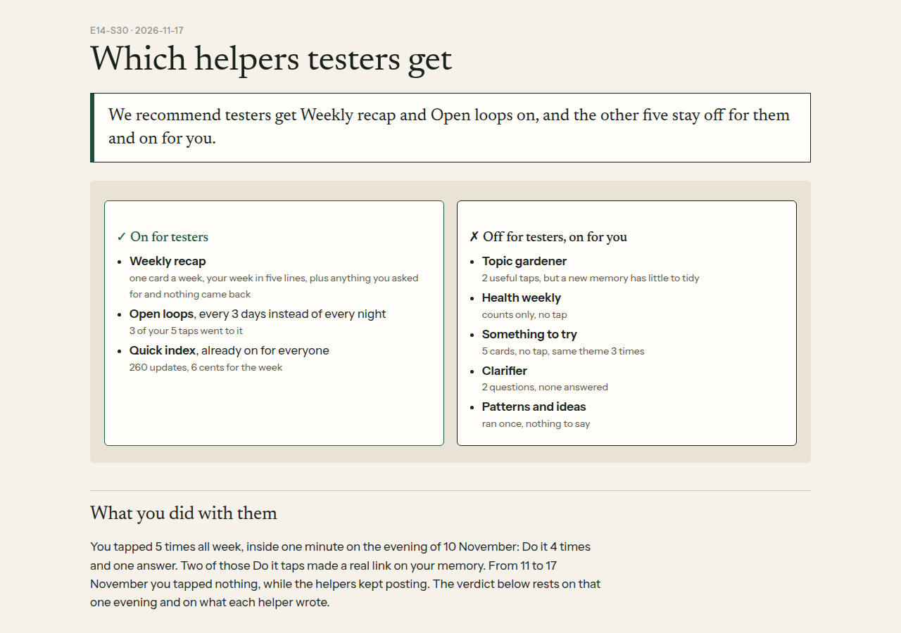

# E14-S30 verdict: which memory helpers earned their place on Jordi's memory (2026-11-17)

Row: S30 in [EPIC-14](../plan-personas-inbox-voice-and-calls-come.md). Run: run_a97b64b1-e871-4351-876f-073bcd055082 (replaces run_a14a66e8). Page with examples (tailnet only, his memory quoted): http://vps3.taild81fbb.ts.net:8921/e14-s30/ (serves `~/zenod-evidence-pages/e14-s30/`). Counts: [e14-s30/tally.jsonl](e14-s30/tally.jsonl), day 1: [e14-s30-2026-11-10.md](e14-s30-2026-11-10.md).

**Bottom line.** We recommend testers start with Weekly recap and Open loops switched on (Open loops every 3 days, never repeating a suggestion), the quick index on as today, and the other five helpers off for testers and on for Jordi. Jordi tapped 5 times in the week, all inside one minute on 10 Nov 21:32Z (4 Do it, 1 answer); from 11 to 17 Nov he tapped nothing while helpers kept posting.

## Counts, his account, 10 Nov 05:42Z to 17 Nov 08:00Z (694 log reads, 0 failed)

| Helper | Runs | Posted | His taps | Cost | For testers |
|---|---|---|---|---|---|
| Weekly recap | 2 | 1 finding, 2 recaps | 0 | $0.0013 | keep on (today off for new accounts) |
| Open loops | 9 (1 skipped) | 4 suggestions, 4 questions | 2 Do it, 1 answer | $0.0208 | change: on, every 3 days, no repeats |
| Topic gardener | 6 (1 skipped) | 5 suggestions | 2 Do it | $0.0118 | keep off (on for him) |
| Health weekly | 2 | counts only | 0 | $0 | keep off |
| Something to try | 5 (1 skipped) | 5 findings | 0 | $0.0024 | keep off |
| Clarifier | 5 (1 skipped) | 2 questions | 0 | $0.0008 | keep off |
| Patterns and ideas | 1 (2 skipped) | nothing to say | 0 | $0.0006 | keep off |
| Quick index | 260 updates | Read as shown 1 | 0 corrections | $0.0601 | keep on (as today) |

People and follow-ups and Ideas digest were off all week. Two of the four Do it taps produced memory-desk links (21:32Z and 21:33Z on 10 Nov). Schedule: every switched-on helper ran on its wake from 12 Nov; the 11 Nov 02:00Z wakes were missed while his AI allowance was spent, before the Claude credit route (S41) carried his helpers from 12 Nov 03:49Z.

## Defects seen

- Open loops offered the same link on 16 and 17 Nov; Topic gardener offered nearly the same naming link on 10 and 11 Nov. A helper should not repeat a suggestion it already showed.

## Timers

The VPS3 user timers `zenod-helper-tally` and `zenod-helper-tally-daily` were stopped and disabled on 17 Nov 08:06Z: the week is measured and they served nothing else. The units stay on disk; the private day-by-day page (http://vps3.taild81fbb.ts.net:8921/e14-s30-private/) stays as it was at 08:00Z.
