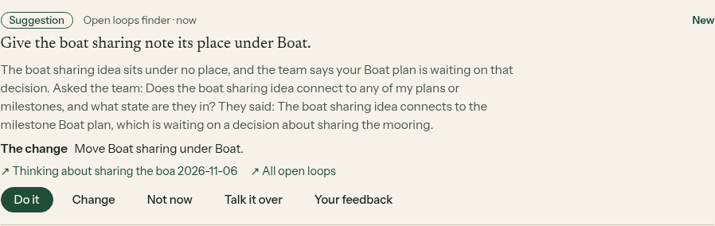
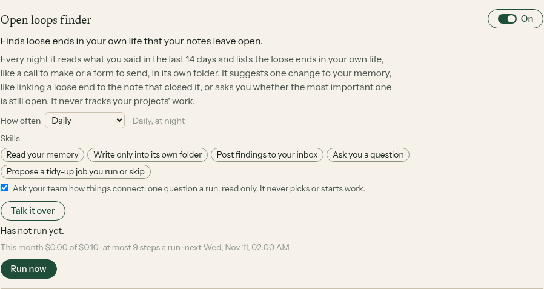

# E14-S35: helpers ask the Team desk how things connect, read only (2026-11-10)

Row: S35 in [EPIC-14](../plan-personas-inbox-voice-and-calls-come.md). Run: run_9519b34f-157b-41c5-b899-690dd10cf795. PRs [#1594](https://github.com/zenod-ai/zenod/pull/1594) (merged as `9b4a249`) and [#1595](https://github.com/zenod-ai/zenod/pull/1595) (merged as `51c0fe5`). Seam built by agent_team E45-S5. Private page with what his helpers asked and what the team said (tailnet): http://vps3.taild81fbb.ts.net:8921/e14-s35-private/

**Bottom line.** On Jordi's account, Open loops finder and Topic gardener each asked the Team desk one question at 11:29 UTC on `51c0fe5`, got an answer in about 5 seconds, used it as context and posted one suggestion each. Each card says "Asked the team: … They said: …". Both suggestions are changes to his memory (link two notes), not project work. Spend for the two runs: $0.00359 in total, of which $0.00139 for the two answers on the team side (gpt-4o-mini). Asking is off by default. It was switched on once for his two helpers that benefit, and he can switch it off per helper in Helpers. The team only reads: nothing was picked, filed, dispatched or posted on its side. His three memory numbers did not move, because no filing, search or retrieval code changed (EPIC-22 freeze kept). WhatsApp and Telegram replies are unchanged (root L-6).

## What was built

- **The seam (root L-7).** A helper's one question goes to the Team connection Zenod already has for voice notes, at that connection's URL plus `/ask`. It is signed with that subscription's own whsec_ secret, exactly like a delivery, so no new key was needed. The body is `{question ≤300 chars, helper, run}`. The answer is `{answer ≤800, refs, model, costUsd}`, with a 20 s timeout. A refusal (bad signature, replay, one per run, daily cap of 20) or a timeout never fails the run: the helper carries on without the answer.
- **At most one a run.** `askTeam` works once per run and counts as one step, and its cost is added to the run and its caps. The agent_team side also refuses a second question per run id.
- **How a helper uses it.** When asking is on, the helper's first model call may name a `teamQuestion`, and its system words say to ask whenever a memory touches a plan, a decision or a project of his. With an answer, a second call gets the question and answer as context only ("never a task") and says whether it used it. The card and the note carry "Asked the team: … They said: …" only when the answer was used. The memory-only rules from S27 round 2 still apply: the suggestion must be a memory desk change, and project-work suggestions are dropped.
- **Off by default.** Each helper that can ask (the four model helpers) has a switch in Helpers: "Ask your team how things connect: one question a run, read only. It never picks or starts work." It shows only when the account has a Team connection. Switching it on wakes the helper once more. Once, at start, an account connected to its team before this release had asking switched on for its switched-on Open loops finder and Topic gardener. Any later choice he makes stands.

## On production, in his account

| Time (UTC) | What happened |
|---|---|
| 10:27:36 | `9b4a249` live, health ok |
| 10:32:56 | asking switched on once for Open loops finder and Topic gardener |
| 10:33 | both woke at once. DeepSeek named no question in either run, so nothing was asked. The wording was too cautious |
| about 10:46 | signed trial call from VPS1 to his connection (`test`): 200 in 6.5 s, gpt-4o-mini, $0.000737. The same signed request again was refused 409 `replayed` |
| 11:23:44 | `51c0fe5` live (plain words on when to ask, one more wake), health ok |
| 11:29:12 | Open loops finder asked: ok, $0.00067 on the team side. Then it posted one suggestion that used the answer |
| 11:29:25 | Topic gardener asked: ok, $0.00072 on the team side. Then it posted one suggestion that used the answer |

| Helper | Steps | AI calls | Tokens in / out | Run cost incl. the answer |
|---|---|---|---|---|
| Open loops finder | 8 of 9 | 2 | 10,571 / 603 | $0.00188 |
| Topic gardener | 8 of 9 | 2 | 10,006 / 312 | $0.00171 |

Both suggestions link two of his own notes. One links a decision note to its place, citing a milestone the team says is still waiting on him. The other links two notes about the product names. The questions, the answers and the suggestion words are on the private page only.

## Local check

Agents cannot sign in to his account, so the screenshots come from the shipped code on a made-up memory ([harness](e14-s35/harness/serve.mjs), [shoot](e14-s35/harness/shoot.mjs)). It used a real tenant Runtime with subscribers on, one made-up Team connection pointed at a fake `/ask`, and a stub model. The switch saved, Run now asked once with a valid signature, and the card showed what the team said.

## Tests

`packages/server/test/teamAsk.test.ts` covers the ask URL, signing (the HMAC checked), refusals as codes, and the one-time switch-on that respects his later choice. `packages/server/test/personas.test.ts` covers: off by default with no question asked for; switched on, it asks once, makes a second call with the answer, puts the line on the card, and counts the cost; a refusal never fails the run; an unused answer stays off the card; a second question is refused; switching on wakes the helper once more and never switches it on. `apps/web/src/components/memory-personas.test.tsx` checks that the switch shows only with a Team connection. CI green on both PRs.
