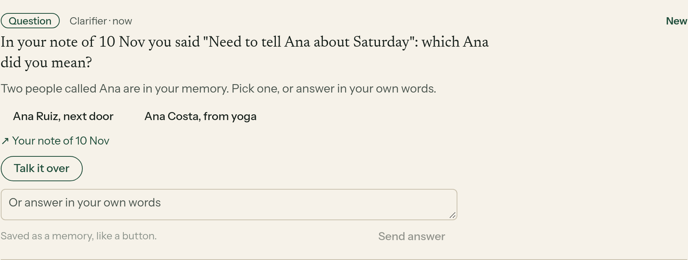
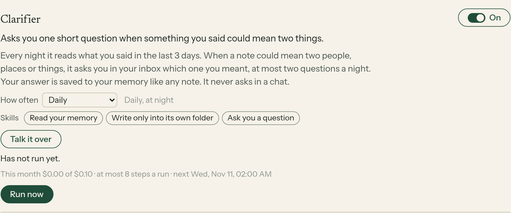

# E14-S37: the Clarifier asks one question when a note could mean two things (2026-11-11)

Row: S37 in [EPIC-14](../plan-personas-inbox-voice-and-calls-come.md). Run: run_e72113cf-0c6b-4496-b0e2-443c268eb45d. PR [#1609](https://github.com/zenod-ai/zenod/pull/1609), merged as `d62d69e`. Private page with the two real questions (tailnet): http://vps3.taild81fbb.ts.net:8921/e14-s37-private/

**Bottom line.** A new helper, the Clarifier, is live on `d62d69e` (health ok at 00:27:57 UTC on 11 Nov). It was switched on for Jordi's account only, at 00:33:06 UTC. It woke at once, read 35 of his notes from the last 3 days and asked him 2 questions in his inbox, at 00:33:22 UTC. Each question is about a voice note where a name could mean two things. One DeepSeek call, 4,594 tokens in and 177 out, $0.0008. Other accounts keep it off. His answer is saved through the inbox's existing answer path, so the filing rules did not change (engine freeze kept). Nothing is said in WhatsApp or Telegram (root L-6).

Jordi's words (voice note 2026-11-10 23:08 UTC, Log/2026-11-10.md#^e-449504): "we could have like a disambiguator or something. And there is like, if something is like, feels like a bit confusing, maybe this guy can ask me to clarify a clarifying question to set the memory." and "Let's just experiment."

## What was built

- **The Clarifier** (`packages/server/src/clarifier.ts`). It wakes nightly. It reads what was said in the last 3 days next to the places in the memory tree, then asks the model for at most 2 notes that could mean two things: a name that could be two people, places or projects, a word that matches several places, or a "there" or "she" it cannot place. Each one becomes a question card. The title names the note, its day and the words, for example 'In your voice note of 10 Nov you said "…": which … did you mean?'. There are 2 or 3 buttons, one per meaning, plus the inbox's own "answer in your own words" box.
- **The answer is a note.** Pressing a button or sending words files "<question>\n\nMy answer: …" through the same durable store job every inbox answer uses. The question leads, so the saved note says what it answers. No filing, search, page or tree code changed.
- **Caps.** At most 2 questions a night. None while 2 of its questions still wait. Never the same note twice: a question is keyed to the note it asks about, and notes already asked about are left out of the next run. One model call a run, $0.02 a run and $0.10 a month at most, inside the helpers' $1.
- **Off for testers (E23-A2).** Off by default for everyone. It was switched on once, at start, for the account whose Team connection predates the release, which is Jordi's. A later choice of his, on or off, stands. The log at 00:33 shows it on for his account and not for the other three accounts in the log.
- **Card text in one place.** All the card's words come from `clarifierCard`, so S36's new card style can replace them in one spot when it lands.

## On production, in his account

| Time (UTC) | What happened |
|---|---|
| 00:27:30 | `d62d69e` container started; health ok at 00:27:57 |
| 00:33:06 | `[persona] … clarifier switched on` for his account only; the daily roster lists `clarifier:night` for his account and not for the others |
| 00:33:22 | `clarifier schedule done: steps=7 calls=1 tokens=4594/177 usd=0.00080 questions=2` |

Its note in his memory, `Personas/clarifier/2026-11-11.md`, lists both questions with their notes. One asks which product a name in a voice note of 11 Nov meant. The other asks which project a name in a voice note of 10 Nov meant. The wording and options are on the private page. The second question's options include one weak guess. This is the experiment he asked for, and his answers will show whether it helps.

## Local check

Agents cannot sign in to his account, so the screenshots come from the shipped code on a made-up memory ([harness](e14-s37/harness/serve.mjs), [shoot](e14-s37/harness/shoot.mjs)). The harness used a real tenant Runtime with the Clarifier on and a stub model reply. Run now posted two question cards, summary "Read 3 memories and asked 2 clarifying questions", with no page errors.

## Tests

`packages/server/test/clarifier.test.ts` covers these cases. Off by default. At most 2 questions, each about a different note, with the right title, buttons, body and link. Repeated or single meanings dropped. The filed answer leads with the question. Quiet, with no model call, while 2 questions wait. Never the same note twice. Nothing asked when nothing is confusing. Project-work questions and bad sources dropped. Switched on once for the team owner, never for a tester, and his later choice stands. `personas.test.ts` now lists seven helpers. CI green on the PR, and the deploy run's CI, publish and deploy jobs passed.
