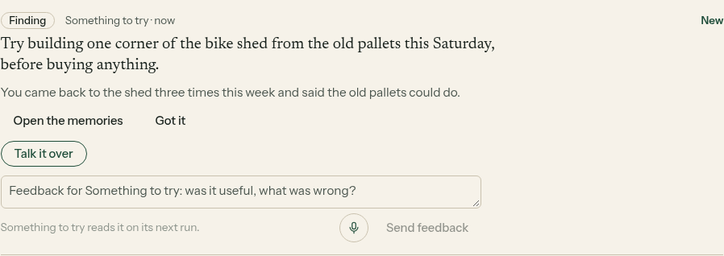
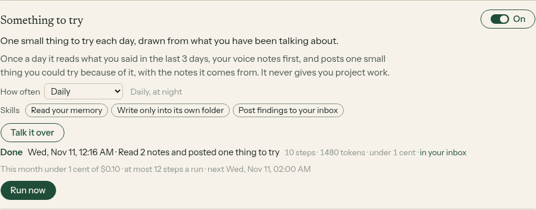

# E14-S38: a daily Something to try card (2026-11-11)

Row: S38 in [EPIC-14](../plan-personas-inbox-voice-and-calls-come.md). Run: run_7da3a757-72c7-4749-b2b8-06974a8cdeae. PR [#1608](https://github.com/zenod-ai/zenod/pull/1608), merged as `d4dbd4f`, live in `17c008e`. Private page with his first card (tailnet): http://vps3.taild81fbb.ts.net:8921/e14-s38-private/

Jordi, voice note 2026-11-10 23:08Z: "And then we could also try a guy that gives me suggestions for things to try. How do you consider this? Let's just experiment. And maybe it's like once a day, and it's about something that I've been leaving voice notes about."

**Bottom line.** A new helper, Something to try, went live at 00:48:38 UTC on 11 November. On his account it ran by itself five minutes later. It read 33 of his voice notes from the last 3 days and posted one card: one small thing to try, why it comes from what he said, and links to the three voice notes it came from. That took 1 AI call for $0.00048. It runs once a day from now on. It is off for new accounts, so testers start without it (E23-A2). His later choice in Helpers stands.

## What was built

- **Once a day.** Each night it reads the last 3 days of what he said. It uses voice notes first, and all notes when there are fewer than two voice notes. Then it makes one call on the cheap model. It asks for one small, concrete thing to try in the next day or two: an experiment, a habit, a way to think about something, a conversation, a tool, a place or a book. The suggestion has to be plainly tied to what he said.
- **The card.** It is a finding in the inbox, from Something to try. It has the thing to try, one or two sentences on where it comes from, links to the notes it came from and a link to its own note. The usual feedback box and voice button are on it, and the helper reads what he writes there before its next card.
- **No repeats.** It reads its own notes from the last 5 days and is told to suggest something different.
- **Not project work.** It is told it is not a project manager. An idea that reads as project work (tickets, deploys, repos, codes) is dropped before it is posted.
- **Off for testers.** It is off by default. It is on for an account that used helpers before 11 November, which is his, through the same keep-on rule U5 added for the weekly recap. It is never switched on again once he chooses.
- **Spend.** At most $0.02 a run and $0.10 a month. All helpers together stay within the $1 a month helper budget.
- **Untouched.** No change to chat replies (root L-6), filing, finding or the tree (engine freeze).

## On production, in his account

| Time (UTC) | What happened |
|---|---|
| 00:25:11 | PR #1608 merged as `d4dbd4f` |
| 00:48:38 | `17c008e` (includes it) deployed by publish.yml, health ok |
| 00:53:45 | Something to try ran on its schedule: 33 voice notes read, 1 AI call, 2,726 tokens in and 126 out, $0.00048. One card posted with links to 3 voice notes. Its note was saved to his memory |

The words of the card are on the private page only.

## Local check

Agents cannot sign in to his account, so the screenshots come from the shipped code on a made-up memory ([harness](e14-s38/harness/serve.mjs), [shoot](e14-s38/harness/shoot.mjs)). The harness uses a real tenant Runtime for an account that used helpers before. Its scheduled wake switched Something to try on, ran it on a stub model and posted the card.

## Tests

`packages/server/test/personas.test.ts` covers the card and its links, voice notes first, the header left out, no repeat of yesterday's suggestion, project work dropped, off for a new account, on for an account that used helpers before, and his later choice standing. CI green on #1608.
