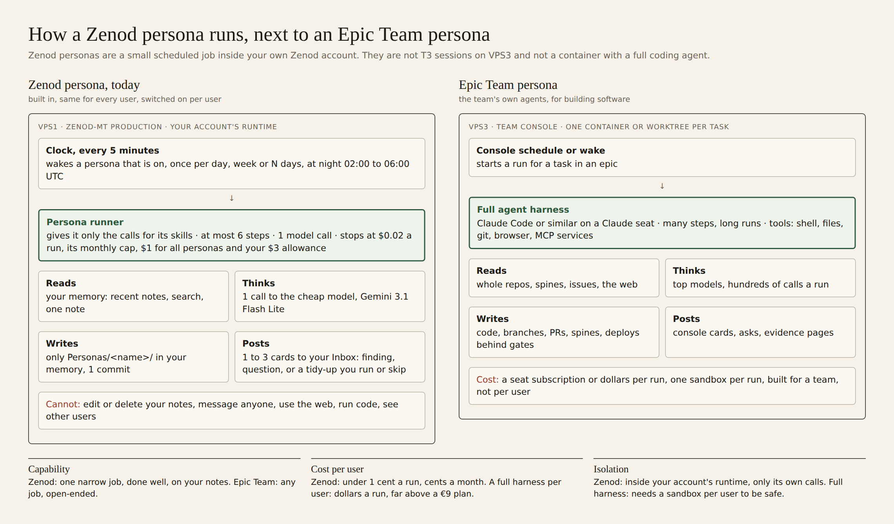
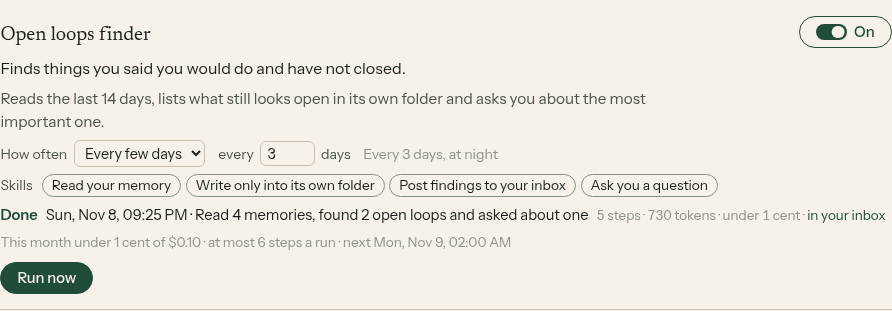
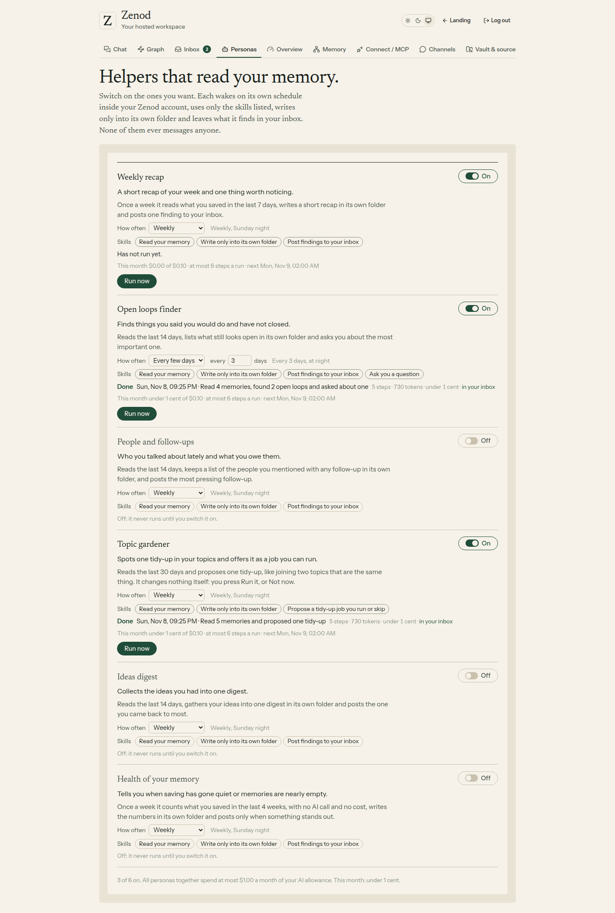
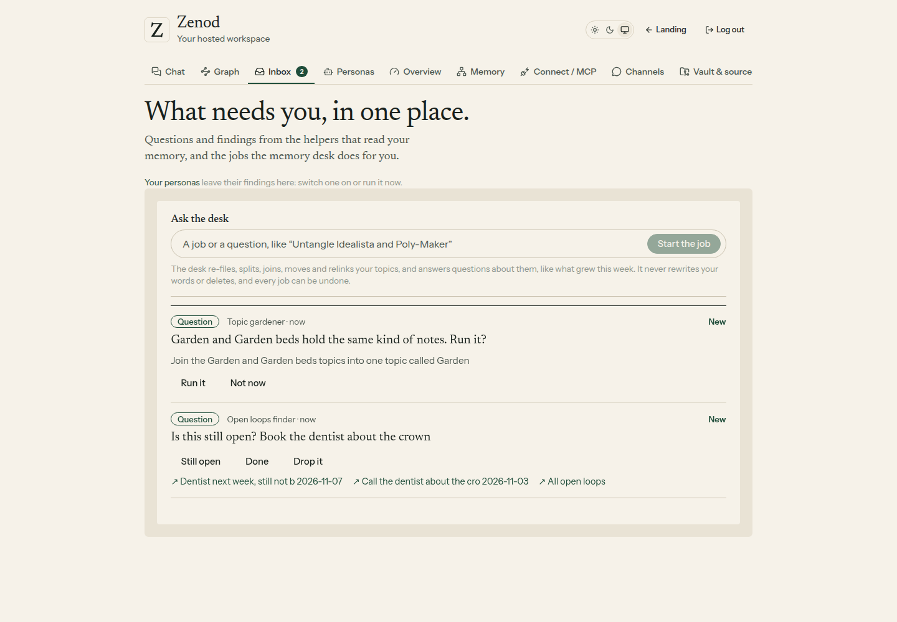
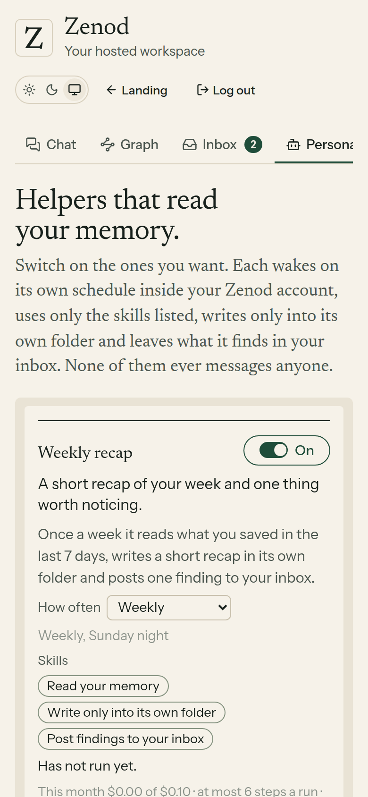

# E14-S4 evidence: a persona catalog you switch on one by one, and how personas run (2026-11-08, round 2)

Row: S4 in [EPIC-14](../plan-personas-inbox-voice-and-calls-come.md) · Round 2 run: run_f572a29d-5175-4679-b73f-753d43f411c0 · Round 1 below.

**Bottom line.** The Personas tab is now a catalog of six helpers: Weekly recap, Open loops finder, People and follow-ups, Topic gardener, Ideas digest and Health of your memory. Each has a one-line purpose, its own on/off switch, a cadence you can change (daily, weekly or every 2 to 30 days) and the skills it comes with. Only Weekly recap is on; the other five are off and never run until switched on (not even Run now). The skills are enforced: a persona gets only the calls for its own skills, so the chips on screen are exactly what it can do. Your questions, answered plainly below: personas are **not** T3 sessions on VPS3 and **not** an Epic Team container. Each is a short scheduled job inside your own Zenod account on VPS1, with one cheap model call (none for Health of your memory) and at most 6 steps. No OpenRouter money was spent for this round: every test and the demo used recorded replies, and nothing was switched on in your account beyond Weekly recap.

## Your questions, answered

**"Are these personas basically T3 sessions waking up on VPS3, hard-coded?"** No. Nothing runs on VPS3 and no T3 or Claude session is involved. The personas are part of the Zenod server that runs in production on VPS1 (the `zenod-mt` app). Each user's account has its own runtime there, and its 5-minute clock (the one that already runs the weekly tree sweep) wakes any persona that is switched on and due. They are "hard-coded" in one sense: the six personas are written in Zenod's code, the same for every user. What is per user is the switch, the cadence and the run log.

**"Is this an Epic Team type motion, running a container against a task with a fully sourced agent?"** No. An Epic Team persona is a full agent harness (Claude Code or similar) in its own worktree or container, with a shell, git, the browser and MCP services, many steps and top models. A Zenod persona is one narrow job: read a window of your notes, one call to the cheap model, write one note into its own folder, leave at most 3 cards in your inbox. It cannot edit or delete your notes, message anyone, use the web, run code or see another user. The one way it can change your memory is to propose a tidy-up to the memory desk, which only runs if you press Run it, and which can be undone.

| | Zenod persona (today) | Epic Team persona |
|---|---|---|
| Where it runs | VPS1, inside your account's runtime in Zenod production | VPS3, a worktree or container per task, started by the team console |
| What drives it | a fixed recipe in Zenod's code, at most 6 steps | a full agent loop that decides its own steps, often hundreds |
| Model | 1 call to Gemini 3.1 Flash Lite (Zenod's chat model); Health of your memory makes none | Claude models on a seat, many calls |
| Tools | only its skills: read, search, write its own folder, post to inbox, ask a question, propose a desk job | shell, files, git, browser, MCP services, the console |
| Can touch | `Personas/<name>/` in your memory, one commit a run, and your inbox | repos, branches, PRs, spines, deploys behind gates |
| Cost | under 1 cent a run, capped per run, per month, $1 for all personas and your $3 allowance | a seat subscription or dollars a run |
| Who it serves | each user, on their own notes | the team, building software |

**If we moved Zenod personas onto an Epic Team-style harness:**

- **Capability goes up.** It could plan, retry, follow a thread across many notes, look things up on the web and keep memory between runs. Good for open questions such as "prepare me for Monday".
- **Cost goes up about a hundred times.** A full agent run is many calls on a strong model, dollars rather than a tenth of a cent. A user's $3 allowance would cover a handful of runs a month, not a weekly recap plus five more helpers.
- **Isolation gets harder.** A harness with a shell needs a sandbox per user, so it can never read another user's memory or our keys. Today the persona has no shell at all, and only its own calls, inside its own account.
- **Recommendation:** keep the cheap, narrow personas for every user, and use the stronger harness only for jobs the user starts and sees the price of, like the memory desk does today.

## Allowances: what your $3 a month covers

Every AI call in a Zenod account is checked against its $3 monthly allowance before the call and counted in its usage ledger. Real per-action costs from EPIC-15 Q0 round 3 and S3:

| What | Cost each | $3 covers about |
|---|---|---|
| Chat answer | $0.002 to $0.003 | 1,000 to 1,500 answers |
| Deeper question (`ask_brain`) | about $0.01 | 300 |
| Filing a note | $0.006 on a small memory, up to $0.05 on a large one like yours | 60 to 500 notes |
| Voice note transcription | $0.003 a minute | 1,000 minutes |
| Memory desk job | $0.0007 for a question, $0.002 to $0.004 for a tidy-up | 750 to 4,000 |
| A persona run | about $0.001 (estimate), capped at $0.02 a run and $0.10 a month each; Health of your memory $0 | all personas together at most $1 a month |

- **A normal new user** costs about $1 to $2 a month, inside the $3 (Q0 round 3).
- **At the cap** (enforced in production for every account, yours included): no AI call starts until the 1st of next month. A new message gets the reply "You have used this month's AI allowance… It was not saved", personas do not start, and desk jobs stop with that reason.
- **How a user sees it:** the Overview tab shows "AI processing: N% of this month's allowance" with a bar, and a warning from 80%. The Personas tab shows each persona's spend this month and all personas' total against their $1.
- **Your own usage:** $1.26 from 1 to 8 November, about $5 a month at this pace, mostly filing on your large memory. At that pace you reach the $3 cap around 19 November, and after that a new WhatsApp note would be refused and not saved. Weekly recap adds about a tenth of a cent a week.

## What was built in round 2

- **Catalog.** Six personas, in this order: Weekly recap (on), Open loops finder, People and follow-ups, Topic gardener, Ideas digest, Health of your memory (all off). Each has a one-line purpose, a short brief and its skills.
- **Its own switch.** One switch per persona. A persona that is off never wakes and Run now answers "Switch it on first". Switching one on wakes it the same day, as before. The footer counts how many are on.
- **Its own cadence.** Daily, weekly (Sunday night) or every 2 to 30 days, set per persona and kept per account. Changing it never switches a persona on. All wakes stay in the 02:00 to 06:00 UTC off-peak window, once per period.
- **Pre-loaded skills, enforced.** Six skills exist: read your memory, search it, write only into its own folder, post findings to your inbox, ask you a question, propose a tidy-up job you run or skip. The runner hands a persona only the calls for its skills; any other call fails the run with "It does not have the skill …".
- **Desk proposals.** Topic gardener's tidy-up is an inbox card "… Run it?" with Run it and Not now. Run it hands the job to the memory desk (S3) with Undo; Not now does nothing.
- **Health of your memory** counts what you saved in 4 weeks with no model call and posts only when saving has gone quiet or many memories are nearly empty.

## Checks

- Server `personas.test.ts`, 21 tests (6 new), recorded model replies: the six personas with only Weekly recap on, so only it wakes; switching one on wakes it the same day; all caps together stay within $1; every-3-days cadence runs once per 3-day period and setting it leaves the switch alone; Open loops finder asks about its top loop; a persona without the ask skill cannot ask; People and follow-ups and Ideas digest post one finding each; Topic gardener's card is owned by the desk and Not now starts nothing; Health of your memory makes no model call and posts only when saving went quiet; routes: Run now on an off persona is refused, cadence validation, back to default. Round 1's tests still pass.
- Web `memory-personas.test.tsx`, 4 tests: catalog with switches, skills and no Run now when off; switch on and set every few days.
- Typecheck and full build pass.

## Local run of the shipped code, demo data

The built tree on VPS3 localhost: real customer-layer routes behind a real customer session, the built web app, the real runner and engine on a made-up git vault, and recorded model replies, so no model was called ([local-serve.mjs](e14-s4-r2/local-serve.mjs), [local-shoot.mjs](e14-s4-r2/local-shoot.mjs), headless Chromium).

| Step | Result |
|---|---|
| Open Personas | six switches: Weekly recap on, the other five off; "1 of 6 on" |
| Switch Open loops finder on, set Every few days | "Every 3 days, at night", Run now appears |
| Run now | "Read 4 memories, found 2 open loops and asked about one" |
| Switch Topic gardener on, Run now | "Read 5 memories and proposed one tidy-up"; "3 of 6 on", this month under 1 cent |
| Vault | one commit per run: "persona: Open loops finder run 2026-11-08", "persona: Topic gardener run 2026-11-08", each only in its own folder |
| Inbox | "Is this still open? Book the dentist about the crown" with Still open, Done, Drop it; "Garden and Garden beds hold the same kind of notes. Run it?" with Run it, Not now |

## Live

- PR [#1540](https://github.com/zenod-ai/zenod/pull/1540) merged as `90d9c30b` after `ci` passed twice (before and after rebasing onto S2 round 3, whose reply-feedback change to the runner it keeps). Production rolled with `371d883f`, which contains it: `https://cloud.zenod.dev/api/health` reported that sha at 22:42 UTC.
- The live web app serves the catalog (its bundle holds "Off: it never runs until you switch it on."), and `/api/console/personas` without a session answers 401, so it needs your sign-in.
- Nothing ran or was spent by the roll: Weekly recap's recipe did not change, so it does not wake again before its Sunday night, and the five new personas are off in every account, yours included.

## Not proven yet

- Signed in on cloud.zenod.dev: waits on E7-A15, so the screens are the local run.
- The five new personas on your real notes: S5, once E15-A6 adds OpenRouter credit. Their prompts were tried only with recorded replies.

---

# Round 1: personas that read your memory and leave findings in the Inbox

Row: S4 in [EPIC-14](../plan-personas-inbox-voice-and-calls-come.md) · Run: run_c2819cef-1485-461e-87e0-92063fc41f17 · PRs [#1525](https://github.com/zenod-ai/zenod/pull/1525) (merged `afaae1d5`), [#1529](https://github.com/zenod-ai/zenod/pull/1529) (merged `f640ce66`), [#1537](https://github.com/zenod-ai/zenod/pull/1537).

## What was built

A **persona runner** inside Zenod and one demo persona, **Weekly recap**, with a **Personas** tab beside the Inbox.

| Plan item (slide 3, step 4) | How it works now |
|---|---|
| A persona has a name, a short brief, a schedule and permissions | A persona record (copied in shape from Epic Team's `team/personaRecord.ts`): id, name, brief, schedule (nightly by default, or weekly), the permissions in plain words, on or off, and its caps |
| Wakes on a schedule, nightly by default | On the tenant's existing 5-minute clock, in the tree sweep's 02:00–06:00 UTC off-peak window, once per night or week (the run log's period key survives restarts). A persona that is on and has never run wakes at once, so a user sees it the same day |
| Mostly reads | The persona only gets a small context: recent memories, search, read a note, one model call, a note in its own folder, an inbox post. No other write exists for it |
| Writes only into its own folder, one commit per run | New engine call `writePersonaNotes`: files only under `Personas/<id>/`, published as ONE revision on the background write lane behind any live filing; any other path fails the run and the working tree is put back. `Personas/` is not a memory folder, so its notes never show up in search or the graph as memories |
| Posts questions and findings to the Inbox | Through S2's `inboxFor(runtime).post(...)`, sender = the persona's name, at most 3 posts a run |
| Spend capped per persona and in total, $1 of the $3 allowance | Checked before every model call: per run, per persona per month, all personas together $1 a month. Every call also goes through the tenant's AI allowance check and is recorded in its usage ledger. Allowance used up: no persona starts |
| Steps capped per run | Every read, call, note and post is a step; Weekly recap stops at 6 |
| Runs logged (time, tokens, cost) | `personas.sqlite` per tenant: trigger, period, status (done, skipped, stopped at a cap, failed), start and end, steps, model calls, tokens, cost, summary, inbox items, commit. A restart marks a half-done run failed so its night can run again |
| Settings screen: switch on or off, see the last run | Personas tab: what it may do, last run with steps, tokens and cost, this month's spend against its cap, next wake, **Run now**, **Switch off / on**. The Inbox links to it |
| Cheapest model | One call per run on Zenod's chat model (Gemini 3.1 Flash Lite on OpenRouter, about $0.0003 an answer in E12-S1b) |
| Copy Epic Team where it fits, run inside Zenod | The no-model wake check is Epic Team's skip-unchanged (`cycle/skipUnchanged.ts`): a scheduled wake with nothing new since the last real run is logged as skipped with no model call. No calls to the team console (root L-7) |

**Weekly recap** reads what you saved in the last 7 days, writes a short recap note in `Personas/weekly-recap/<date>.md` and posts one finding to the Inbox, with links to the memories behind it and to the recap. Caps: 6 steps, $0.02 a run, $0.10 a month. On by default (the Delivery Manager's addition: Jordi asked for a persona that leaves messages and a way to launch one); the user can switch it off.

Nothing goes to WhatsApp or any chat (root L-6).

## Checks

- Server `personas.test.ts`, 15 tests, stub model replies: a full run (one call, one note, one finding, tokens and cost logged); nothing to read and nothing new both skip with no call; a period runs once; the step cap; the spend caps per run, per persona and in total, each stopping before a call; allowance used up; a persona's own error logged as failed; first wake at once, then only in the window; restart recovery; a revised persona waking once more; memories spread over the week; voice-note headers dropped; lenient reply parsing; routes (list, Run now, switch off, 404, 400, 401).
- The same file, on a made-up demo vault in a real git repo with the real engine: the recap read only the last 7 days, published ONE commit whose only file is `Personas/weekly-recap/2026-11-08.md`, pushed to the vault's origin; notes outside the folder are refused and the vault stays clean.
- Web `memory-personas.test.tsx`: Run now shows the run with tokens and the inbox link; the switch.
- Locally: core, server and web typecheck, full build, Phylax bundle verified, server inbox, tree sweep, runtime, customer layer and allowance tests pass.

## Local run of the shipped code, demo data

The built tree ran on VPS3 localhost: the real customer-layer routes behind a real customer session, serving the built web app, with the real runner and engine on a made-up git vault and a recorded model reply ([local-serve.mjs](e14-s4/local-serve.mjs), [local-shoot.mjs](e14-s4/local-shoot.mjs), headless Chromium).

| Step | Result |
|---|---|
| Personas tab | Weekly recap, On, "Has not run yet." |
| Run now | "Done · Read 4 memories, wrote a recap and posted one finding · 5 steps · 730 tokens · under 1 cent" (the older memory was left out) |
| Vault | one new commit "persona: Weekly recap run 2026-11-08", only file `Personas/weekly-recap/2026-11-08.md` |
| Inbox | tab count 1; the finding "You mentioned the dentist twice this week and it is still not booked." from Weekly recap, with its memories |

## Live

- `afaae1d5` (#1525) rolled to production at about 19:05 UTC; `https://cloud.zenod.dev/api/health` reported that sha, and `/api/console/personas` without a session answers 401 (live, needs a sign-in).
- **Found on the first real memory, fixed the same evening (#1529):** a voice note's text starts with its capture header (file name, artifact links, transcriber), so a 400-character excerpt held none of the person's words, and with about 50 memories a day the 40 newest covered only today. Now the header is dropped, the 7 days are read in one scan with an even share per day, and a persona revised after its last run wakes once more at once, so the fix reached Jordi the same evening instead of next Sunday.
- Before the fix no persona commit reached Jordi's memory (checked on its GitHub history from 19:07 to 20:33 UTC); the run log that says why is in his Personas tab, which needs his sign-in to read.
- `a8f529ce` (contains #1529) went live at 20:33 UTC (health sha checked). **At 20:38:51 UTC Weekly recap ran on Jordi's own memory:** one commit `aab3276d` "persona: Weekly recap run 2026-11-08" in his memory repo, whose only file is `Personas/weekly-recap/2026-11-08.md` (added). The note says it read 40 memories, holds a 4-line recap and one finding about a loose end from 6 November, with a link to that memory. Content is not quoted here: this repo is public.
- The runner commits a run's note only after the persona's last step, and the finding is posted before that, so the same finding is in Jordi's Inbox, from Weekly recap.
- Cost: one call on the cheap chat model; the shared OpenRouter account showed $0.33 left before the run (read-only check of totals), well above a run's cap of $0.02.
- #1537 then names audio and file captures by their kind in the links ("Audio" instead of the file name), seen in that first live note.

## Not proven yet

- Signed-in production check: waits on E7-A15, so the screens above are from the local run, not from cloud.zenod.dev, and the Inbox item was not seen on screen.
- The three starter personas are the next step, not this one.
