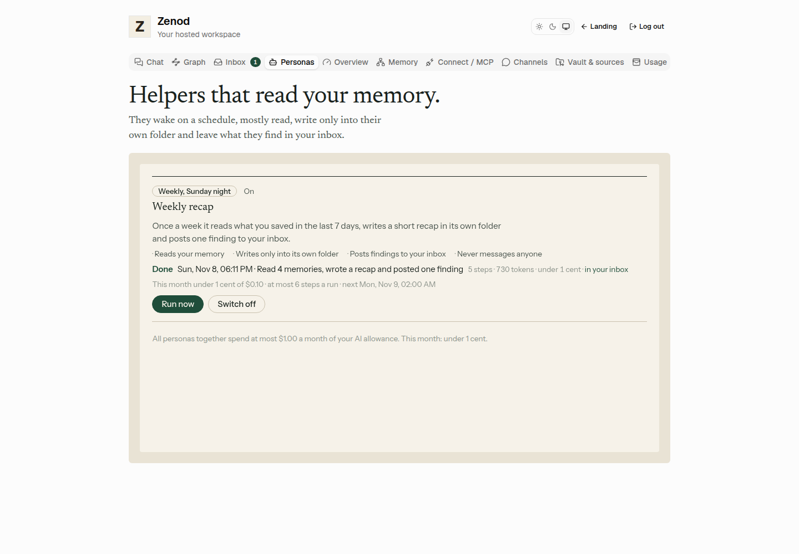
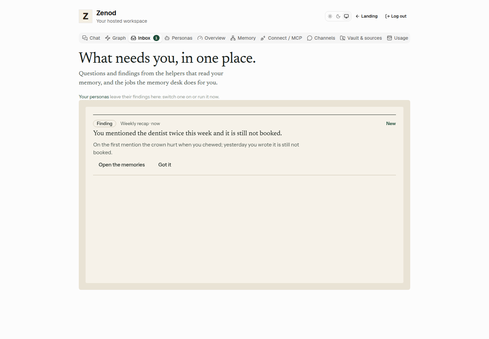
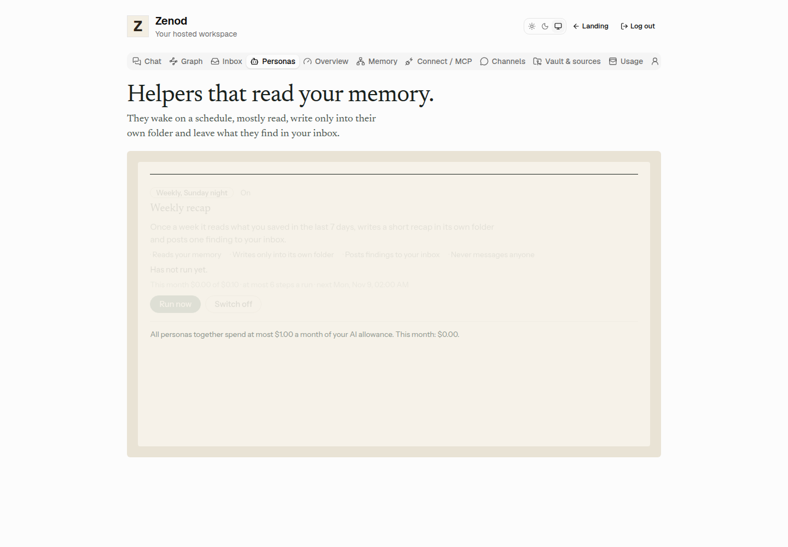
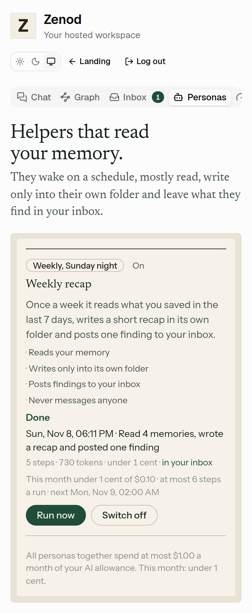

# E14-S4 evidence: personas that read your memory and leave findings in the Inbox (2026-11-08)

Row: S4 in [EPIC-14](../plan-personas-inbox-voice-and-calls-come.md) · Run: run_c2819cef-1485-461e-87e0-92063fc41f17 · PRs [#1525](https://github.com/zenod-ai/zenod/pull/1525) (merged `afaae1d5`), [#1529](https://github.com/zenod-ai/zenod/pull/1529) (merged `f640ce66`), [#1537](https://github.com/zenod-ai/zenod/pull/1537).

## What was built

A **persona runner** inside Zenod and one demo persona, **Weekly recap**, with a **Personas** tab beside the Inbox.

| Plan item (slide 3, step 4) | How it works now |
|---|---|
| A persona has a name, a short brief, a schedule and permissions | A persona record (copied in shape from Epic Team's `team/personaRecord.ts`): id, name, brief, schedule (nightly by default, or weekly), the permissions in plain words, on or off, and its caps |
| Wakes on a schedule, nightly by default | On the tenant's existing 5-minute clock, in the tree sweep's 02:00–06:00 UTC off-peak window, once per night or week (the run log's period key survives restarts). A persona that is on and has never run wakes at once, so a user sees it the same day |
| Mostly reads | The persona only gets a small context: recent memories, search, read a note, one model call, a note in its own folder, an inbox post. No other write exists for it |
| Writes only into its own folder, one commit per run | New engine call `writePersonaNotes`: files only under `Personas/<id>/`, published as ONE revision on the background write lane behind any live filing; any other path fails the run and the working tree is put back. `Personas/` is not a memory folder, so its notes never show up in search or the graph as memories |
| Posts questions and findings to the Inbox | Through S2's `inboxFor(runtime).post(...)`, sender = the persona's name, at most 3 posts a run |
| Spend capped per persona and in total, $1 of the $3 allowance | Checked before every model call: per run, per persona per month, all personas together $1 a month. Every call also goes through the tenant's AI allowance check and is recorded in its usage ledger. Allowance used up: no persona starts |
| Steps capped per run | Every read, call, note and post is a step; Weekly recap stops at 6 |
| Runs logged (time, tokens, cost) | `personas.sqlite` per tenant: trigger, period, status (done, skipped, stopped at a cap, failed), start and end, steps, model calls, tokens, cost, summary, inbox items, commit. A restart marks a half-done run failed so its night can run again |
| Settings screen: switch on or off, see the last run | Personas tab: what it may do, last run with steps, tokens and cost, this month's spend against its cap, next wake, **Run now**, **Switch off / on**. The Inbox links to it |
| Cheapest model | One call per run on Zenod's chat model (Gemini 3.1 Flash Lite on OpenRouter, about $0.0003 an answer in E12-S1b) |
| Copy Epic Team where it fits, run inside Zenod | The no-model wake check is Epic Team's skip-unchanged (`cycle/skipUnchanged.ts`): a scheduled wake with nothing new since the last real run is logged as skipped with no model call. No calls to the team console (root L-7) |

**Weekly recap** reads what you saved in the last 7 days, writes a short recap note in `Personas/weekly-recap/<date>.md` and posts one finding to the Inbox, with links to the memories behind it and to the recap. Caps: 6 steps, $0.02 a run, $0.10 a month. On by default (the Delivery Manager's addition: Jordi asked for a persona that leaves messages and a way to launch one); the user can switch it off.

Nothing goes to WhatsApp or any chat (root L-6).

## Checks

- Server `personas.test.ts`, 15 tests, stub model replies: a full run (one call, one note, one finding, tokens and cost logged); nothing to read and nothing new both skip with no call; a period runs once; the step cap; the spend caps per run, per persona and in total, each stopping before a call; allowance used up; a persona's own error logged as failed; first wake at once, then only in the window; restart recovery; a revised persona waking once more; memories spread over the week; voice-note headers dropped; lenient reply parsing; routes (list, Run now, switch off, 404, 400, 401).
- The same file, on a made-up demo vault in a real git repo with the real engine: the recap read only the last 7 days, published ONE commit whose only file is `Personas/weekly-recap/2026-11-08.md`, pushed to the vault's origin; notes outside the folder are refused and the vault stays clean.
- Web `memory-personas.test.tsx`: Run now shows the run with tokens and the inbox link; the switch.
- Locally: core, server and web typecheck, full build, Phylax bundle verified, server inbox, tree sweep, runtime, customer layer and allowance tests pass.

## Local run of the shipped code, demo data

The built tree ran on VPS3 localhost: the real customer-layer routes behind a real customer session, serving the built web app, with the real runner and engine on a made-up git vault and a recorded model reply ([local-serve.mjs](e14-s4/local-serve.mjs), [local-shoot.mjs](e14-s4/local-shoot.mjs), headless Chromium).

| Step | Result |
|---|---|
| Personas tab | Weekly recap, On, "Has not run yet." |
| Run now | "Done · Read 4 memories, wrote a recap and posted one finding · 5 steps · 730 tokens · under 1 cent" (the older memory was left out) |
| Vault | one new commit "persona: Weekly recap run 2026-11-08", only file `Personas/weekly-recap/2026-11-08.md` |
| Inbox | tab count 1; the finding "You mentioned the dentist twice this week and it is still not booked." from Weekly recap, with its memories |

## Live

- `afaae1d5` (#1525) rolled to production at about 19:05 UTC; `https://cloud.zenod.dev/api/health` reported that sha, and `/api/console/personas` without a session answers 401 (live, needs a sign-in).
- **Found on the first real memory, fixed the same evening (#1529):** a voice note's text starts with its capture header (file name, artifact links, transcriber), so a 400-character excerpt held none of the person's words, and with about 50 memories a day the 40 newest covered only today. Now the header is dropped, the 7 days are read in one scan with an even share per day, and a persona revised after its last run wakes once more at once, so the fix reached Jordi the same evening instead of next Sunday.
- Before the fix no persona commit reached Jordi's memory (checked on its GitHub history from 19:07 to 20:33 UTC); the run log that says why is in his Personas tab, which needs his sign-in to read.
- `a8f529ce` (contains #1529) went live at 20:33 UTC (health sha checked). **At 20:38:51 UTC Weekly recap ran on Jordi's own memory:** one commit `aab3276d` "persona: Weekly recap run 2026-11-08" in his memory repo, whose only file is `Personas/weekly-recap/2026-11-08.md` (added). The note says it read 40 memories, holds a 4-line recap and one finding about a loose end from 6 November, with a link to that memory. Content is not quoted here: this repo is public.
- The runner commits a run's note only after the persona's last step, and the finding is posted before that, so the same finding is in Jordi's Inbox, from Weekly recap.
- Cost: one call on the cheap chat model; the shared OpenRouter account showed $0.33 left before the run (read-only check of totals), well above a run's cap of $0.02.
- #1537 then names audio and file captures by their kind in the links ("Audio" instead of the file name), seen in that first live note.

## Not proven yet

- Signed-in production check: waits on E7-A15, so the screens above are from the local run, not from cloud.zenod.dev, and the Inbox item was not seen on screen.
- The three starter personas are the next step, not this one.
