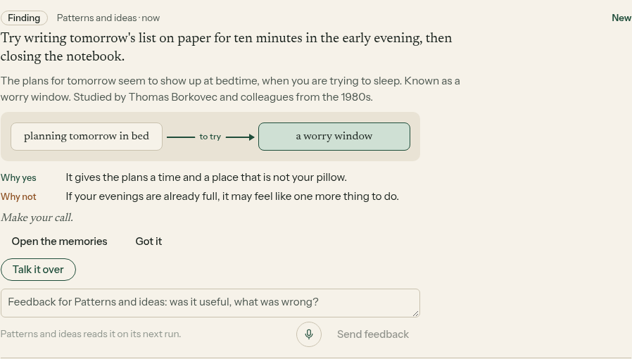
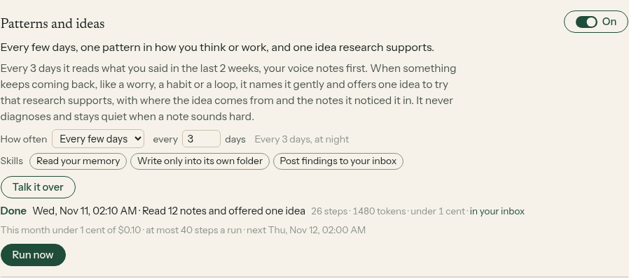

# E14-S41: Patterns and ideas, a gentle helper on your memory (2026-11-11)

Row: S41 in [EPIC-14](../plan-personas-inbox-voice-and-calls-come.md). Run: run_a8d0e681-15b0-4b4d-a86c-98159fb3b2c3. PR [#1617](https://github.com/zenod-ai/zenod/pull/1617), merged as `3831b06`, live in `3831b06`. Private page with a preview on his notes (tailnet): http://vps3.taild81fbb.ts.net:8921/e14-s41-private/

Jordi, voice note 2026-11-10 23:08Z: "Can you hire a therapist on your memory? That would be really interesting, you know, because it's like a person that is looking at your thoughts, but it's looking at that perspective of what are kind of cognitive behaviors or mindset that maybe there is research that points to things to try."

**Bottom line.** A new helper, Patterns and ideas, went live at 02:50 UTC on 11 November. It switched itself on for his account at 02:54 and for no tester. It has not posted on his account yet: his account has used $2.52 of its $3 AI allowance this month, and every helper pauses once less than 50 cents is left, until the reset on 1 December. To let him judge it now, the same shipped code read his last 2 weeks of notes from a copy of his memory and wrote one card, shown on the private page only: 63 notes read, 1 AI call, about $0.0013 from the team's DeepSeek balance. That is a preview, not the live card.

## What was built

- **Every few days.** Every 3 days it reads the last 2 weeks of what he said, voice notes first, and makes one call on the cheap model. It looks for one thing that keeps coming back in how he thinks or works: a worry, a habit, a loop.
- **The card.** It names the pattern gently in one sentence. It offers one idea to try that well-known research supports, gives the idea's plain name and one line on where it comes from, and links the notes it saw the pattern in. It uses the helpers' card shape: what keeps coming back, an arrow to the idea, why yes, why not and "Make your call." The feedback box and voice button are on it, and the helper reads what he writes before its next card.
- **Gentle by design.** It is told never to diagnose, never to label him and never to use medical or clinical words. A reply that uses such words anyway (disorder, therapy, symptom, anxiety, depression and the like) is left out before it reaches the inbox. A pattern has to show in at least two notes.
- **Quiet on hard notes.** When any note in the window has words of real distress, it makes no AI call, posts nothing and writes only "Nothing this time" in its own note. It never advises on it.
- **At most one card every 3 days**, even when run by hand from Helpers. It reads its own notes from the last 3 weeks so it never offers the same idea twice running.
- **Not project work.** An idea that reads as project work is dropped, as with the other helpers.
- **Off for testers.** Off by default. It comes on for an account that used helpers before 11 November, which is his, through the same keep-on rule as Something to try. Once he switches it off in Helpers, that choice stays.
- **Spend.** At most $0.02 a run and $0.10 a month.
- **Untouched.** No change to chat replies (root L-6), filing, finding, page format or the tree (engine freeze).

## On production, in his account

| Time (UTC) | What happened |
|---|---|
| 02:22:49 | PR #1617 merged as `3831b06` |
| 02:50:09 | `3831b06` deployed by publish.yml, cloud.zenod.dev/api/health ok on `3831b06` |
| 02:54:28 | On his account it switched on and woke at once, then stopped before reading anything: helpers are paused at the allowance reserve, $2.52 of $3 used this month. No AI call, no cost |
| 02:53–02:54 | On three other accounts that used helpers before 11 November it switched on too and found nothing to read yet. Testers stay off |
| 03:25 | Preview with the shipped code on a copy of his memory: 63 notes, 1 AI call, 4,199 tokens in and 184 out, about $0.0013. One card, on the private page |

**What unblocks his first real card.** Either his account's monthly AI cap goes above $3, or the allowance resets on 1 December and the helper runs at its next wake. At his pace this month, about 23 cents a day, his chat answers stop at $3 around 13 November too. Filing never stops.

The words of the preview are on the private page only.

## Local check

Agents cannot sign in to his account, so the screenshots come from the shipped code on a made-up memory ([harness](e14-s41/harness/serve.mjs), [shoot](e14-s41/harness/shoot.mjs)). The harness uses a real tenant Runtime for an account that used helpers before. Its scheduled wake switched Patterns and ideas on, ran it on a stub model and posted the card: 12 notes read, 26 steps.

## Tests

`packages/server/test/personas.test.ts` covers the card, its picture, why yes and why not, its links, voice notes first, the wait of 3 days even when run by hand, no repeat of an earlier idea, silence on distress words with no AI call, clinical words left out, off for a new account, on for an account that used helpers before and his later choice standing.
