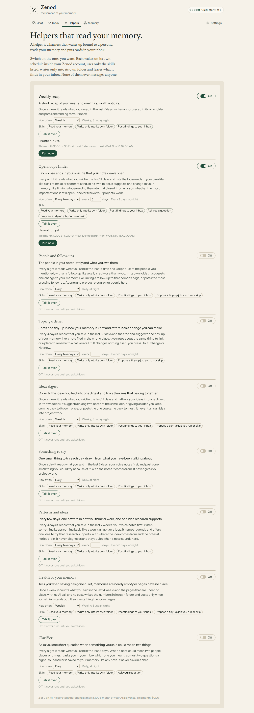

# E14-S44: new testers start with Weekly recap and Open loops on (2026-11-17)

Row: S44 in [EPIC-14](../plan-personas-inbox-voice-and-calls-come.md), follow-up of S30 (Jordi chose "Recap and loops: switch both on for new testers", 17 Nov). Run: run_9cdcc383-3942-4f74-85f1-69dcd4b2145c.

**Bottom line.** Live on production `9deb454` since 2026-11-17T19:59:27Z (promote gate passed). A new account starts with Weekly recap on (weekly) and Open loops on every 3 days. The other seven helpers stay off. Jordi's accounts did not change. The one real tester (signed up 13 Nov, nothing saved) got the same defaults. Nothing was sent to them: the defaults are switches only, and a helper with nothing saved skips without a model call or a card.

## What changed

- [#1688](https://github.com/zenod-ai/zenod/pull/1688) merged `b166eca`: `PersonaStore.applyTesterDefaults` + `TESTER_DEFAULT_HELPERS` (personaStore.ts). When an account's helpers have never been touched (no switch, no cadence, no run), the defaults are written once as explicit switches as soon as its store opens. An account with any switch or run is left alone. If a tester switches one off, it stays off. Quick start: the helper step is ticked from the start ("Quick start 1 of 5").
- [#1689](https://github.com/zenod-ai/zenod/pull/1689) merged `9deb454`: Open loops' description used to say "Every night it reads…", which was wrong for a tester on 3 days. It now says "On its schedule it reads…", and the How often line shows the cadence.
- `ci` green on both; self-merged; branches and worktrees removed.

## Production, before and after (container log `[persona] tenant=… switched-on=`, ids cut)

| Account | Before (19:13Z, `04ec365`) | After (20:04Z, `9deb454`) |
|---|---|---|
| `user-usr_7a96c40c…`: the 13 Nov tester (the only account made after 11 Nov) | none | **weekly-recap:week, open-loops:days3**; log line `tester defaults on: weekly-recap,open-loops` |
| `github-6…`: Jordi's main account | recap, open-loops **nightly**, topic-gardener, something-to-try, patterns-and-ideas, … | identical |
| `user-usr_450335af…`: Jordi's Sept account | recap, something-to-try, patterns-and-ideas | identical |
| `jordiepi…` | recap, something-to-try, patterns-and-ideas | identical |
| `user-usr_b17aca05…`: our T7 test account (switched by hand in E26-S18) | none | none (already touched, left alone) |

The tester's first wakes are 18 Nov 02:00Z for both helpers. Since they have nothing saved, both skip: no model call, no card.

## Fresh account, Helpers page, 390 and 1280 px

Sign-in is Google or GitHub only. The team's only Google identity (operations@alpha9.io) already has an account, so a brand-new account on production would need a new Google or GitHub identity. Instead, a fresh account was made on the merged code (`b166eca`, production's server `main.js` with `ZENOD_HELPERS_FOR_TESTERS=1`, a new data dir, the account bound through the real checkout binding adapter). `GET /api/console/personas` returned weekly-recap on (Weekly, Sunday night), open-loops on (Every 3 days, at night), and the other seven off. The page reads "2 of 9 on". The switches' `aria-checked` was `true,true,false×7` at both widths. No real login was created, so there is nothing for Bitwarden (L-53).

- [1280 px](e14-s44/01-fresh-local-1280.png) · [390 px](e14-s44/02-fresh-local-390.png). These were taken before #1689, so Open loops still reads "Every night"; that line is fixed in `9deb454`.

## Not in this row

- Helpers repeating a suggestion they already showed (S30's "no repeats" follow-up).
