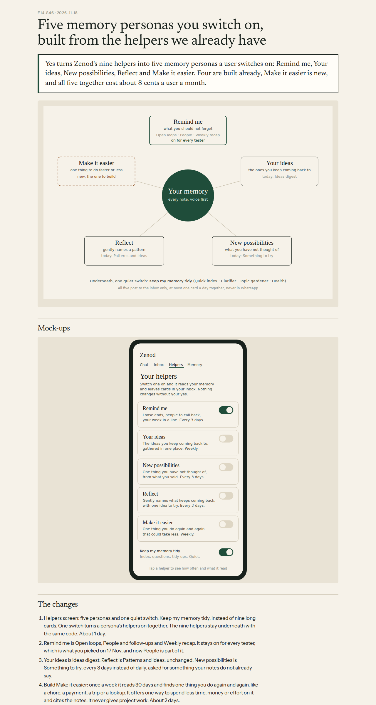

# E14-S46: five memory personas you switch on, a plan for Jordi's yes (2026-11-18)

Row: S46 in [EPIC-14](../plan-personas-inbox-voice-and-calls-come.md). Run: run_feacdd2f-2461-46d6-9ab1-c49922262799. Proposal page (tailnet): http://vps3.taild81fbb.ts.net:8921/e14-s46/ (serves `~/zenod-evidence-pages/e14-s46/`, registered in agent_team docs/pages/registry.json `e1f8590c4`). Source: Jordi vn_101d2c67, 18 Nov 04:17Z: "personas that are kind of dispatched on your memory to look for like things that you should be reminded of or maybe look for ideas or look for possibilities you haven't thought of or maybe more therapy stuff or more like optimization".

**Bottom line.** Yes turns Zenod's nine helpers into five memory personas a user switches on: Remind me, Your ideas, New possibilities, Reflect and Make it easier. Four are built already, Make it easier is new, and all five together cost about 8 cents a user a month. Plan only, nothing built.

## His five kinds against what runs today (`packages/server/src/personaCatalog.ts`, `patterns.ts`, `clarifier.ts`)

| His word | Persona | Helpers inside | Exists? | Tester default |
|---|---|---|---|---|
| reminded of | Remind me | Open loops, People and follow-ups, Weekly recap | ✓ | on (his S30 pick, S44 live; adds People) |
| ideas | Your ideas | Ideas digest | ✓ | off |
| possibilities you haven't thought of | New possibilities | Something to try, every 3 days, asked for what the notes do not already say | ✓ (retuned) | off |
| therapy stuff | Reflect | Patterns and ideas (S41) | ✓ | off |
| optimization | Make it easier | new: weekly, 30 days, one repeated effort and one way to spend less time, money or effort on it | ✗ to build | off |
| (not a persona) | Keep my memory tidy | Quick index, Clarifier, Topic gardener, Health of your memory | ✓ | on |

## Cost per user per month

Measured on Jordi's memory, the busiest we have (S30 week, S41 round 5, Claude credit route): Open loops $0.0023 a run, Weekly recap $0.00065, Topic gardener $0.002, Something to try $0.0005, Clarifier $0.00016, Patterns and ideas $0.00068, quick index $0.06 a week for him (about 0.3 cent a day typical, S24). Per month: Remind me ~$0.05 (People estimated like Open loops, it was off in the S30 week), Your ideas ~$0.01 (estimated, off in the S30 week), New possibilities ~$0.005, Reflect ~$0.007, Make it easier ~$0.01 (estimated). Five together ~$0.08; with the tidy switch ~$0.20; cap $3.

## Safety, for all five

Quiet on distress (the `DISTRESS` word list plus the prompt's quiet rule, as Reflect has today), no `CLINICAL` words on any card, Reflect never diagnoses and posts at most once in 3 days, every card cites its notes, at most one card a day across the five, no repeats (folds draft S45). Inbox only: WhatsApp and chat replies unchanged (root L-6); Zenod stays standalone (root L-7).

## Build steps on a yes (drafts for the Delivery Manager)

1. Helpers screen regroup: five personas and one tidy switch, one switch per persona, the nine helpers underneath (about 1 day).
2. Remind me takes in People and follow-ups; New possibilities retuned to every 3 days.
3. Make it easier helper (about 2 days).
4. One card a day across the five, and no repeats (S45).

## Checks

text_wall_check: leads with a picture. clean_look_check: clean. page_shell proposal parts: none missing. Looked at 1280 and 390 px ([390](e14-s46/02-proposal-390.png)); phone gets a narrow hub drawing.
