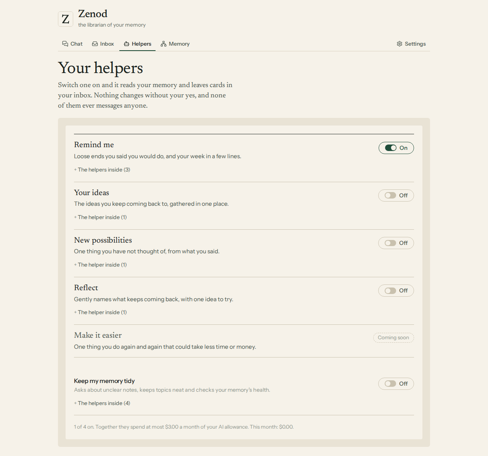

# E14-S47: five memory personas on the Helpers screen, live (2026-11-18)

Row: S47 in [EPIC-14](../plan-personas-inbox-voice-and-calls-come.md). Run: run_45f856b5-8a75-4e86-92b1-c357dcd35532. Evidence page (tailnet): http://vps3.taild81fbb.ts.net:8921/e14-s47/ (serves `~/zenod-evidence-pages/e14-s47/`, registered in agent_team docs/pages/registry.json `dd94c73a1`). Source: Jordi's E14-A12 "APPROVED", 18 Nov, on the [S46 plan](http://vps3.taild81fbb.ts.net:8921/e14-s46/).

**Bottom line.** The Helpers screen shows five personas (Remind me, Your ideas, New possibilities, Reflect, Make it easier as coming soon) and one quiet Keep my memory tidy switch, live on production `7cd94c3` since 18 Nov 08:22:17Z. Nothing that runs changed for anyone.

## What shipped

- [#1696](https://github.com/zenod-ai/zenod/pull/1696), merged `7cd94c3` (CI green), `apps/web/src/components/memory-personas.{tsx,css,test.tsx}` only. No server, store or filing change (filing and retrieval freeze to 24 Nov kept).
- One switch per persona turns its helpers on or off together (one POST per helper to the existing `/api/console/personas/:id`). A persona reads on while any helper inside it is on; a part-on persona says "1 of 2 helpers on".
- The helpers stay underneath, folded ("The helpers inside (n)"), each with its own switch, cadence, Talk it over and Run now.
- People and follow-ups is listed under Remind me with its own switch until S48 moves it in. Quick index is listed under the tidy switch as always on: it is part of filing, so it has no switch (freeze).
- Make it easier: shown as "Coming soon", no switch, until S49 ships.
- A helper no persona holds would still show, on its own, under the personas (nothing is ever hidden).

## Switch states carried over

Grouping is client-side only, so every stored switch is as before: Jordi's accounts keep every helper they had on (each persona with an on helper reads on); a tester with Weekly recap and Open loops on (S44 defaults) sees Remind me on and the rest off. Tests: `memory-personas.test.tsx` 10 pass (all-on account, tester defaults, one switch flips the tidy three together, the older per-helper cases).

## Proof on production, 390 and 1280 px

Production `/api/health`: ok, sha `7cd94c336171c589d6fddb36545a89a1c24108b2`. Promote gate (run by this worker, `scripts/promote-production.sh --sha 7cd94c3`): staging healthy, question set demo 96 / 100 / 1.7, real-note set 94.1 / 91.2 / 3.1, passed; production runs `7cd94c3` since 08:22:17Z. Undo: `scripts/promote-production.sh --rollback`.

The test account (operations@alpha9.io) could not be signed in: its Google session in the agents' browser profile has expired and asks for a password, which was not forced. The screenshots are production's own page and bundle from cloud.zenod.dev, opened in headless Chromium with the API answered by a new tester's switches (Weekly recap weekly, Open loops every 3 days, the rest off): [1280](e14-s47/01-live-1280.png) · [390](e14-s47/02-live-390.png) · [Remind me opened](e14-s47/03-open-1280.png) · [before, same method on `e86c6e3`](e14-s47/00-before-1280.png). Jordi opens his own at https://cloud.zenod.dev/app#personas.

## Checks

text_wall_check: leads with a picture. clean_look_check on the evidence page: clean. `clean_look_check.py --screens` checks EpicTeam and EpicSocial only (Zenod's screen needs a sign-in); its findings there are not from this change.

## Follow-ups

S48 (Remind me takes in People and follow-ups; New possibilities every 3 days), S49 (Make it easier), S50 (one card a day across the five, no repeats) are ready on the board.
