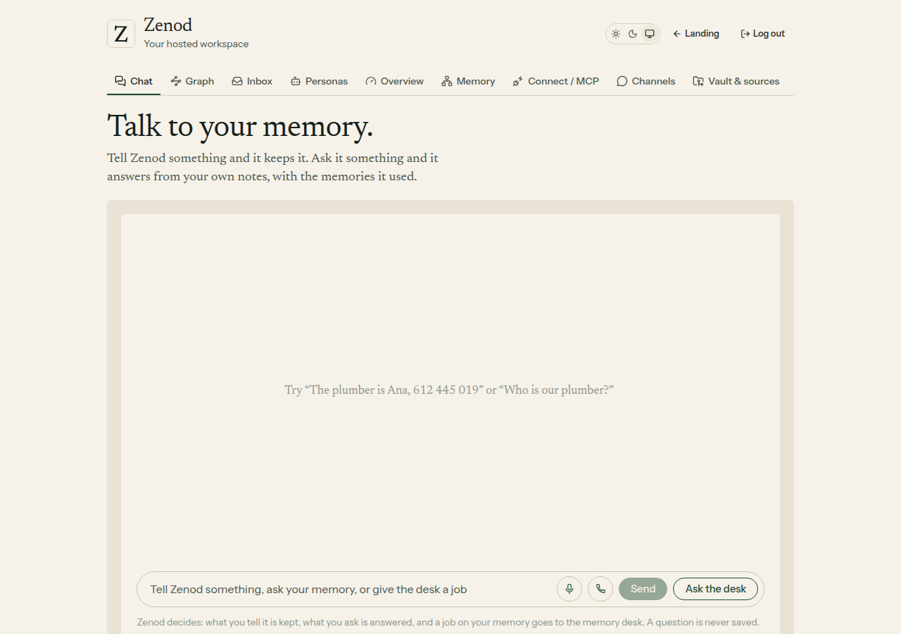
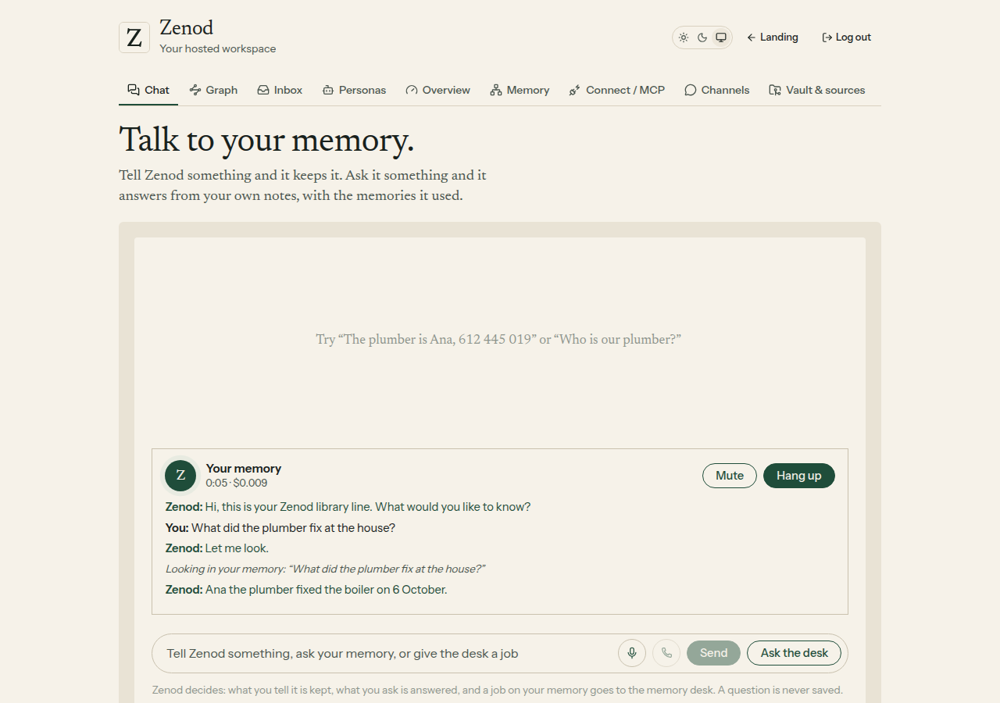
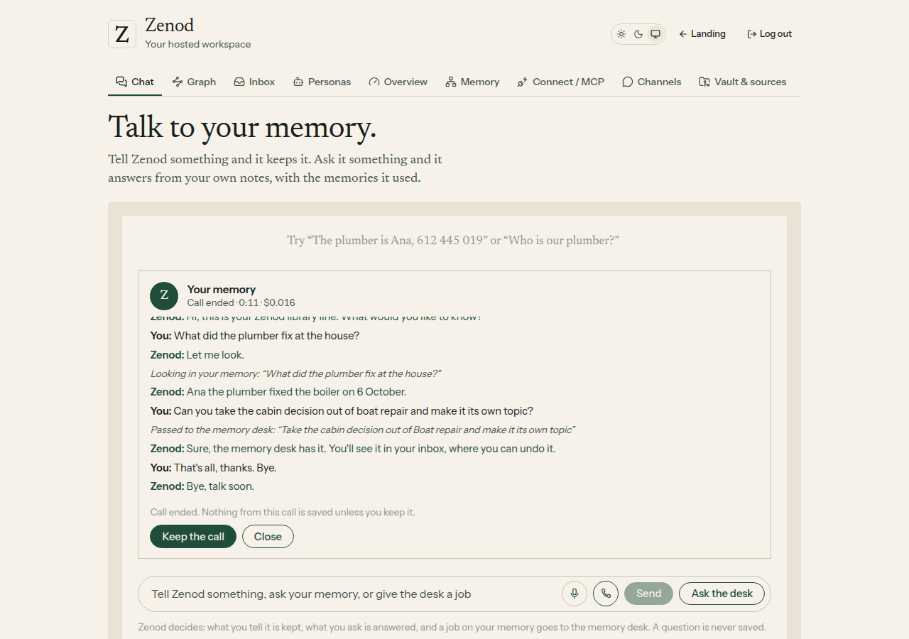
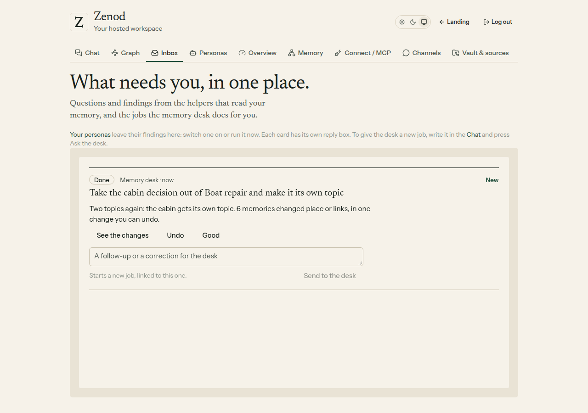
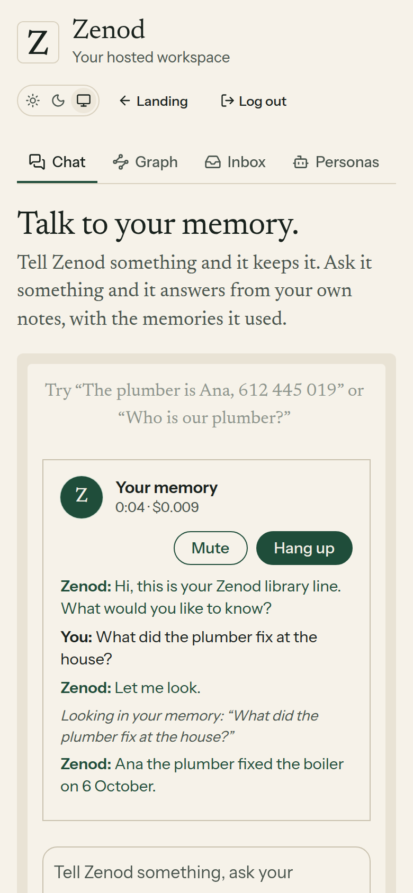
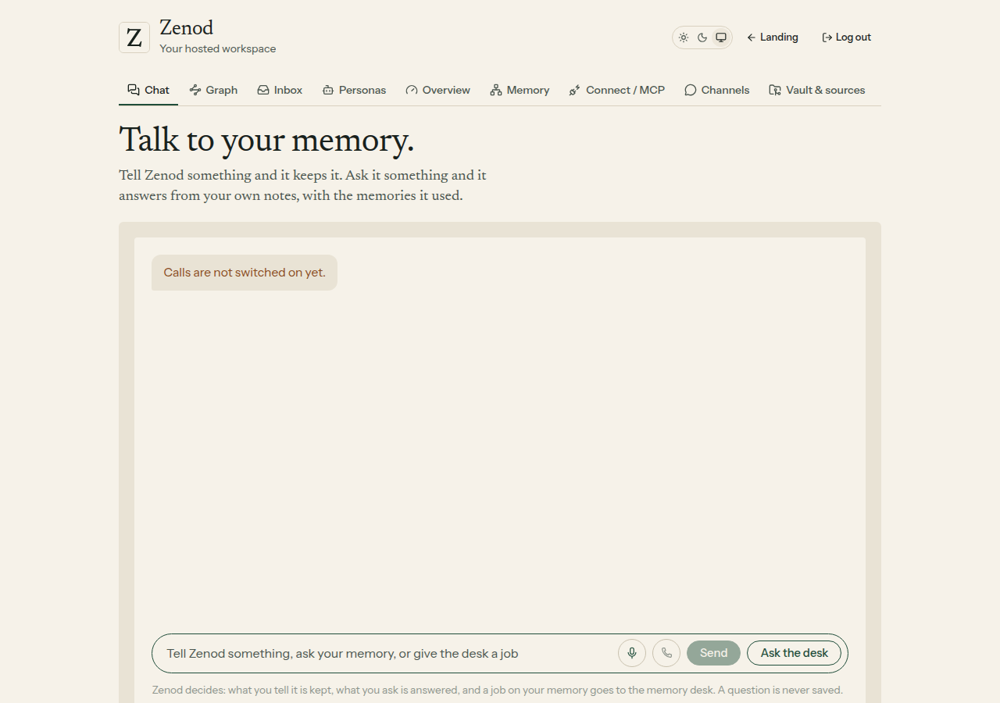

# E14-S8 evidence: the call button, a library hotline (2026-11-08)

Row: S8 in [EPIC-14](../plan-personas-inbox-voice-and-calls-come.md) (the plan's step S6) · Run: run_e6d8ab9e-2ebe-4e9d-9539-57a8a5207612 · PR [#1542](https://github.com/zenod-ai/zenod/pull/1542)

**Bottom line.** The chat now has a call button next to the voice note microphone. You talk with Zenod out loud. It asks your memory for answers and passes jobs to the memory desk. When you hang up, nothing from the call is saved unless you press Keep the call. Calls are switched on in production: the key is in place and the build is live on `806d1f6` (cloud.zenod.dev health, 23:03 UTC). Two live test calls on a test path cost **$0.0104 and $0.0103**. Each mints a key exactly as production does, opens the real OpenAI voice session, and runs a question, a desk job and a goodbye, with no user account and no user memory. Nobody has called from the live app yet, because the agents still cannot sign in there (that waits on E7-A15). So the browser half of a live call, the microphone and WebRTC audio, is proven on a recorded session only. Your first call is the real test.

[The same call as a video (19 s)](http://vps3.taild81fbb.ts.net:8921/e14-s8/stubbed-call.mp4)

## What you get

| | |
|---|---|
| Where | Chat, compose bar: a phone button beside the microphone. The call screen opens above the box, with who said what, the length, the cost so far, Mute and Hang up |
| What it does | Answers questions about your memory through Zenod's answer engine (the same checked answers as the chat, read out without links or numbers), and passes jobs (split, join, move, rename, relink) to the memory desk. The job shows in your inbox, undoable |
| What is kept | Nothing, unless you press **Keep the call** after hanging up. Then the transcript is filed like any Keep ("Call with my Zenod library line, date, length", then Me/Zenod lines) |
| Voice | OpenAI `gpt-realtime-2.1-mini`, voice `marin`, your words captioned by `gpt-4o-mini-transcribe`; straight from the browser over WebRTC with a key that lives 60 seconds; the real key never leaves the server |
| Ends by itself | After 10 minutes (warning at 9), after a minute of quiet (warning 10 s before), at a cost cap, or when you say bye (it says goodbye first) |

Without the key the button is greyed out and says why when pressed (local check with the key removed):

## Costs and caps

| Cap | Value | Where |
|---|---|---|
| One call | 10 minutes, **$0.50** | Zenod hangs up when either is reached |
| One account | **$1.00 a month** of calls, inside the AI allowance ($3); no call starts with less than $0.05 left, or when the allowance is used up | per account |
| All of Zenod | **$10 a month** for every account's calls together (E14-A3) | Zenod's own call meter, `call-meter.sqlite` on the production volume |

Each call's cost is computed from OpenAI's own usage numbers on every reply, with the price table copied from Epic Team (checked 2026-11-01). It lands in three places:

- **The account's usage ledger**, as operation `call`, so it counts against the account's AI allowance like any other model use.
- **Zenod's call meter**, one row per call under app **`zenod`** and the account, so Zenod's spend on the shared key stays visible apart from the console's.
- **The server log**: `[call] app=zenod tenant=… call_… ended: … cost_usd=…`.

Live test calls (test path, no account): **$0.0104** (6 replies, 4.8 s) and **$0.0103** (6 replies, 6.1 s), **$0.0207** together. That is short Q&A, so expect about 2–3 cents a minute and up to about 20 cents a minute for long monologues (the Epic Team measurements).

## The key

- **Name:** `OPENAI_REALTIME_KEY` on the production app `zenod-mt` (store `zenod-mt/OPENAI_REALTIME_KEY`). It is the same value as the console's `OPENAI_API_KEY`, copied under E14-G1 after E14-A3 was answered: Zenod uses the team key that carries your $10 call credit.
- **Why not `OPENAI_API_KEY`:** Zenod already reads that name for transcription and model settings. Copying under it would have quietly moved that spend onto this account too.
- Listed in infra-vps `secrets/zenod-mt.yml` and `inventory/secrets.md` (c287181). Never printed.

## How it was checked

1. **Recorded session, in the real app.** `docs/evidence/e14-s8/local-call.mjs` runs the real server code and customer routes behind a real session, on a demo vault. The web app is built with `VITE_ZENOD_CALL_STUB=1`, so a recorded OpenAI session plays the call. That session covers the WebRTC offer and answer, the data channel events, the caller's captions, both tools, usage, and the goodbye. The server minted its key from a local copy of OpenAI's key endpoint. Ranking and the desk job were real: one commit on the demo vault, undoable. Only the checked answer's last model step was scripted. On the meter, the call cost $0.0155: 8 ledger rows add up to exactly the meter's row for app `zenod`. A normal build contains none of the recorded session's code (checked on the built files).
2. **Live, test path.** `docs/evidence/e14-s8/live-call.py` ran on VPS1 with the key in its environment only (`secret run`). It minted a client key from OpenAI with Zenod's exact session settings, tools and instructions, then held the call over the Realtime API with the caller's turns as text and the voice answering in audio. Records: `live-call.json` and `live2-call.json`. The first call found two wording slips: the voice said a queued job "has been created", and it hung up without a goodbye. Both were fixed before the second call.
3. **Tests.** Server: 13 call tests (no key, the whole call, the caps, the lost call, the platform stop with another app's row, minting, no credit, routes, words). Web: 5 (no key, no WebRTC, the recorded call end to end with Keep, a cap hang-up, a refused start). The existing chat, voice note, desk, inbox and usage tests pass, and so does the Phylax bundle check.

Root L-6: the WhatsApp and Telegram paths are untouched; the call lives only in the web chat. Root L-7: the call engine was copied from Epic Team's desk call (server `voice.ts`, `prices.ts`; web `engine.ts`) and cut down, with no run-time calls across the seam.

## Not yet proven

- ✗ **A real call from the live app.** The browser's microphone, the WebRTC audio and a real person's voice, on production. The agents cannot sign in until E7-A15. Your first call is that test, and its cost shows in the call meter under app `zenod`.

Follow-ups: price and limits for calls in the plan's last step (S7, already in the ledger).
