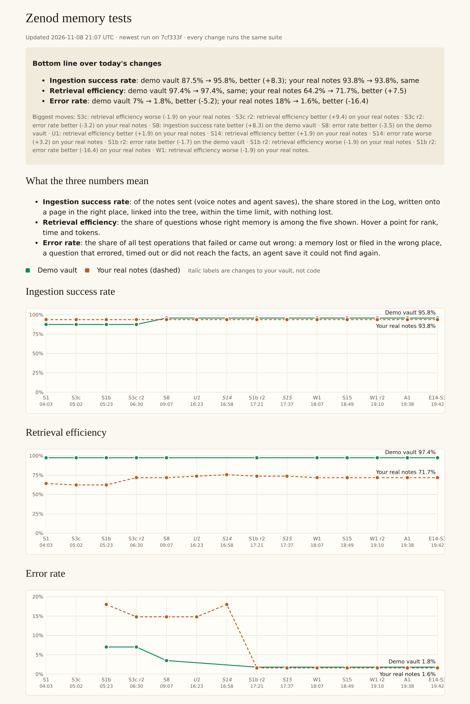

# Memory test suite: what each change did to your three numbers (E15-Q2, 8 Nov 2026)

**Bottom line. Better over today's changes: retrieval on your real notes went from 64.2% to 71.7% (S3c round 2 did most of it), the error rate on your real notes from 18% to 1.6% (S1b round 2), and ingestion on the demo vault from 87.5% to 95.8% (S8). Ingestion on your real notes stayed at 93.8%.**

**Dashboard (tailnet, no password):** http://vps3.taild81fbb.ts.net:8921/memory-tests/. It updates after every production roll and every night.

Row Q2 in [EPIC-15](../memory-answers-quality-check-and-real-li.md), from your S3c relaunch note (vn_f986ae4b). Run `run_6e8a4f58-5694-4b3e-8916-2cd88e0f225c`. Code: [PR #1535](https://github.com/zenod-ai/zenod/pull/1535). Definitions: [memory-test-suite.md](../memory-test-suite.md).

## The three numbers, in one line each

- **Ingestion success rate**: of the notes sent, the share stored, written on the right page, linked into the tree, in time, with nothing lost.
- **Retrieval efficiency**: the share of questions whose right memory is among the five shown. Rank, time and tokens are also tracked.
- **Error rate**: the share of all test operations that failed or came out wrong. That covers lost or misfiled memories, questions that errored, timed out or never reached their facts, and agent saves that could not be found again.

## Each change, as rebuilt today

Every commit below was rebuilt and run through the same suite. Your vault's own changes (U1, S14, S15) are separate points, with the code unchanged.

| Change (UTC) | Ingestion: demo · yours | Retrieval: demo · yours | Errors: demo · yours | What moved |
|---|---|---|---|---|
| S1 chat (04:03), start | 87.5% · 93.8% | 97.4% · 64.2% | no answer step yet | 3 demo memories land in the wrong place or stall |
| S3c percentages (05:02) | same | same · 62.3% | no answer step yet | one of your questions drops out of the top 5 |
| S1b fast answers (05:23) | same | same | 7% · **18%** | the answer step reads about 3,800 tokens; for 10 of your 45 questions the facts never reach it |
| S3c round 2 (06:30) | same | same · **71.7%** | 7% · 14.8% | 5 more of your questions get the right memory in the top 5, mostly "last note", "yesterday" and "this week" questions |
| S8 filing (09:07) | **95.8%** · 93.8% | same | **3.5%** · 14.8% | 2 of the 3 demo memories that stalled or were misfiled now land |
| U1 untangle (your vault, 16:23) | – · same | – · 73.6% | – · same | one more question finds its memory |
| S14 report lines moved (your vault, 16:58) | – · same | – · **75.5%** | – · 18% | one more question finds its memory, two lose their facts from what the answer reads |
| S1b round 2 (17:21) | same | same · 73.6% | **1.8% · 1.6%** | the facts now reach the answer step for all 45, at about twice the tokens (7,400); one question leaves the top 5 |
| S15 lines moved (your vault, 17:37) | – · same | – · same | – · same | |
| W1 weighted links (18:07) | same | same · 71.7% | same | one question leaves the top 5; the last demo graph link is now tied |
| S15, W1 round 2, A1, E14-S3 (18:49 to 19:42) | same | same | same | no change in these numbers |

## How it was measured

- **Five suites.** Filing: 16 made-up voice notes, 12 shapes. Graph: 8 links that should be strong, 4 pairs that should stay apart. Retrieval and answers: 20 demo questions. Recall: 10 questions about the notes just filed. An agent's store and find over MCP: 8 facts saved with `store_memory`, then read back with `get_memory` and found with `search_memory`.
- **Two datasets.** The demo vault lives in the repo: made-up, about 680 pages. Your set stays on VPS3 only: your 45 real questions on a throwaway copy of your vault, plus the 8 notes behind the placements you judged on the trial page, filed again. A note fails if it lands on a page you said was wrong. Nothing from your vault is in this repository, and only counts leave the machine.
- **No model credit spent.** A free, deterministic stand-in takes the AI model's place. It files each sentence onto the candidate page that shares the most rare words with it, using the candidates Zenod's own code offers. For answers, it records what the answer step was given. So the numbers show what Zenod's code does with a note or a question. They do not show how well a model writes or answers. Those live-model checks from today are on the dashboard, recorded and not rerun: S6 and S8 landing quality, S1b round 2 answers (8 to 29 of 45 correct, blind graded), and Q1.
- **Runs on every change.** The demo suite runs in CI on every pull request and push. It first ran on this PR with 95.8%, 97.4% and 1.8%, the same as on VPS3, and it fails under a floor. On VPS3 a user timer runs both datasets after each production roll and nightly, then redraws the dashboard.

## What the numbers do not show yet

- **Model judgement.** Whether answers are right in meaning, and whether a model files a note well, needs live model calls. Those wait on test model credits (E15-A3, A5). ✗ on the card.
- **Demo retrieval is near its ceiling** at 37 of 38, so it cannot show gains. Your real set is where retrieval moves.
- **Ingestion on your notes is flat** at 15 of 16: the stand-in files your 8 judged notes the same way on every version. Your own verdicts still carry more weight: 8 of 34 placements right before S8, and 3 to 5 of 10 in S8's live re-run.
- **Found on the way:** an old lint error on a page, such as a page without links, made notes filed onto it fail in the demo runs, and they became provisional leaves. 27 of your pages carry such an error. The demo vault was made lint-clean so the suite measures filing, not this.
