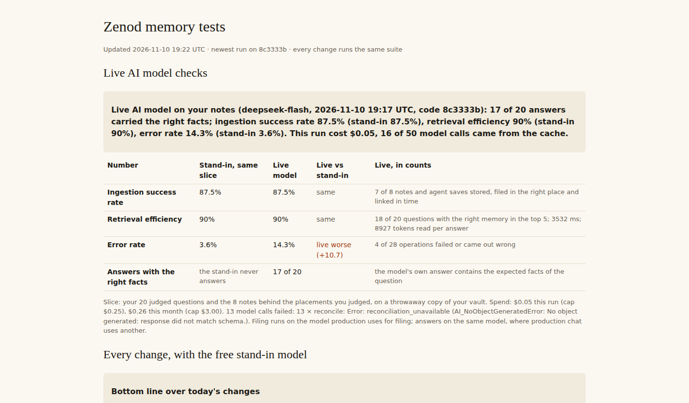

# Live model checks: first real DeepSeek runs (E15-Q3, 10 Nov 2026)

**Bottom line. The live checks run every night on DeepSeek now, with their numbers on the dashboard next to the free stand-in. On Jordi's 20 judged questions the real model gets the right facts in 17 or 18 answers, and finds the same memories as the stand-in. Ingestion is the same as the stand-in (87.5%). The live error rate is higher, 10.7% to 14.3% against 3.6%: DeepSeek's filing replies fail the reconcile schema on about half the calls, and production files on DeepSeek. That is handed to EPIC-24.**

Row Q3 in [EPIC-15](../memory-answers-quality-check-and-real-li.md). Run: run_c050db5e-72b2-4aa6-b8be-f46747421bd4. Dashboard: http://vps3.taild81fbb.ts.net:8921/memory-tests/ (live section first). Built in [#1556](https://github.com/zenod-ai/zenod/pull/1556). Failure reasons added in [#1600](https://github.com/zenod-ai/zenod/pull/1600), live in production be15341 at 2026-11-10T19:18Z. Key: zenod-tests DEEPSEEK_API_KEY from E15-A7, served by `secret run` since EPIC-2-A47.

## Jordi's three numbers on the live slice

The slice is his 20 judged questions and the 8 notes behind the placements he judged. "Before" is the free stand-in on the same slice and code; "after" is the real model.

| Number | Stand-in | Live DeepSeek, run 1 (0274bf2) | Live, run 2 (0274bf2) | Live, run 3 (8c3333b) |
|---|---|---|---|---|
| Ingestion success | 87.5% | 87.5% (7 of 8) | 87.5% | 87.5% |
| Retrieval efficiency, right memory in the top 5 | 90 to 95% | 90% | 95% | 90% (18 of 20) |
| Error rate | 3.6% | 14.3% | 10.7% | 14.3% (4 of 28) |
| Answers with the right facts | the stand-in never answers | 17 of 19 | 18 of 20 | 17 of 20 |

On the full private set the stand-in suite is unchanged by these runs: 93.8 / 100 / 1.6.

## Why the live error rate is higher

The live tier now records why each call failed (method, error name, status, first words, never a body):

- **Reconcile** (placing ideas on a page) fails the schema on 10 to 13 calls a run, about half: `invalid_union` in `operations`, sometimes `too_small` in `sourceIds`.
- **Classify** fails on 0 to 4 calls a run (schema or JSON parse).
- Filing still completes through the fallback, so ingestion holds. Each failure is a paid call wasted and a weaker placement.
- One answer stream was cut off ("terminated") in run 1.

Production files on DeepSeek again since E24-M3 (08:36Z), so the same failures happen there. Desk note to EPIC-24: `desk/inbox/2026-11-10-zenod-epic-24-filing-on-deepseek-fails-the-rec.md`.

The cache saves less than the stub promised: answers replay (17 to 20 of 20 from the cache), but filing calls mostly do not. A failed call is never cached, and its fallback changes every later filing input.

## Spend

| Run | DeepSeek |
|---|---|
| Run 1, nightly timer, 17:43Z | $0.074 |
| Run 2, forced rerun, 18:15Z | $0.057 |
| Two diagnostic runs to name the failures | $0.082 |
| Run 3, nightly timer, 19:10Z | $0.045 |
| **Q3 total this month** | **$0.258** (caps $0.25 a run, $3 a month) |

OpenRouter: $0. A live check runs at most once per production roll or day, off DeepSeek's peak hours, at about $0.05 to $0.13 a run.
