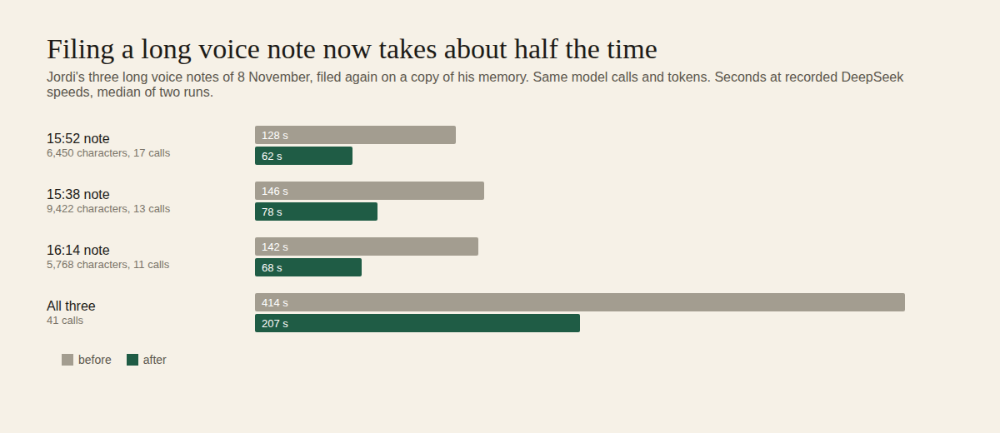

# E15-Q4 evidence: faster filing, no billing for abandoned memory questions, cost labels per app (2026-11-09)

**Bottom line.** On a copy of Jordi's memory, filing his three long voice notes of 8 November now takes about half the time: 414 s → 207 s in total at recorded DeepSeek speeds (median of two runs), with the same model calls and tokens. A memory question that runs out of time now stops its model call instead of running on and billing. Every model call is now labelled with its app and feature, so spend can be summed per label. The plan for one key per app is below, and no key was minted. No model credit was spent: every run used the free stand-in model. The three test-suite numbers did not move.

Row: E15-Q4 in [EPIC-15](../memory-answers-quality-check-and-real-li.md), Jordi's approval E15-A5 points 3 and 4. Run: run_bf349c07-b400-4f7b-b21f-15e4e4625bbe. Code: [PR #1552](https://github.com/zenod-ai/zenod/pull/1552), merged as `bed7d51`; live `cloud.zenod.dev/api/health` sha `bed7d51` (2026-11-09, publish run 42570945800: ci, publish, deploy green).

## 1. Filing on a large memory

**Why it was slow.** I filed the 8 November 15:52 voice note (6,450 characters) again on a copy of Jordi's memory (vault `d4f479d`), through production's capture-then-file path, and logged every step.

- **17 model calls, one after another:** 2 classify calls, then **15 reconcile calls, one per page** the note touched, each waiting for the previous one.
- **About 45 s of work on the server itself:** each page ran a search over the whole memory with up to 128 words. Most of that went into re-normalising the same text (titles once per word, every matching line again on each of the about 17 searches). The rest was 686 git processes, mostly re-reading the committed copy of every changed page after each page was written.

**What changed:**
1. Before any page is written, every page's reconcile request is prepared and sent, up to 4 at a time. Pages are still written one by one in the same order, each with its own answer. The calls and tokens are unchanged, and the waiting overlaps.
2. Search normalises each text once and remembers matched lines across the searches of one filing. It has a fast path for plain-ASCII text, checked identical on 200,000 random strings, and it reads ripgrep's plain output instead of one JSON event per line.
3. The git layer remembers what a commit holds, because a commit never changes. Git processes per filing went from 686 to 242.

**Measured** with `scripts/memory-eval/filing-profile.mjs`, on a copy of his memory, with the stand-in model waiting as long as each call takes at DeepSeek V4.1 Flash speeds. Those speeds come from a least-squares fit to 24 recorded real filings (E12-S6): 0.45 s per call, 0.41 s per 1,000 prompt tokens and 290 answer tokens per second, with a median error of 3.8 s on a median note of 29 s. Server time is measured. Model time is the fitted estimate. Each side ran twice, one after the other, on a busy machine (load 6 to 16).

| Voice note (8 Nov) | Size | Model calls | Server time, before → after | Model wait, before → after | **Total, before → after** |
|---|---|---|---|---|---|
| 15:52 (the 14-minute one) | 6,450 chars | 17 | 45 s → 15 s | 82 s → 47 s | **128 s → 62 s** |
| 15:38 | 9,422 chars | 13 | 73 s → 32 s | 72 s → 46 s | **146 s → 78 s** |
| 16:14 | 5,768 chars | 11 | 78 s → 24 s | 64 s → 44 s | **142 s → 68 s** |
| All three | | 41 (same) | 196 s → 70 s | 218 s → 137 s | **414 s → 207 s** |

Prompt tokens per note stayed the same (37,234 on average), so the cost per filing is unchanged.

**What this does not explain.** At recorded model speeds this note takes about 2 minutes, not 14. The rest of the 14 minutes in production was most likely waiting: notes file one at a time, and the 9,422-character 15:38 note was filing when this one arrived. Slower live model calls may also have added to it. I could not read production's call log to confirm: `read_llm_timeline` through the team connection returned HTTP 403. Shorter filings also shorten that queue. ✗ The live time per note has not been measured yet. It is first visible on Jordi's next long voice note.

**The three numbers (Q2 suite), before → after:**

| Set | Ingestion success | Retrieval efficiency | Error rate |
|---|---|---|---|
| Demo memory | 95.8% → 95.8% | 100% → 100% | 1.8% → 1.8% |
| Jordi's notes, on a copy of his memory | 93.8% → 93.8% | 86.8% → 86.8% | 1.6% → 1.6% |

On his set, the stand-in filing of the 8 judged notes took 343 s of server time before and 253 s after.

## 2. Memory questions that time out

**Before:** the team connection gives a tool call 15 s, and `ask_brain` runs up to three model loops of up to 8 steps each. The caller gave up, but Zenod ignored the hang-up and finished the loop, so the answer was billed and never read. That happened on 3 of 4 live asks on 8 November.

**Now:**
- `ask_brain` stops when the caller hangs up, or after **55 s**, under the 60 s many MCP clients wait. `ZENOD_ASK_BRAIN_TIMEOUT_MS` overrides that limit.
- The answer loop now streams. On a stop it closes the open request to the model, so generation stops, and it starts no further step.
- The reply says what happened: "No answer this time: I stopped after 55 seconds…" (`ask_timeout`), or `ask_cancelled` on a hang-up.
- The cost log keeps any steps that had already finished. They were billed, so the row is marked `answer_cancelled`.

Tests: a fake model endpoint that never finishes is cut off at the limit, its request is closed and no second call is made. An already-cancelled ask makes no call at all. The MCP tool stops at its limit and on a client cancel.

What can still be billed: the tokens of a step already finished, and whatever the provider generated before the request closed.

Follow-up outside this repo: the team connection's 15 s is shorter than a typical answer, so team agents will now get a fast "cancelled" instead of a billed timeout. Giving `ask_brain` about 60 s there would let those questions get answers.

## 3. Labels and one key per app

**Labels now.** Every logged model call carries `app` and `feature`:
- `app` comes from `ZENOD_APP_LABEL` and defaults to `zenod`.
- `feature` is one of filing, chat, personas, desk or calls.
- `GET /api/usage` adds `byLabel`, the spend per `app/feature` with failed calls counted apart. `read_llm_timeline` shows the label on each call.

No gateway header was added. An OpenRouter app header would put Zenod on OpenRouter's public app list, which is publishing, so the gateway tells apps apart by their keys.

**The key layout, ready to mint.** Nothing was minted. It needs the OpenRouter management key, which is in Jordi's Bitwarden on purpose, or the OpenCode Go key. Today two OpenRouter keys exist: production's own, and one shared key used by everything else, with no cap.

| App (label) | Who calls models | Key NAME | Cap | Lives in |
|---|---|---|---|---|
| `zenod` | Zenod production: filing, chat, personas, desk, transcription | `ZENOD_PLATFORM_OPENROUTER_KEY` (exists) | $26 a month (exists) | Dokploy app zenod-mt |
| `zenod` (DeepSeek route) | production background filing on DeepSeek's own API (E14-S10) | `DEEPSEEK_API_KEY` | prepaid balance | zenod-mt |
| `zenod-tests` | memory test suite live checks (Q3), filing benches (E12-S6/S8), real-question runs (Q1) | `ZENOD_TESTS_OPENROUTER_KEY`, plus `OPENCODE_GO_API_KEY` for DeepSeek | $5 a month, plus the $10 Go plan (E15-A5 point 2) | secret store app `zenod-tests`, used through `secret run` |
| `scrapingv1` | scraping service | `SCRAPINGV1_OPENROUTER_KEY` | Jordi sets it from its spend | scrapingv1 |
| `whatgpt-service` | WhatGPT service | `WHATGPT_OPENROUTER_KEY` | Jordi sets it | whatgpt-service |
| `team-agents` | agents' ad-hoc runs through `secret run openrouter` | `AGENTS_OPENROUTER_KEY` | $5 a month | secret store, class shared |
| `openprop`, `abnb-agent` | the bots that read the shared key from volume files | `OPENPROP_OPENROUTER_KEY`, `ABNB_OPENROUTER_KEY` | Jordi sets it | their volumes |

**When a key arrives:**
1. Mint one capped key per row with the NAME above.
2. Store it with `secret put <app> <NAME> --stdin`, or `dokploy env-set` for Dokploy apps. Never print it.
3. Set `ZENOD_APP_LABEL=zenod-tests` where tests run Zenod's server.
4. Once every app has its own key, retire the shared `OPENROUTER_API_KEY`.

After that, OpenRouter's activity page shows spend per key, and Zenod's `byLabel` shows it per feature inside each app.

## How it was measured

- Code: merged `bed7d51`. CI is green, and locally core passed 1,333 tests and server 1,604.
- Filing: `filing-profile.mjs --vault <copy> --from-log <the three Log refs> --latency-scale 1`, with base `5714c48` and after `wt/e15-q4`, two runs each. The raw results are on VPS3 in `/tmp/q4/final-*.json`. Only counts leave the machine.
- Three numbers: `scripts/memory-eval/run.mjs`, demo and private datasets, base and after.
- Nothing was sent to anyone. Zenod's chat replies are unchanged (L-6, L-7).
