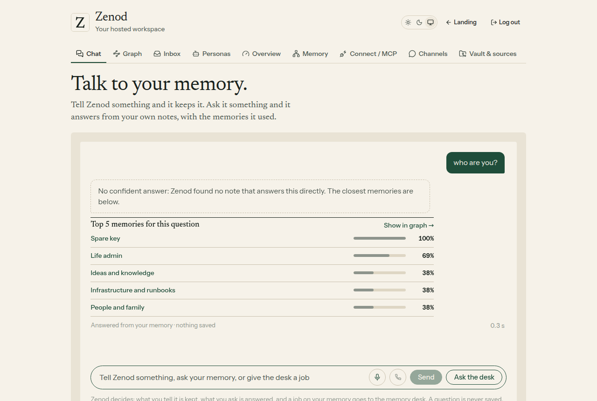
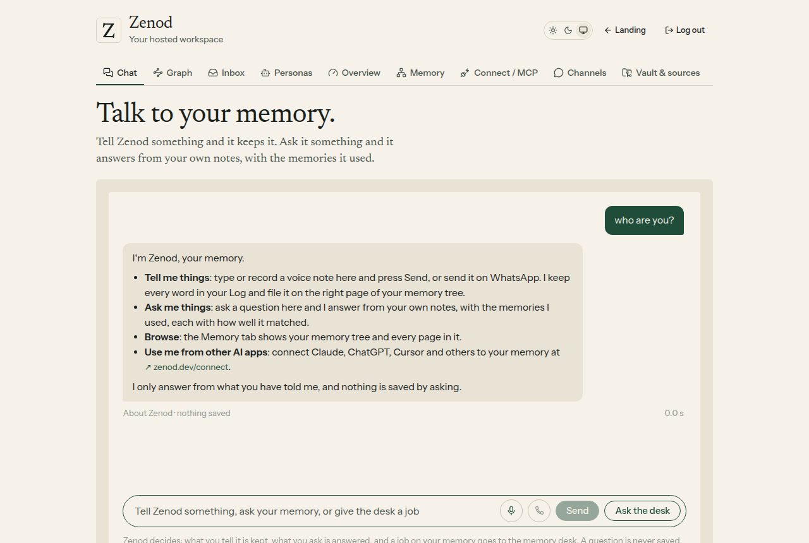

# E15-S1 evidence: "who are you?" gets a real answer, not five random memories (2026-11-09)

**Bottom line.** In the Zenod app chat, a question about Zenod itself ("who are you?", "what can you do?", "how do I add a memory?") now gets a short, true description of Zenod and no memory cards. Memories under a 15 % match are no longer shown, and notes about family, people, health or money only show on a strong match (50 % or more) or when the checked answer cites them. On Jordi's 45 real questions no right source is lost, and his three memory numbers are unchanged. Live on production: `cloud.zenod.dev/api/health` reports sha `79e2c7c` since 2026-11-09 17:21 UTC, and the live app carries the new "About Zenod" label.

| Before: production code, "who are you?" | After: this change, "who are you?" |
|---|---|
|  |  |

Both screenshots are the shipped chat routes and web app over the made-up demo memory, so no private note appears. The before run is production's code at 5f7aa14, the after run this change. Harness: [serve.mjs](e15-s1/harness/serve.mjs) and [shoot.mjs](e15-s1/harness/shoot.mjs); no model runs, the answer step replies "no answer", as the live model did.

Row: E15-S1 in [EPIC-15](../memory-answers-quality-check-and-real-li.md), Jordi's ask from the Team desk ("why this answer? should it be that?"). Run: run_a0d8e804-6315-4de7-823d-c624d474def5. Code: [PR #1561](https://github.com/zenod-ai/zenod/pull/1561), merged as `79e2c7c`.

Private detail, with his real example and the notes involved (tailnet only): http://vps3.taild81fbb.ts.net:8921/e15-s1-private/

## 1. Why it happened

Reproduced on production's code (5f7aa14) on a read-only copy of Jordi's memory: "who are you?" gave "No confident answer" and five notes at 22 % to 25 %, one of them a private family note, exactly as in his screenshot.

1. **The chat had no idea of itself.** Every message was searched in the person's notes, and the model may only answer from them. No note says who Zenod is, so the model rightly said it had no answer.
2. **No relevance floor.** The chat always showed the top five, however weak. For "who are you?" the match is only the shared words "who", "are" and "you", so the five are near random.
3. **No care for private notes.** A family note was shown like any other.

## 2. What changed (web app chat only)

- **Questions about Zenod.** The whole question must be about Zenod, in English or Spanish: "who are you", "what can you do", "what is Zenod", "how does this work", "how do I add a memory", "¿quién eres?". "What did I say about Zenod pricing?" still searches the notes. The answer is a fixed description of what Zenod does today: keep what you tell it, here or on WhatsApp; answer from your notes with the memories used; browse the Memory tab; connect other AI apps at zenod.dev/connect. No search and no model call. None of Jordi's 45 real questions is taken for one.
- **Relevance floor, 15 %.** Picked on Jordi's 45 real questions: the lowest right source shown reads 19 %, so a floor of 20 % or more would lose one. At 15 %, 7 of the 223 memories shown drop and no right source is lost. A memory the checked answer cites always shows.
- **Sensitive notes.** A note whose title, path or branch names family, people, relatives, health, medical, money, bank, tax, debt, mortgage, insurance or similar (English and Spanish) shows only from 50 % up, or when the checked answer cites it. The vault has no sensitivity tags, so this is a cheap word rule on names, never on the note's text. It hides 4 more of the memories shown on his questions, none of them a right source.
- **Nothing else moves.** WhatsApp, Telegram and calls answer exactly as before (root L-6). The model reads the same notes as before (7,850 tokens per question before and after), so answers and model costs do not change.

## 3. Jordi's three memory numbers, before and after

The memory test suite (E15-Q2), free stand-in model, zero OpenRouter or DeepSeek spend. The suite now asks as the app chat does, so the floor and the sensitive rule are measured.

| Number | Before (production 5f7aa14) | After (this change) |
|---|---|---|
| Ingestion success, his real notes | 93.8 % (15/16) | 93.8 % (15/16) |
| Retrieval efficiency, his real questions | 94.3 % (50/53), MRR 0.74 | 94.3 % (50/53), MRR 0.75 |
| Error rate, his real set | 1.6 % (1/61) | 1.6 % (1/61) |
| Demo set (ingestion, retrieval, errors) | 95.8 %, 100 %, 1.8 % | 95.8 %, 100 %, 1.8 % |

Memories shown on his 45 questions: 223 before, 212 after; right sources shown: 90 before, 90 after. Dashboard: http://vps3.taild81fbb.ts.net:8921/memory-tests/

## 4. Checks

- Unit tests for the chat (`packages/server/test/memoryChat.test.ts`): Zenod questions answered with no search and no model call, and left alone off the app chat; questions that only mention Zenod still search; the floor; sensitive notes hidden on a weak match, shown on a strong one or when cited. CI green on #1561.
- Web app test (`memory-chat.test.tsx`) and type check pass; an answer about Zenod is labelled "About Zenod · nothing saved", not "Answered from your memory".
