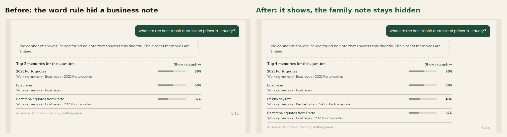

# E15-S2 evidence: private notes are marked when Zenod files them (2026-11-09)

**Bottom line.** Better. Zenod now marks a family, people, health or own-money note as private when it files it, and the app chat reads that mark instead of guessing from names. On Jordi's real memory the mark lands on his 8 private pages and no other; the old word rule named 21 pages, 14 of them not private, 9 of those under his company's tax branch. On his 45 real questions the old rule hid 4 memories, 3 of them business notes; the mark hides 1, his family note, and no right source is lost either way. His three memory numbers are unchanged: 93.8 % ingestion, 94.3 % retrieval, 1.6 % errors. Live on production: `cloud.zenod.dev/api/health` reports sha `fa68fce` (which contains this change, `50c72e3`) since 2026-11-09 19:46 UTC; his vault was back-filled in commit `6376fcb`.

Same question on the made-up demo memory, before (production code) and after (this change). The studio's price note sits under a company tax branch: the word rule hid it as "money"; now it shows at 40 %. The family note of the same match (37 %) stays hidden both times. No real note appears. Harness: [seed.sh](e15-s2/harness/seed.sh) with E15-S1's [serve.mjs](e15-s1/harness/serve.mjs); no model runs.

Row: E15-S2 in [EPIC-15](../memory-answers-quality-check-and-real-li.md), started by Jordi when he closed E15-S1. Run: run_fe2b4f77-287d-444a-80d0-c883c7a39536. Code: [PR #1566](https://github.com/zenod-ai/zenod/pull/1566), merged as `50c72e3`.

Private detail, with the pages marked and the ones the word rule got wrong (tailnet only): http://vps3.taild81fbb.ts.net:8921/e15-s2-private/

## 1. The numbers

| | Old word rule (E15-S1) | Private mark (this change) |
|---|---|---|
| His pages taken for private | 21 | 8 |
| of them truly private | 7 of 8 | 8 of 8 |
| of them business or other (false positives) | 14 | 0 |
| His Log entries taken for private | 33 | 13 |
| Memories hidden on his 45 questions (match 15 to 49 %) | 4 | 1 |
| of them business notes | 3 | 0 |
| Right sources hidden (of 86 shown) | 0 | 0 |
| Private notes still shown on a weak match | 0 | 0 |

The 8 private pages are a hand reading of every page any rule put forward (the old word rule, the model's own tags, words in the text): family, health and his own money are private; his companies' tax, accounting and prices are not.

## 2. How the mark is decided, with no model call

Three options were measured on his 250 indexed pages:

- **The filing model's own tags** (family, health, finance): 1 of the 8 private pages, and "finance" on 15 business pages. Not used.
- **Names** (E15-S1's word rule on title, path and branch): 7 of 8, and 14 business pages, because "tax" names his company's tax branch.
- **What the page says and where it sits** (chosen): a kind's words (family, health, own money such as mortgage, salary, savings, debt; people such as friends and partners) must be at least 3 and at least 2 % of the page's words, or the page sits under a private page. His 5 private pages that say so read 29 to 55 such words per thousand; no other page reads over 18. The 3 short notes under his family page say little ("my father", twice) and are marked by place. Business words (tax, invoice, accounting) are not money words.

## 3. What changed

- **Filing.** Every page filing writes (composed, reconciled, appended, or a rescued note's own page) gets one frontmatter line, `private: family` (or health, money, people), when the rule says so. The mark is only ever added; the model can neither set nor remove it; `private: false` written by the person keeps a page out for good.
- **The Log stays as it is.** A Log entry is private when a page it was filed on, or a page that cites it, is marked.
- **Back-fill.** His existing pages were marked by the same rule in one vault commit, `6376fcb`: 8 files, 8 added lines (`private: family` 6, `health` 1, `money` 1), nothing else. Reverting that commit undoes it.
- **Retrieval.** The app chat's rule from E15-S1 is unchanged (a private note shows from 50 % or when the checked answer cites it); only what counts as private changed. WhatsApp, Telegram and calls answer as before.

## 4. Jordi's three memory numbers, before and after

The memory test suite (E15-Q2), free stand-in model, zero OpenRouter or DeepSeek spend. Before is production's code on his vault; after is this change on the same vault with the back-fill.

| Number | Before (production aedfcf0, vault a3b5775) | After (this change, same vault back-filled) |
|---|---|---|
| Ingestion success, his real notes | 93.8 % (15/16) | 93.8 % (15/16) |
| Retrieval efficiency, his real questions | 94.3 % (50/53), MRR 0.72 | 94.3 % (50/53), MRR 0.71 |
| Error rate, his real set | 1.6 % (1/61) | 1.6 % (1/61) |
| Demo set (ingestion, retrieval, errors) | 95.8 %, 100 %, 1.8 % | 95.8 %, 100 %, 1.8 % |

A first pair of runs taken while the machine ran at a load of 40 to 70 timed out (filing over 180 s, search over 10 s) and was discarded; these are the rerun at normal load. Dashboard: http://vps3.taild81fbb.ts.net:8921/memory-tests/

## 5. Checks

- Unit tests: the rule (family, health, money in English and Spanish; one mention in a work note and a company tax note stay unmarked), one added line and nothing else, never twice, the person's opt-out kept, marking by place, the back-fill parents first, the model unable to set or drop the mark, the index marking a private page and the Log entry it cites, the chat hiding by the mark and no longer by the word "tax". CI green on #1566.
