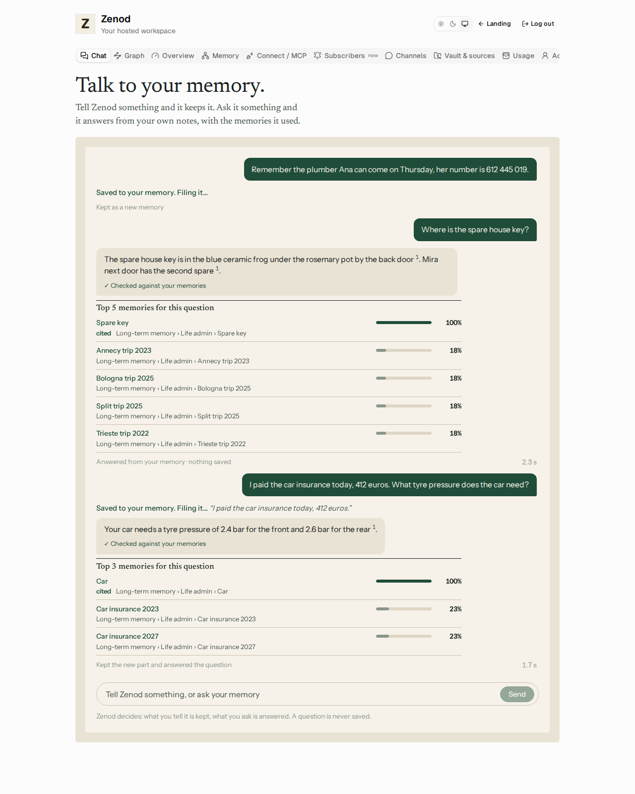

# E16-B1 evidence: one Send button, and Zenod decides whether to keep or answer (2026-11-08)

**Evidence page (tailnet, no password):** http://vps3.taild81fbb.ts.net:8921/e16-b1/

Row: B1 in [EPIC-16](../one-send-button-the-agent-decides-keep-o.md). Run: run_68834ea4-ac9e-41b7-96a6-2ba7aa12a7e9. PR [#1518](https://github.com/zenod-ai/zenod/pull/1518), merged as `db093a5`, live on cloud.zenod.dev.

Jordi, 2026-11-08 voice note: "There is a button that says ask and a button that says keep. Remove those two buttons. It's always just send. And then based on the content, the agent decides whether it needs to store a new information or retrieve."

The screenshot is the built web app on the real chat routes (session, tenant, allowance, store queue, streaming) with a made-up demo vault and the real hosted chat model, driven in a headless browser. Three messages: a statement (kept: "Saved to your memory", "Kept as a new memory"), a question (answered and checked: "Answered from your memory · nothing saved"), and a mixed message (the told part quoted and kept, the question answered: "Kept the new part and answered the question"). The keeps show "Filing it…" because the harness reached the model through a slow relay; the store queue filed them a minute later ("Saved — … Notes/The plumber Ana can come on Thursday.md"). The recent-saves list held only the told parts, never a question.

## What shipped

- **One Send.** The cloud chat has one Send button. Ask, the composer's Keep and the Keep under answers are gone. The hint reads "Zenod decides: what you tell it is kept, what you ask is answered. A question is never saved."
- **The decision.** `POST /api/console/memory-send/stream` asks the engine's `routeSend`: one small call on the hosted chat model, no tools, no vault read, metered and allowance-checked like every call. It returns the part to keep (in the sender's own words, lead-ins like "remember that" dropped) and the question to answer. Prompt, parse and guard: `packages/core/src/llm/sendRoute.ts`.
- **The guard.** Whatever the model says: a keep that has any question in it, or that is not at least 80% the sender's own words, is replaced by what the plain rules keep; a message the rules read as only questions keeps nothing; a question mark the model missed is still answered. With no chat model, or a reply that does not parse, the plain rules decide.
- **Keep and answer paths.** The kept part goes through the tenant's durable store queue with the same idempotency key and status route as the old Keep (`GET /api/console/memory-keep/:id`). The question goes through the S1b checked answer path. Stream order: `route`, `kept`, `memories`, `text`, `answer`, `done`.
- **Unchanged.** Session-only tenant, AI allowance checked before any model call (a cap hit while deciding stops the send with its reason), two chats in flight per tenant. WhatsApp and Telegram are untouched (root L-6). The old ask and keep routes stay for other callers.

## Measured: the decision on real-style messages

Two sets of 40 demo messages (17 to keep, 17 questions, 6 mixed), all invented: [the first](../../packages/core/test/fixtures/send-route-40.json) written with the feature, [the second](../../packages/core/test/fixtures/send-route-heldout-40.json) written blind by a separate agent that never saw the code (casual, lowercase, voice-transcript style, missing question marks, some Spanish, tricky ones like "do the taxes by friday" and "when i was nine we moved to Rotterdam…").

| Decider | First 40 | Blind 40 | Questions kept |
|---|---|---|---|
| **Hosted chat model `google/gemini-3.1-flash-lite` + guard** (what runs) | **40/40** | **40/40** | **0** |
| The same model without the guard | 40/40 | 40/40 | 0 |
| Plain rules alone (the fallback), before two general fixes | 40/40 | 32/40 | 0 |
| Plain rules alone, after them (comma-joined questions; "when I…", "do the…" read as statements) | 40/40 | 40/40 | 0 |

- Bar: right at least 9 times in 10 and no question ever kept. Met with margin by the model, and by the fallback on its own.
- No reply from the model failed to parse (0 of 80). Median time per decision 0.9 s (first set) and 1.1 s (blind set), over OpenRouter from VPS1.
- The rules were tuned after seeing the blind set's misses, so the rules' "after" row is not blind; the model rows are.
- Cost: about 330 input and 30 output tokens per decision on Gemini 3.1 Flash Lite, about $0.0001 per message.
- Rows: [model-eval-2026-11-08.json](e16-b1-eval/model-eval-2026-11-08.json). Reproduce: `node scripts/e16-send-route-eval.mjs` with an OpenRouter key in the environment.

## Tests

Core `sendRoute.test.ts` (both 40-message sets, mixed split, the guard refusing a kept question or invented words, slips). Server `memoryChat.test.ts` (statement kept only in the sender's tenant, question answered and kept nowhere, mixed message keeps only the told part when the model tries to keep the question, model failure falls back to rules, cap hit before and while deciding). Web `memory-chat.test.tsx` (one Send and no Ask or Keep, each of the three replies says what it did, saved link, allowance reason).

## Live

- Merged as `db093a5` (CI green, 11m30s). The push to `main` ran publish.yml: ci, publish and the Zenod production roll all succeeded (run 42500535175).
- `https://cloud.zenod.dev/api/health` reports `status: ok`, sha `db093a5120ee6b7b12b06c221aa90403b460d094` (checked 2026-11-08).
- The served app bundle (`/assets/index-DrQDC9YW.js`) carries the one Send chat ("Talk to your memory", "A question is never saved", `/api/console/memory-send/stream`), and the live route refuses a request without a session (401).
- ✗ Not yet sent from a signed-in account on production: no non-Jordi hosted account with a vault exists yet; that check waits on the agents' Google sign-in (E7-A15).
