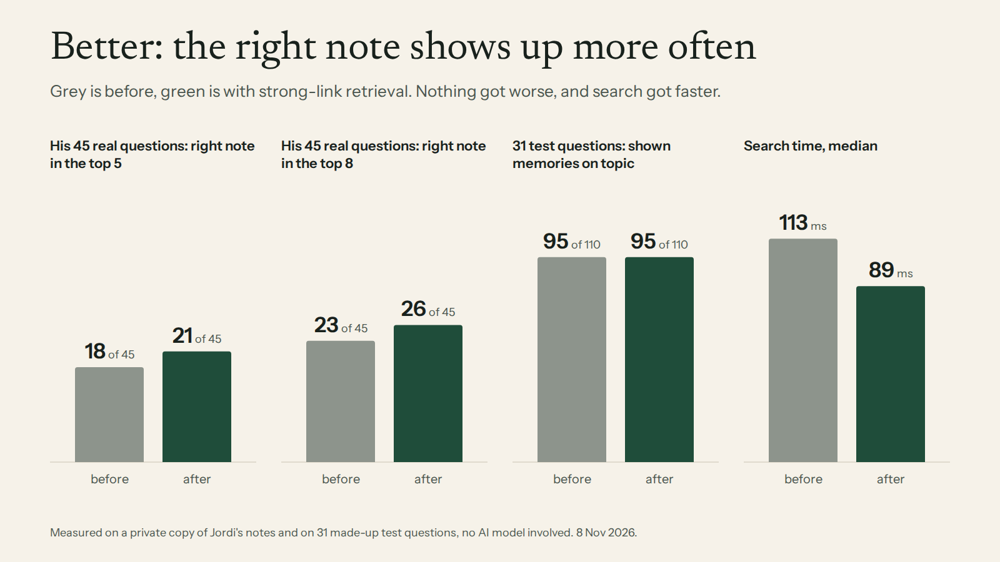
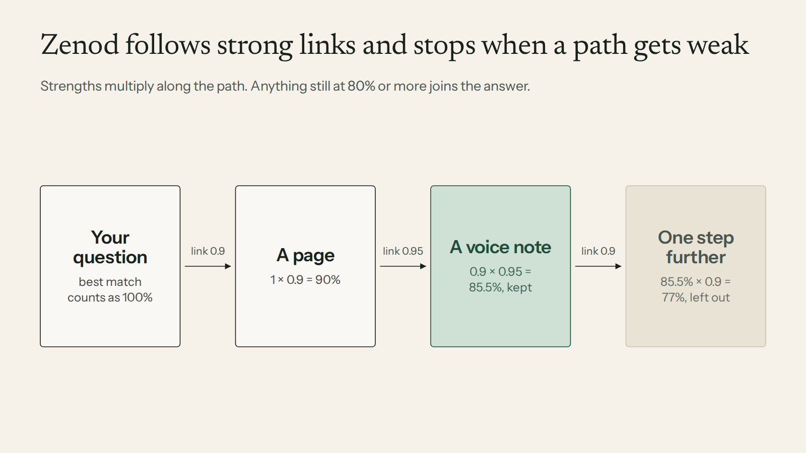
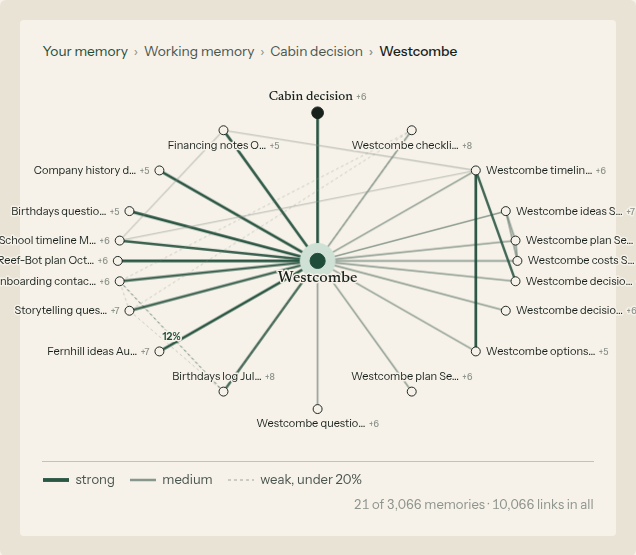
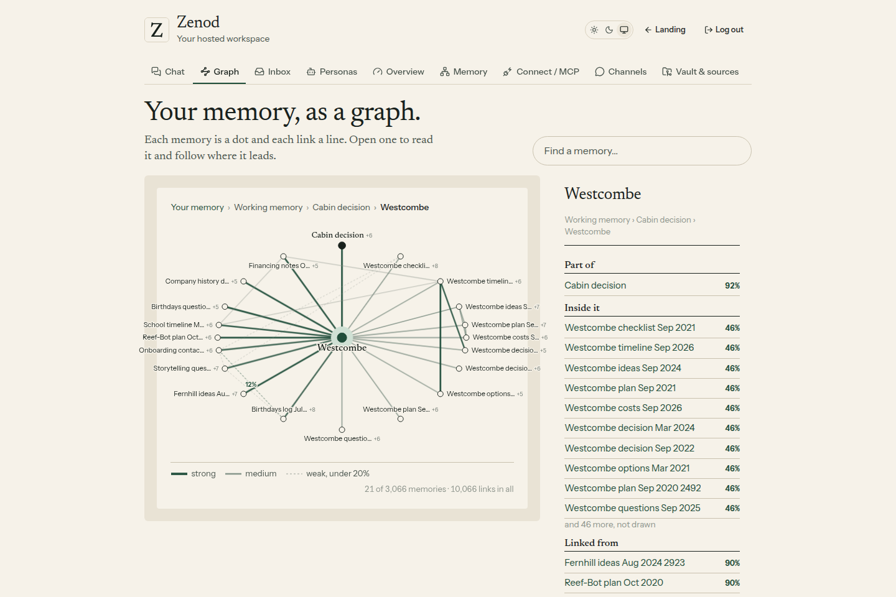
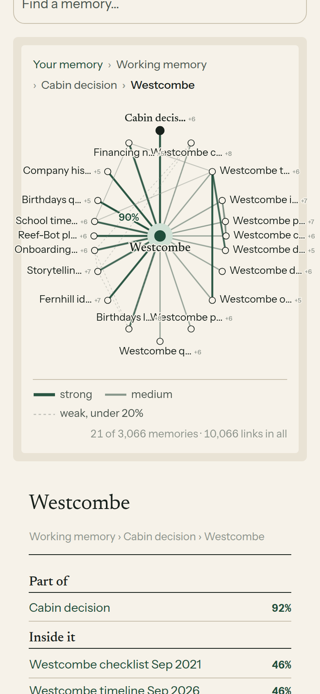

# Weighted memory links: is it better? (E18-W1, 8 Nov 2026)

**Bottom line. Better: with strong-link retrieval the right note lands in the top 5 for 21 of your 45 real questions instead of 18, and in the top 8 for 26 instead of 23. Nothing got worse: 95 of 110 on topic, same as before. Search got faster: 89 ms instead of 113 ms.**

Not shown yet: better *answers* or fewer tokens. That needs an AI judge, and the test credits ran out (✗ on the card).

## How it works

Every link between two memories now has a strength from 0 to 100 %. Zenod starts at the best match for your question and walks the links, multiplying the strengths. Whatever stays at 80 % or more comes along. One weak step ends a path, so loosely related notes stay out.

## What the strengths look like in your graph

New in this round, in the Graph tab of cloud Zenod:

- **Thicker and greener = stronger.** A 90 % link is a wide deep-green line. A 45 % link is thinner and grey-green.
- **Dashed = weak**, under 20 %. These are mostly two pages that only show up in the same old voice note.
- **Hover or tap a line** to see its percent.
- **A key under the graph** shows strong, medium and weak.
- **The side panel** lists the neighbours strongest first, each with its percent.

The screenshots are the shipped code on the made-up demo vault (3,066 memories), not your notes. Three made-up voice notes were added to it so that weak and medium shared-note links exist. Checking it on your own account needs the team sign-in (E7-A15), so that is a ✗ for now.

## Live

Live on cloud.zenod.dev: `https://cloud.zenod.dev/api/health` reports sha `d85488b` since 2026-11-08 19:45Z. Publish run 42513703571 ran ci, publish and deploy, all green. The served app contains the strength key and the weighted line style. The graph route answers 401 without a session. Round 1's retrieval change went live earlier, on `e7840bf` at 18:25Z.

## Details

**This round (graph view).** PR [#1528](https://github.com/zenod-ai/zenod/pull/1528), merged as `d85488b`. The server now attaches each drawn line's strength in every graph view. If two pages on screen only share voice notes, it also draws that tie as a "related" line, at most 24 per view, because that is where the weak links are. A view still has at most 40 dots, so big vaults stay quick: the strengths come from a table that is already cached. Answers lit up from the chat (E12-S13) keep their own green styling. On the demo vault the Westcombe view draws 34 lines: 6 weak (11–12 %), 3 at 22 %, 22 at 44–47 % and the strongest at 87–92 %.

**Tests.** Core `memoryGraph.test.ts`: every drawn edge carries its strength in its own direction (a wikilink 90 %, a parent to its child), Tree.md's edges have none, a related edge for pages that share an old note is under 20 %, and lit views get no related edges. Web `memory-graph.test.tsx`: stronger means wider and greener, weak lines are dashed, tapping a line shows its percent, the strength key is shown, and the panel lists percents. The full suite ran locally before merge, and CI ran it on the PR.

**How the numbers above were measured** (round 1, unchanged this round): on a read-only copy of your vault, for your 45 real questions (EPIC-15 Q1 and E12-S1b), comparing main at `bafc31a` with path retrieval. No AI model was called. The questions and notes stay private on VPS3.

| | Before | After |
|---|---|---|
| Right note in the top 5 | 18 | **21** |
| Right note in the top 8 | 23 | **26** |
| Right note in the top 20 | 37 | **39** |
| Right note among what the answer reads | 43 | 43 |
| Answer prompt tokens, average | 7,518 | 7,515 |
| Search time, median | 113 ms | 89 ms |
| 31 test questions, shown memories on topic | 95 of 110 | 95 of 110 |

**Why tokens did not drop.** The answer step already reads the top 16 memories plus your own best-matching notes. That puts the right source in front of the model for 43 of 45 questions, with or without path retrieval. Fewer tokens would come from having the answer read only the strong-path cloud, and that has to be judged for correctness first.

Harness: [serve](e18-w1/harness/serve.mjs) (from the E12-S13 one), [screenshots](e18-w1/harness/shoot2.mjs), [chart](e18-w1/harness/chart.py), [diagram spec](e18-w1/harness/path.json).

## Round 1 details (8 Nov, PR #1524)

### What existed before (audit)

- **Graph (EPIC-12 S2, #1514).** Each tenant has one SQLite file beside its vault (`memory-index.sqlite`, the tier-0 index, never inside the vault). Its `edges` table held raw, unweighted edges per file: wikilinks between pages, the tree (`parent:` and the roots in Tree.md), page → Log entry citations, and from filing receipts the note → page ties (`filed`, `planned`) and note links (`mentions`). Targets were resolved at read time, Obsidian style. No strengths, no node ids: everything was keyed by path.
- **Ranking (EPIC-12 S3c round 2, #1516).** "What was in my last voice note" ranked by time, then the note's pages at fixed weights (cited 0.8, filed 0.78, linked 0.72, plus up to 0.12 for how much of the note a page holds). Other questions: up to two pages under or linked from a clear best hit at the best hit's percent × 0.5 or 0.45. One step only, no multiplication along paths.
- **Filing (S8, #1517) and receipts.** Each filing writes `Inbox/filing-<date>-e-xxxxxx.md` with a JSON record; its outcomes carry a **confidence** per topic, which nothing used. Pages carry citations `[[date#^e-xxxxxx]]` to the Log entries they came from.
- **Ids.** Log entries already have stable block ids (`^e-xxxxxx`), invisible in Obsidian. Pages had none.
- **Tree (EPIC-9).** `parent:` front matter and Tree.md, as above.

### What was built

- **Node ids in the Markdown.** A Log entry's id is its own block id. A page's id is its front matter `zid`, which filing now writes once (on create, or on its next update of an older page) and never changes or takes from the model; until then the id is derived from the path (`p-` + 10 hex), so nothing in his notes has to change for the graph to work. Rename-safe once the `zid` is written.
- **Weighted links in SQLite**, tables `nodes (id, path)` and `links (src, dst, strength, reasons)`, beside the existing index. They are derived from the vault in the same transaction as every sync, so each filing updates them (11 ms on the real vault), and a rebuild from the vault alone gives the same links (tested). SQLite, not DuckDB: it is already the per-tenant index, built into Node, transactional with the rows it derives from, and the graph is small (thousands of links) with point lookups, not analytics.
- **How strong a link is** (memoryWeights.ts, one place):
  - a filing put a note on a page: the filing's own confidence from its receipt (else 0.9), both ways; a page that cites a note 0.9 both ways; planned but never written 0.4;
  - a wikilink 0.9 forward, 0.6 back;
  - the tree: parent → child 0.8, child → parent 0.75 (a parent is broader);
  - two pages filed from the same note (co-mention): 0.5 per shared note, halving every 180 days of the note's age (never below a quarter), thinner when a note fed many pages;
  - several reasons for one link add up as independent evidence (1 − Π(1 − s));
  - a memory with more than 8 links shares its weight (each × (8 / links)^¼), so a hub never pulls in everything.
- **Path retrieval.** From the seeds, a best-first walk multiplies strengths along each path and keeps every memory whose product stays at or above the threshold (0.8 by default, tunable per call). The threshold, not a fixed depth, decides how deep it goes. A voice note ends a path unless the walk starts from it: a note about three topics ties each topic to the note, not the topics to each other (those keep their co-mention strength).
- **The chat's ranked list and its percentages (S3c round 3).** The best word matches (60 % or more, up to three) are the seeds; the best starts at 1, the others at their percent against the best. A memory reached along a path reads **the best match's percent times its path strength**: with a 90 % best match, a page its note was filed into with strength 0.95 reads 86 %. A word match also reached by a stronger path reads the higher. "What was in my last voice note" reads the note's percent × the note → page strength (a parent: × the page → parent link too), replacing the fixed weights.
- **The answer step** is unchanged: it keeps E12-S1b round 2's reading (merged an hour before this), the top 16 ranked memories plus his own best-matching notes. A first version of this row cut the reading to the memories within 40 % of the best; S1b's blind-graded result (8 → 29 of 45 right) came from reading wider, so the cut was dropped rather than shipped unjudged.
- **MCP:** a new read-only tool `memory_cloud` (query or one memory, threshold, max nodes) returns the cloud strongest first with node ids, strengths, hops, the path walked and the links between them. Additive: every existing tool and field is unchanged. The zenod.dev connect page lists it.

### Measured

All on a read-only copy of Jordi's vault at the revision the questions were written against, index outside the vault, $0: no model was called. Only counts are shown here; the questions and notes stay private (`~/zenod-eval` on VPS3).

**His 45 real questions** (EPIC-15 Q1 and EPIC-12 S1b round 3). Every expected source is one of his voice notes. Baseline: main at `bafc31a`, which already carries E12-S1b round 2.

| | Today (main) | Path retrieval |
|---|---|---|
| Expected note in the top 5 shown | 18 | **21** |
| Expected note in the top 8 | 23 | **26** |
| Expected note anywhere in the top 20 | 37 | **39** |
| Expected note among what the answer reads | 43 | 43 |
| Memories the answer reads, average | 16.8 | 16.8 |
| Answer prompt tokens, average (exact prompt, model stubbed) | 7,518 | 7,515 |
| Search time, median | 113 ms | 89 ms |

**Tokens: no saving on today's main.** The answer step reads 16 memories plus his own best-matching notes (S1b round 2); that wide read already puts the source in front of the model for 43 of 45 questions, and path ranking does not change it. Reading fewer was tried on both builds: 12 memories keep 42 of 45 and save 12 % of tokens, 8 keep 40 of 45 and save 23 %, the same on both builds, because his own notes carry most of the recall. A token saving from the graph needs the answer to read the path cloud instead of the wide read, judged for correctness first.

**S3c's 31 questions** (demo vault, the round 2 measure: shown memories truly about the question): 95 of 110 on topic before, **95 of 110 after; no question worse**. The recent-note questions keep their order: the latest voice note 100 %, the pages it was filed into 98 %, its topic 74 %.

**The graph on his vault:** 925 memories (819 Log entries, 106 pages), 2,690 weighted links (1,864 from citations, 350 co-mention, 198 wikilinks, the rest tree and filing ties); 1,087 links at 0.9 or more, 107 at 0.8 to 0.9, 1,496 below. Full rebuild 0.8 s; a filing's refresh 11 ms; one cloud 74 ms.

**Before the rebase on S1b round 2** (main at `a70bf9a`, answer reading 8): top 5 17 → 20, top 8 22 → 25, and the 40 % reading cut gave 3,774 → 3,155 tokens (−16 %) with the source read 22 → 25. That cut is not shipped (see the answer step above).

**Tuning on the way (kept honest):** the first version shared a hub's weight by √(8 / links); a page holding 14 notes then tied each at 0.75 and four sources sat just below the threshold. The fourth root keeps those at 0.86 while a 40-note hub still falls to 0.66. Walking through a note from one topic to another and seeding from weak matches each added off-topic memories on S3c's set (95 → 98 on topic but 15 → 19 off); both were removed, giving the no-regression result above.

**Not measured yet: answer correctness judged by a model.** The judge and answer model run on the shared OpenRouter test key, which has about $1.38 left, and the spine records no test spend before the provisioning conversation (EPIC-15 E15-A1, Q0 → E15-A2). The bench is ready (E12-S1b's `bench-real.mjs` on both builds); it runs as soon as Q0 provides a test model. Better ranking (+3 of 45 in the top five) is measured; better answers and fewer tokens are not shown.

### Tests

- `packages/core/test/memoryWeights.test.ts` (9): Jordi's 0.9 × 0.95 example kept at 0.8 and the next 0.9 step dropped; strongest path wins; cap; a note ends a path; strengths from filing confidence, citations, links, tree; co-mention fade; hub share-out; node ids from block id, `zid` or path; two indexes of one vault hold identical links (rebuildable) and the vault is never written; a filing's `zid` and new link show on the next read; ranked percents equal best × path strength.
- `meaningNotes.test.ts`: filing writes `zid` once, keeps an existing one, ignores one from the model. `recentNotes.test.ts`: recent-note percents are the note's × path strength. Server: `mcp`, `zenodUnit`, hosted customer surface snapshot (eight tools), site connect list. CI runs the whole suite.

### Not in this row

- The constellation idea on zenod.dev is W2.
- Untangling Idealista and Poly-Maker is its own epic (EPIC-19); the co-mention links built here are where such a knot shows.
- Signed-in check on Jordi's account waits on E7-A15 (✗ on the card).
