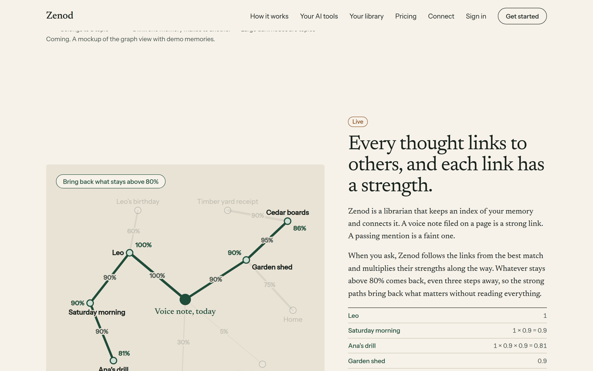
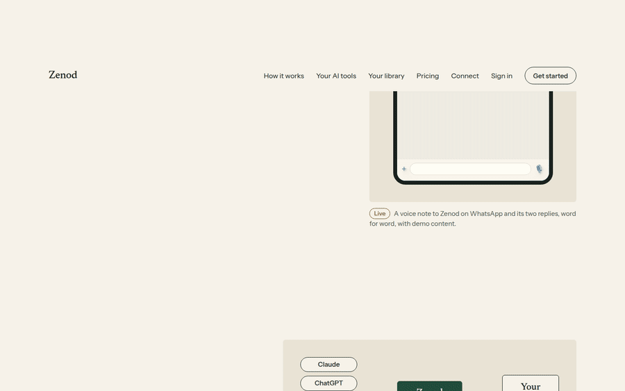
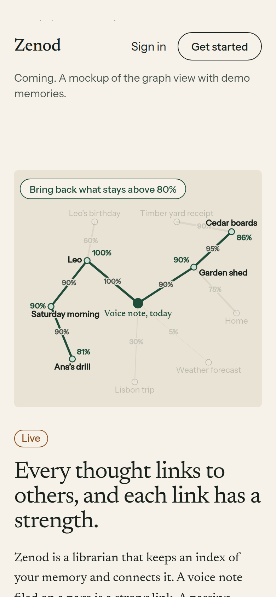
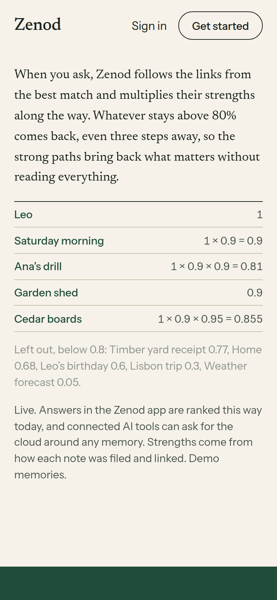

# E18-W2 evidence: zenod.dev explains the weighted memory graph as a constellation (2026-11-08)

Row: W2 in [EPIC-18](../weighted-memory-graph-strengths-path-ret.md) (Done means E18-3). Run `run_8db27ba9-d1a0-4a4a-b0b3-3f12d9ea6b5e`. Trigger: Jordi's voice note of 2026-11-08 16:09Z (Log/2026-11-08.md#^e-6d07aa): explain on the landing page, at a high level, that Zenod is a librarian that keeps an index of your memory and connects it; show one thought as a constellation of links of different weights, and a retrieval at about 80% that follows the path.

PR: [#1527](https://github.com/zenod-ai/zenod/pull/1527), merged as `d5ee98f`. **Live:** `https://cloud.zenod.dev/api/health` reports sha `d5ee98f05144` (checked 2026-11-08 19:25Z; publish run 42512568321: ci, publish, deploy all green). zenod.dev serves the same image: its bundle `/site/assets/main-CpZu9Q1l.js` carries the new section. Open it: [zenod.dev/#constellation](https://zenod.dev/#constellation).

## What is on the page

A new section after the graph section, marked **Live** (weighted links and path retrieval shipped in W1, `e7840bf`):

- **Heading:** "Every thought links to others, and each link has a strength."
- **Words:** Zenod is a librarian that keeps an index of your memory and connects it. A voice note filed on a page is a strong link, a passing mention a faint one. When you ask, Zenod follows the links from the best match and multiplies their strengths. Whatever stays above 80% comes back, even three steps away, so strong paths bring back what matters without reading everything.
- **The scene** (paper deck style, about 14 s loop): one voice note appears, ten links draw out with thickness equal to strength and labels from 100% to 5%; the pill "Bring back what stays above 80%" appears; the walk lights Leo (1), Saturday morning (1 × 0.9), Ana's drill (1 × 0.9 × 0.9 = 0.81, three steps), Garden shed (0.9) and Cedar boards (1 × 0.9 × 0.95 = 0.855); then the faint ones fade: Timber yard receipt 0.77, Home 0.68, Leo's birthday 0.6, Lisbon trip 0.3, Weather forecast 0.05. A ruled list beside it shows each sum as it lights.
- **Fine print:** answers in the Zenod app are ranked this way today, and connected AI tools can ask for the cloud around any memory (the `memory_cloud` tool). Demo memories.

The animation, recorded from live zenod.dev at 1440 × 900:

At 390 px (iPhone width): no horizontal scroll (`scrollWidth` 390), labels enlarged for the phone.

## Checks

- Live bundle contains "Every thought links to others" and "librarian that keeps an index" (curl, 19:26Z).
- Reduced motion (Chromium `reducedMotion: reduce` on live zenod.dev): final frame at once, 5 memories lit, 10 faint links and memories faded, nothing moves. `?still` and no script give the same frame.
- Horizontal scroll: none at 1440 or 390 px.
- Tests: `paper-landing.test.tsx` gains a W2 test (Live tag, librarian sentence, 80%, the 100%/60%/5% weights, the 0.855 sum, 5 lit paths, 10 faded items, an aria-label on the scene); site suite 37/37, tsc and eslint clean; CI green on the PR and on main.
- Change kept to the landing's content: one section component, one scene file, scene CSS, the test. No nav, favicon or app change (EPIC-17 D1 is restyling those).

## Not in this row

- The section "Ask, and see how strongly each memory answers" further down still says the strengths are Coming, though W1 made the app's percentages live. Updating that tag belongs to the strength section's own owner, so it is listed as a follow-up.
