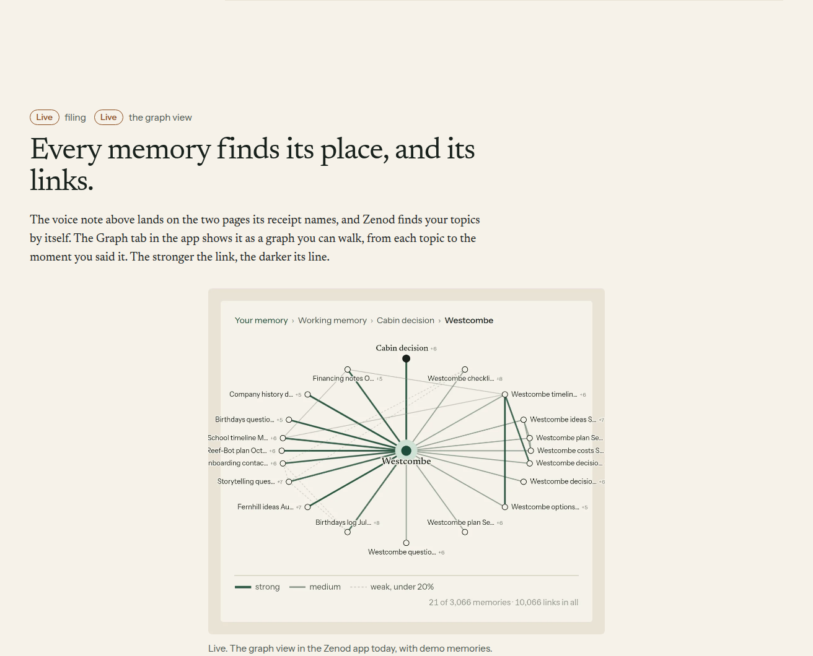
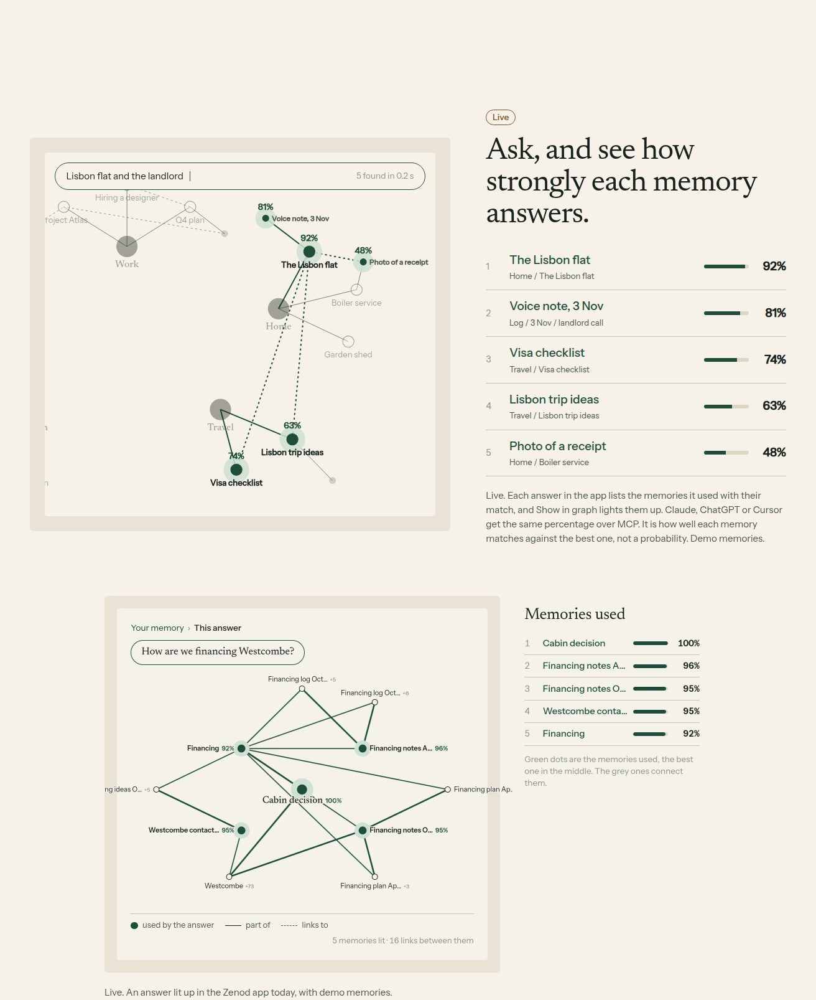
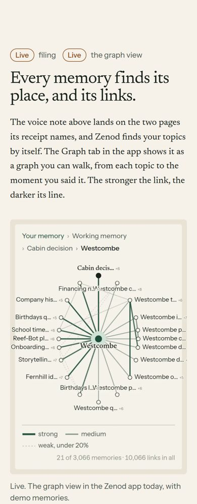
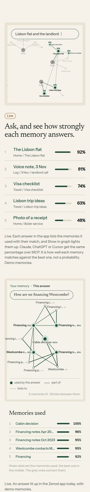

# E18-W4 evidence: zenod.dev marks the graph view and match strengths Live (2026-11-08)

**Bottom line:** two Coming tags on zenod.dev are now **Live**: *the graph view* (graph section) and *how strongly each memory answers* (strength section). Every tag on the page now says Live and none says Coming, because everything the page shows is in production. The graph mockup is gone: in its place is a **real screen** of the graph view with link strengths. Under the retrieval scene there is now a real screen of an answer lit up with its percentages. Both screens were taken from the shipped web app on the made-up demo vault. Open it: [zenod.dev/#graph](https://zenod.dev/#graph) and [zenod.dev/#strength](https://zenod.dev/#strength).

Row: W4 in [EPIC-18](../weighted-memory-graph-strengths-path-ret.md) (Jordi started it when he closed W2: "mark the strengths section live on the landing"). Run `run_60fbef92-8827-4d41-864c-2d1f0643cd9f`.

PR [#1536](https://github.com/zenod-ai/zenod/pull/1536), merged as `8ab7fe7`. **Live:** publish run 42522193845 (ci, publish, deploy all green) rolled `f1512c1`, which contains `8ab7fe7`. `https://cloud.zenod.dev/api/health` reports sha `f1512c1ff2c4` (checked 2026-11-08 21:15Z). The zenod.dev bundle `/site/assets/main-DWnS-x4L.js` carries the new captions, and the old "is coming" wording is gone from it.

## What changed, claim by claim

| On the page | Before | Now | Why it is true in production |
|---|---|---|---|
| Graph section tag | Live filing, **Coming** the graph view | Live filing, **Live** the graph view | Graph tab shipped in E12-S2 (`220dcc5`). Line strength (strong, medium, weak under 20 %) shipped in E18-W1 round 2 (`d85488b`). Both are ancestors of live `f1512c1` |
| Graph section picture | Animated mockup, "Coming. A mockup of the graph view" | Real graph view screen, "Live. The graph view in the Zenod app today, with demo memories." | Shot from the shipped web app (same code as live) on the demo vault: 3,066 memories, 10,066 links |
| Graph section words | "Soon the app shows it as a graph you can walk" | "The Graph tab in the app shows it as a graph you can walk … The stronger the link, the darker its line." | Same as above |
| Strength section tag | **Coming** | **Live** | Percentages appear in the app's chat answer list (E12-S3a/S3c) and the lit graph (E12-S13, `9ef8c0c`). MCP `search` returns `matchPercent` on every note hit (`packages/server/src/mcp.ts`) |
| Strength section fine print | "The strength of each match is coming, in the app and for Claude, ChatGPT or Cursor" | "Each answer in the app lists the memories it used with their match, and Show in graph lights them up. Claude, ChatGPT or Cursor get the same percentage over MCP." | Same as above. The "not a probability" sentence stays |
| Strength section picture | Animated scene only | Scene kept as the illustration, plus the real lit answer screen: "Live. An answer lit up in the Zenod app today, with demo memories." | Shot from the shipped web app: "How are we financing Westcombe?", five memories lit from 100 % down to 92 % |

The constellation section (W2) was already Live and is unchanged. The MCP section and the WhatsApp tag were already Live. Nothing that is not yet live is claimed. Phone and desktop layouts both check out.

## Live screenshots (zenod.dev, after deploy)

Strength section, 1440 px:

At 390 px (iPhone width) the page has no horizontal scroll (`scrollWidth` 390). The phone serves the phone-sized screens (`graph-live-phone`, `lit-phone`). In the strength section the real screen comes after the scene and the words:

## Checks

- Site tests: 37 of 37 pass. The landing test now asserts that no Coming tag is left, that the graph section has two Live tags and that both real screens carry alt text and phone sources. Site build ok, eslint clean. PR `ci` green.
- Live page (headless Chromium, 21:15Z): 6 tags, all "Live". Desktop serves `graph-live` (1272 px) and `lit` (1952 px). Phone serves `graph-live-phone` and `lit-phone` (716 px each). `scrollWidth` equals the viewport at 1440 and at 390.
- The unused graph mockup scene (`apps/site/src/scenes/graph.html`) was removed.

## Not done, and why

- The screens use the made-up demo vault, not a signed-in production account. No tester account has a vault yet (E7-A15), and the landing must show demo content anyway.

Harness: [real app screens](e18-w4/harness/shoot.mjs) (the E18-W1 local server over the demo vault, built from this branch, at 2x), [landing check](e18-w4/harness/land.mjs).
