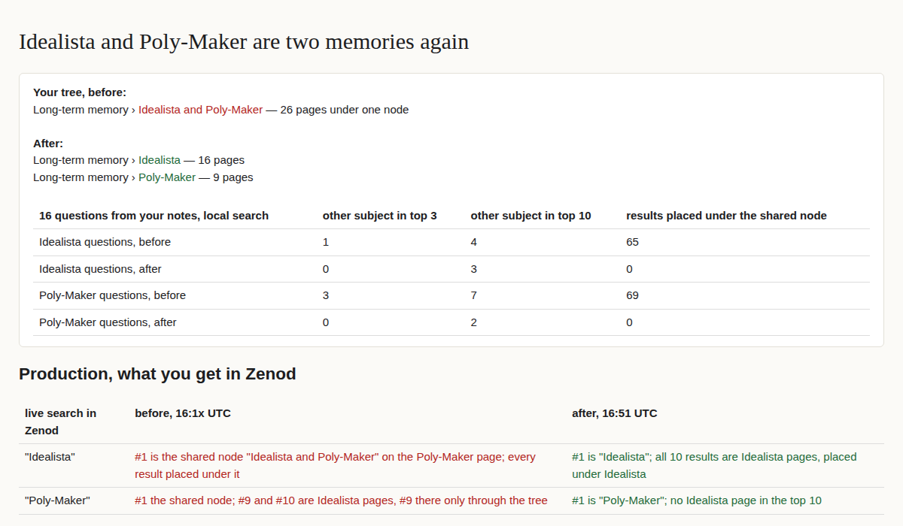

# E19-U1 evidence: Idealista and Poly-Maker untangled (2026-11-08)

Row: E19-U1 in [EPIC-19](../untangle-idealista-and-poly-maker-in-the.md), from Jordi's voice note `Log/2026-11-08.md#^e-6d07aa` (read in full). Run: run_383b13fc-f1bb-4852-a67f-8c7927016853. No code change: the code cause is already fixed by E12-S8 ([PR #1517](https://github.com/zenod-ai/zenod/pull/1517)), live as `dce775e` on `cloud.zenod.dev/api/health` (checked 2026-11-08 16:2xZ).

**Jordi's page (tailnet, private details stay there):** http://vps3.taild81fbb.ts.net:8922/ — the tree before and after, the counts, then each question's top 5 results before and after.

## Why they knotted

1. **2026-11-02, vault commit `68b81aa` (E9-2h re-derive).** Tree discovery ran with a cap of 6 long-term areas (`DEFAULT_MAX_AREAS`) and an area similarity floor of 0.04. The cap forced the cold Idealista and Poly-Maker topics into one long-term root, named "Idealista and Poly-Maker", that sat on the Poly-Maker page. The Idealista hub page got `parent:` the Poly-Maker page, so all 26 pages of both subjects were under one node. Before that commit they were two roots.
2. **2026-11-08 02:01, vault commit `3559a06` (weekly sweep, step "deepen").** `deepenRootCitations` copies a capture cited only by a root onto the best-matching page *under that root*. With the knot, the Idealista pages counted as under Poly-Maker's root. Six Poly-Maker captures were copied onto five Idealista pages. Reproduced exactly by running the same step on the vault as it was before that sweep.
3. **Effect on retrieval.** The shared root's summary names Idealista, so the Poly-Maker page ranked #1 for "Idealista" in production. Every result of either subject carried the place "Idealista and Poly-Maker". The search ranks by tree place as well as by words, so pages of one subject showed up for the other.

## Does it recur?

- **The merge: fixed and live.** E12-S8 removed the area cap and raised the area floor to 0.06. A dry run of the live discovery code on the vault before this change already derives two roots, Idealista (16 pages) and Poly-Maker (9 pages). After the change it derives the same two as continuing roots, with the same ids and no other change to them, so the next weekly sweep keeps them apart.
- **The deepen step only spreads an existing knot.** On the vault after this change, the sweep's deepen step moves no Poly-Maker capture onto an Idealista page: 0, against 6 on the pre-sweep vault. It never moves a capture across roots. No new code row is needed. Untangling knots in general is the memory desk in EPIC-14 (EPIC-19 Non-Goals).

## The vault change

One commit on Jordi's vault: [`32bb6ae`](https://github.com/AlfaBlok/obsidian-brain/commit/32bb6ae), a fast-forward push, never forced. 8 files changed, 6 lines added and 34 removed. Log/ and _attachments/ are untouched.

- Tree.md: the shared line becomes two long-term lines, "Idealista" (`^n-b2ec051f`, 16 pages) and "Poly-Maker" (`^n-5e87712b`, 9 pages). Both are word for word what the live discovery derives. One note about neither subject had been hung under the Idealista page; it gets its own long-term line (`^n-dad45ca3`), again as the live discovery derives it.
- `parent:` set back to `[[Tree]]` on the Idealista hub page and on that note (plus its `memory: long-term`).
- 6 stray Poly-Maker capture lines removed from 5 Idealista pages. Each capture is still cited on the Poly-Maker page and in the Log. Those 5 pages are now byte-identical to how they were before the 2026-11-08 sweep.
- Tree lint before and after: 118 pages, all rooted, 0 errors. Long-term roots went from 6 to 8.
- **Revert:** `git revert 32bb6ae` in the vault. The tag `pre-e19-u1-2026-11-08` (pushed) marks the state before, and a full bundle of the vault before the change is on VPS3 at `/var/lib/vps3-scratch/t3agent/e19u1/vault-pre-e19-u1.bundle`.

## Before and after retrieval

**Method.** 16 questions written from his notes: 8 on Idealista and 8 on Poly-Maker, from the titles and subjects of each side's pages. Each question ran through Zenod's own index search (`zenod index search`, the tier-0 index with tree places). The index was built fresh from a copy of the vault before and from a copy after. Each of the top 10 hits was classed by its path and tree place as Idealista, Poly-Maker, the shared node, or other.

| 16 questions, top 10 each | Before | After |
|---|---|---|
| Idealista questions: Poly-Maker results in top 3 | 1 | 0 |
| Idealista questions: Poly-Maker results in top 10 | 4 | 3 |
| Poly-Maker questions: Idealista results in top 3 | 3 | 0 |
| Poly-Maker questions: Idealista results in top 10 | 7 | 2 |
| Results placed under the shared node | 134 | 0 |
| Results about the asked subject (of 160) | 122 | 131 |

**Why some overlap is left.** The overlap left in the top 10 comes from shared words and shared machines, not the knot. "market" in a Poly-Maker question matches "marketing" on an Idealista page. One server page that hosts both projects' services is filed under Poly-Maker. Splitting that is content, out of this row's scope.

**Production, live, `cloud.zenod.dev` at `dce775e`.** Production pulled vault `32bb6ae` and rebuilt its index by itself; nothing was redeployed or restarted. Checked through `search_memory`, top 10:

| Live search | Before (16:1x UTC) | After (16:51 UTC) |
|---|---|---|
| "Idealista": rank 1 | the shared node "Idealista and Poly-Maker", on the Poly-Maker page | "Idealista" |
| "Idealista": Poly-Maker results in top 10 | 1, and all 10 placed under the shared node | 0, all 10 Idealista pages placed under Idealista |
| "Poly-Maker": rank 1 | the shared node | "Poly-Maker" |
| "Poly-Maker": Idealista results in top 10 | 2, rank 9 with score 0, present only through the tree | 0 |
