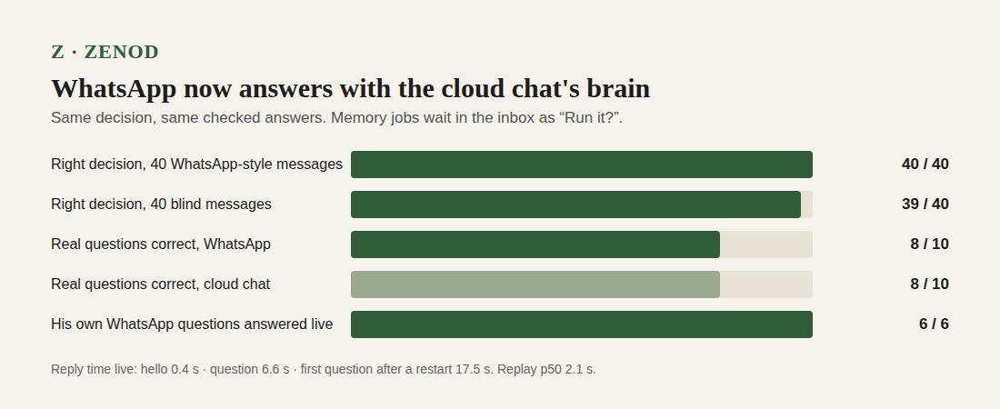

# E20-A1 evidence: WhatsApp answers with the cloud chat's brain (2026-11-08 to 11-09)

**Bottom line: better.** WhatsApp text now gets the cloud chat's decision and checked answers. The decision was right on **40 of 40** WhatsApp-style messages and **39 of 40** blind ones. On Jordi's real questions, WhatsApp graded **the same as the cloud chat (8 of 10 correct each)**. All **6 of 6** questions he sent over WhatsApp on 9 Nov were answered live. Live reply time: **0.4 s** for a hello, **6.6 s** for a question, **17.5 s** for the first question after a restart. Before this, WhatsApp text ran the old chat loop, and his last question on 8 Nov got "Memory filing is in progress".

Row: A1 in [EPIC-20](../whatsapp-first-class-again-same-brain-as.md). Run: run_b72ff779-04e1-4467-8292-655206a85cac. Mandate: Jordi's Team desk voice note vn_14cb0d46 (2026-11-08 18:52Z), recorded in the epic's Decisions (root L-6). The message-by-message review is on a private tailnet page: http://vps3.taild81fbb.ts.net:8921/e20-a1-private/

## What shipped

| PR | What | Live |
|---|---|---|
| [#1530](https://github.com/zenod-ai/zenod/pull/1530) | A filing whose base another writer moved is filed again, not stuck. This was cause 1 of the review: his memory refused every save from 16:14Z ([ZAL-A12](a12-2026-11-08.md)). | `7cf333f`, 2026-11-08 20:02:58Z; fired at 20:03:43Z, writes unblocked 20:15:21Z |
| [#1532](https://github.com/zenod-ai/zenod/pull/1532) | The WhatsApp brain: a typed WhatsApp message goes through the one Send decision (keep, answer, both, a memory job). Answers use the checked answer path, markdown stripped, at most two sources. A memory job is never run from WhatsApp: it waits in the inbox as "Run it?" and the reply says so. Greetings get a hello with no model call. Voice notes and receipts are unchanged. | merged `a8f529c`, live in `468ee50` (cloud.zenod.dev health, 2026-11-09) |
| [#1553](https://github.com/zenod-ai/zenod/pull/1553) | Sources read "Your voice note, 8 Nov", not a file name | see the row |

## The review, in short (E20-1)

Recent exchange, 8 Nov: 6 voice notes (15:37–16:09Z) and 1 question (18:50Z). Ranked causes:

1. Agent jobs wrote straight into his vault while a voice note was mid-filing (E19-U1, E12-S14, E12-S15). Its filing could never publish, and every save from 16:14Z failed. Fixed by #1530.
2. WhatsApp text ran the old `engine.chat` loop, not the cloud chat's decide-and-check path. During the jam it answered "Memory filing is in progress". Fixed by #1532.
3. Voice notes queue behind a slow filing on one serial lane: three short notes waited 11–13 min behind a long one. Not changed here (follow-up).

## Measured

**Decision** (replay through `channelTurn` on a copy of his memory with the hosted chat model, `e20-a1/replay.mjs`):

| Set | Right |
|---|---|
| 40 WhatsApp-style messages: 10 keep, 12 ask, 6 both, 8 memory jobs, 4 hellos (`packages/server/test/fixtures/whatsapp-40.json`) | 40 / 40 |
| 40 blind messages written by another agent (E16 `send-route-heldout-40.json`) | 39 / 40: one feeling statement also got a needless "Run it?" from the desk rule; it was still saved |

**Answers on his real questions** (10 of 45, from the private set; the bench relay's spending cap stopped the rest). Graded blind, WhatsApp and cloud chat answers shown as A and B:

| Version | WhatsApp | Cloud chat |
|---|---|---|
| first cut, 700 characters | 5 correct, 4 partly, 1 wrong | 9 correct, 1 wrong |
| shipped, whole checked answer up to 1,600 characters | 8 correct, 1 partly, 1 wrong | 8 correct, 1 partly, 1 wrong (same grade on all 10) |

The first cut lost points on every answer it shortened, so the whole checked answer goes.

**Live, on production** (`468ee50`):

| What | Result |
|---|---|
| His own WhatsApp questions, 9 Nov 03:15–03:18Z | 6 of 6 answered by the new path: 5 from his memory with sources, 1 "no note answers this directly" with the nearest two ([ZAL-A15](zal-a15-2026-11-09.md)) |
| `chat_with_zenod`, surface `whatsapp`, "hi" | hello, 0.4 s |
| same, a question about a note from 8 Nov | right answer and source, 17.5 s (first question after a production roll) |
| same, a second question | right answer, 2 sources, 6.6 s |
| replay timing (no WhatsApp transport) | p50 2.1 s, p95 4.6 s |

## Not proven live

- **Keep from WhatsApp text:** proven by replay (10/10 plus 6 mixed) and unit tests. No live test, because it would write a test note into his memory.
- **"Run it?" from WhatsApp:** proven by replay (8/8) and unit tests. No live test, because it would put a test item in his inbox.
- **Voice notes:** unchanged by this row. Since 9 Nov 03:19Z they cannot be transcribed because the OpenRouter account is out of credit ([ZAL-A15](zal-a15-2026-11-09.md), E15).

## Mishap

The replay copied a symlinked vault checkout as the link itself, and then removed the copy's `.git`, which was the checkout's own (`~/github/obsidian-brain` on VPS3). The checkout was rebuilt from GitHub: same files, level with `origin/main`. Nothing was pushed and his GitHub vault was untouched. The script now copies the files and never the `.git` (commit in #1532).
