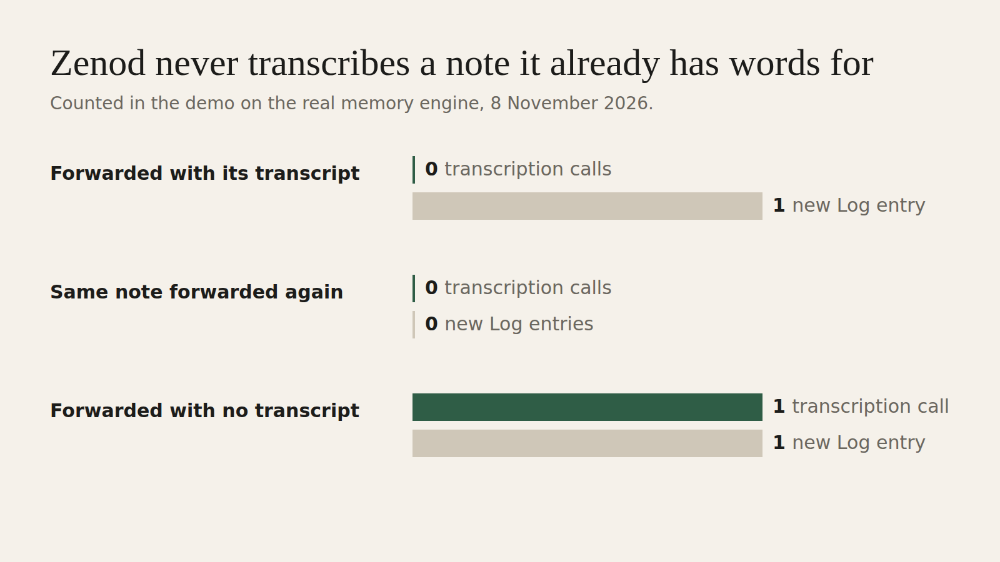
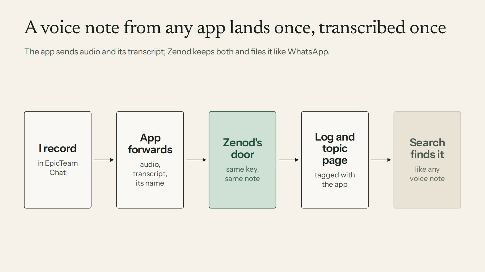
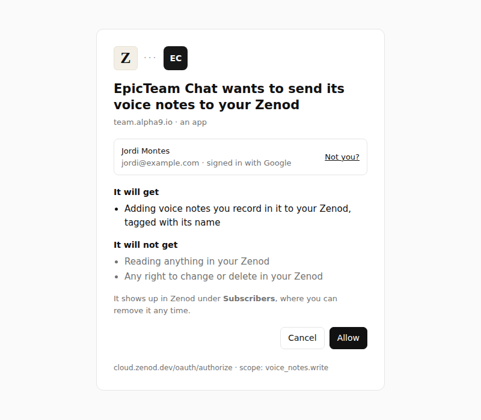

# E21-V1 evidence: one door for voice notes from other apps (2026-11-08)

**Bottom line: better.** Another app can now forward a voice note to Zenod with its transcript. Zenod used that transcript as is and made **0 transcription calls**. A note sent without a transcript took **exactly 1**. Forwarding the same note again added **0** Log entries. Each note was filed to its topic page and search found it. On the cloud chat question, "are we transcribing twice?": **no**. The cloud chat's voice button sends only the audio, and Zenod transcribes it once.

**Evidence page (tailnet, no password):** http://vps3.taild81fbb.ts.net:8921/e21-v1/

Row V1 in [EPIC-21](../one-home-for-all-your-voice-notes-other.md), which also carries EPIC-14 S1 round 2 ([spine](../plan-personas-inbox-voice-and-calls-come.md)). Run: run_7966dd8b-8633-4403-af3c-43ca19284c7e. PR [#1534](https://github.com/zenod-ai/zenod/pull/1534), merged as `5e0b7dd`, live on cloud.zenod.dev.



| Counted in the demo | Transcription calls | New Log entries | Filed to | Search "Porthaven antifouling" |
|---|---|---|---|---|
| Forwarded with its transcript (gpt-4o-mini-transcribe) | 0 | 1 | Projects/Boat repair.md | Log entry and Boat repair page, top two |
| Same note forwarded again, same key | 0 | 0 (same job returned, `duplicate: true`) | none | still one hit |
| Forwarded with no transcript | 1 | 1 | Projects/Boat repair.md | none |



## Is the cloud chat button transcribing twice? No

Checked on the shipped code (`ded82b7`) and on the live bundle at cloud.zenod.dev (`/assets/index-BfTcKTcI.js`, 8 Nov 20:00Z):

- The voice button in the cloud chat records in the browser and posts **only the audio** to `/api/console/voice-note`. The bundle has no browser speech recognition (`SpeechRecognition`: 0 matches) and no call to Epic Team (`team.alpha9.io`: 0 matches).
- Zenod's media seam transcribes that audio **once**, as for a WhatsApp voice note. The S1 run counted one transcription per note.
- The bundle also calls `/api/chat/voice/transcribe`, but that belongs to the older dictation box in Settings (vaultless chat), not to the voice note button.
- The cloud chat has no transcript before Zenod makes one, so there was nothing to send. What changed is the door below. An app that already has words, like EpicTeam Chat with its gpt-4o-mini-transcribe text, now sends them, and Zenod does not transcribe again.

## What was built

- **A door for any app.** It is an MCP server at `POST https://cloud.zenod.dev/api/subscribers/v1/mcp` with two tools. `ingest_voice_note` takes the audio (base64 or a public HTTPS link), an optional transcript with the model that made it, the app's name, the time it was recorded, its length and an idempotency key. `get_voice_note_ingest` returns the receipt.
- **Its own key per app.** An app gets a token through Zenod's existing "Sign in with Zenod" with the new scope `voice_notes.write`. The person sees the consent screen below. The token can add voice notes and nothing else: it cannot read the memory, cannot call `/mcp`, and stops at once when the person removes the app. Forwarding apps show in Subscribers as "Apps that forward voice notes", each with a Remove button.
- **Filed like WhatsApp.** The note goes into the same media seam. The raw audio is archived with its sha256, and the transcript is used word for word. The Log entry carries `Source app: EpicTeam Chat` and `Transcribed by gpt-4o-mini-transcribe (transcribed by EpicTeam Chat)`, followed by filing into topic pages. Recent saves in the app label it "EpicTeam Chat voice". The entry's content type is `voice_note`, so search, `ask_brain` and the voice-note list find it.
- **Once per note.** Keys are scoped per app, so two apps can never collide. A note an app forwarded is not announced back to that app's own voice-note subscription, which avoids a loop where Epic Team hears its own note again.
- **Safe input.** A link must be public HTTPS and redirects are refused. The largest audio is 16 MB. The AI allowance is checked before anything is kept. It accepts webm, ogg/opus, mp4/m4a, aac, mp3 and wav.
- **Contract for any provider:** [voice-note-forwarding.md](../voice-note-forwarding.md), covering the token, both tools, every field and error, what lands in the memory, and a curl example.
- WhatsApp is unchanged, and the chat path is unchanged (root L-6). Zenod builds nothing of agent_team's side (root L-7): the seam is MCP.



## The demo

Setup: `packages/server/test/voiceNoteForward.test.ts`, test "demo on the real memory engine". It used Zenod's real HTTP routes on a local port: Sign in with Zenod (consent, code, token), the MCP door called with the official MCP client, a real task queue and raw archive, and the real memory engine writing to a throwaway git vault (the made-up test vault). The filing model and the transcriber were recorded stand-ins, so the demo spent nothing (the shared OpenRouter account is nearly empty, E15-A3). Every call to them was counted. The note's words are invented: "Note for the boat repair. The yard in Porthaven quoted 940 euros for new antifouling. Ask Marta to compare it with the Westbay quote before Friday."

The Log entry it wrote:

```
## 19:59 Voice note "epicteam-chat-voice-note-2026-11-08T18-53-00Z...  ^e-383aa0
- source: mcp
- content-type: voice_note
- captured-at: 2026-11-08T18:53:00Z
> Voice note "epicteam-chat-voice-note-2026-11-08T18-53-00Z.ogg" ingested through Zenod media seam.
> Raw artifact sha256: a9a2bb8d…
> Source: EpicTeam Chat voice note
> Source app: EpicTeam Chat
> Source timestamp: 2026-11-08T18:53:00Z
> Transcribed by gpt-4o-mini-transcribe (transcribed by EpicTeam Chat).
>
> Note for the boat repair. The yard in Porthaven quoted 940 euros for new antifouling. Ask Marta to compare it with the Westbay quote before Friday.
- filed: [[Projects/Boat repair]]
```

The receipt the app got back: `status: done, transcript: supplied, transcribedBy: "gpt-4o-mini-transcribe (transcribed by EpicTeam Chat)", evidenceRef: Log/2026-11-08.md#^e-383aa0, pagesTouched: [Projects/Boat repair.md, …]`. The repeat forward returned the same `jobId` with `duplicate: true`.

## Tests

- `voiceNoteForward.test.ts` has 11 tests. They cover the scopes Zenod offers and refuses, and the consent words. A write token cannot read notes, and a reader token cannot forward. Removing an app stops its token. Only the two tools are listed. A bare JSON-RPC `tools/call` works with no SDK (the curl example). A note with a transcript makes 0 transcription calls and keeps the app tag, and the same key gives the same job. A note without a transcript makes 1 call. Links: public HTTPS is fetched, while private and plain-http links are refused. Bad input and the AI allowance are checked. Two apps stay apart. There is no echo to the sending app while other subscribers are told. The last test is the real-engine demo.
- Full server suite 1539/1539 plus the new tests. Web 178/178, including the new "Apps that forward voice notes" card. `npm run build`, `build:phylax` and `schemas:check` are green.

## Live

- publish.yml on `5e0b7dda` ran `ci` (success), publish and deploy. `https://cloud.zenod.dev/api/health` reports `"status":"ok"` and `"sha":"5e0b7dda4c655e4e060f850555742ccc2d6325b6"` (8 Nov, about 20:45Z).
- The door is live and closed to anyone without a forwarding token. `POST /api/subscribers/v1/mcp` with no token gives 401 `invalid_token` ("Send the zvn_ token from Sign in with Zenod."). A made-up token gives 401 ("This connection was removed or is not valid."). `GET` gives 405 (POST JSON-RPC only).
- `/oauth/authorize?scope=voice_notes.write` is handled by Sign in with Zenod: an unknown app gets its error page, and a registered app gets the consent screen above.
- The production capture-stall fix (A12, `7cf333f`) was live before this roll, as the brief required.

## Not proven yet

- **A real note from EpicTeam Chat.** That is V2: agent_team builds the forwarding on its side. The spec they need is below, and the Delivery Manager sends it.
- **A real paid transcription in this run.** The no-transcript path is the same transcriber a WhatsApp voice note uses, proven many times. Here it was a counted stand-in.

## Proposed for agent_team (V2): EpicTeam Chat forwards its voice notes

A short spec for the agent_team side. Zenod is ready; nothing in Zenod changes for it.

1. **Connect once.** On the Connections page, the existing "Connect Zenod" asks for `voice_notes.read voice_notes.subscribe voice_notes.write` in one Sign in with Zenod. Epic Team already does the subscriber pair, so this adds one scope word. Store the `zvn_` token as today.
2. **After each voice note is transcribed** (today: gpt-4o-mini-transcribe, `vn_…` ids), call `ingest_voice_note` on `https://cloud.zenod.dev/api/subscribers/v1/mcp` with `sourceApp: "EpicTeam Chat"`, `idempotencyKey: <vn id>`, the audio (`audioBase64` + `mimeType`, or a short-lived signed `audioUrl`), `transcript`, `transcriptModel`, `recordedAt` and `durationSeconds`. If the note was recorded in two-minute parts, join them into one file first: Zenod takes one recording per note. The limit is 16 MB of audio, over an hour at 32 kbit/s.
3. **Retry** on network errors, 429 or `capture_unavailable` with the same key: it can never file twice. Stop on 401, because the person removed the app.
4. **No loop:** Zenod does not announce these notes back to Epic Team's own subscription, so the desk will not see Jordi's chat note a second time.
5. **Prove it:** one real voice note from Jordi in EpicTeam Chat lands once in his Zenod. Its Log entry says `Source app: EpicTeam Chat` and the receipt says `transcript: supplied` (E21-2).
