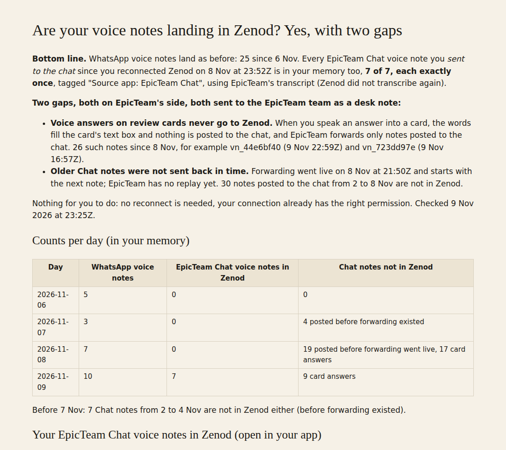

# E21-V2 evidence: EpicTeam Chat voice notes land in Jordi's Zenod (2026-11-09)

**Bottom line: yes, with two gaps on the EpicTeam side.** Every EpicTeam Chat voice note Jordi posted to the chat since he reconnected Zenod (2026-11-08 23:52Z) is in his Zenod memory, 7 of 7, each exactly once, with `Source app: EpicTeam Chat` and the supplied transcript (no second transcription). WhatsApp voice notes land as before (25 from 6 to 9 Nov). Per-note list with links into his app: private tailnet page http://vps3.taild81fbb.ts.net:8921/e21-v2/ (not in this public repo).

Row V2 (with V3) in [EPIC-21](../one-home-for-all-your-voice-notes-other.md). Run: run_22db4b08-7edb-43ea-a9f8-4be865ee859c. Read only; no code changed, nothing filed into his memory.

| Day (UTC) | WhatsApp voice notes in Zenod | Chat notes in Zenod | Chat notes not in Zenod |
|---|---|---|---|
| 2026-11-06 | 5 | 0 | 0 |
| 2026-11-07 | 3 | 0 | 4 posted before forwarding existed |
| 2026-11-08 | 7 | 0 | 19 posted before forwarding went live, 17 card answers |
| 2026-11-09 | 10 | 7 | 9 card answers |

Plus 7 Chat notes from 2 to 4 Nov, before forwarding existed. Total not in Zenod: 30 posted to the chat before forwarding, 26 card answers.

## How it was checked

- **Zenod (his memory, read only, through the team's Zenod connection):** `search_memory` for `contentType: voice_note` since 2026-11-06 returned 32 entries: 25 `whatsapp`, 7 `mcp` titled `epicteam-chat-voice-note-<recorded time>`. Each Chat entry's capture time matches one forwarded note's start time; none repeats. One opened in full (`get_memory`) carries `Source: EpicTeam Chat voice note`, `Source app: EpicTeam Chat`, `Transcribed by gpt-4o-mini-transcribe (transcribed by EpicTeam Chat)`.
- **agent_team (production console.db on VPS1, opened read only, no token column read):** `zenod_voice_forwards` holds 7 rows, all `sent`, `transcript_mode: supplied`, `duplicate: 0`, no error; 6 sent on the first try, 1 on the second. The connection has `voice_notes.write` since the reconnect, so no reconnect is needed.
- **The brief's examples:** vn_bd75972d (posted 23:18Z, 14 min 49 s) landed once. vn_44e6bf40 and vn_723dd97e did not: both are voice answers spoken into a card.

## The two gaps (agent_team side, desk note sent)

1. **Card voice answers are never forwarded.** In agent_team `console/server/src/voice/notes.ts`, `finish()` with `fill: true` sets state `transcribed` and returns before `onPosted`, so the note never enters the forward outbox. This is by design in E42-S39 ("card answers are not posted, so not forwarded") but falls inside this epic's goal.
2. **No replay.** Forwarding starts with notes posted after it went live (2026-11-08 21:50Z); the outbox has no HTTP replay, so the back-fill could not be run from here. Zenod's door is idempotent per app by key, so a back-fill keyed on the vn id is safe to run.

Desk note to agent_team: `desk/inbox/2026-11-09-zenod-e42-s39-chat-voice-notes-to-zenod-two-ga.md` (commit 45c3b1f7 in agent_team), proposing both fixes with the exact cause. Follow-up row V4 verifies the back-fill lands once each.

## Zenod side

No fault found and no change needed. One small observation for later: forwarded entries carry no `sourceId`, so search cannot look a note up by the forwarding app's id; matching by capture time works.
