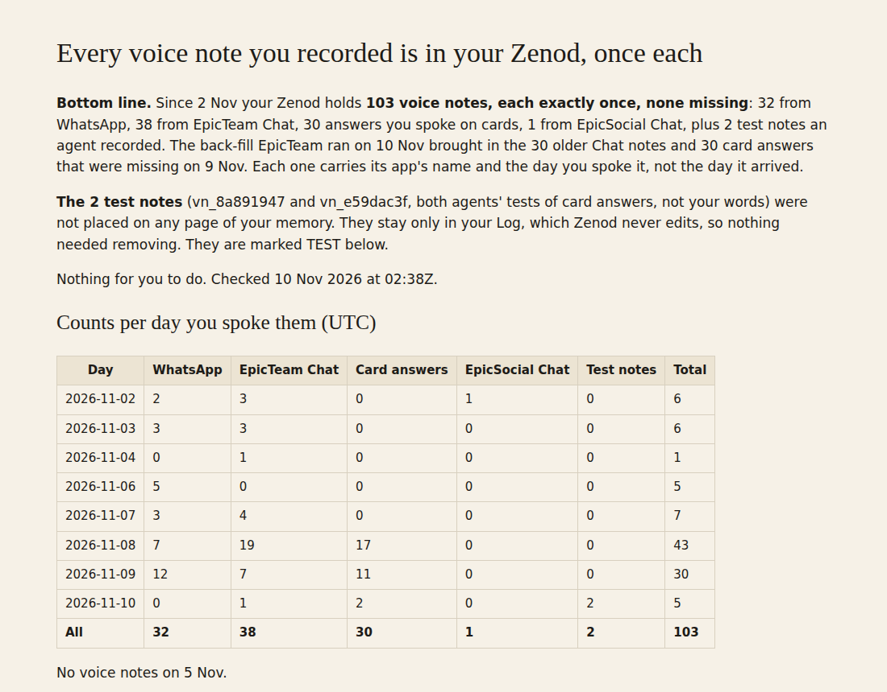

# E21-V4 evidence: the back-fill landed, every voice note in Jordi's Zenod once (2026-11-10)

**Bottom line: all 70 notes agent_team sent landed once each, none missing, none doubled.** With the one Chat note forwarded since (02:30Z), 71 forwarded notes are in his memory, each exactly once, with the right `Source app:` line and his own recorded time. Together with WhatsApp, his Zenod holds 103 voice notes since 2026-11-02 and nothing else. Per-note list with links into his app: private tailnet page http://vps3.taild81fbb.ts.net:8921/e21-v2/ (updated in place, not in this public repo).

Row V4 (with V5) in [EPIC-21](../one-home-for-all-your-voice-notes-other.md). Run: run_3f9aba7d-ae07-4e96-b7ce-be16ff726677. Read only; no code changed, nothing written to his memory. Answers agent_team's desk note `desk/inbox/2026-11-10-alpha9-e42-s42-voice-notes-backfill-done.md` (E42-S42, console 6549192).

| Day spoken (UTC) | WhatsApp | EpicTeam Chat | Card answers | EpicSocial Chat | Test notes | Total |
|---|---|---|---|---|---|---|
| 2026-11-02 | 2 | 3 | 0 | 1 | 0 | 6 |
| 2026-11-03 | 3 | 3 | 0 | 0 | 0 | 6 |
| 2026-11-04 | 0 | 1 | 0 | 0 | 0 | 1 |
| 2026-11-06 | 5 | 0 | 0 | 0 | 0 | 5 |
| 2026-11-07 | 3 | 4 | 0 | 0 | 0 | 7 |
| 2026-11-08 | 7 | 19 | 17 | 0 | 0 | 43 |
| 2026-11-09 | 12 | 7 | 11 | 0 | 0 | 30 |
| 2026-11-10 | 0 | 1 | 2 | 0 | 2 | 5 |
| **All** | **32** | **38** | **30** | **1** | **2** | **103** |

## How it was checked (2026-11-10 02:20–02:40Z)

- **agent_team outbox (production console.db on VPS1, opened `mode=ro`, no token column read):** `zenod_voice_forwards` holds 71 rows, all `sent`, 71 distinct note ids and job ids, `duplicate: 0`, `transcript_mode: supplied`. 70 are the desk note's (7 forwarded before, 30 Chat and 30 card back-filled at 00:50:28Z, 1 EpicSocial at 00:50:29Z, 2 test card answers); 1 Chat note since (02:30Z). Notes since 2026-11-02 not in the outbox: 31 discarded, 1 empty, 2 abandoned 0-second recordings; nothing real.
- **Zenod (his memory, read only, through the team's Zenod connection):** `search_memory` `contentType: voice_note, source: mcp` since 2026-11-01 returns 71 entries; each outbox note matches exactly one by `capturedAt` = the note's `started_at`; no entry is left over. Title prefixes match the kind: 38 `epicteam-chat-voice-note`, 32 `epicteam-card-answer-voice-note`, 1 `epicsocial-chat-voice-note`. `source: whatsapp` returns 32, each with its own WhatsApp id.
- **His vault (read from its repo):** for all 71 entries the `Source app:` line is the expected one (`EpicTeam Chat`, `EpicTeam card answer`, `EpicSocial Chat`), `Source timestamp:` and `captured-at:` equal the note's own start time, and the transcript is EpicTeam's (no second transcription). All voice-note entries in the Log files 2026-11-02..10: 103 = 32 WhatsApp + these 71. The back-filled ones sit in `Log/2026-11-10.md` (the day they arrived), dated by their own capture time.

## The test notes

Two card answers in the outbox were agents' tests, not Jordi's words: vn_8a891947 (card TEST-A42, the one the desk note names) and vn_e59dac3f (card TEST-A1, E42-S44's test, which the desk note calls a live card answer). Both landed once as Log evidence. Neither was placed on any vault page: vn_e59dac3f has a filing receipt with disposition `evidence_only`, pages none; vn_8a891947 has none and no page cites it. The Log is immutable, so no vault commit was needed or made; both are marked TEST on the private page.

## Zenod side

No fault, no change needed. As in V2: forwarded entries carry no `sourceId` that names the vn id, so matching is by capture time, which is exact.
