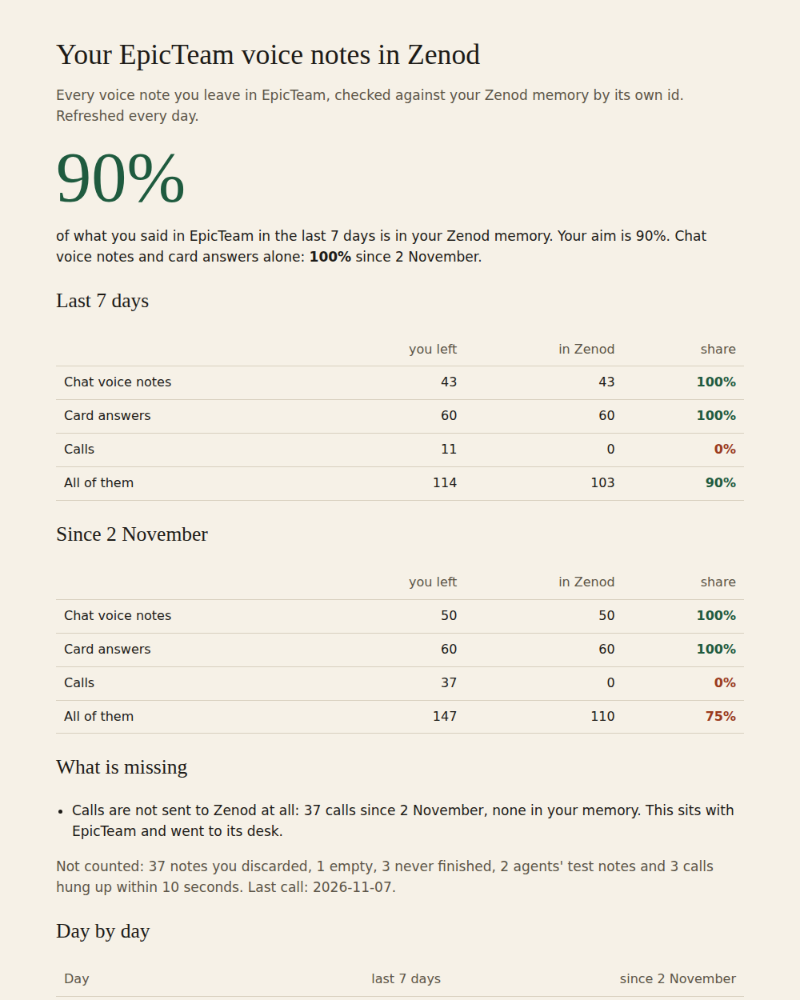

# E21-V6 evidence: 90% of Jordi's EpicTeam voice notes in the last 7 days reached Zenod; calls are the only gap (2026-11-10)

**The share that landed: 90% in the last 7 days (103 of 114) and 75% since 2 November (110 of 147).** Every Chat voice note and every card answer is in his Zenod memory exactly once: 110 of 110. No call has ever reached Zenod: 0 of 37 since 2 November, and 0 of 11 in the last 7 days. That is the whole gap, and it is on the EpicTeam side.

The live count, refreshed every day at about 06:20 UTC: http://vps3.taild81fbb.ts.net:8921/v6-voice-note-count/ (tailnet, counts only).

Row V6 in [EPIC-21](../one-home-for-all-your-voice-notes-other.md). Run: run_2aeaac10-229e-4f2c-a93f-79ae3a30f907. Source: Jordi's voice note 2026-11-10 23:08Z (his Zenod `Log/2026-11-10.md#^e-449504`): "I want to double check that it is true that all the voice notes that I'm leaving in Epic Team are making their way into Zenod memory … Zenod will have a pretty damn good feel for what's going on in Epic Team. If he gets like 90% of the voice notes."

| Channel | Last 7 days: left / in Zenod | Since 2 Nov: left / in Zenod | Share since 2 Nov |
|---|---|---|---|
| Chat voice notes (EpicTeam and EpicSocial Chat) | 43 / 43 | 50 / 50 | 100% |
| Card answers | 60 / 60 | 60 / 60 | 100% |
| Calls (10 seconds or longer) | 11 / 0 | 37 / 0 | 0% |
| **All** | **114 / 103 (90%)** | **147 / 110** | **75%** |

Counted 2026-11-10T23:46Z. Not counted: 37 notes he discarded himself, 1 empty, 3 still recording or transcribing at count time, 2 agents' test card answers, and 3 calls hung up within 10 seconds. His last call was on 2026-11-07.

## How it was counted (read only)

- **EpicTeam side:** the production console database on VPS1, opened `mode=ro` on VPS1 itself, so no transcript leaves it: per voice note its id, state and start time, its forward state, and per call its length. The 107 notes counted at 23:29Z were all marked `sent`, with no forward waiting or failed.
- **Zenod side:** the forwarded entries in his vault's Log. Each carries a `source-id` whose last part is `sha256(note id)[:32]`, so every note matches its own entry by id, never by time. At 23:29Z there were 109 forwarded entries (including the two test notes) and 109 notes marked sent: each matched exactly once, with no extras and no doubles. A `search_memory` call through the team's Zenod connection (`source: mcp`, `contentType: voice_note`) found the same 109.
- **Calls:** EpicTeam's forward outbox only takes voice-note ids, so calls are never queued. Their transcripts go to the desk chat, and a search of his memory finds no call transcript.

## Gaps and who owns them

- **Calls are not forwarded (EpicTeam's side, root L-7).** Sent to agent_team as a desk note with the counts and the exact gap: `desk/inbox/2026-11-10-zenod-zenod-v6-calls-not-forwarded.md` (agent_team 66fe92bef). Once calls are forwarded with the call id as the key, the daily count matches them on its own. agent_team took this as E42-S47: forward each call's transcript once and back-fill the 37. The Delivery Manager decided calls go through `store_memory`, with the call id as `sourceId` and idempotency key. Nothing has to be built on Zenod's side, and the count matches them by call id (#1613). Zenod's earlier answer pointing at `ingest_voice_note` (agent_team e9a5aef8f) was replaced by desk note 11ce19d07. Until then calls show 0 of 37.
- **No Zenod-side fault:** no empty transcripts, no failed jobs, no missing or doubled entries. Nothing in Zenod was changed and nothing was written to his memory.

## What was built

`scripts/voice-note-count/count.py` (PR #1610, merged ce6ef831, live in production d62d69e6 since 2026-11-11T00:27:51Z) with its test, run daily by the VPS3 user timer `zenod-voice-note-count.timer`. Like the helper tally, it runs the script from `origin/main`. It writes only the tailnet page and a one-line-per-day history in `~/zenod-eval/v6/history.jsonl`.
