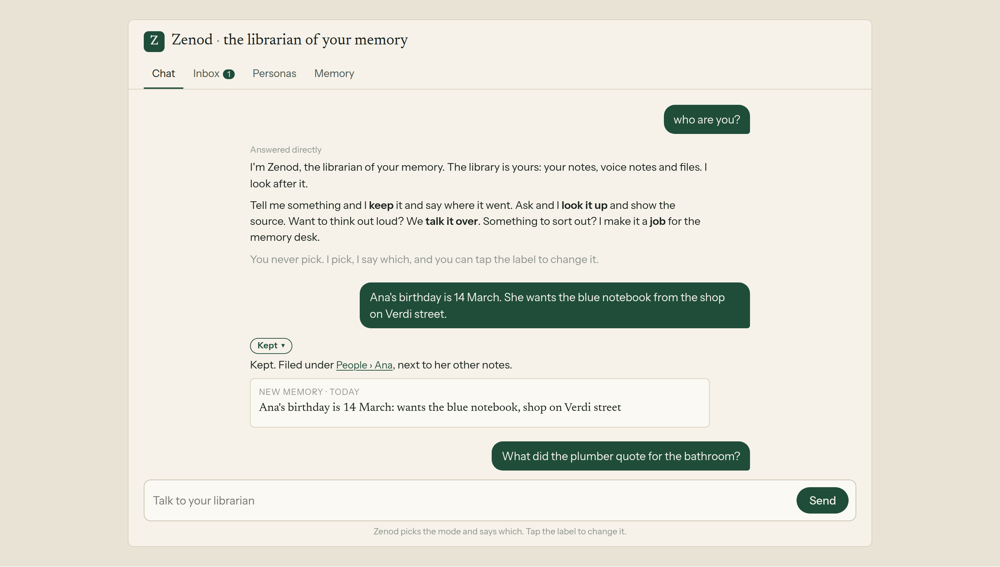
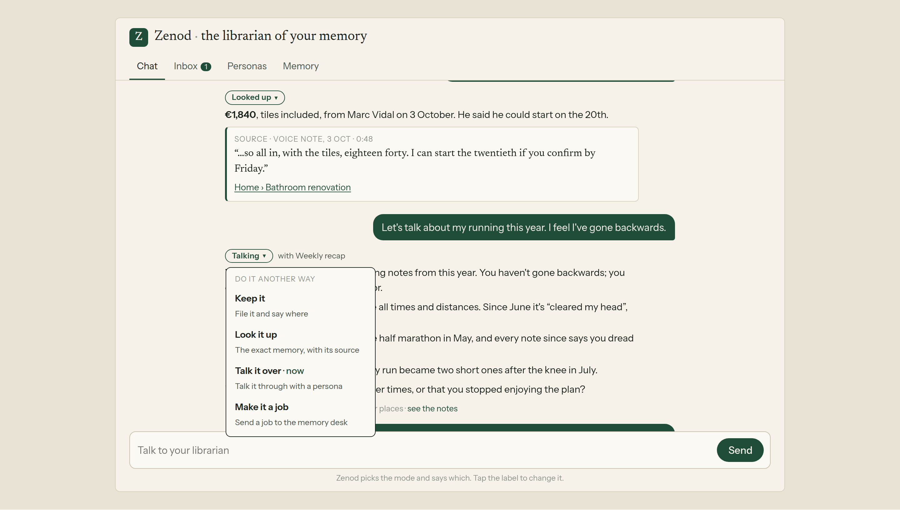
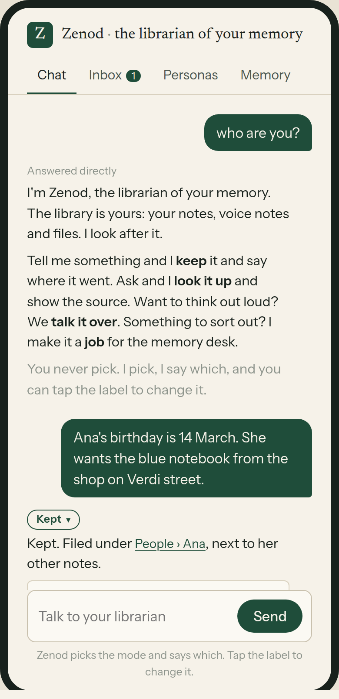
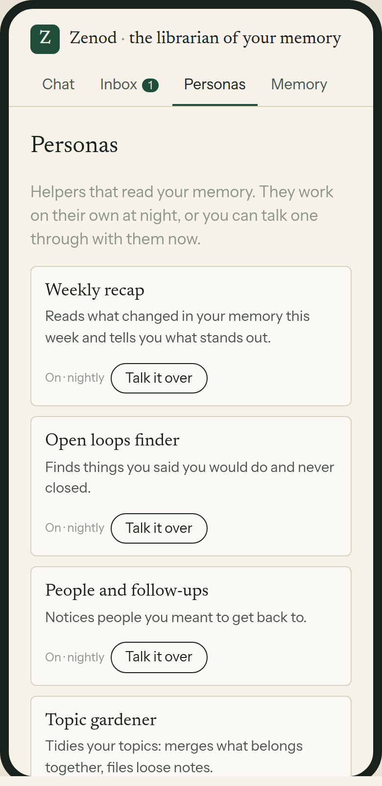
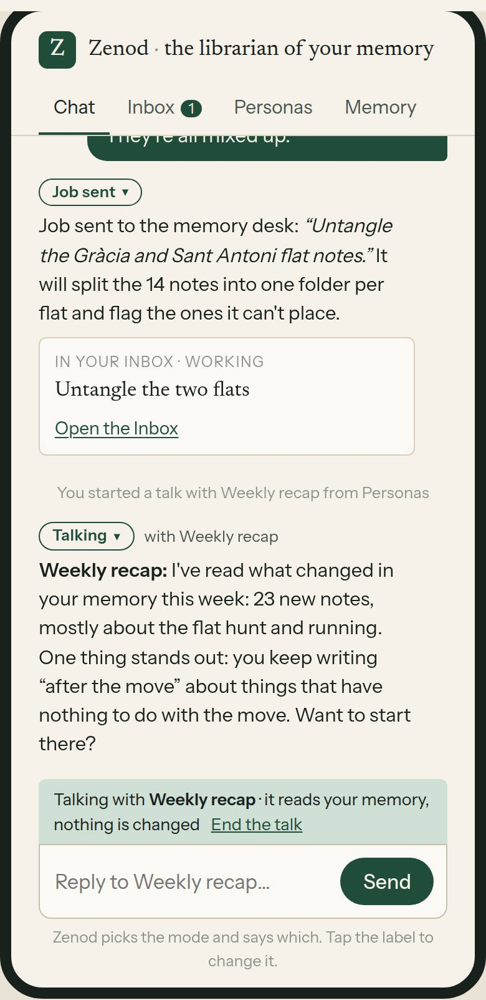

# E22-L1: mockup of Zenod as the librarian of your memory (2026-11-09)

Live, no password, from the tailnet: http://vps3.taild81fbb.ts.net:8921/e22-l1/
Source: [mockup/](e22-l1-2026-11-09/mockup/) (static HTML, served by `zenod-evidence-pages.service` from `~/zenod-evidence-pages/e22-l1/`). Every memory in it is invented.

What it shows: the header reads "Zenod · the librarian of your memory". The box says "Talk to your librarian". "who are you?" gets a direct answer. There is one exchange for each mode, labelled Kept, Looked up, Talking and Job sent. Tapping a label opens "Do it another way" and redoes the same message in the mode you pick. A talk shows a "Talking with …" bar and the box becomes a reply to the persona. Personas and the Inbox notes each have "Talk it over". The Inbox shows the job. There is a desktop and phone toggle, and the page also works at 390 px.

## What exists for each mode today (read 2026-11-09 on main 875a7820)

| Mode | Today | New in L2 |
|---|---|---|
| Keep | Send decision `keep` (`packages/core/src/llm/sendRoute.ts`, `packages/server/src/customerLayer.ts:1597`): saves and shows a receipt with the place (`KeepLine` in `apps/web/src/components/memory-chat.tsx`) | the label, the folder named first |
| Look up | Send decision `answer`: `streamAnswerFromMemory` (`packages/server/src/memoryChat.ts:97`) with cited memories, citations checked | the label, the source card first |
| Talk it over | nothing: personas only run on a schedule and post to the Inbox (`personaRunner.ts`, `personaCatalog.ts`), plus feedback replies on Inbox cards (`inboxRoutes.ts:110`) | a read-only, multi-turn talk with an existing persona, from the box, Personas or an Inbox card; new Send action `talk`. Shape copied from agent_team `console/server/src/desk/session.ts` (one long-lived thread per key, run by a persona). It is a copy, not a link: root L-7 keeps Zenod free of agent_team machinery |
| Job on the memory | Send decision `job` goes to `startDeskJob` (`packages/server/src/memoryDesk.ts:76`), and the result goes to the Inbox. "Ask the desk" (`memory-chat.tsx:674`) skips the decision | the label. "Ask the desk" is removed and "Make it a job" in the label menu replaces it |
| All | header "Your hosted workspace" (`apps/web/src/views/Settings.tsx:272`) | new title and box text, a label chip with a switch menu (it re-sends with a forced mode), and "who are you?" answered directly |

Also worth reusing from agent_team: `console/web/src/lib/chatMarkdown.tsx` (a safe Markdown renderer for persona replies). The patterns are copied in, never imported across the seam.

Rough size: about a week, and Talk it over is half of it. Scope stays the web app: WhatsApp replies are unchanged unless Jordi asks (root L-6). The channel shares the decision since E20-A1, so L2 must keep the channel's replies as they are.

## Screens

Whole page: [desktop](e22-l1-2026-11-09/page-desktop-full.png), [phone 390 px](e22-l1-2026-11-09/page-phone-390.png).
