# E22-L2: mockup round 2 of Zenod as the librarian of your memory (2026-11-09)

Live, no password, from the tailnet: http://vps3.taild81fbb.ts.net:8921/e22-l2/
Source: [mockup/](e22-l2-2026-11-09/mockup/) (static HTML, served by `zenod-evidence-pages.service` from `~/zenod-evidence-pages/e22-l2/`). Every memory in it is invented. Round 1: http://vps3.taild81fbb.ts.net:8921/e22-l1/ ([evidence](e22-l1-2026-11-09.md)).

Round 2 answers Jordi's feedback on E22-A1 (voice note vn_723dd97e): the name leads and the tagline is quieter, there are fewer tabs and no feature is lost, and Memory has its charts, graph and settings.

## What changed since round 1 (the page's first screen)

1. **Zenod** leads the header (serif, 1.6 rem, ink). "the librarian of your memory" sits under it in small sans, faint colour.
2. Five tabs where today's hosted app has twelve: Chat, Inbox, Personas, Memory, Settings (gear, at the right). Every feature of today's app still has a home, and a map on the page shows where each one went.
3. Memory has sub-views: At a glance (totals, memories each week, strongest places, where they come from, recent saves), Tree (with a note viewer), Graph (link strength, find a memory, an answer lit up) and Check filings (the S27 list, with moves and undo). Settings is one home with five sections: Connect AI apps, WhatsApp & Telegram, Vault & sources, Usage & plan, Account.

Kept from round 1: one box, four modes with labels (Kept, Looked up, Talking, Job sent), tap a label to switch, and "who are you?" answered directly. New in the chat: the voice note and call buttons sit in the box. A "Looked up" reply links to the graph with its answer lit up.

## Map: today's tab → new home (read on main 0db6fd54, `apps/web/src/views/zenod-edition.ts` HOSTED_SECTIONS, `Settings.tsx`)

| Today's tab | Component today | New home |
|---|---|---|
| Chat | `MemoryChat`, `voice-note-button`, `memory-call` | Chat (four modes). "Ask the desk" becomes "Make it a job" in the label menu |
| Inbox | `MemoryInbox` | Inbox, plus Talk it over |
| Personas | `MemoryPersonas` (on/off, how often, skills) | Personas, plus Talk it over |
| Graph | `MemoryGraph` | Memory › Graph |
| Memory | `MemoryTreePanel` (`memory-tree-card`, `memory-review`, `MemoryNoteViewer`) | Memory › Tree and Memory › Check filings |
| Overview | `ZenodOverview` (`HostedUsagePanel compact`, `RecentSavesPanel`, shortcut cards) | Memory › At a glance (recent saves), Settings › Usage & plan (usage). Shortcut cards are dropped because Settings holds them |
| Connect / MCP | `DashboardOverview` (MCP address, snippets, `mcp-tokens-card`) | Settings › Connect AI apps |
| Channels | `HostedChannelsPanel` (WhatsApp, Telegram) | Settings › WhatsApp & Telegram |
| Subscribers | `SubscribersPanel` (flagged) | Settings › WhatsApp & Telegram, same flag |
| Vault & sources | `VaultTab`, `GoogleDriveConnect` | Settings › Vault & sources |
| Usage | `HostedUsagePanel`, `UsageByFeaturePanel` | Settings › Usage & plan |
| Account | `HostedAccountLink` (/account) | Settings › Usage & plan (billing) and Settings › Account |
| Header | `HostedFreePlanBanner`, `ThemeToggle`, Landing, Log out | plan line next to the name, Settings › Account |

New, not moved: the At a glance charts and totals. They are drawn from data Zenod already stores. The build keeps old `?tab=` links working through `dashboardSectionForTab`.

Build size: round 1's estimate was about a week. The regrouping and the charts add about two days.

## Screens

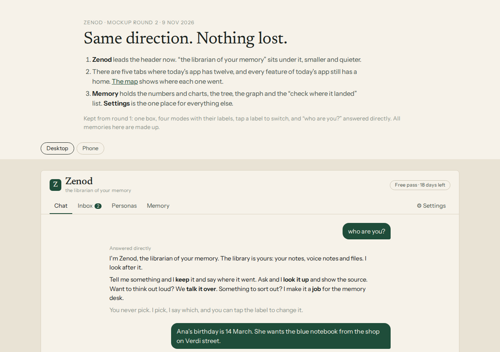
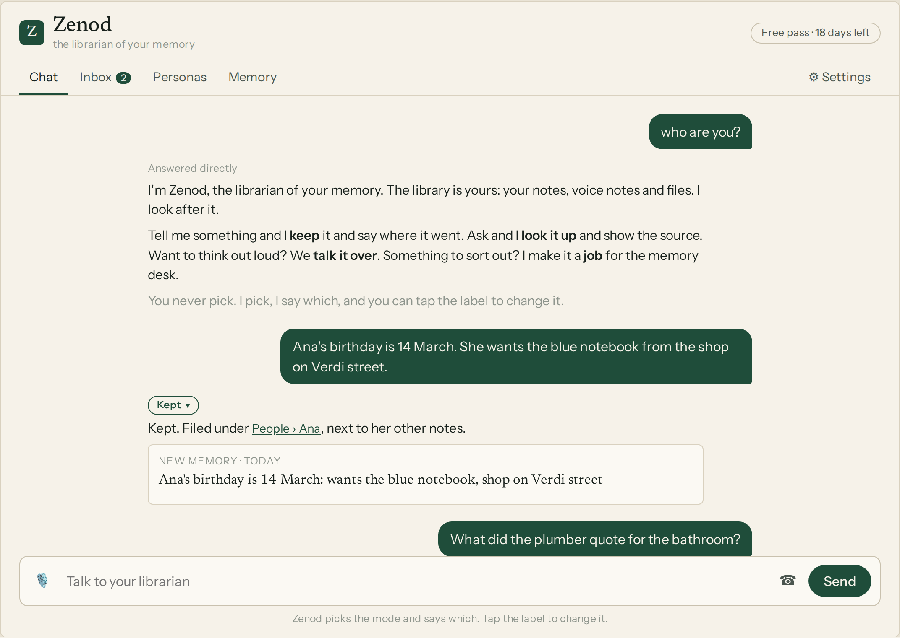
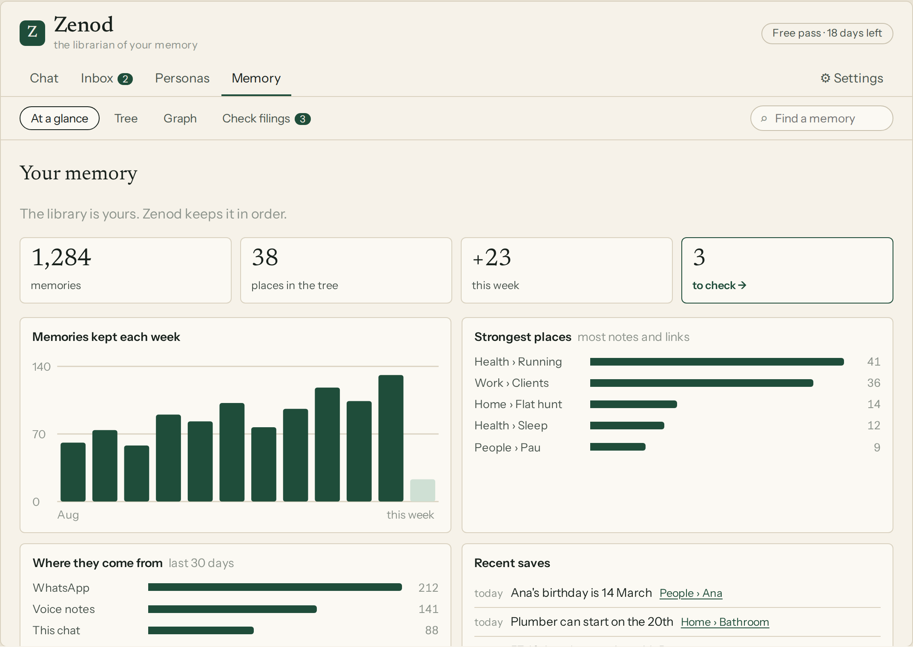
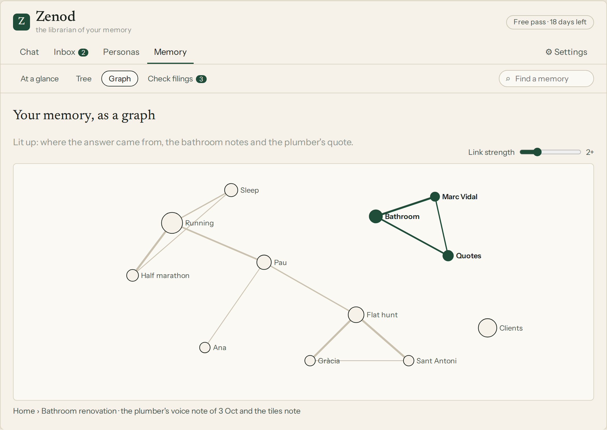
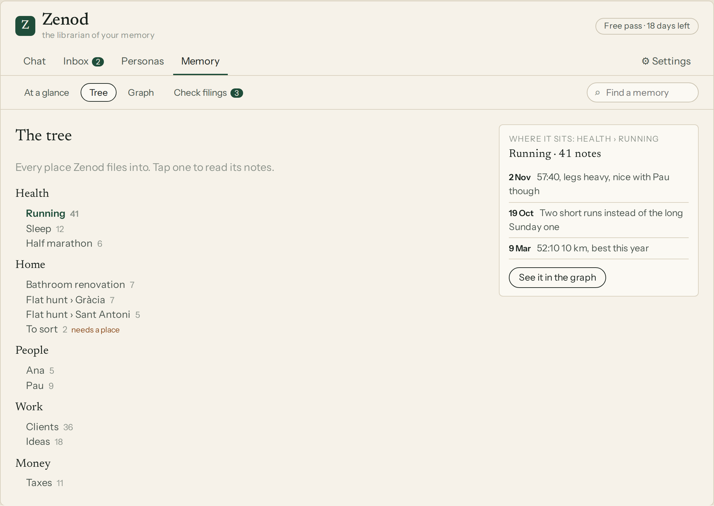
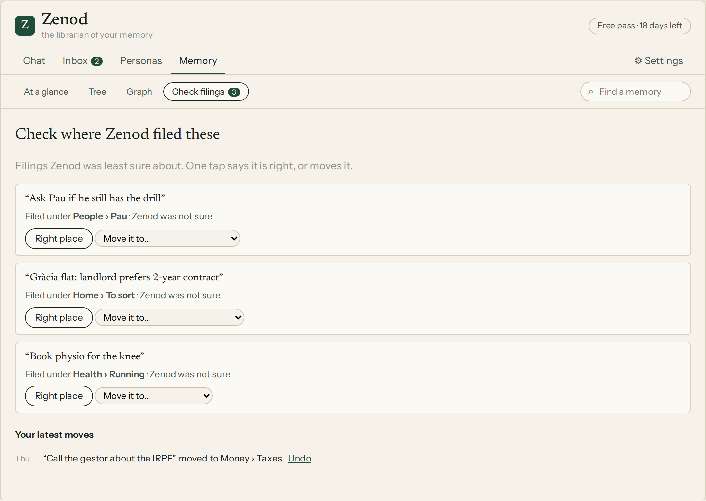
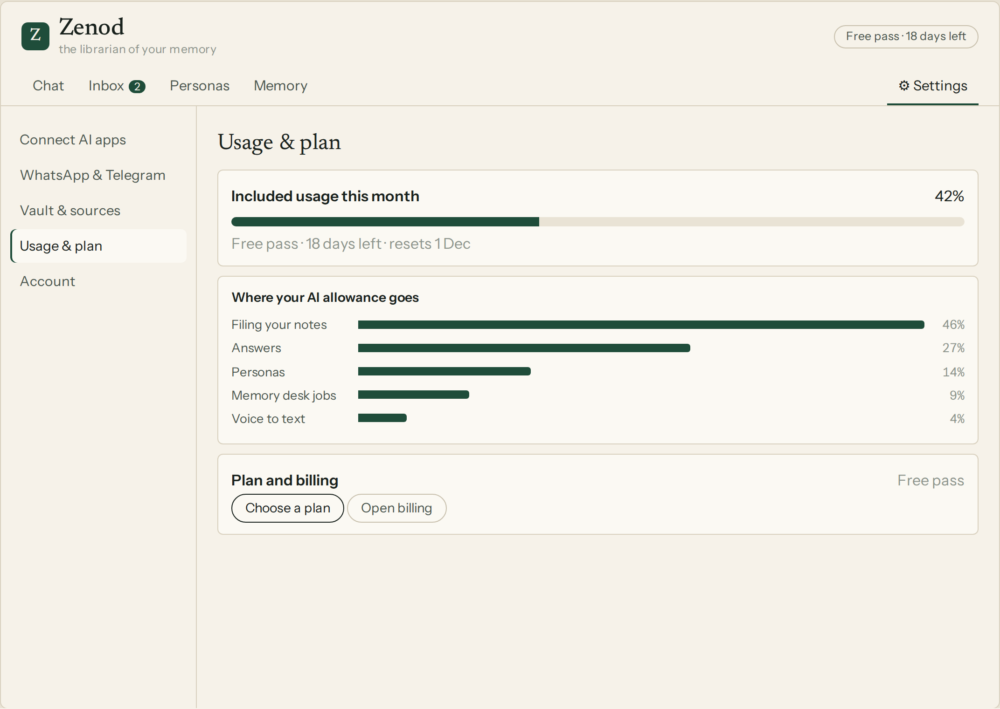
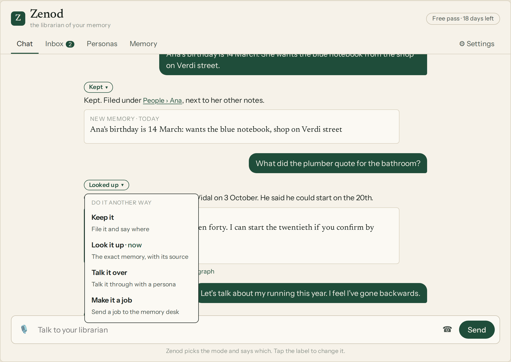
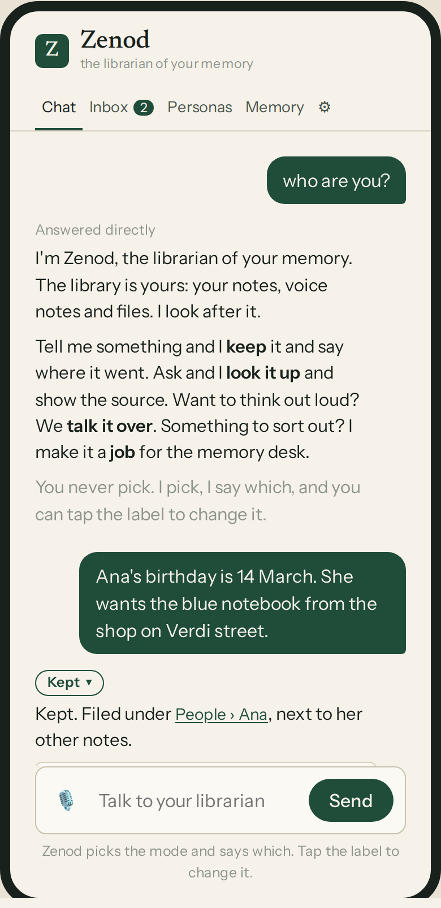
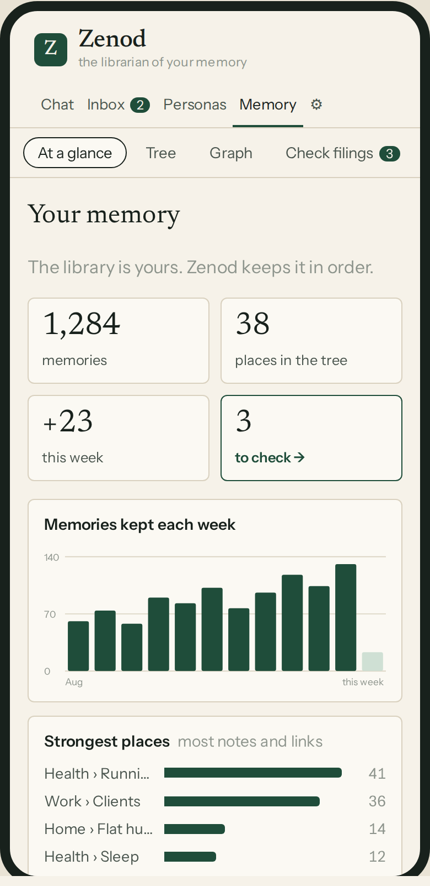
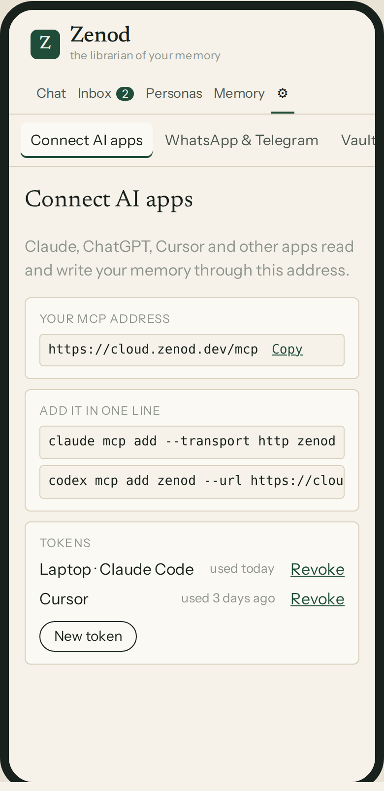

Whole page: [desktop](e22-l2-2026-11-09/page-desktop-full.png), [phone 390 px](e22-l2-2026-11-09/page-phone-390.png). Checked: no script errors, and no sideways scroll at 390 px.
