# E22-L2: Zenod is the librarian of your memory, live (2026-11-09)

**Bottom line.** cloud.zenod.dev now opens as "Zenod, the librarian of your memory": five tabs, one box, and Zenod picks Keep, Look up, Talk it over or Job on the memory and labels each reply. Tap a label to redo the message another way. On a fixed set of 72 of your real messages Zenod picks the right mode 71 times (99 %). On 141 messages, with 69 voice notes it was never tuned on, it is right 128 times (91 %). Your three memory numbers held: ingestion 93.8 % before and after, retrieval 88.7 % before and after, error rate 3.3 % before and 1.6 % after.

Live: production runs fa68fce1 since 2026-11-09 19:46:55Z (health ok; the live bundle carries the new app and the new routes answer 401 without a session). Open https://cloud.zenod.dev/ and sign in.

## What changed in the app

| Mockup round 2 asked for | Live now |
|---|---|
| "Zenod" leads, "the librarian of your memory" small and quiet | Header: the Z, **Zenod** in the serif, the tagline under it in small faint type, the free pass line on the right |
| Five tabs: Chat, Inbox, Personas, Memory, Settings gear | Five tabs. On a phone they fit as words, with the gear alone |
| One box "Talk to your librarian", voice and call buttons in it | One box with the mic, the call button and Send. "Ask the desk" is gone; "Make it a job" in the label menu replaces it |
| Each reply labelled Kept, Looked up, Talking or Job sent; tap to switch | Every reply carries its label. A tap opens "Do it another way" and redoes the same message: Keep it, Look it up, Talk it over or Make it a job. After a keep it says "What was kept stays kept" |
| Talk it over, also from a persona card | New. The talk is read-only: the persona reads the memories that match, answers, cites them and asks one question back. A bar says who you are talking with, and "End the talk" stops it. Persona cards and Inbox notes have **Talk it over** |
| "who are you?" answered directly | Answered directly, now as the librarian with its four modes |
| Memory: At a glance, Tree, Graph, Check filings | At a glance (new: totals, kept each week, strongest places, where they come from, recent saves), Tree with the note viewer, Graph, Check filings |
| Settings: Connect AI apps, WhatsApp & Telegram, Vault & sources, Usage & plan, Account | The same five, each the old tab's panel, moved and not rewritten. Theme, Landing and Log out are under Account |
| Old links keep working | `#graph…`, `#memory?path=…`, `#inbox`, `#personas`, `#vault`, `#account`, `#phylax-channels` and `?tab=graph`, `?tab=usage` and the like open the panel's new home (tested) |

WhatsApp and Telegram replies did not change (root L-6). The desk rule they share (`looksLikeDeskJob`) is untouched and tested. Talk it over runs in the web app only.

## E22-3: the mode Zenod picks, on your real messages

Bottom line: **71 of 72 right (99 %)** on the fixed set, **128 of 141 (91 %)** with 69 held-out voice notes, against 64 of 72 and 80 of 141 for the code before this change.

- The fixed set has 72 messages, kept private in `~/zenod-eval/e22-modes/set.jsonl` on VPS3 and read only: your 45 real questions from the memory test suite, 25 of your messages in the Team desk chat (relays, duplicates and "yes ok" left out), your real "Idealista and Poly-Maker are tangled, please split them", and "who are you?". Each message is labelled by hand with the mode that is right. A mixed message may accept Kept and Looked up together.
- The held-out set is your 69 WhatsApp voice notes to Zenod in your vault. The right mode is Keep.
- What is measured: Zenod's plain rules, which decide with no model and which the model's pick must agree with for a talk or a job. No model call was made, so OpenRouter spend was zero.
- Before the fix, 8 misses had one cause: spoken tags like "you know?" and "right?" were read as questions, so long spoken notes came out as Kept and Looked up. Now a tag is not a question, and a long note is kept whole and looked up only when it ends on a question. "How do we progress this aggressively?" is now a talk. These rules were tuned after seeing the 72, which is why the 69 voice notes are reported apart: 57 of 69 are Keep only; the other 12 end on a real question and are Kept plus Looked up.
- The one miss: "We're going to use EpicSpine as a doctrine, what does that mean for how the team works?" is labelled a question and comes out as Kept plus Looked up.

| | Before (aedfcf0) | This build |
|---|---|---|
| Fixed set, 72 | 64 | **71** |
| Held-out voice notes, 69 | 16 | **57** |
| Both, 141 | 80 (57 %) | **128 (91 %)** |

## Your three memory numbers (EPIC-15 Q2 suite, private vault)

| | Ingestion success | Retrieval efficiency | Error rate |
|---|---|---|---|
| Before, production 0f2aad5 (2026-11-09 19:38Z) | 93.8 % | 88.7 % | 3.3 % |
| After, production fa68fce (2026-11-09 20:07Z) | 93.8 % | 88.7 % | 1.6 % |

This change does not touch filing or search. Ingestion and retrieval are the same. The error rate moved by one error, which is run-to-run noise and not this change. Retrieval reads 88.7 % on both because the suite changed between 17:36Z (94.3 %) and 19:38Z, before this roll.

## Screens

These are the shipped routes and the built web app at fa68fce1, over a made-up demo memory, so no private note shows. No model runs: the answer and the talk are fixed demo replies. Harness: [seed.py](e22-l2-live/harness/seed.py), [serve.mjs](e22-l2-live/harness/serve.mjs), [shoot.mjs](e22-l2-live/harness/shoot.mjs). No script errors. Nothing scrolls sideways at 390 px. `?tab=graph` and `#account` land on their new home.

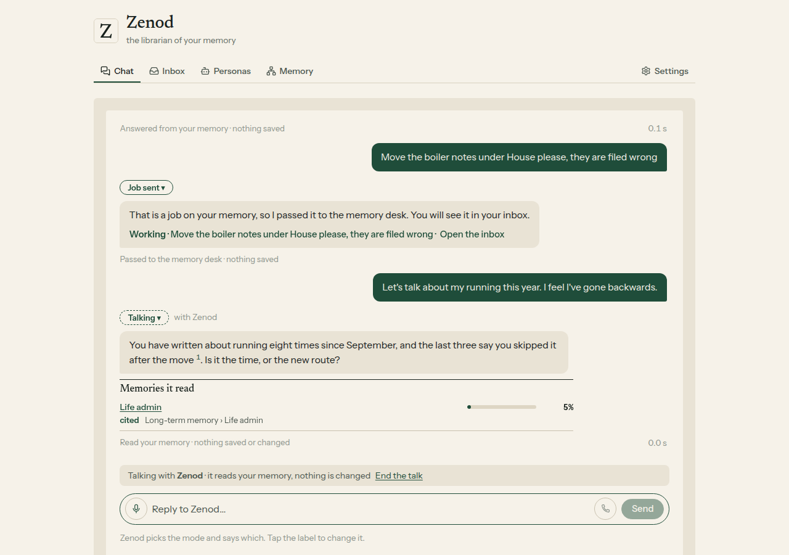
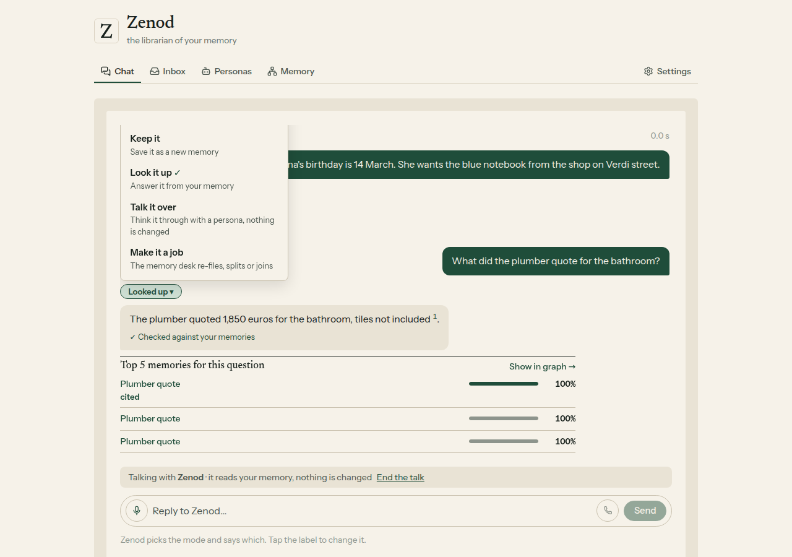
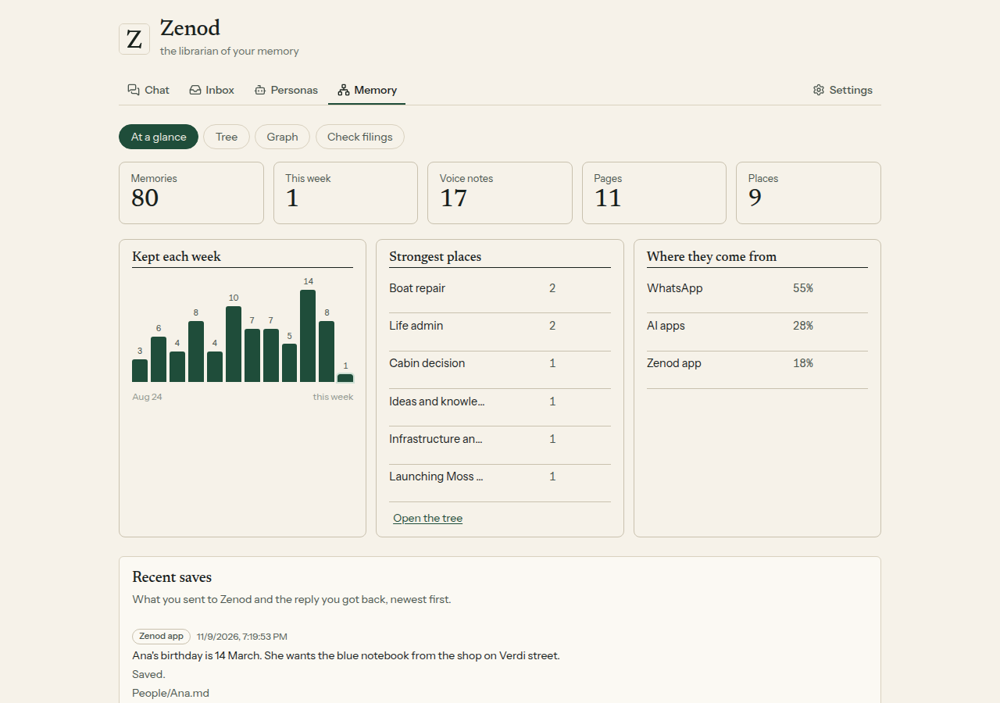
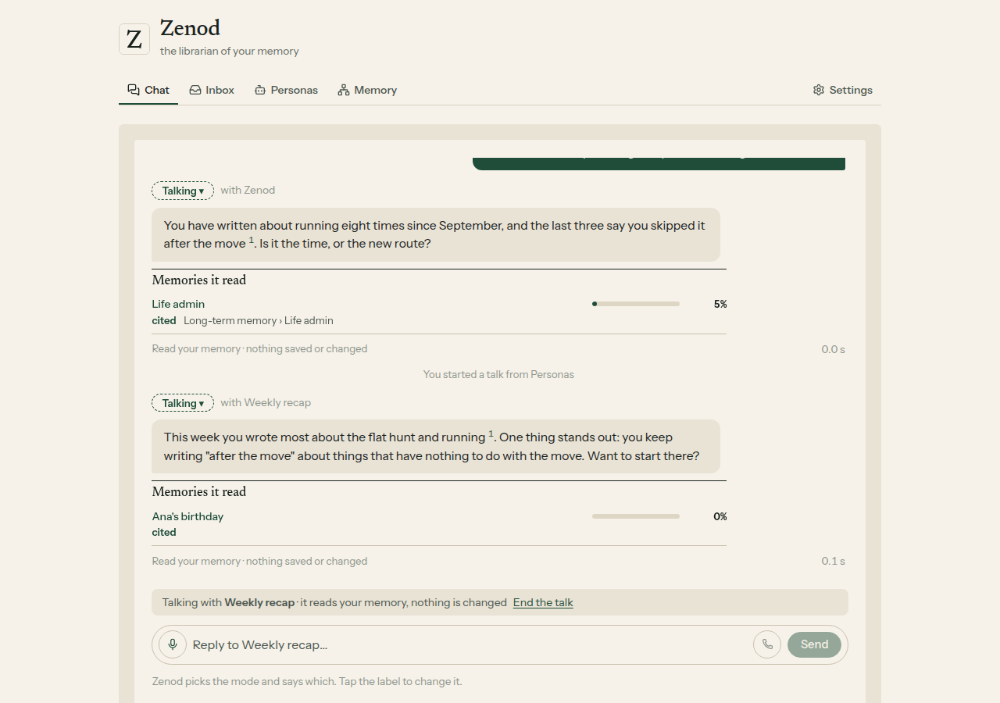
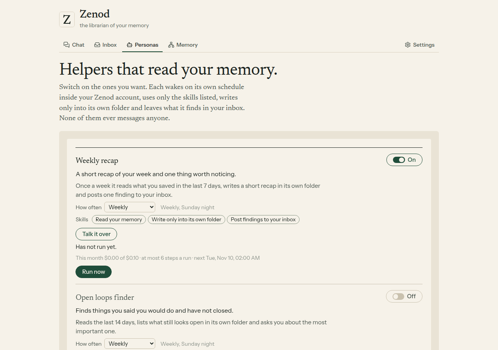
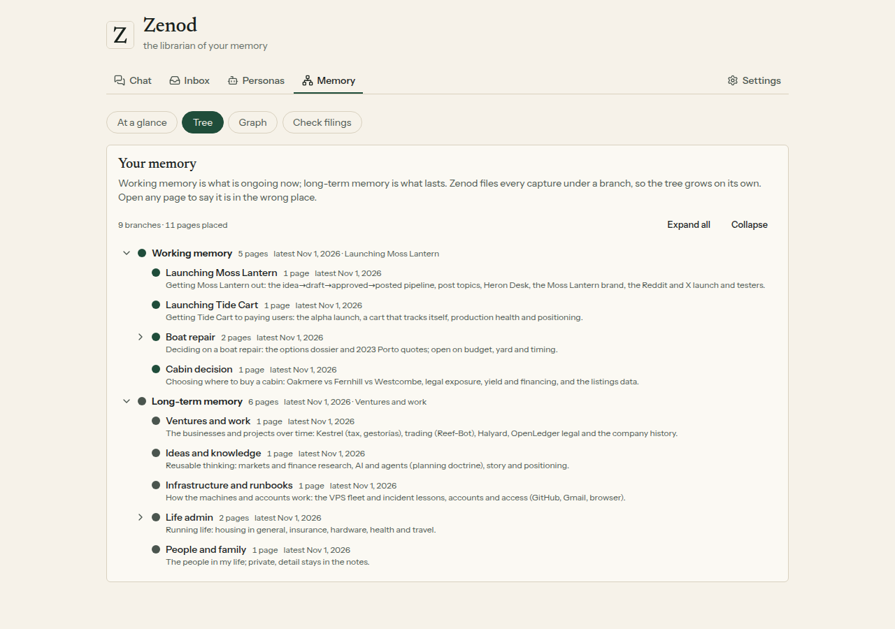
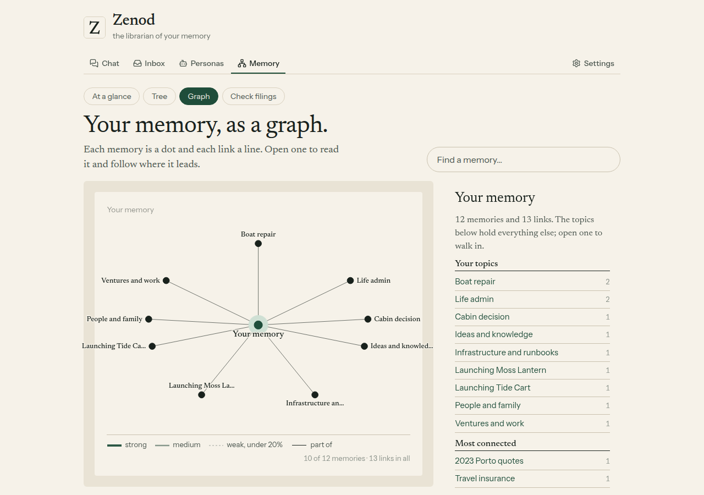
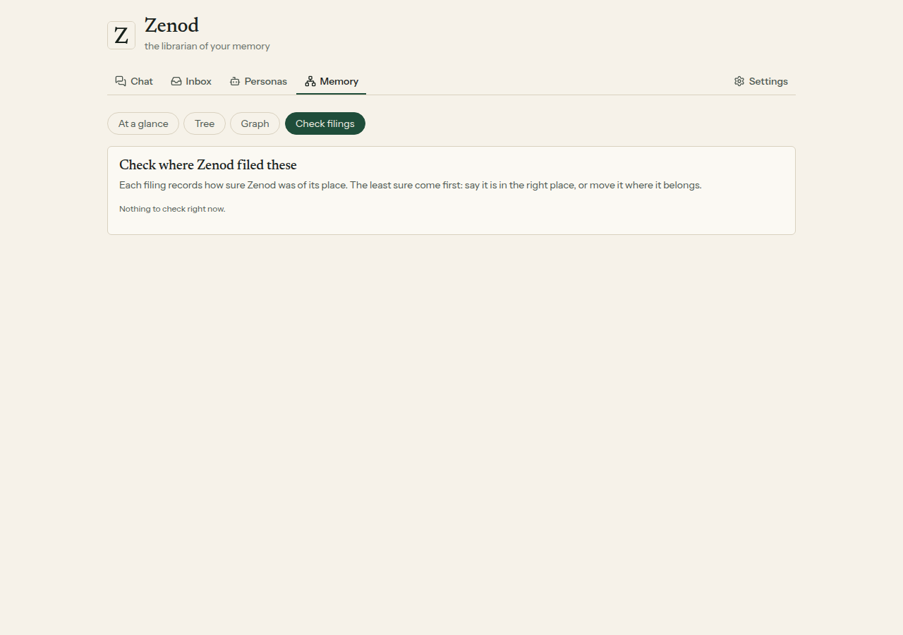
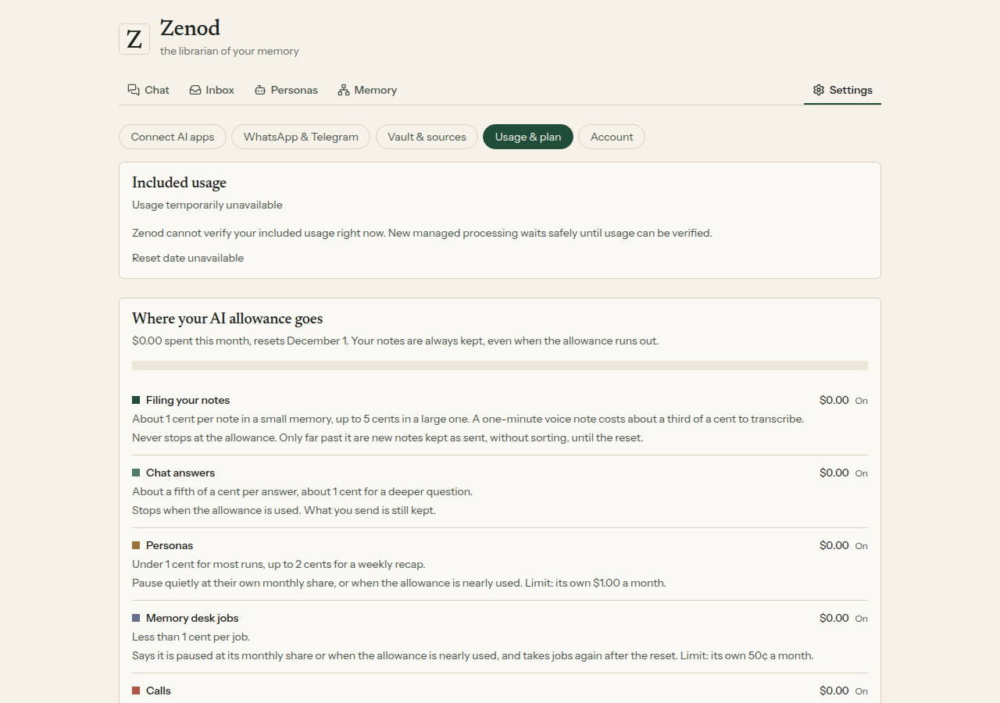
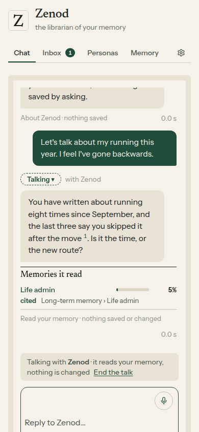
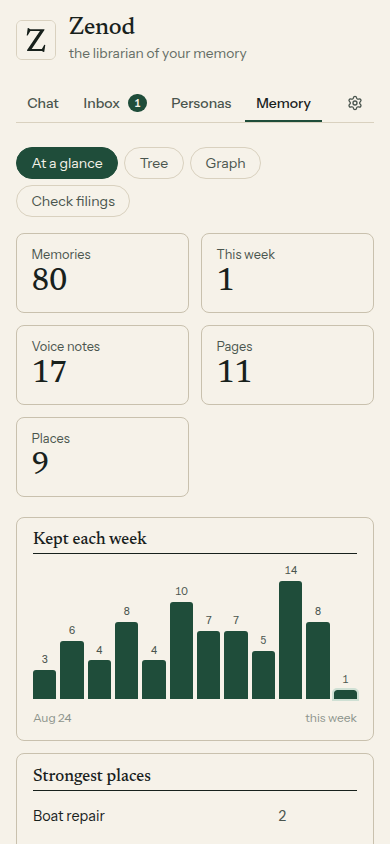
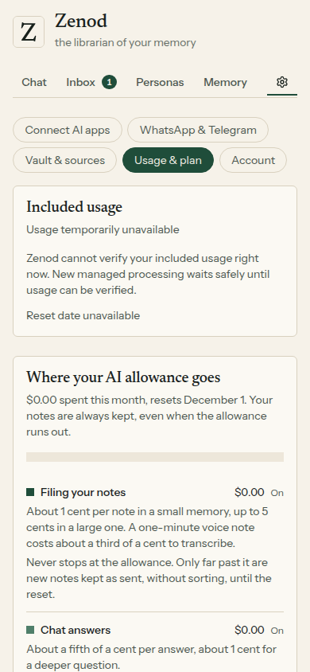

## Tests

Web: chat (labels, switch, talk from the box and from a card, who are you), navigation (every old tab and anchor), editions (five tabs, `?tab=`), onboarding. Server: talk and At a glance (`memoryTalk.test.ts`). Core: talk routing, spoken tags, long notes, and the 80 fixture messages, which still decide as before. CI green on PR [#1565](https://github.com/zenod-ai/zenod/pull/1565).
