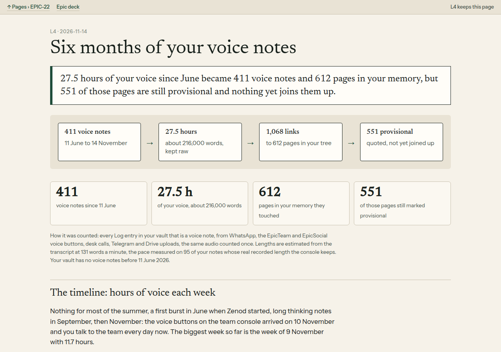

# E22-L4 evidence, 2026-11-14: six months of Jordi's voice notes, charted, and a three-pass re-extraction proposed

**Answer:** 27.5 hours of voice since 11 June 2026 became 411 voice notes and 612 pages in his memory, but 551 of those pages are still provisional and nothing joins them up yet. Three passes over all 411 notes would cost about $8 and take under an hour. The sample run on 10 real notes cost $0.197.

| Page | URL | What it shows |
|---|---|---|
| Chart page (the deliverable) | http://vps3.taild81fbb.ts.net:9004/ | the counts, a weekly timeline, lengths, channels, what was extracted, one note end to end |
| Proposal page (feeds E22-A6) | http://vps3.taild81fbb.ts.net:9005/ | three passes, the sample before and after, cost for everything |

Both pages are served on the tailnet only, from `/var/lib/vps3-scratch/t3agent/pages/e22-l4-chart` and `/var/lib/vps3-scratch/t3agent/pages/e22-l4-proposal` (systemd user units `zenod-e22-l4-chart`, `zenod-e22-l4-proposal`; registered in agent_team `docs/pages/registry.json`, ports 9004 and 9005). They quote his private notes, so they are **not** in this public repo. The data and page builders are kept privately in `/var/lib/vps3-scratch/t3agent/artifacts/e22-l4-data/` (VPS3, readable by the owner only). The counting and sample scripts are in [e22-l4-method/](e22-l4-method/). They hold no private content.

## How it was counted

- Source: obsidian-brain `Log/*.md` at 143d82c (2026-11-14 05:44Z). A voice note is an entry with `content-type: voice_note` or `audio`, or a title naming a voice note, a WhatsApp ptt or a voice transcript. Typed text, images and summaries are left out. 517 candidates came down to 420 voice entries. After removing duplicate ingests of the same Drive file or the same transcript, 412 were left. 411 have words and fall inside the six months.
- Channels: WhatsApp 125 notes and 19.0 h. EpicTeam card answers 125 and 2.3 h. EpicTeam chat 103 and 2.6 h. EpicTeam desk calls 35 and 0.8 h. EpicSocial chat 16 and 0.8 h. Early raw transcripts 3 and 1.0 h. Drive uploads 2 and 0.9 h. Telegram 2.
- Lengths are estimated, not measured. The Drive audio was not read, because no read-only Drive path exists on VPS3 without production credentials. The estimate uses 131.4 words a minute, the pooled pace of 95 console voice notes from 10 to 14 November whose real recorded seconds the console keeps (median per note 146 wpm).
- The vault has no voice notes before 11 June 2026.
- Months: June 24 notes and 2.2 h. July 1. August 9 and 0.2 h. September 17 and 4.9 h. October 11 and 3.1 h. November to the 14th 349 and 17.0 h. The biggest week was the week of 9 November with 11.7 h. 16 of the 27.5 h came in the last two weeks. The console voice buttons arrived on 10 November.
- Lengths: 123 notes are under 30 s and 83 run 30 s to 1 min. 112 run 1 to 3 min, 54 run 3 to 10 min and 26 run 10 to 30 min. 13 run over 30 min and hold 10.2 h. The median is 1.0 min. The longest is about 77 min, on 2026-11-12.
- What was extracted: a note "became" a page when the page cites the note's `^e-` id, or when the note's `filed:` line names the page. Archive and Inbox filing records are not counted. 358 of 411 notes reached at least one page, with 1,068 links to 612 distinct pages. Of the 564 Notes pages, 551 carry `provisional: true` and 13 do not. The other 48 are project and area pages. The projects fed, counted from the 222 notes with a filing path: Zenod 141, Epic Team 97, Housing 19, Anthropic Engineers 18, Agent Team 17, Idealista 15, Markets 14, EpicSpine 10, Family 10.

## Sample re-extraction (10 notes, read only)

- Notes: 10 picked by seeded random across June to November and WhatsApp, card answers and chat, 150 to 2,600 words each, 7,437 words in all.
- Pass 1: `claude-haiku-5-5`, effort low, one call per note, gist plus 3 to 12 typed points, each with a quote. Cost $0.0059.
- Pass 2: `claude-sonnet-5-5`, one call over the pass-1 output and the 89 Project and Area pages: 5 threads, 83 of 83 points placed on existing pages, 0 new pages, 5 repeats or tensions flagged. Cost $0.0834.
- Pass 3: `claude-opus-5-5`, one call: 6 insights over time, 16 open loops, one compounding paragraph. Cost $0.1078.
- Total: $0.197 and 95 s, on the shared OpenRouter key via `secret run openrouter` on VPS1, at Anthropic list prices. Zenod's own Anthropic key is per-app, so it was not used. Nothing was written to the vault.
- Before, for the same 10 notes: 30 page links, 19 of them provisional, mostly the whole quote pasted under a sentence title.
- Cost for all 411 notes: pass 1 scales with words, about $0.17. Pass 2 is about 41 batches of 10 plus 50% for carrying threads, about $5. Pass 3 is a digest per month plus one overall, about $3. That makes about $8, and the proposal sets a hard stop at $15. Prices: Haiku 5.5 $0.10 in and $0.50 out per million tokens, Sonnet 5.5 $2 and $10, Opus 5.5 $4 and $20. The batch price is half.
- One caveat on pass 3: the sample insights rest on 10 notes only. A line like "went quiet" must be checked against all notes on a full run.

## Not done (on purpose)

- The full re-extraction is not run. It waits on E22-A6.
- Nothing is written into the tree. The engine freeze runs to 2026-11-24 (E22-A5).
