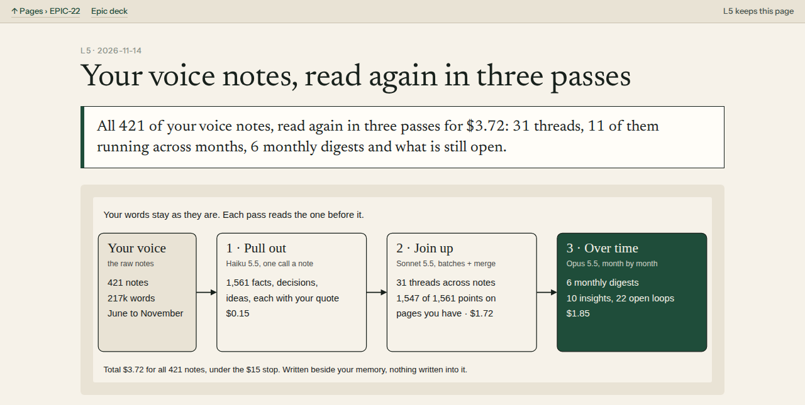

# E22-L5 evidence, 2026-11-14: all of Jordi's voice notes read again in three passes

**Answer:** all 421 voice notes were read again in three passes for $3.72, well under the $15 stop. The result is 1,561 points, each with his quote, 31 threads (11 of them span more than one month), 6 monthly digests, 10 insights over time and 22 loops still open.

| Page | URL | What it shows |
|---|---|---|
| Three-pass page (the deliverable) | http://vps3.taild81fbb.ts.net:9006/ | the three passes and what each added, one note before and after, what shows up over time, the 31 threads, the 6 monthly digests, the cost |
| Pinned voice-notes page | http://vps3.taild81fbb.ts.net:9004/ (team.alpha9.io/my-voice) | now links the three-pass page under its updated line |

The page quotes his private notes, so it is served on the tailnet only (systemd user unit `zenod-e22-l5-threepass`, port 9006, registered in agent_team `docs/pages/registry.json`, commit 816ecd188) and is **not** in this public repo. Only numbers are written here.

## What ran (Jordi's yes on E22-A6: "Yes: run it on all notes")

| Pass | Model | Input | Output | Cost |
|---|---|---|---|---|
| 1 Pull out | claude-haiku-5-5, one call a note | 421 of 421 notes, 217,010 words | 1,561 points (463 asks, 389 ideas, 218 decisions, 190 facts, 188 feelings, 104 learnings), each with his quote | $0.150 |
| 2 Join up | claude-sonnet-5-5, 36 date-order batches + 1 merge | the 1,561 points and his 89 Project and Area pages | 31 threads; 1,547 of 1,561 points placed on pages he already has, 2 new pages suggested; 225 repeats or tensions flagged | $1.718 |
| 3 Over time | claude-opus-5-5, one digest a month (each reads the month before) + 1 overall | the points, the threads, the digests | 6 monthly digests, 10 insights, arcs for the 12 biggest threads, 22 still-open loops, decisions that held, changes of mind | $1.851 |
| **Total** | 466 calls | | | **$3.719** |

- Notes per month: June 24, July 1, August 9, September 17, October 11, November (to the 14th) 359.
- The biggest thread: "Epic app UI feedback and bugs", 50 notes, 2 to 14 November. The longest: "Voice channel tests and health checks", 45 notes, 14 June to 12 November.
- Before, the same 421 notes held 1,083 links to pages, mostly a quote under a sentence title, not joined to each other.

## How it ran

- Notes: the pinned page's own counting (L4 `refresh.py`), frozen at obsidian-brain 8ca26d3 (2026-11-14): every voice note since June, the same audio once. The pinned page rebuilt from the same commit also counts 421, so the counts match.
- Spend: $0.679 was paid on the shared OpenRouter key (`secret run openrouter`, the key the sample used, on VPS1). Pass 2 then hit `402 in_flight_budget_exhausted`: that account had about $0.83 of its $120 left. The rest ran on the team's Claude subscription: seat 5's token, an empty config directory, no tools, through `claude -p`. That is $3.04 at list price and no extra charge. Zenod's own production Anthropic key was not used. The $15 stop counts both (the script's `CAP` was $14.50).
- Every call is cached, so a rerun costs nothing for the parts already done. The spend ledger is `spend.jsonl` beside the output.
- Output: `/var/lib/vps3-scratch/t3agent/artifacts/e22-l5-threepass/out/` on VPS3, readable by the owner only, beside the memory. Nothing was written into his vault. His raw words and the tree are untouched, and the engine freeze runs to 24 November.
- The temporary copy on VPS1 was deleted after the run.
- Rollback: delete that folder and `pages/e22-l5-threepass`, then stop the `zenod-e22-l5-threepass` unit.
- Scripts (no private content): [e22-l5-method/](e22-l5-method/) (`prep.py` builds the note set, `run.py` runs the three passes, `build_page.py` builds the page).

## Not done (on purpose)

- Nothing is folded into his memory. Whether the threads and digests become pages in his tree after the freeze is the card's decision.
- No words of his go to zenod-social, only the numbers above.
