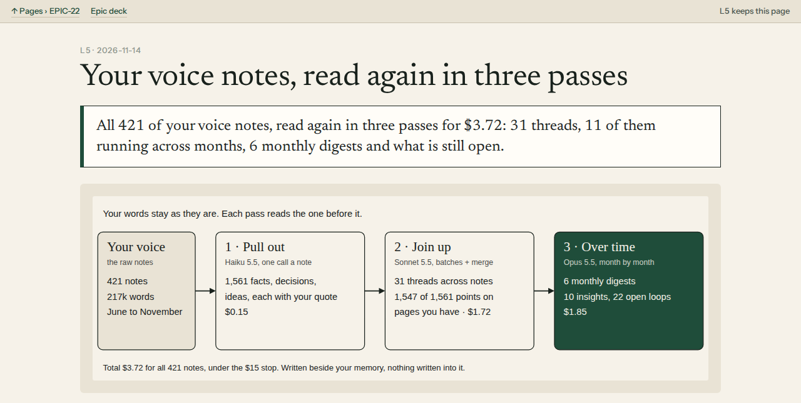
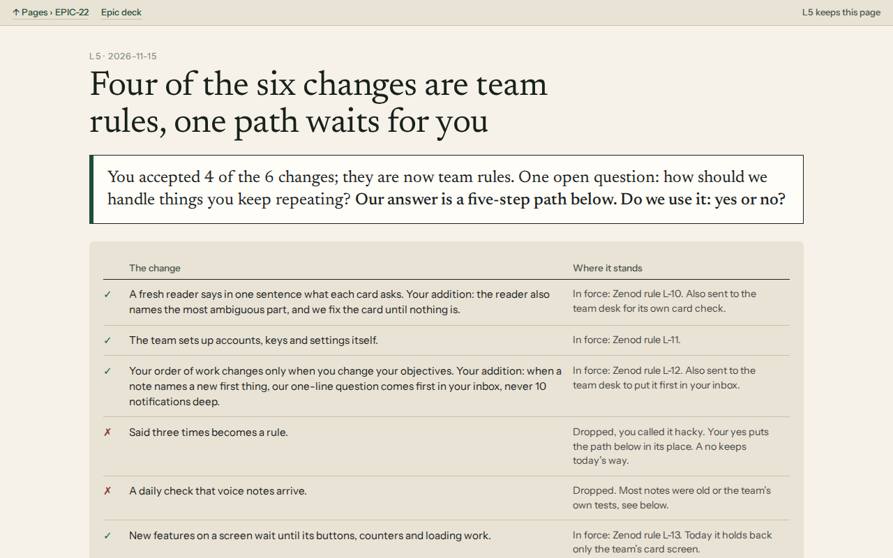

# E22-L5 evidence, 2026-11-14: all of Jordi's voice notes read again in three passes

**Answer:** all 421 voice notes were read again in three passes for $3.72, well under the $15 stop. The result is 1,561 points, each with his quote, 31 threads (11 of them span more than one month), 6 monthly digests, 10 insights over time and 22 loops still open.

| Page | URL | What it shows |
|---|---|---|
| Three-pass page (the deliverable) | http://vps3.taild81fbb.ts.net:9006/ | the three passes and what each added, one note before and after, what shows up over time, the 31 threads, the 6 monthly digests, the cost |
| Pinned voice-notes page | http://vps3.taild81fbb.ts.net:9004/ (team.alpha9.io/my-voice) | now links the three-pass page under its updated line |

The page quotes his private notes, so it is served on the tailnet only (systemd user unit `zenod-e22-l5-threepass`, port 9006, registered in agent_team `docs/pages/registry.json`, commit 816ecd188) and is **not** in this public repo. Only numbers are written here.

## What ran (Jordi's yes on E22-A6: "Yes: run it on all notes")

| Pass | Model | Input | Output | Cost |
|---|---|---|---|---|
| 1 Pull out | claude-haiku-5-5, one call a note | 421 of 421 notes, 217,010 words | 1,561 points (463 asks, 389 ideas, 218 decisions, 190 facts, 188 feelings, 104 learnings), each with his quote | $0.150 |
| 2 Join up | claude-sonnet-5-5, 36 date-order batches + 1 merge | the 1,561 points and his 89 Project and Area pages | 31 threads; 1,547 of 1,561 points placed on pages he already has, 2 new pages suggested; 225 repeats or tensions flagged | $1.718 |
| 3 Over time | claude-opus-5-5, one digest a month (each reads the month before) + 1 overall | the points, the threads, the digests | 6 monthly digests, 10 insights, arcs for the 12 biggest threads, 22 still-open loops, decisions that held, changes of mind | $1.851 |
| **Total** | 466 calls | | | **$3.719** |

- Notes per month: June 24, July 1, August 9, September 17, October 11, November (to the 14th) 359.
- The biggest thread: "Epic app UI feedback and bugs", 50 notes, 2 to 14 November. The longest: "Voice channel tests and health checks", 45 notes, 14 June to 12 November.
- Before, the same 421 notes held 1,083 links to pages, mostly a quote under a sentence title, not joined to each other.

## How it ran

- Notes: the pinned page's own counting (L4 `refresh.py`), frozen at obsidian-brain 8ca26d3 (2026-11-14): every voice note since June, the same audio once. The pinned page rebuilt from the same commit also counts 421, so the counts match.
- Spend: $0.679 was paid on the shared OpenRouter key (`secret run openrouter`, the key the sample used, on VPS1). Pass 2 then hit `402 in_flight_budget_exhausted`: that account had about $0.83 of its $120 left. The rest ran on the team's Claude subscription: seat 5's token, an empty config directory, no tools, through `claude -p`. That is $3.04 at list price and no extra charge. Zenod's own production Anthropic key was not used. The $15 stop counts both (the script's `CAP` was $14.50).
- Every call is cached, so a rerun costs nothing for the parts already done. The spend ledger is `spend.jsonl` beside the output.
- Output: `/var/lib/vps3-scratch/t3agent/artifacts/e22-l5-threepass/out/` on VPS3, readable by the owner only, beside the memory. Nothing was written into his vault. His raw words and the tree are untouched, and the engine freeze runs to 24 November.
- The temporary copy on VPS1 was deleted after the run.
- Rollback: delete that folder and `pages/e22-l5-threepass`, then stop the `zenod-e22-l5-threepass` unit.
- Scripts (no private content): [e22-l5-method/](e22-l5-method/) (`prep.py` builds the note set, `run.py` runs the three passes, `build_page.py` builds the page).

## Not done (on purpose)

- Nothing is folded into his memory. Whether the threads and digests become pages in his tree after the freeze is the card's decision.
- No words of his go to zenod-social, only the numbers above.

## Iteration 2, 2026-11-15: the reading answers "what changes do we drive into EpicSpine?"

**Answer:** his six months of voice notes point to **6 changes in how the team works**. The page at http://vps3.taild81fbb.ts.net:9006/ now opens with that line and a table of the six; the numbers, threads and digests moved into a details section, and the iteration 1 reading stays one click away as `reading.html`.

Why: Jordi relaunched L5 (voice note vn_5b3ad6c9, 2026-11-15): "I don't know what you're asking. I don't understand your question, bro ... my expectation was, what changes were we gonna drive into the Epic Spine? ... 10,000 times more clear, please." Iteration 1 asked whether to fold the threads into his memory; that question is now parked as its own follow-up.

| # | The change (team-internal, reversible, none made yet) | Where it lands | His notes that say it | Months |
|---|---|---|---|---|
| 1 | Every card and question sent to Jordi passes a "what is being asked?" test by a fresh reader first | EpicSpine skill rule (review cards and asks) | 41 (thread "Card clarity, approvals and feedback controls") | Nov 1–13 |
| 2 | The team sets up accounts, keys and settings itself; a question reaches him only when only he can answer it | EpicSpine skill rule (ask tier) | 69 (threads "Stop asking Jordi" + "Credentials, secrets and Bitwarden") | Nov 9–14; pass 3 traces it to June |
| 3 | His first priority changes only when he edits the objectives list; a note naming a new first thing gets a one-line "move it to the top?" | EpicSpine skill rule (objectives) | 11 (priority statements; three different first things on 12–14 Nov) | Nov 10–14 |
| 4 | When he says the same thing three times, the team writes it as a rule that day and tells him | EpicSpine skill rule (learnings) | 7 ("I asked this already", "over and over"); pass 3: three November frustrations were already in June | Nov 8–14 |
| 5 | Zenod checks every day that each voice note arrived in full, so he stops sending test notes | new row in EPIC-22 | 70 (threads "Voice channel tests" + "Voice note latency, cutoff and reliability") | Jun, Aug, Sep, Nov |
| 6 | New features on a screen wait until its buttons, counters and loading work | a stop, EpicSpine skill rule | 50 (thread "Epic app UI feedback and bugs") | Nov 7–14 |

How they were found: from the iteration 1 output only (no new model spend): pass 2 threads give the note sets for 1, 2, 5 and 6; a phrase search over the pass 1 quotes gives 3 and 4; pass 3's insights ("being the bottleneck from June on", "a complaint became a rule", "top priority changed several times in three days", "voice capture has never been reliable") pick which threads are about how the team works. Personal threads (house, family, markets, company) were left out on purpose. Each change on the page carries one short quote of his and its date; the quotes stay on the tailnet page, not here. Builder: `build_page_v2.py` beside the output (private, it holds the quotes); the change list without quotes is `changes.json` there.

Checks: agent_team `text_wall_check.py` (leads with a box), `clean_look_check.py` (clean), `page_shell.py check --strict` (on the shell); captured at 390 and 1280 px with `card_qc_shots.mjs`, no sideways scroll at either width.

### Clarity self-test (a fresh Sonnet agent, no context, shown only the card text and the page's first screen)

Question: "What is being asked of you, in one sentence?"

| Round | Its answer | What it found unclear | Fix |
|---|---|---|---|
| 1 | "Do you approve making all six proposed changes ... or do you want to pick some or none?" | ✓ marks read as done; the page never asks; "A stop for the team" vague | a bold line under the answer: none made yet, your call on the card; column named "We say yes"; "Goes into: ..." labels |
| 2 | "make six changes to how the team works, all six, some of them, or none?" | the card does not name any change; $3.72 does not matter to the decision | the card's first line names two of the six; cost moved off the card |
| 3 | "Do we make these six changes to how the team works: yes to all six, pick some, or no?" | what making them costs or risks | a line on the page: each one is a written rule or task, easy to undo |

All three rounds named the right ask; it stopped at round 3 as briefed.

Not done (on purpose): none of the six is applied; that waits on his answer on the card. Folding the threads and digests into his memory is parked for after 24 Nov.

## Iteration 3, 2026-11-15: his verdict on the six changes, four applied, one path to decide

**Answer:** Jordi accepted 4 of the 6 changes (voice note vn_cdcf1208, read in order); they are now Zenod root rules L-10 to L-13. He rejected change 4 as "hacky" and asked for a real protocol for things he keeps repeating: a five-step path, shown on three real cases, is the one decision on the card. Change 5 is dropped: the notes behind it were old or the team's own tests. Page: http://vps3.taild81fbb.ts.net:9006/ (tailnet only; the iteration 2 page stays one click away as `six-changes.html`).

| # | Change | His verdict (vn_cdcf1208) | Where it stands |
|---|---|---|---|
| 1 | Fresh reader checks every card and ask | ✓ "I like the first suggestion ... I would also add, the fresh reader also says what is the most confusing, what is most ambiguous in this card. Ambiguity is our enemy." | root L-10 (with his addition); desk note to agent_team for the ask gate's dry run and card QC |
| 2 | Team sets up accounts, keys and settings itself | ✓ "Yeah, of course, absolutely." | root L-11 |
| 3 | First priority changes only when he edits his objectives | ✓ rewritten in plain words, with his addition: "you can make that question also very high up ... if the question reaches me 10 notifications deep, then already we've defeated the purpose" | root L-12; desk note to agent_team for the top-of-inbox spot |
| 4 | Said three times becomes a rule | ✗ "This feels hacky, man ... We do need to have a protocol" | replaced by the proposed path below, waits on his yes; not applied |
| 5 | Daily voice-note arrival check | ✗ "I don't get that one. How recent are these notes?" | dropped, see dates |
| 6 | New features on a screen wait until its buttons, counters and loading work | ✓ "OK, yeah." | root L-13; today it holds back only the team console's card screen (his 14 Nov notes still named its buttons, key paste box, counters and slow loading); no Zenod screen is held, and the D37 hold already stops new Zenod features |

### The proposed path for things he keeps repeating (not applied)

Spot it (the same ask in two notes, or his words "again", "I already asked", "still not fixed") → say it back in one sentence with one question he answers by voice (root L-66 in agent_team) → find why it did not stick (misread, no rule, or a broken tool) → fix that cause → tell him in one line where it lives now. It starts at the second time, not the third.

Shown on three real cases from the three-pass output (his quotes are on the tailnet page only):

| Case | Said | Why it did not stick | What the path would have done |
|---|---|---|---|
| Card buttons | 2 notes on 12 Nov ("fifth iteration") | broken check: fixes closed without a click on the live card | a live click at phone and laptop size before a button fix closes; stopped at round two, not five |
| Keys and accounts | 10 and 12 Nov | no rule: nothing told the team to find a key first or make the account | a written rule; today root L-11 |
| "Did we get a tester?" | 14 Nov, his second ask | misread: the yes or no was buried in long reports | the tester count first on the Zenod page, every answer starting with yes or no |

Source: a phrase search for repeated-frustration words over the pass 1 quotes (8 to 14 Nov) and pass 3's insights "Being the bottleneck is a problem from June on" and "A complaint became a rule".

### How recent are the notes behind change 5? (his question)

| The 70 notes (threads "Voice channel tests" + "Voice note latency, cutoff and reliability") | When |
|---|---|
| 21 were the team's own automated test notes, marked "TEST, not Jordi's words" | 12 Nov, 19:51 to 19:58 UTC |
| 20 of his | 9 in June, 8 in August, 3 in September |
| 29 of his | 2 to 11 Nov, most from the EpicTeam card and chat screen, not Zenod |
| his last worry | 11 Nov: two notes lost on a server restart, on the EpicTeam screen |

None since 11 Nov; Zenod's voice capture works, as he said. Dropped, nothing asked of him.

### Fresh-reader test (his rule 1 applied to its own card: a no-context Sonnet agent, shown the card front matter and the page's first screen at 1280 and 390 px)

| Round | (a) What is asked | (b) Most confusing or ambiguous | Fix |
|---|---|---|---|
| 1 | ✓ decide whether the team uses the five-step path: yes, change it, or no | title "... done" while a decision is open; the page's question sounds open-ended, the card's is yes or no | page title names the open path; the punchline box adds "Our answer is a five-step path below. Do we use it: yes or no?"; goal and delivered say the path waits on him; "shown on three past cases" |
| 2 | ✓ yes, change, or no on the five-step path, starting only after his yes | ✓ marks read as "live" while two rows said "not done yet" | the column says "In force: Zenod rule L-n"; the desk part reads "also sent to the team desk"; who runs the steps ("the team runs these five steps"); the page points at the card's buttons |
| 3 | ✓ yes, change, or no on the five-step path, from his next repeat | what a no means, now that the three-times rule is dropped | row 4 says "Your yes puts the path below in its place. A no keeps today's way."; the No button reads "No: park it, repeats stay as today"; the card title says the path awaits his yes |

All three rounds named the right ask. Round 3's (b) was fixed after the round; the brief's limit of 3 rounds was reached, so no round 4 ran. Smaller items left as they are: rule codes L-10 to L-13 on the page (he asked where each lives).

Checks: agent_team `text_wall_check.py` (leads with a box), `clean_look_check.py` (clean); captured at 390 and 1280 px with `card_qc_shots.mjs`; at 390 px the five steps stay one compact line with a numbered list under it, no sideways scroll; rows 1 and 3 of the table carry his two additions word for word (card QC round 1 held the card for missing them). Builder: `build_page_v3.py` beside the three-pass output (private, it holds the quotes and asserts the 70 = 21 + 20 + 29 split).

Also: the old per-page unit `zenod-e22-l5-threepass.service` was crash-looping (port 9006 is served by the page hub since E6-S94); stopped, it stays disabled.
