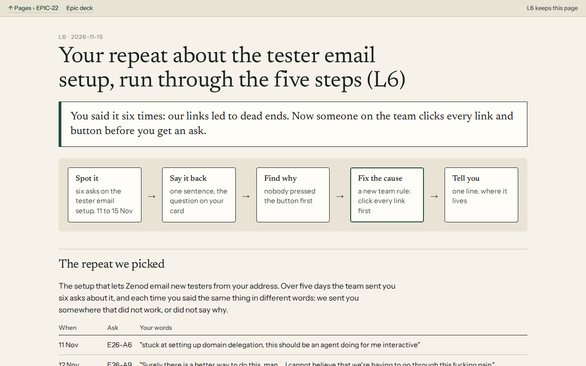

# E22-L6 evidence, 2026-11-15: the five-step path, used on Jordi's repeat about dead-end links

**Answer:** the path is now Zenod root rule L-14, and its first use found why the tester email asks kept sending Jordi into dead ends: nobody clicked the button before he did. The fix is root rule L-15 (an agent clicks every link and button of an ask first, and the ask opens with what it is for), plus a desk note asking the EpicTeam ask check to do the same. Page: http://vps3.taild81fbb.ts.net:9007/ (tailnet only, it quotes his notes).

```
┌──────────────┐   ┌──────────────┐   ┌──────────────┐   ┌──────────────┐   ┌──────────────┐
│ 1 Spot it    │ → │ 2 Say it back│ → │ 3 Find why   │ → │ 4 Fix cause  │ → │ 5 Tell him   │
│ 6 asks on the│   │ "test every  │   │ nobody had   │   │ root L-15 +  │   │ one line on  │
│ tester email │   │ link first,  │   │ pressed the  │   │ desk note to │   │ the card and │
│ 11-15 Nov    │   │ say what for"│   │ button first │   │ agent_team   │   │ the page     │
└──────────────┘   └──────────────┘   └──────────────┘   └──────────────┘   └──────────────┘
```



## Step 1 · Spot it (the repeat picked)

His words since 2026-11-14 were read from this repo's spines (answered asks, step notes, Decisions) and agent_team `docs/his-words.json`; his vault logs are not in this checkout. The strongest repeat: the tester email setup (EPIC-26 E26-S11 / E26-S28), six asks in five days, each answered with the same complaint.

| When | Ask | His words |
|---|---|---|
| 11 Nov | E26-A6 | "stuck at setting up domain delegation, this should be an agent doing for me interactive" |
| 12 Nov 04:14Z | E26-A9 | "Surely there is a better way to do this, man ... I cannot believe that we're having to go through this fucking pain." |
| 12 Nov | E26-A10 | "you need to tell me where do I need to click, what permissions, you need to tell me everything" |
| 12 Nov | E26-A11 | "convince me that you absolutely need this key ... and that it's the last time" |
| 12 Nov 19:39Z | E26-A12 | "Don't ask me for API keys and tell me that we're blocked" |
| 15 Nov 06:05Z | E26-A15 | "you led me to a dead end. button clicked nothing happens" · "What is the ultimate goal of this" · "I hate it when you direct me into loose ends" |

Also on L5 (vn_5b3ad6c9): "10,000 times more clear". Under the path the second time was 12 Nov (A9 after A6); it did not exist yet, so it ran to round six.

## Step 2 · Say it back

"We think you mean: test every link first, and say what it is for." Put to him as the one question on the L6 card in his inbox (agent_team root L-66 and L-68: a card, answered by Yes or by voice under Not quite), never a multiple choice.

## Step 3 · Find why

| Cause | Kind | Proof |
|---|---|---|
| Nobody pressed the button before he did | broken check | E26-A15 passed the ask dry run on 14 Nov (E26 Decisions row of that day); the dry run reads the card and page, never clicks; the Connect button did nothing until E26-S28 iteration 2 fixed it on 15 Nov |
| The ask opened with the step, not the goal | no rule | his step note: "I see a lot of text but not a word about what's this for" |
| Keys asked of him that the team could set up | no rule | already fixed as root L-11 (15 Nov) |

## Step 4 · Fix the cause

| Fix | Where it lives |
|---|---|
| An agent opens every link and presses every button in a real browser up to the one screen only he can act on, keeps a screenshot, and the ask's first line says what it is for; a dead end is fixed, never sent | Zenod root L-15 |
| The ask check presses buttons too, not only reads | agent_team desk note `desk/inbox/2026-11-15-zenod-the-ask-check-should-press-an-ask-s-butt.md` (tool change goes as a note, no agent_team code edited) |
| The path itself | Zenod root L-14; agent_team desk note `desk/inbox/2026-11-15-zenod-jordi-approved-a-five-step-path-for-thin.md` so the team desk can use it across worlds |

Already in effect on this case: E26-S28 iteration 2 walked the Connect button to Google's sign-in before re-asking (E26-A16); A16 is held by the dry run because its sign-in step does not name the browser, which is L-15's second half. That fix is EPIC-26's, not touched here.

## Step 5 · Tell him

"Before any ask reaches you, someone on the team clicks every link and button in it first. That is now Zenod rule L-15, and the EpicTeam ask check has been asked to do the same." (the page's last box; the card's third delivered line)

## Fresh-reader test (root L-10: a no-context Sonnet agent, shown the card and the page's first screen)

| Round | (a) What is asked | (b) Most confusing or ambiguous | Fix |
|---|---|---|---|
| 1 | ~ confirm the team found and fixed the cause | the page's say-it-back sentence differed from the card's; "the mail sender" unexplained | one sentence, word for word the same on card and page; "the tester email setup", explained in one line on the page |
| 2 | ✓ confirm the rule "test every link first, say what it is for" matches what he meant | the box label "ask check told"; does the tester email still need him? | box reads "a new team rule: click every link first"; page says the tester email is a separate ask |
| 3 | ✓ the same | the card's "has its own card" line made him wonder if he must act now | line removed from the card, the page says nothing there asks him to act now |

Round 3's (b) was fixed after the round; the limit of 3 rounds was reached, so no round 4 ran.

Checks: agent_team `text_wall_check.py` (leads with a box), `clean_look_check.py` (clean); captured at 390 and 1280 px with `card_qc_shots.mjs`; at 390 px the five-step line scrolls sideways inside its band (the shell's line shape). Page dir `/var/lib/vps3-scratch/t3agent/pages/e22-l6-repeat-path`, served by the vps3 page hub on :9007, registered in agent_team `docs/pages/registry.json` (fc17b47e1).

Rollback: delete root L-14 and L-15, the page dir and its hub entry.
