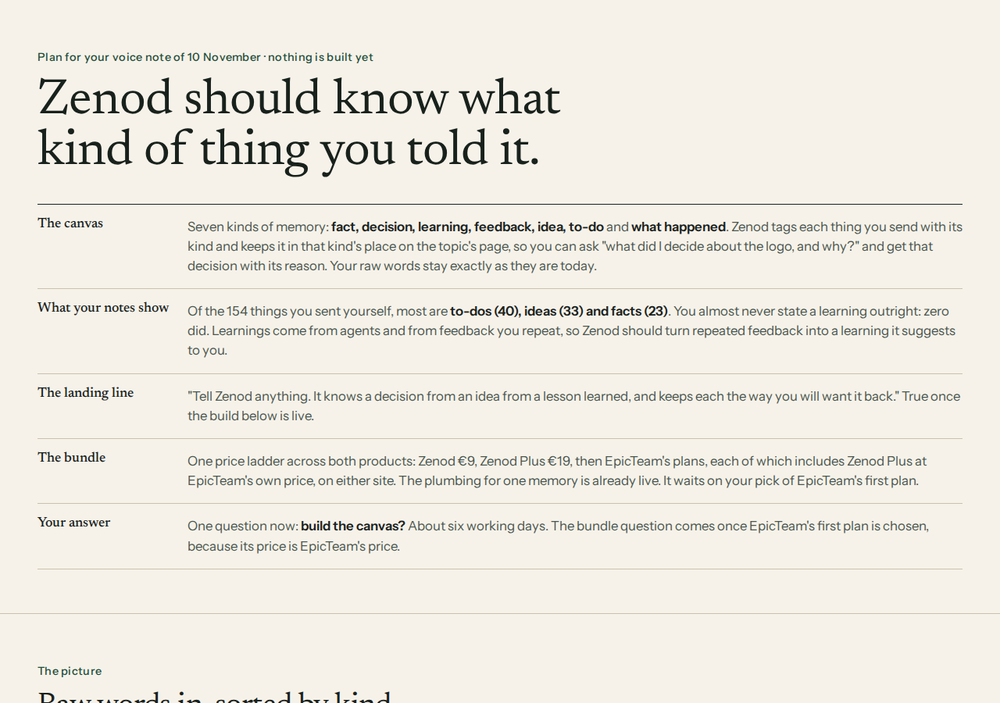

# E22-S1 evidence: memory canvas plan, landing line, Zenod and EpicTeam bundle (2026-11-10)

Row: E22-S1 in [EPIC-22](../zenod-is-the-librarian-of-your-memory-fo.md) · run run_e9da6afd-145b-4f0d-a588-619c65ec8bd6 · plan round, nothing built.
Page (tailnet): http://vps3.taild81fbb.ts.net:8921/e22-s1/ · checked at 1280 and 390 wide, no sideways overflow.
Source: Jordi's WhatsApp voice note 2026-11-10 03:54Z, Zenod Log/2026-11-10.md ^e-ecf0b8 (read only).

## Bottom line

- **Canvas:** seven kinds of memory: fact, decision, learning, feedback, idea, to-do, what happened. Filing tags each topic with its kind and writes it in that kind's section on the topic page; search, answers and MCP can ask for one kind. Raw log, tree and chat replies unchanged (L-6).
- **Landing line (true once built):** "Tell Zenod anything. It knows a decision from an idea from a lesson learned, and keeps each the way you will want it back."
- **Bundle:** recommended one ladder: Zenod €9, Zenod Plus €19, then EpicTeam's plans with Zenod Plus included at EpicTeam's own price, sold from either site. Waits on agent_team E97-A2 (EpicTeam's first plan). L-7 seams kept: billing grants both accounts; the products talk only through MCP and the subscriber push.

## Sources checked

- EpicSpine product canvas: epicspine-skill `skill/epic-spine/packs/social/schema.json` `product` (eight parts) and `intake.kinds` (each desk message sorted into one kind, landing in one place) @ f4fb816.
- Zenod filing today: `packages/core/src/engine` splits a capture into topics and picks pages (`classificationContract.ts`, `meaningNotes.ts`); dated facts with history are `temporalFacts.ts` (`memoryFacts` frontmatter, live on 13 of Jordi's pages); pages are summary plus dated Capture sections; no kind of memory exists.
- Seams for one memory, live: Sign in with Zenod and subscriber push (docs/DEPLOYMENTS.md "Subscribers", live 2026-11-02 bb9eaec), MCP `search_memory`, `ask_brain`.
- Prices: zenod.dev shows €9/month + VAT (fetched 2026-11-10); Zenod Plus €19 agreed (EPIC-14 E14-A6) and not on sale; free is self-hosted only, every paid plan hosted with WhatsApp (EPIC-14 Decisions 2026-11-09). EpicTeam €49 own AI and €99 all included are proposals in agent_team EPIC-97, waiting on E97-A2.

## The count (method)

All 1,102 entries of Jordi's Log (2026-06-04 to 2026-11-10), each labelled with one main kind plus any others by six Sonnet readers (read only; long voice notes judged on their first 2,500 characters, agent entries on their first 600). Rough, not hand-checked; 3 entries unlabelled.

| Kind | Jordi (WhatsApp, web, Drive) | Agents (MCP) | All |
|---|---|---|---|
| to-do | 40 | 63 | 103 |
| idea | 33 | 64 | 98 |
| what happened | 26 | 533 | 566 |
| fact | 23 | 77 | 102 |
| feedback | 11 | 38 | 49 |
| decision | 1 | 98 | 100 |
| learning | 0 | 33 | 33 |
| other | 20 | 27 | 48 |
| total | 154 | 935 (+2 unlabelled) | 1,102 (13 with no source) |

Feedback appears anywhere in 21 of his 154 entries; learning in 2. So learnings should mostly come from repeated feedback, suggested to him.

## Draft ask E22-A3 (for the Delivery Manager to post; not posted)

[ask E22-A3: decide @Jordi row E22-S1] Build the memory canvas? Open http://vps3.taild81fbb.ts.net:8921/e22-s1/ (about 4 minutes) — context: you asked that Zenod know how to store a learning, like EpicSpine's product canvas; the page proposes seven kinds, fact, decision, learning, feedback, idea, to-do and what happened, each kept in its own place on the topic's page and found by asking for it ("what did I decide about the logo, and why?", "what's still open?"); counted on your 1,102 real log entries, what you send yourself is mostly to-dos, ideas and facts, and you almost never state a learning, so repeated feedback becomes a suggested learning; examples are made up — impact: a yes starts about six working days: kind on every filed topic, kind sections on pages, find by kind in search, answers and MCP, the feedback-to-learning suggestion, then the landing line "Tell Zenod anything. It knows a decision from an idea from a lesson learned, and keeps each the way you will want it back." — risk: low; your raw words, the tree and what Zenod says in chat stay as today, old pages are not rewritten at first; rollback is reverting the release — options: yes, all seven · only your four, fact, decision, learning and feedback · change the kinds — recommend: yes, all seven, because your own notes are mostly to-dos and ideas — why Jordi: it changes how Zenod keeps your memory and what it promises — unblocks: build rows B1 to B5 — details: [evidence](evidence/e22-s1-2026-11-10.md)

## Draft ask E22-A4 (plan text: post only after agent_team E97-A2 is answered)

Sell Zenod and EpicTeam as one ladder? — Zenod €9, Zenod Plus €19, then EpicTeam's first plan with Zenod Plus included at EpicTeam's own price, sold from either site, one memory — options: A one ladder (recommended: no new price, what you described; including Plus costs about €2 to €5 of AI a month per customer) · B a bundle discount, e.g. €59 for Plus with the €49 plan · C sell apart until each has paying users — why Jordi: prices are his call — unblocks: B6. Needs from agent_team: plan says it includes Zenod Plus; same Stripe account or a one-time grant link; a Sign in with Zenod step in the E97-S2 wizard; what the desk writes back, MCP only (desk note db5555d3).

## Draft build rows (enter the ledger on a yes to E22-A3)

| Row | Work | Est. | Depends |
|---|---|---|---|
| B1 | Kind on every filed topic (seven kinds), written beside the topic and on the log filing line; measured on 100 hand-labelled real entries; chat replies unchanged | 2 d | E22-A3 |
| B2 | Kind sections on topic pages (Decisions, Learnings, Feedback, Ideas, Open) beside facts and timeline; new filings only | 2 d | B1 |
| B3 | Find by kind: `kind` filter in search, answers and MCP; a kind filter in the Memory tab | 1 d | B2 |
| B4 | Same feedback twice on a topic becomes a suggested learning on the existing suggestion cards | 1 d | B2 |
| B5 | Landing line on zenod.dev, inside EPIC-25's landing work | 0.5 d | B1–B3 live |
| B6 | Bundle: Zenod Plus price, pricing card, shared checkout or grant link; agent_team does its side | 2 d | E22-A4, E97-A2 |

## Also in the note

- Landing (raw kept forever, cloud of thoughts, librarian, one memory every AI reads): EPIC-25. Tester invite: EPIC-26.
- EpicSocial vs EpicTeam, and EpicTeam's side of the bundle: agent_team desk note `desk/inbox/2026-11-10-zenod-also-in-jordi-s-note-2026-11-10-03-54z-z.md` (db5555d3).
