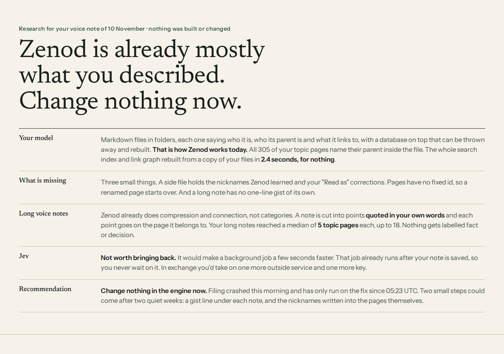

# E22-S2: Zenod as markdown files that know their place, how close it is today

Row E22-S2 in [EPIC-22](../zenod-is-the-librarian-of-your-memory-fo.md) · run run_b4762199-92fb-448d-a009-e6c702837f6e · 10 November 2026 · research only, nothing built or changed

Page: http://vps3.taild81fbb.ts.net:8921/e22-s2/ (tailnet)

Source: Jordi's voice note vn_175d7a7f, his answer to E22-A3.

**Bottom line: Zenod is already mostly what he described. Change nothing in the engine now.** Every topic page names its parent inside the file, and the whole search index and link graph rebuild from the markdown alone in 2.4 s for $0. The one gap is the quick index side file. Filing crashed this morning and has only run on the fix since 05:23 UTC, so the two small improvements wait for two quiet weeks.

## What we stop changing (from today, 10 November, for two weeks)

Your words, 05:18Z: "we are leaping a lot on Zenod, deep structural changes; when I try it I get very weird behaviour; the one thing I like is the voice notes keep working". So, until 24 November:

- **Frozen:** how Zenod files a note, how it finds one, the page format and the tree. No new structure, no categories, no canvas, no bundle.
- **Still allowed:** fixes for things that break or lose a note (the filing crash, M3), and fixes to answers you report as wrong, each tested on your own questions before it ships.
- **Running, observation only:** a week of watching the helpers (S30) and counting your mode switches (L3). They change nothing until you see the results.
- **Kept as ideas, not built:** the one-line gist under each note, pages listing where each note went, nicknames written into the pages, Zenod as a dispatcher that sends a memory to EpicTeam and brings the answer back to your inbox.
- **On 24 November:** we look at two weeks of filing and your answers, and only then propose the smallest next step.

## 1. How close to "each file says me, my parent, my links; reboot from the markdown"

Counted on a read-only copy of his vault at 2026-11-10 05:37 UTC (vault commit f280900). Only counts are recorded here.

| Question | Today |
|---|---|
| Each file says who it is | title in every page; summary and type in 303 of 305 live topic pages; each of 1,103 Log entries has its own id |
| Each file names its parent | 305 of 305 live topic pages, all resolve (0 before E9-2a on 2026-11-01) |
| Each file says its links | 287 of 305 pages cite the notes they came from; 114 link sideways beyond their parent; only 32 of 142 voice-note entries list their pages themselves (the pages hold the link) |
| Children in the file | derived from parents; 9 branch pages also list them. Keep it derived: two copies drift |
| Rebuild from markdown alone | search and graph: yes. `zenod index rebuild` with production code 1f1ebae on the copy: 1,420 rows from 481 files, 2,297 edges, 5,432 weighted links, 2.4 s, no model call |
| Outside the markdown | the quick index side file `quick-index.json` (nicknames found by a model call, "Read as" corrections, a few written summaries). Nicknames re-derivable for at most $0.15 (first-build cap); corrections would be lost |
| Fixed id per page | 0 of 305 pages carry `zid`; ids follow the path, so a rename starts a new node |

Verdict: nearly all true today; one small side file sits outside the markdown.

## 2. Smallest step to make it fully true

Write quick-index nicknames and corrections into each page's own `aliases:` front matter (already used by 10 pages), so the side file is only a cache; add a nightly rebuild-and-compare check on VPS3, off production. Risk low to medium: it writes pages after every filing, the path that crashed today (E24-M3). Worth small now. Later, after two quiet weeks of filing. Push-back: a fixed id is not worth it (12 merges since June, each recorded in the file as `merged-into`); children should stay derived.

## 3. Long voice notes: compression and connection today

Today: transcript saved word for word in the Log first (the step that never breaks); one model reading cuts it into points quoted in his own words and picks a page for each; points land on their pages with a link back, unplaced points become provisional pages (203 of 305 are provisional); the index ties the note to each page and the pages to each other.

| His voice notes | Notes | Reached a topic page | Pages per note |
|---|---|---|---|
| over 1,000 words | 31 | 28 | median 5, max 18 |
| 300 to 1,000 words | 29 | 23 | median 2 |
| under 300 words | 82 | 34 | median 0 |
| all before 2026-11-10 | 70 | 66 | |
| 2026-11-10 batch (69 from EpicTeam's voice buttons) | 72 | 19 | rest saved and searchable, not filed yet |

Better without categories: a gist line under each note in the Log (the classification summary already exists; today it only reaches the receipt and the commit message), and each note listing its pages. Both go through filing, so later.

Model pass: DeepSeek, 9.4 s of model time and 0.19¢ off-peak (0.39¢ peak) per filing ([E14-S11](e14-s11-2026-11-09.md)); long notes not measured separately. Reliability is the weak spot (E24-M1, E24-M3), not speed.

Jev (TypeSafe): only the filing choice, typed output, 2.5 s timeout then fallback; off since E7-A13 (2026-11-02, leaked key). Not worth bringing back: filing runs after the note is saved, so speed is never felt; a percentage breakdown of a note helps neither finding nor connecting; one more service and key.

## 4. Ask for the Delivery Manager (drafted, not posted)

[ask E22-A5: decide @Jordi row E22-S2] Leave Zenod's engine as it is for now? Open http://vps3.taild81fbb.ts.net:8921/e22-s2/ (about 3 minutes) — context: you asked whether Zenod can be plain markdown files that each say who they are, their parent and their links, rebuildable from the files, with compression and connection instead of categories; it already mostly is: all 305 of your topic pages name their parent in the file, your exact words stay in the Log, and the whole search and link index rebuilt from a copy of your files in 2.4 seconds for nothing; a 10-minute note is cut into points quoted in your words and placed on the pages they belong to, a median of 5 pages for your long notes, with no categories; the gaps are small: a side file of nicknames and your "Read as" corrections, and no one-line gist under each note; a fast classifier like Jev would save seconds on work you never wait for and add another outside key — impact: nothing changes and voice notes keep working as today; after two quiet weeks of filing we come back with two small steps, a gist line under each note and the nicknames written into the pages — risk: none now; nothing to roll back — options: leave it as it is, look again in two weeks · build the two small steps now · bring back Jev — recommend: leave it as it is, because filing crashed this morning and has only run on the fix since 05:23 UTC, and the gaps cost little — why Jordi: it is your call how much the core engine changes — unblocks: nothing; it closes the canvas question — details: [evidence](evidence/e22-s2-2026-11-10.md)

## How counted

Read only: a clone of the vault, scripts outside the repo reading counts only, the index rebuilt with the production build (1f1ebae) into a throwaway data dir. No model call; nothing written to the vault or production. All examples on the page are made up. Code read: `packages/core/src/vault/{tree,memoryIndex,memoryWeights,quickIndex}.ts`, `packages/server/src/quickIndex.ts`, `packages/core/src/engine/{treePlacement,noteLinker,classificationContract,sourcePassages}.ts`, `packages/core/src/llm/jev.ts`.

Also found: 53 of the 72 voice notes logged on 2026-11-10 (a batch through EpicTeam's voice buttons, 48 captured in the 01h UTC hour) were not on any topic page at 05:37 UTC; saved and searchable. Handed to the errors epic (EPIC-24) as a watch item in this row's report.
