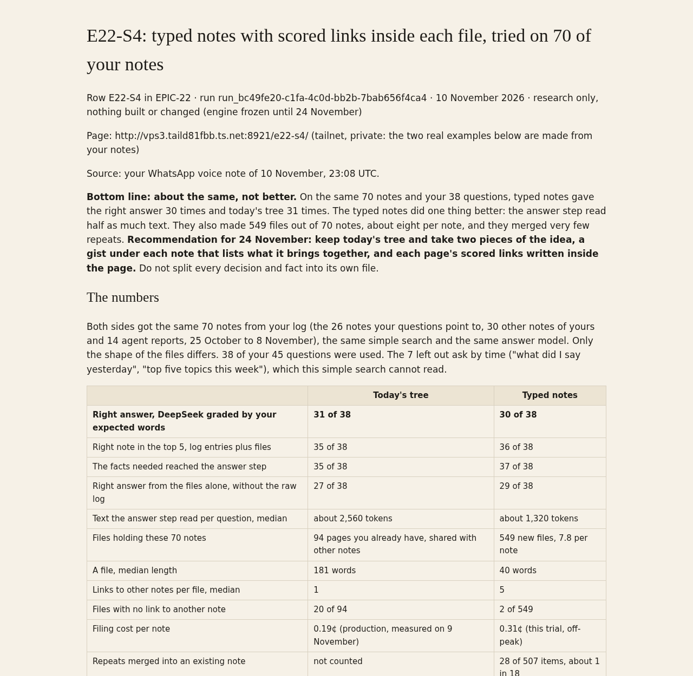

# E22-S4: typed notes with scored links inside each file, tried on 70 of your notes

Row E22-S4 in [EPIC-22](../zenod-is-the-librarian-of-your-memory-fo.md) · run run_bc49fe20-c1fa-4c0d-bb2b-7bab656f4ca4 · 10 November 2026 · research only, nothing built or changed (engine frozen until 24 November)

Page: http://vps3.taild81fbb.ts.net:8921/e22-s4/ (tailnet; that page also shows two real typed notes made from your notes, this public copy only shows made-up ones)

Source: your WhatsApp voice note of 10 November, 23:08 UTC.



**Bottom line: about the same, not better.** On the same 70 notes and your 38 questions, typed notes gave the right answer 30 times and today's tree 31 times. The typed notes did one thing better: the answer step read half as much text. They also made 549 files out of 70 notes, about eight per note, and they merged very few repeats. **Recommendation for 24 November: keep today's tree and take two pieces of the idea, a gist under each note that lists what it brings together, and each page's scored links written inside the page.** Do not split every decision and fact into its own file.

## The numbers

Both sides got the same 70 notes from your log (the 26 notes your questions point to, 30 other notes of yours and 14 agent reports, 25 October to 8 November), the same simple search and the same answer model. Only the shape of the files differs. 38 of your 45 questions were used. The 7 left out ask by time ("what did I say yesterday", "top five topics this week"), which this simple search cannot read.

| | Today's tree | Typed notes |
|---|---|---|
| **Right answer, DeepSeek graded by your expected words** | **31 of 38** | **30 of 38** |
| Right note in the top 5, log entries plus files | 35 of 38 | 36 of 38 |
| The facts needed reached the answer step | 35 of 38 | 37 of 38 |
| Right answer from the files alone, without the raw log | 27 of 38 | 29 of 38 |
| Text the answer step read per question, median | about 2,560 tokens | about 1,320 tokens |
| Files holding these 70 notes | 94 pages you already have, shared with other notes | 549 new files, 7.8 per note |
| A file, median length | 181 words | 40 words |
| Links to other notes per file, median | 1 | 5 |
| Files with no link to another note | 20 of 94 | 2 of 549 |
| Filing cost per note | 0.19¢ (production, measured on 9 November) | 0.31¢ (this trial, off-peak) |
| Repeats merged into an existing note | not counted | 28 of 507 items, about 1 in 18 |

Answers differ on 5 questions: today got 3 of them right, typed notes 2. One question of 38 apart counts as "same". Readable by hand: a typed note is short and clear on its own, but a topic is spread over many of them. Three notes about the Airbnb observatory became eight separate files. Across your whole log of 1,212 entries this shape would make about 9,500 files, against 305 topic pages today, and a rebuild of all of it would cost about $3.80.

## What you said

"Maybe inside the file itself it can link out from within as if it was HTML. You know, you can say, like, I am connected to these 12 pages, each of them with this relevant score. So this could really be written in each piece. So you don't need a parallel database... fundamentally this is a decision... this other node on the network is fundamentally going to describe this fact... in one note, you're explaining like a situation... It's a pure node of ideas that are kind of coming together into a node."

You also said: "let me extract a list of decisions. Let me extract a list of facts... the next step is like, are these things new or are they complementing an existing thing?" and that the typed graph "is also like... a second graph on top of the pure knowledge graph".

## The design that was tried

One incoming note goes through two model passes.

1. **Take out.** The note is read once and split into decisions (what you chose or asked for, with your reason), facts (what is true: names, numbers, places, prices) and events (what happened or is planned, with a date). At most 12 per note, each one short sentence plus your words in quotes. The note itself becomes one **situation** file: a one-line gist and a list of what it brings together.
2. **New or adds to.** Each item is shown the closest existing notes. The model says whether it is new or adds to one of them (then it goes under "Since then" on that note, with the date and source), and which existing notes it relates to, with a score from 0.1 to 1.0.

Every file carries its links and scores in its own front matter, and links are read from both ends, so the graph rebuilds from the files alone. Your raw words stay in the Log as today. A made-up example:

```
---
id: d-0042
type: decision
title: "Show the garden photos on the landing page before the text"
created: 2026-11-04
updated: 2026-11-07
sources:
  - "Log/2026-11-04.md#^e-000001"
  - "Log/2026-11-07.md#^e-000002"
links:
  - {to: "[[s-0018 voice note about the new landing page]]", score: 1.0}
  - {to: "[[f-0090 visitors leave the page after eight seconds]]", score: 0.7}
  - {to: "[[d-0031 one button only on the first screen]]", score: 0.4}
---
# Show the garden photos on the landing page before the text

"People need to see it before they read about it."

Why: visitors leave before they reach the pictures.

## Since then
- 2026-11-07: photos first on phones too (Log/2026-11-07.md#^e-000002)
```

## What worked and what did not

- **Worked:** short notes read well on their own; the situation file is a good gist of a long voice note and links straight to its decisions; links inside the file make the graph portable with no database; the answer step reads half as much.
- **Did not:** the number of files; weak merging (a repeated decision usually became a new file instead of a "since then" line); the model writes in the third person ("he wants"), so your words are only in the quotes; misheard names are copied as they came (Zenot, Xenon), the same gap E22-S2 found.
- **Already there today:** E22-S2 found the search and the weighted graph rebuild from the markdown alone in 2.4 seconds, so the database is already only a cache. 13 topic pages already carry typed facts with their source in their front matter.

## Recommendation for 24 November, when the freeze ends

Only if the two weeks of filing were quiet, one at a time, each measured on your questions with this same trial before it ships:

1. **A gist under each note, listing what it brings together.** This is the situation node, written in the Log entry itself. It is the E22-S2 gist line with its links.
2. **Scored links inside each page.** Each topic page lists its strongest links with their score in its own front matter, from the strengths Zenod already computes, so every page says "I am connected to these 12 pages, with these scores". The index stays a cache rebuilt from the files.
3. **Not now:** one file per decision, fact or event. It answered no better, made eight files per note and merged too little. If you still want decisions and facts typed, they can live as short typed lines inside the topic page they belong to, which 13 pages already do for facts.

## How it was done

Read only. A copy of your vault at revision a85308c, made with git archive into a private folder on VPS3; nothing written to your vault or to production. DeepSeek Flash on the separate test key, 300 calls, $0.28 in total (taking out and merging $0.22, answers $0.06), under the $0.30 to $1 limit for this row. The search is plain word matching plus one step along the links, the same code for both sides, so it compares the shapes, not production's search, which scores 100% of 53 on your notes. Questions, notes and answers stay private on VPS3; only counts are here. Scripts and outputs: VPS3 `~/zenod-eval/e22-s4/`.
