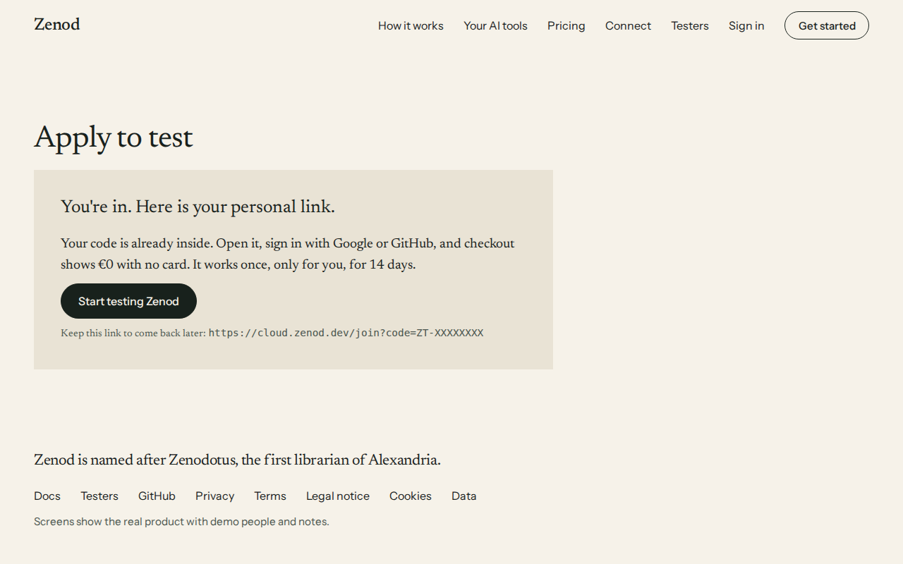
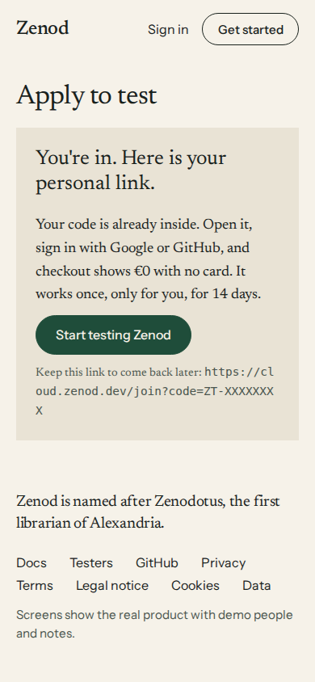
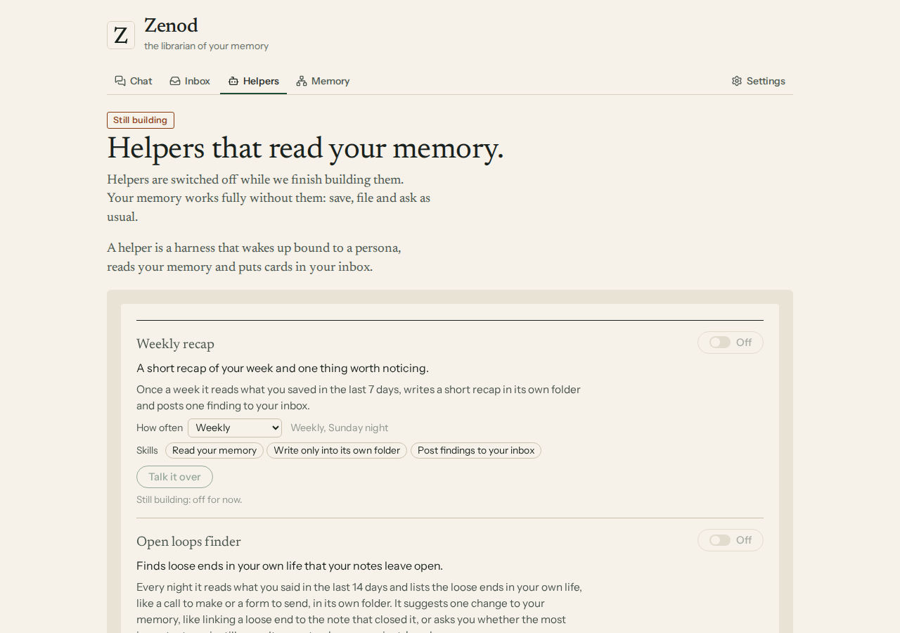
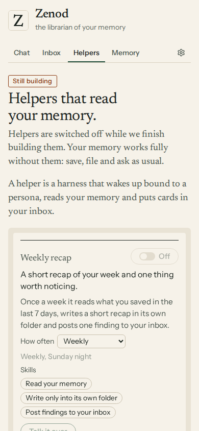
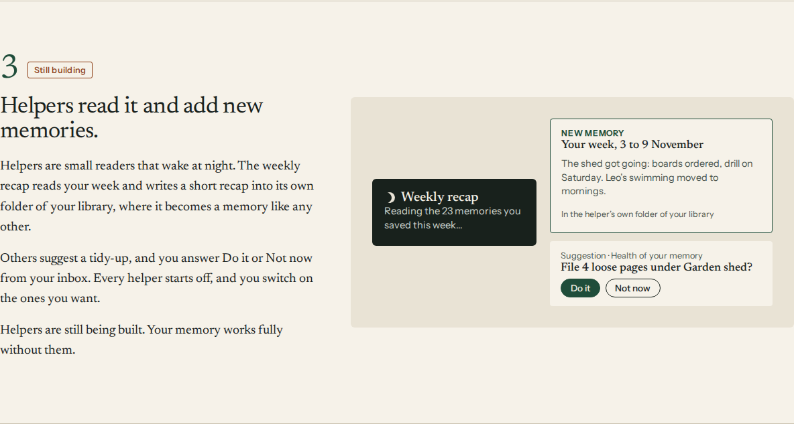

# Is Zenod, memory only, ready for testers? 11 Nov 2026

**Verdict: live. Zenod, memory only, is ready for testers on production d9ebdd6, checked 04:23Z. Each tester gets their own memory, WhatsApp link and MCP. Someone who applies at zenod.dev/testers and gets a place sees their personal link at once, with a one-time code inside. Their checkout is €0 with no card, one free month and the usage caps. No email is needed. Helpers are switched off and labelled still building for testers, and yours keep running. The social desk has the apply link.**

Your words (voice note, 11 Nov 02:05Z): "if we turn off the personas for launch or during test, we just say it's disabled and we're still building it. For Zenod, let's say Zenod without personas, do we have it already multi-tenant? … I want to get to the state where for at least one of the products, we are live."

## The plain answer, one line each

| Question | Answer | Proof, on production |
|---|---|---|
| Does a new account get its own memory? | **Yes** | Each account gets its own workspace and picks its own Google Drive folder or GitHub repository. Every screen and every answer takes the account from the sign-in only, never from the request. Drive consent is bound to one account and refused if the account changes mid-way. The code running live is covered by isolation tests: one account's routes return nothing of another's. |
| Its own WhatsApp link? | **Yes** | In Settings, a tester types their number and sends a short code to the Zenod number. From then on, messages from that number file into their memory only. A sender that matches no account is refused before anything happens, and one sender reaches exactly one account. Your own WhatsApp notes keep filing into your memory, 33 in the week before 10 Nov. |
| Its own MCP? | **Yes** | `cloud.zenod.dev/mcp` answers 401 to anyone not signed in and points to Zenod's own sign-in, checked tonight. Each AI tool signs in per account, and its token reaches that account only. |
| Billing with the tester code, €0, one free month, the cap? | **Yes** | At 04:23Z one test application from one of our own addresses, which takes no place, was accepted. The answer carried a fresh code and its personal link. The link opens the invite page with Google and GitHub sign-in. The code is a real one-time Stripe code on the tester coupon: E26-S2 round 2 made one and switched it off on this same build at 04:20:58Z. Checkout then opens with the code applied, €0, no card, then "You're in". The free month ends by itself unless the team adds one, with the $3 answer cap and the $5 sorting cap (E26-S5 round 3). The test code was never shown or kept, and it expires by itself in 14 days. |
| Sign-up open to the public? | **Yes** | The live readiness report says paid sign-up and Google sign-up are open and ready. Four dated checks are stale: webhook, billing portal, a live billing journey and the Drive acceptance stamp. They are advisory and do not block checkout. |

Not measured with a fresh account tonight: agents have no Google or GitHub sign-in of their own, and the browser we share has none either. So the first tester's sign-up is the first live end-to-end run of a brand-new account. An agent watches it.

## Live check, 04:23Z

The live testers page, with production's own answer to the test application played back so no second application was sent. The code is masked here.

## What changed tonight

**Mail is not needed for the first testers.** When someone applies at zenod.dev/testers and gets a place, the page now shows their personal link straight away: "You're in. Here is your personal link." It has a Start testing Zenod button and the link to keep. The email still goes out once Zenod has a mail key. A repeat application never shows the link, so typing someone else's email reveals nothing. Live, and working with real codes since the 04:20:44Z promote. If a code is ever not ready yet, the page says the link comes by email.

**Helpers are off and labelled still building for testers.**

- Every hosted account except yours has helpers switched off on the server. None wakes, none can be switched on, Run now is refused, and Talk it over with a helper is greyed out.
- The Helpers page says "Still building" and "Helpers are switched off while we finish building them. Your memory works fully without them".
- The landing page's helpers section carries the same label.
- Your own helpers are unchanged.
- Chat replies are unchanged.
- One server setting opens helpers for everyone again.

These two screens were drawn locally from the shipped code with a made-up tester account, because the live page needs a tester sign-in agents do not have. The landing page, live:

The line "you switch on the ones you want" in that section is no longer true for testers. It now says they stay off for now ([PR #1627](https://github.com/zenod-ai/zenod/pull/1627)), live on the next promote.

**Our own test applications no longer take one of the ten places.**

**A way round the Stripe permission, now in the code-fix worker's hands.** Before your answer on E26-A3 arrived, the first change let Zenod make a code itself and put the tester coupon straight on checkout. Once you said the key already had Write, U7 stopped there. E26-S2 round 2 took the code path over: a real Stripe code first, Zenod's own code only if Stripe refuses, and a Stripe code is always checked by Stripe. To keep production making no codes until that fix, U7 set the server's minting switch to off for the 04:04Z promote. It was removed again, and the 04:20:44Z promote runs E26-S2's default.

## Releases

- [PR #1621](https://github.com/zenod-ai/zenod/pull/1621), merged as b75a90c: link on screen, helpers still building, test applications. **Live on production 7f36574 since 04:04:13Z**, the first promote, health checked 04:04:17Z.
- [PR #1623](https://github.com/zenod-ai/zenod/pull/1623): closed unmerged, superseded by E26-S2 round 2.
- [PR #1627](https://github.com/zenod-ai/zenod/pull/1627), merged as d219cba: the landing line. On staging, waits for the next promote. Production d9ebdd6 does not carry it yet.
- E26-S2 round 2, d719e34d: the tester code. Live on production d9ebdd6 since the 04:20:44Z promote.

## Still open

- **The tester code.** Done by E26-S2 round 2, live on d9ebdd6 since the 04:20:44Z promote.
- **Mail (E26-A6).** No longer blocks the first testers.

## Spend

No model calls. $0.
