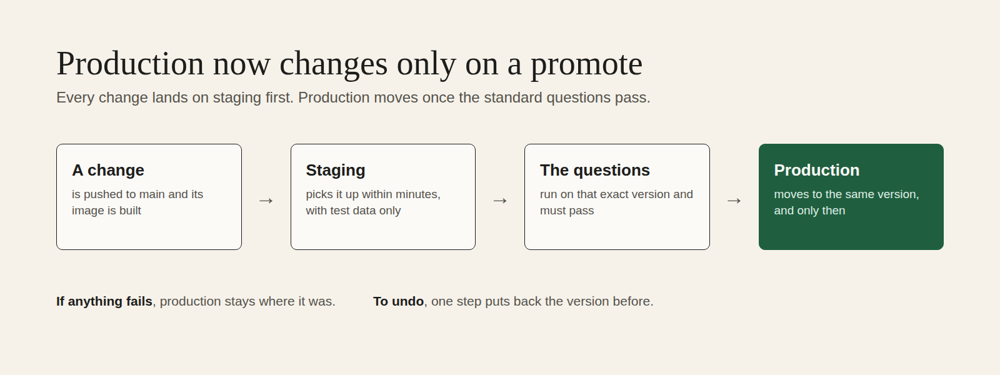

# Production now changes only on a promote

**Every change now lands on a separate staging copy of Zenod first. Production moves only when the standard question set has passed on that exact version, and one step puts the previous version back.**

Asked for by Jordi on 11 November at 02:05 UTC: "a stable production where things are kind of working in a state where we feel like, OK, we're gonna stop here, and then we can keep on the crazy development on another one." Row M10 in EPIC-24, run `run_5e2f6ab3-5177-4574-9ce6-81609780f90b`. Code: zenod PR #1622 (merged 7f36574), infra-vps 9980f3e.

## The first promote, 11 November

| Step | Version | Time (UTC) |
|---|---|---|
| Production before | 3831b06 | rolled 02:50, the last push-to-main roll |
| Staging took another worker's change (the bolder Z) while production stayed put | bfef1a0 | 03:14 |
| Staging took this change | 7f36574 | 03:50:56 |
| The question set passed on 7f36574 | 7f36574 | 03:51 to 04:03 |
| Production promoted | 3831b06 → **7f36574** | **04:04:13**, healthy after 24 s |

This promote carried three changes to production: the bolder Z mark for zenod.dev and the app, Zenod live for testers with memory only, and this switch itself.

**The question set on 7f36574** (free stand-in model, no spend), each above its floor of 85% ingestion, 90% retrieval and at most 10% errors:

| Set | Ingestion | Retrieval in the top 5 | Errors |
|---|---|---|---|
| Demo vault | 96% (24/25) | 100% (40/40) | 1.7% (1/58) |
| Jordi's real notes, on a throwaway copy | 94.1% (16/17) | 98.2% (56/57) | 3.1% (2/64) |

The real-note error rate was 1.6% on the dry run at c31e7a6 an hour earlier. One more test operation failed on 7f36574. That is still well under the floor, so the gate passed. The nightly check will show whether it repeats.

## What staging is

- Its own Zenod app on the same server, running the same image as production, with its own data and one test account. It holds no real users' data and has no WhatsApp number, no Stripe key and no model key.
- Reachable on the tailnet only, at http://100.104.206.10:8781/api/health. The server's firewall lets only web and ssh traffic in from outside, so the public address times out. No new public host, no new key from any provider, no extra spend.
- It follows every push to main within minutes, the way production used to.

## How production moves

The Delivery Manager runs `scripts/promote-production.sh` on VPS3. It does nothing for Jordi to do.

1. It checks that staging is healthy on the version it reports: the health check, the app page and its script, a refused request without a token, and the test account's health.
2. It builds that exact version and runs the standard question set (the memory test suite) on the demo vault and on Jordi's real notes.
3. Only if both pass does it re-pin production to that image. The server waits for the new version to report healthy and puts the old one back by itself if it never does.

Every promote is one line in VPS3 `~/zenod-eval/promotions.jsonl`, with both versions, the numbers and the time.

**Undo, one line:** `scripts/promote-production.sh --rollback` puts back the version production ran before the last promote, here 3831b06.

**Who promotes:** only the Delivery Manager. A promote carries everything on staging, including other workers' changes, so it is one deliberate call.

## Going back to the old way

Two small commits bring back push-to-main: return production to the poller's list in infra-vps `hosts/vps1/deploy-poller.json`, and restore the deploy job in `publish.yml` from its history. The full procedure is in docs/DEPLOYMENTS.md, under "Staging and promote".

## Known side effects

- The publish run for bfef1a0 went red once at 03:30. It started under the old workflow, which waited for production to report the pushed version. Runs from 7f36574 on have no such job.
- The prod smoke check and the health page now expect staging, not production, to be on the newest image. Production behind main is normal now.
