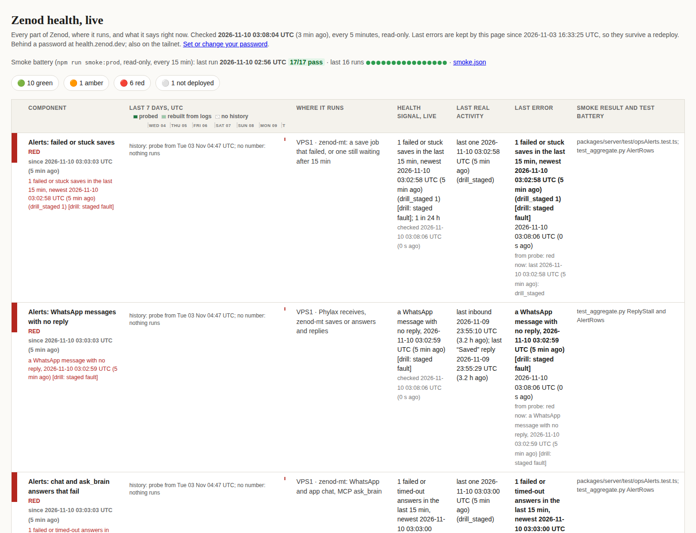

# E24-M2 evidence, 2026-11-10: alerts within 15 minutes, on the health page

Row M2 of [EPIC-24](../zenod-errors-now-find-fix-and-monitor-so.md) (Done means E24-2). Run
run_7ea46bf8-ba5d-48db-a2d8-300133163fcd. Code: PR [#1580](https://github.com/zenod-ai/zenod/pull/1580), merge
`317a333`, **live in production since 2026-11-10T03:35:01Z** (cloud.zenod.dev `/api/health` sha `317a3339b4a2`).
The probe and aggregator (same PR) run on VPS3 from `~/.local/lib/epic6-s1-health/` since 03:02Z. How it works:
[AGGREGATOR.md, EPIC-24 M2](../health/AGGREGATOR.md#epic-24-m2-alert-rows-13-to-18-what-a-person-would-notice).

## What was built

Six new rows on the health page (13 to 18), each red within one probe run (every 5 min) of a failure a person
would notice, sent to the HQ alert thread by the existing S5 sender, cleared 15 min after the last one:
failed or stuck saves, WhatsApp messages with no reply for 15 min, chat and ask_brain answers that fail or time
out, failed sign-ins, app errors (5xx and errors in the browser, which the app now reports itself), helper runs
that fail. Counts, error kinds and route templates only: no message text, emails or ids.

## Proof 1: a drill on every row (staged faults, no account touched)

`probe.py --drill <kind>` for all six kinds at 03:02:58 to 03:03:02Z.

| Row | Red (transition) | Alert queued | Delivered to HQ | Green again | Recovery queued |
|---|---|---|---|---|---|
| 13 saves | 03:03:03 | 03:03:13 | yes | 03:18:06 | 03:18:20 |
| 14 replies | 03:03:03 | 03:03:13 | yes | 03:18:06 | 03:18:20 |
| 15 answers | 03:03:03 | 03:03:13 | yes | 03:18:06 | 03:18:20 |
| 16 sign-ins | 03:08:06 | 03:08:16 | yes | 03:18:06 | 03:18:20 |
| 17 app errors | 03:08:06 | 03:08:16 | yes | 03:18:06 | 03:18:20 |
| 18 helpers | 03:08:06 | 03:08:16 | yes | 03:18:06 | 03:18:20 |

One alert and one recovery per row (`~/.local/state/zenod-alert/alert.log` on VPS1; all 6 alert ids show
`alert=sent` in the HQ relay log). Rows 13 to 15 were picked up by a probe run already in flight at 03:03.
Worst case from fault to alert: 5 min 18 s.

## Proof 2: real faults through the deployed code (317a333)

At 03:36:41Z, from VPS3, no account involved:

- a Google sign-in callback with a made-up code and state → `400`, server line `[ops-alert] signin invalid_state`
- `POST /api/public/client-error {"kind":"staged"}` → `204`, server line `[ops-alert] app client_staged`

The 03:38 run turned rows 16 and 17 red, and both alerts were queued at 03:38:20Z (1 min 39 s after the fault).
Both alerts were delivered to the HQ thread. Both rows turned green at 03:53:06Z and each sent one recovery at 03:53:20Z.

## Tests

`packages/server/test/opsAlerts.test.ts` (6), `apps/web/src/lib/client-errors.test.ts` (4),
`docs/health/s1-live/test_aggregate.py` (43, new `AlertRows`), `test_probe.py` (9). `ci` on #1580 green.

## Not proven live

- The browser side of app errors (a real script error in a visitor's browser) is unit tested and goes through the
  same endpoint as proof 2. It has not been triggered in a real browser.
- Stuck saves and ask_brain timeouts are unit tested. In production only the drill exercised them, because
  forcing them would need someone's save or question.

