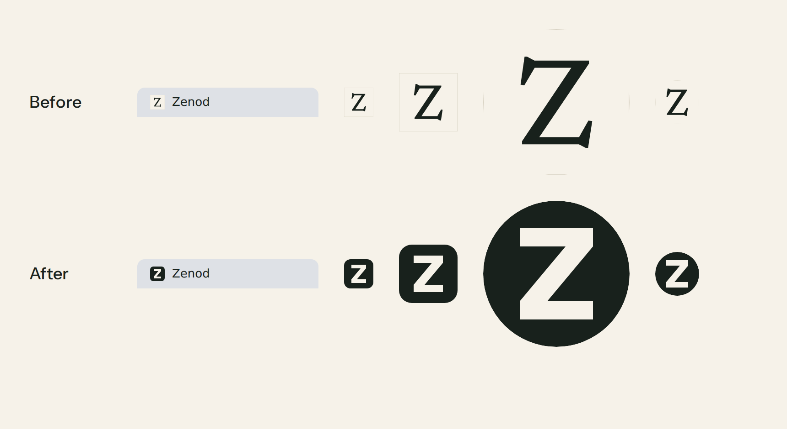
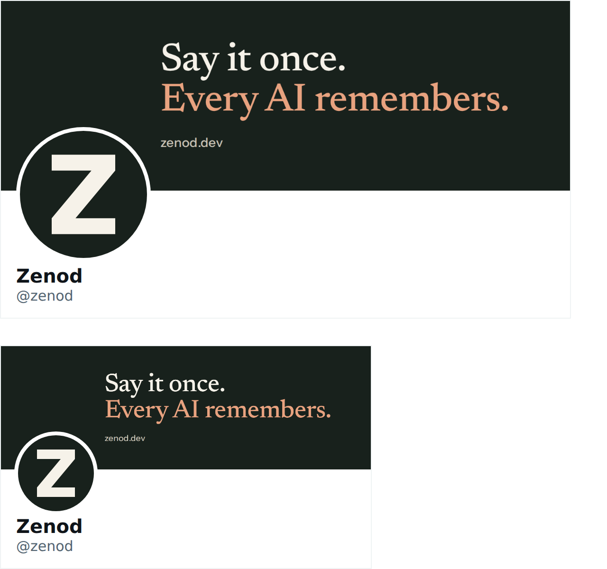
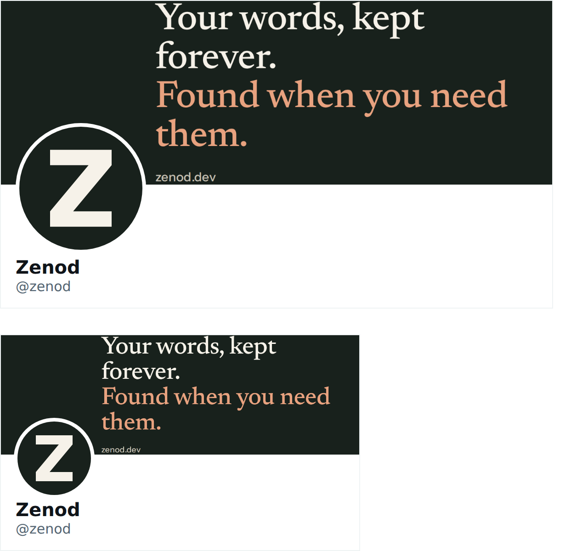
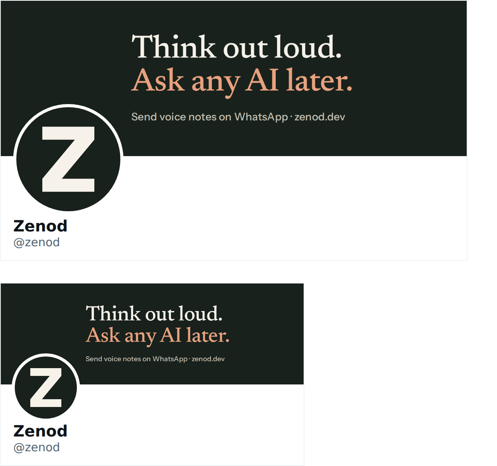
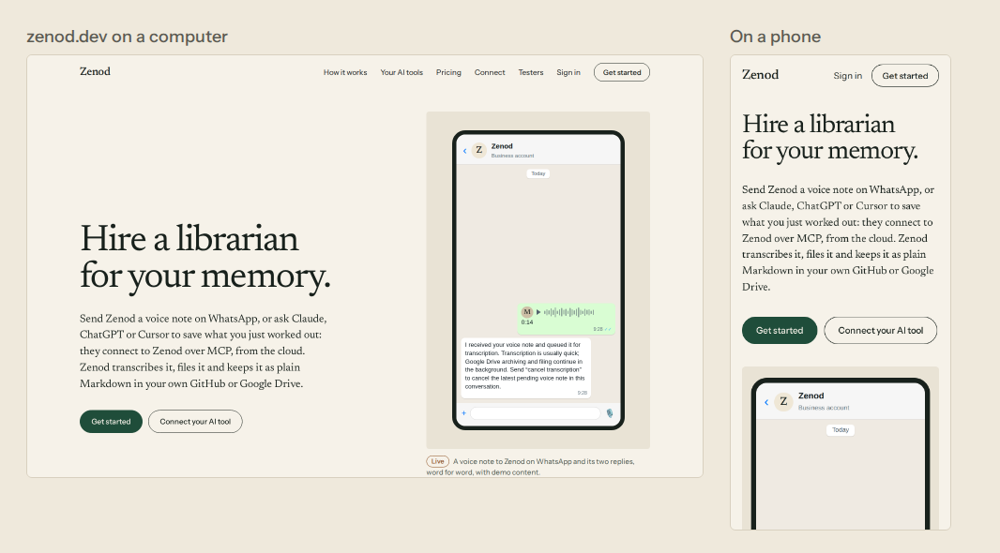
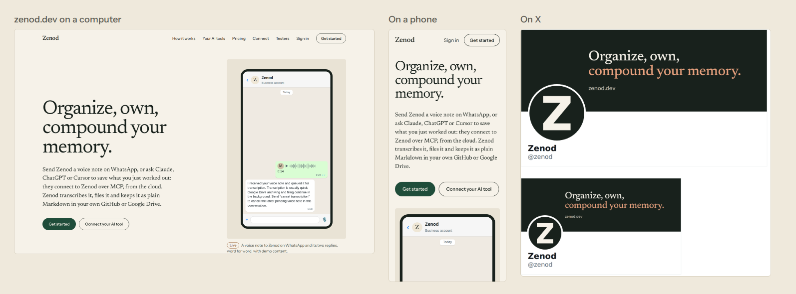

# A bolder Z for Zenod, and three tagline options (2026-11-11)

**Bottom line:** the thin Newsreader Z is replaced by a heavy parchment Z on Zenod's ink tile, for zenod.dev and the app. It is merged and running on staging, and reaches production at the next promote. Its top and bottom bars are a fifth of the letter's height, the same weight as the EpicTeam T and EpicSpine E, and it stays readable at 16 px and cropped round. Three taglines are below on X banner mocks. The landing tagline is unchanged until Jordi picks one.

Jordi's words (EpicTeam desk, 2026-11-11): "an icon for this Z that is worse than a lot of the other icons we have which are better this is too thin on the top and bottom and also the banner you can barely read and maybe a cooler tagline."

## The Z, before and after

Browser tab, 32 px, 64 px, a round avatar and a small round avatar:

- Where it runs: merged in PR #1620 as bfef1a08 on 2026-11-11 at 02:52Z. Staging reports bfef1a08 at `/api/health` and serves the new Z as the site favicon, the app favicon and the listing icon (checked 03:35Z). Production still runs 3831b06. Since today's switch to staging and promote, a push to main no longer rolls production, so publish run 42948887365's old deploy check went red as expected. zenod.dev and the app show the new Z after the Delivery Manager's next promote.
- Files: the tab icon, touch icon and app icons for zenod.dev and the app, and the listing icon at https://zenod.dev/brand/zenod-icon.svg, https://zenod.dev/brand/zenod-icon-512.png and https://zenod.dev/brand/zenod-icon-1024.png. The PNGs are full-bleed ink squares, so avatars and directories can crop them round or rounded.
- The old Z stays in git and can come back with one revert.

## Three taglines, on an X banner at real size

Each mock is a 1500 by 500 banner, shown as X lays it out on a computer and a phone, with the new Z as the avatar. The words sit right of the avatar so it never covers them. Large light text on ink, so it reads at the size X shows it.

**A. Say it once. Every AI remembers.** (recommended)

**B. Your words, kept forever. Found when you need them.**

**C. Think out loud. Ask any AI later.**

Full-size banners: [A](e25-s1/banner-a.png) · [B](e25-s1/banner-b.png) · [C](e25-s1/banner-c.png)

### Why A

It is the shortest and it names the one thing nobody else has. You tell Zenod once, by WhatsApp voice note or any connected tool, and Claude, ChatGPT, Cursor, VS Code, Codex, Gemini CLI and any MCP tool read the same memory. B is true and calm but sounds like a notes app. C is the most playful and fits the voice-note habit, but "later" undersells it.

All three hold today: WhatsApp captures voice notes, the log is kept word for word in the user's own Drive or GitHub, and every connected AI reads and writes one memory over MCP. That is the same as what zenod.dev's five moves say.

## Split with the social team

This row owns the Z and the tagline options. Building and uploading each channel's avatar and banner (X, YouTube, Instagram, LinkedIn) is the social team's row, using the files above and the tagline Jordi picks.

## Round 2: taglines in Jordi's pattern (2026-11-11)

Jordi's answer to the three taglines above, word for word: "Organize, own, compound your memory - play with sentencer like that".

So A, B and C are out. Below are six lines in his rhythm, three short verbs and then "your memory", his own first. Each is shown as the zenod.dev hero line, on a computer and a phone, and on the same X banner at real size. The site shots are the live zenod.dev with only the two hero lines swapped in the browser, nothing deployed.

Today's hero, for comparison:

**1. Organize, own, compound your memory.** (Jordi's own words)

**2. Capture, own, compound your memory.** (recommended)

**3. Own, organize, compound your memory.**

**4. Capture, organize, own your memory.**

**5. Speak, file, own your memory.**

**6. Keep, link, own your memory.**

Full-size X banners: [1](e25-s1/r2/banner-1.png) · [2](e25-s1/r2/banner-2.png) · [3](e25-s1/r2/banner-3.png) · [4](e25-s1/r2/banner-4.png) · [5](e25-s1/r2/banner-5.png) · [6](e25-s1/r2/banner-6.png)

Full-size zenod.dev shots, computer and phone: [1](e25-s1/r2/hero-1-desk.png) [phone](e25-s1/r2/hero-1-phone.png) · [2](e25-s1/r2/hero-2-desk.png) [phone](e25-s1/r2/hero-2-phone.png) · [3](e25-s1/r2/hero-3-desk.png) [phone](e25-s1/r2/hero-3-phone.png) · [4](e25-s1/r2/hero-4-desk.png) [phone](e25-s1/r2/hero-4-phone.png) · [5](e25-s1/r2/hero-5-desk.png) [phone](e25-s1/r2/hero-5-phone.png) · [6](e25-s1/r2/hero-6-desk.png) [phone](e25-s1/r2/hero-6-phone.png)

### What each verb rests on today

- Capture: you send a WhatsApp voice note, or ask Claude, ChatGPT, Cursor or another connected tool to save something over MCP.
- Organize, file, link: Zenod transcribes each note, files it under a topic and links it to related notes.
- Own, keep: every note is kept word for word as plain Markdown in your own Google Drive or GitHub.
- Compound: each new note is filed next to and linked with what is already there, and every connected AI reads the same memory, so it gets more useful the more you add. This is the softest of the verbs: it promises growth, not a feature, and it is Jordi's word.
- Speak: true for voice notes, but it leaves out saving from an AI tool, which is why 5 is not the pick.

### Why 2

It keeps Jordi's rhythm and his strongest word, compound, and swaps "Organize" for "Capture". Organize sounds like work you do; Zenod does the organizing for you. Capture is the one thing you do, send a note, and the three verbs then read in the order things happen: you send it, it lands in your own Drive or GitHub, it grows. If he prefers his own line exactly, 1 works just as well on the banner and the site.

### zenod.dev too?

On the site all six fit two lines on a phone and two to three on a computer, and the paragraph under the hero still explains how. Recommend using the pick on zenod.dev as well, so the banner and the site say the same thing; the page title and link preview, which say "hire a librarian for your memory" today, would change with it. One line of copy, undone by one revert. Nothing changes on the site until he picks.
