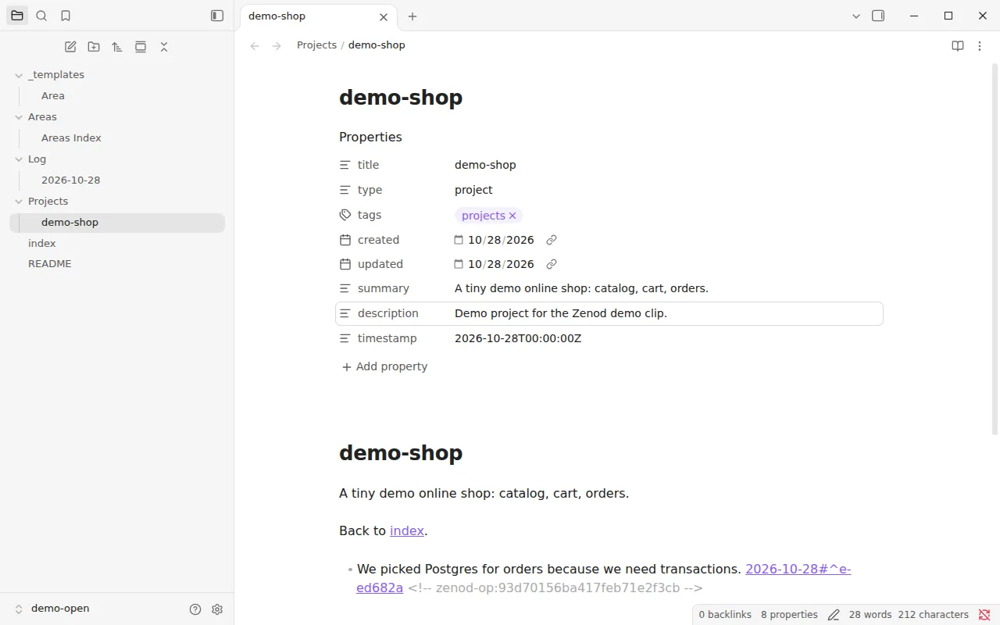
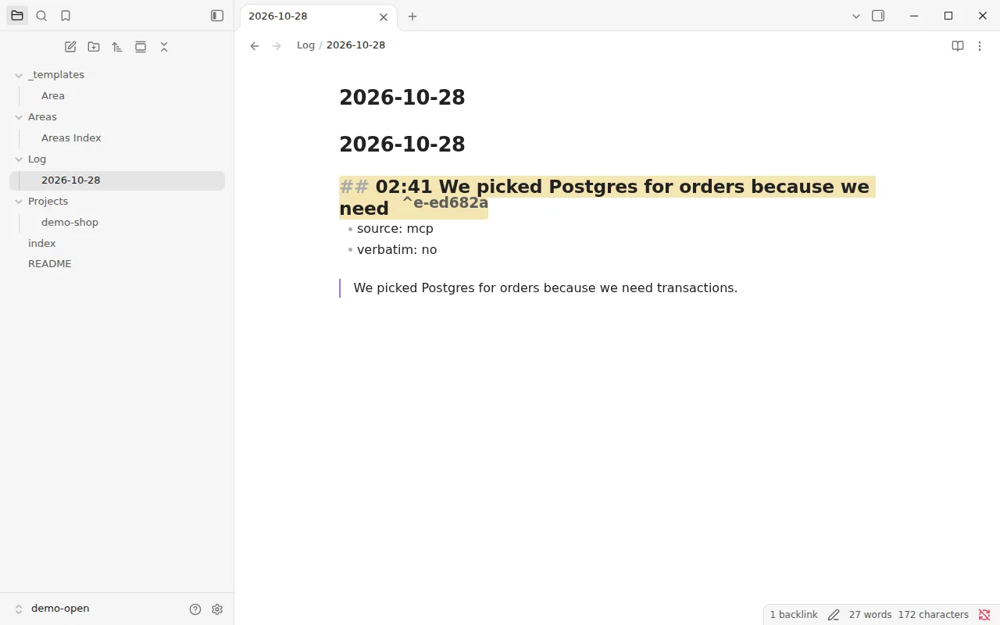
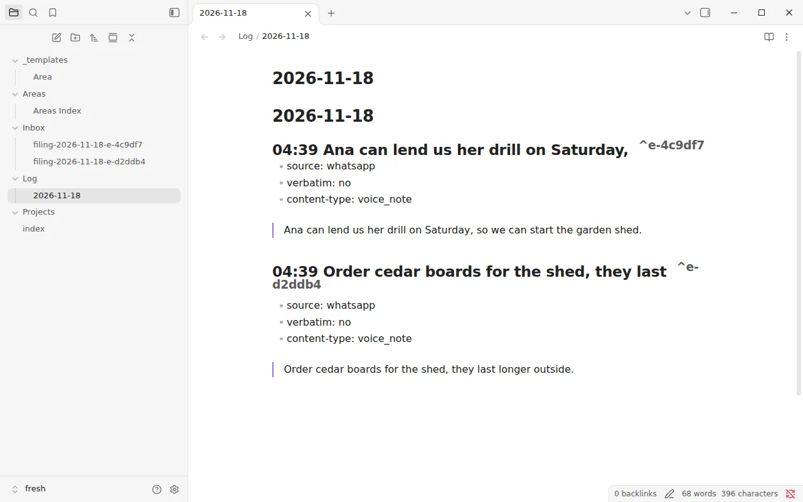
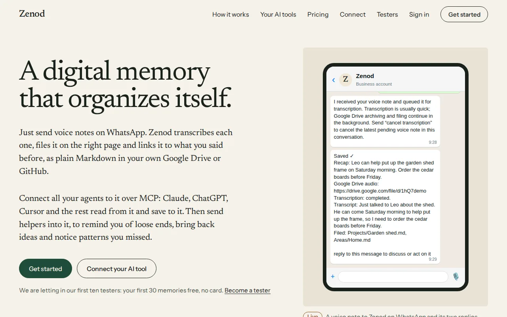
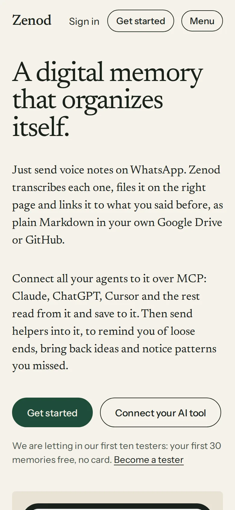
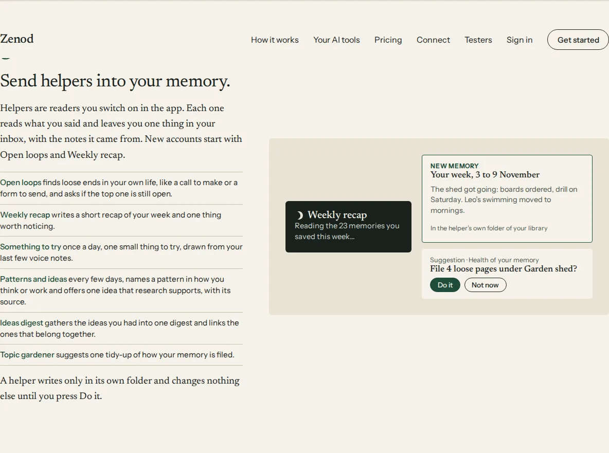

# E25-S3 evidence: zenod.dev says it Jordi's way (2026-11-18)

**Bottom line:** zenod.dev now opens with "A digital memory that organizes itself": you just send WhatsApp voice notes, you connect all your agents over MCP, and you send helpers into your memory. The helpers section lists only the six helpers that run on production today. And yes, a Zenod vault opens in Obsidian as it is (checked in Obsidian 1.15.1). One gap is described below.

```
 Jordi's words (vn_101d2c67)          zenod.dev now                         checked true on production
 ┌──────────────────────────┐   ┌──────────────────────────────────┐   ┌──────────────────────────────┐
 │ self-organizing digital  │──▶│ H1: A digital memory that        │──▶│ filing + links live          │
 │ memory                   │   │ organizes itself.                │   │                              │
 │ WhatsApp voice notes     │──▶│ Just send voice notes on WhatsApp│──▶│ WhatsApp capture live        │
 │ connect all agents (MCP) │──▶│ Connect all your agents ... MCP  │──▶│ cloud.zenod.dev/mcp, OAuth   │
 │ personas on your memory: │──▶│ Send helpers into your memory:   │──▶│ personaCatalog.ts, patterns. │
 │ remind, ideas, therapy,  │   │ Open loops, Weekly recap,        │   │ ts at 3ec90ca; new accounts  │
 │ optimization             │   │ Something to try, Patterns and   │   │ start with Weekly recap and  │
 │                          │   │ ideas, Ideas digest, Topic       │   │ Open loops (S44)             │
 │                          │   │ gardener                         │   │                              │
 │ (Obsidian, his question) │──▶│ "Open the folder in Obsidian as  │──▶│ Obsidian 1.15.1, screenshots │
 │                          │   │ it is" + Drive for desktop note  │   │ below                        │
 └──────────────────────────┘   └──────────────────────────────────┘   └──────────────────────────────┘
```

- Live: https://zenod.dev/ (hero), https://zenod.dev/#helpers, https://zenod.dev/#yours
- Code: PR #1691 (merge 1a62d8e0), CI green; site tests 57 of 57.

## Each claim against production (sha 3ec90ca, engine identical in 1a62d8e0)

| Page line | Checked |
|---|---|
| Helpers are readers you switch on in the app, and each leaves one thing in your inbox with its notes | Helpers tab in the app (`HostedApp.tsx`), skills `post-inbox`, cards link their source memories |
| New accounts start with Open loops and Weekly recap | `TESTER_DEFAULT_HELPERS` in `personaStore.ts` (EPIC-14 S44, live) |
| Open loops: loose ends in your own life, asks if the top one is still open | `OPEN_LOOPS` brief and its Still open, Done, Drop it question |
| Weekly recap: short recap and one thing worth noticing | `WEEKLY_RECAP` |
| Something to try: once a day, from your last few voice notes | `SOMETHING_TO_TRY`, 3 days, voice notes first |
| Patterns and ideas: every few days, a pattern and one idea research supports, with its source | `patterns.ts` (S41), every 3 days |
| Ideas digest: one digest, suggests linking ideas that belong together | `IDEAS_DIGEST` |
| Topic gardener: one tidy-up of how your memory is filed | `TOPIC_GARDENER`, changes nothing itself |
| A helper writes only in its own folder and changes nothing else until you press Do it | skill `write-own-folder`; changes go through `propose-desk-job` cards |
| Left off the page | People and follow-ups, Health of your memory (shown in the moving scene only), Clarifier: live, but kept off the list to keep it short |

The "Still building" label on helpers is gone: it was out of date since S44.

## Obsidian: does a fresh Zenod vault open as it is?

Yes. Three checks:

1. **A vault Zenod set up and filed into** (`zenod-ai/demo-vault`, written by zenod-bot, not Jordi's memory), opened in Obsidian 1.15.1:
   folders show as folders, a page's front matter shows as Obsidian properties, and the link from a page line to the exact log entry (`[[2026-10-28#^e-ed682a]]`) opens that entry and counts as a backlink.
   
   
2. **A brand-new vault built by production's own code** (schema setup plus two voice notes through the engine's capture, at the production engine): it opens too, with the day's log.
   
3. **Our test account's live vault** (operations@, Google Drive, production): every memory is its own `.md` file in the Zenod Vault folder (`Log/2026-11-12.md` is a Drive file of its own); 12 files; Zenod's link check (`/api/vault/lint`) finds no errors.

What is missing, said honestly:
- Obsidian opens folders on your computer, so a Google Drive vault must first be synced with Google Drive for desktop. The page now says so.
- No `.obsidian` settings folder ships with a vault. Obsidian creates its own on first open, so nothing is lost.
- The starter `index.md` links to folders (`Projects/`, `Areas/`, `Notes/`, `Log/`, `_attachments/`). Obsidian cannot open those 5 links. Handed to Zenod's desk (desk note 2026-11-18 "a fresh vault's index has 5 links Obsidian cannot open").
- A new vault also keeps filing receipts in `Inbox/` that read as technical notes in Obsidian.

Told alpha9 with one desk note (agent_team `desk/inbox/2026-11-18-zenod-obsidian-a-fresh-zenod-vault-checked.md`).

Method: Obsidian 1.15.1 AppImage under Xvfb on VPS3 (GTK libraries unpacked locally, no install), driven over its debug port; the file list, properties and link resolution read from Obsidian's own metadata cache. The test account's vault read through the app's own signed-in API (operations-profile browser); no cookie or token read out.

## Live proof

Built from the merged commit 1a62d8e0 (same build staging runs; staging's zenod.dev title reads "Zenod — a digital memory that organizes itself"), 390 and 1280 px, no sideways scroll:





**Not on zenod.dev yet:** the promote gate (`scripts/promote-production.sh`) stopped twice at gate 2: the real-note set scores 89.5% retrieval against a 90 floor; the demo set scores 100%. Production's own build 3ec90ca scores the same 89.5 on today's revision of that set (8b81d42), so the cause is new notes in the set, not this change. Production is untouched (3ec90ca). Handed to the Delivery Manager (desk note 2026-11-18 "Promote gate blocks every promote"). The row goes to review right after the first passing promote, with zenod.dev screenshots.

Kept intact: the tester line with the first 30 memories free, the visit counter (E7-S7), the tester page and the not-found page. `clean_look_check.py` flags `dist/index.html` for "no visual in the first screen", because it reads the HTML shell before the page's script renders; the real first screen shows the WhatsApp scene beside the headline (screenshot above).
