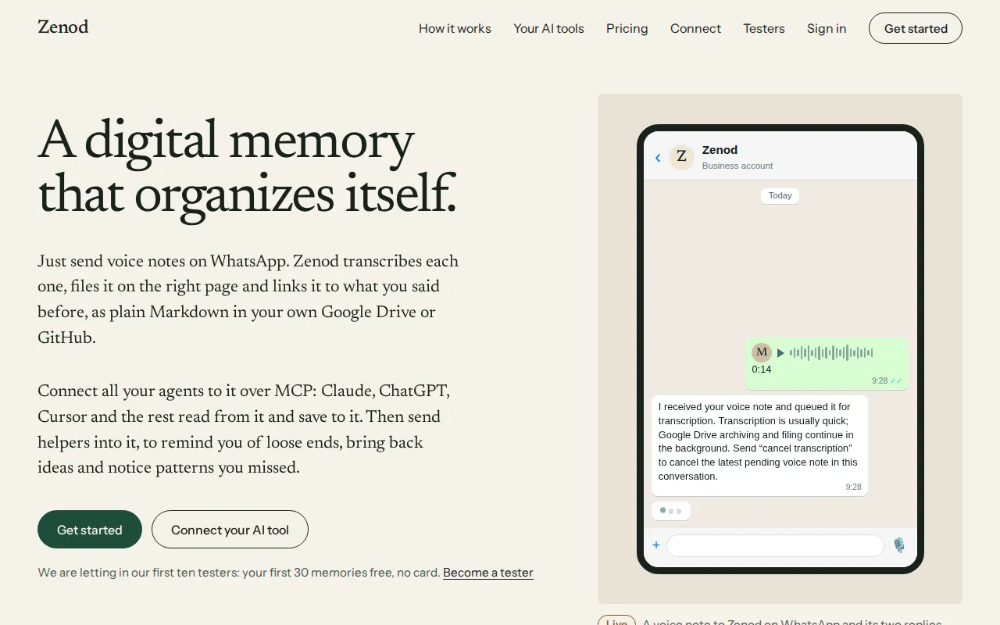
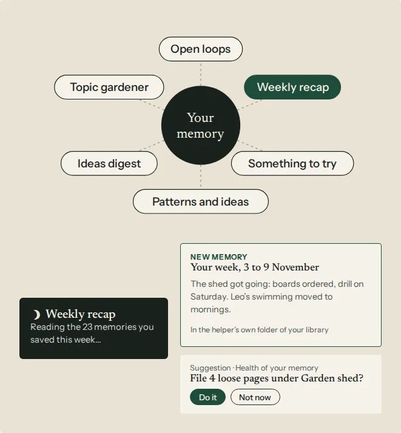

# E25-S3 gate: why the promote gate failed, and the one test-data change that passed it (2026-11-18)

**Bottom line:** two questions in the real-note set fell out of the top 5 after 18 Nov's notes landed in the vault. One fell because its expected answer had become incomplete. Jordi's 18 Nov note is a second right answer, so the set now accepts it. The other is a real ranking miss and stays a miss. With that one change the gate passed at 91.2% (floor 90, unchanged). Production runs e86c6e3 since 2026-11-18T07:07:26Z (the landing plus one copy fix, below), and zenod.dev shows the new landing.

```
 vault 7c7f2e9 (last pass)          vault 8b81d42 (18 Nov notes)           set updated (1 question)
 retrieval 53/57 = 93.0%   ──▶     51/57 = 89.5%  < 90 floor   ──▶       52/57 = 91.2%  ≥ 90  ──▶ promote 3ec90ca → 1a62d8e
                                    ✗ s1b-airbnb-cities                    ✗ s1b-airbnb-cities (real miss, kept)
                                    ✗ s1b-airbnb-prices                    ✓ s1b-airbnb-prices (rank 2)
```

Engine untouched (EPIC-22 freeze to 2026-11-24 respected). Floor untouched (`scripts/memory-eval/floor.json`: 85 / 90 / 10).

## What moved

Per-question diff of the gate's own runs, `~/zenod-eval/promote/runs/private-3ec90ca.json` (vault 7c7f2e9, 93.0) vs `private-1a62d8e.json` (vault 8b81d42, 89.5). Only two hits changed, and both point at the same 8 Nov voice note (`Log/2026-11-08.md#^e-3a6185`, the Airbnb observatory note):

| Question | 7c7f2e9 | 8b81d42 | What took its place |
|---|---|---|---|
| s1b-airbnb-cities "which cities did I want the Airbnb observatory to cover?" | rank 1 | out of top 5 | the 18 Nov voice note `e-a5a0d6` ("check where we are on the Airbnb data ingestion") and three provisional leaves filed from it, plus Areas/Housing |
| s1b-airbnb-prices "what Airbnb prices did I want to know?" | rank 2 | out of top 5 | Notes/Price Increases, then four provisional leaves filed from the same 18 Nov note `e-a5a0d6` |

The other four misses (s1b-briefing, s1b-testers, rq15, rq16) missed at 7c7f2e9 already. s1b-twitter and rq19 slipped one rank but stayed in the top 5.

Method: a copy of the gate's suite with one debug line printing each question's top 5 and its wanted set, run with `--slice s1b-airbnb` on both vault copies against the same build (1a62d8e). The engine and the scoring were not changed.

## Each question, judged

- **s1b-airbnb-prices: the expected answer had become incomplete. Updated.** On 18 Nov (`Log/2026-11-18.md#^e-a5a0d6`) Jordi says which Airbnb prices he wants to see: "how many new bookings at what price were found? Like what economic number was added to that property on that calendar day?" That answers "what Airbnb prices did I want to know?" too. It doesn't replace the 8 Nov answer (one night, one week, two weeks, one month). The change adds `Log/2026-11-18.md#^e-a5a0d6` as a second accepted ref, keeps the 8 Nov ref, adds one sentence to `expected`, and adds an `updated` field with the reason. The fact words (night, week, month) still have to reach the answer, and they do (`facts: true`).
- **s1b-airbnb-cities: still right, not changed.** The 18 Nov note names Barcelona and Valencia only as the cities of the *earlier* ingestion ("we had ... several cities ... Barcelona, Valencia"). It asks for a way to pick "these cities or this region of the map". It does not name the cities for the observatory. Mexico City and São Paulo (8 Nov) is still the answer, so this is a real retrieval miss. A newer note on the same topic outranks the note that answers. Only an engine change (ranking) can fix it, and that waits for the freeze to end.

Change made to `~/zenod-eval/real-questions.jsonl` (private, VPS3 only; backup `real-questions.jsonl.bak-e25-s3-2026-11-18`): one line, `s1b-airbnb-prices`. Nothing else in the set was changed.

## The gate run

`scripts/promote-production.sh` (no flags), staging on 1a62d8e:

```
gate 1/2: staging healthy on 1a62d8e
demo     ingestion 96%   · retrieval 100% (40/40) · errors 1.7%
private  ingestion 94.1% · retrieval 91.2% (52/57, MRR 0.71) · errors 3.1%
gate 2/2: question set passed on 1a62d8e
deploy-poller zenod-mt: rolled sha-3ec90ca -> sha-1a62d8e: live sha 1a62d8e after 22s
promoted: production runs 1a62d8e since 2026-11-18T06:09:43Z
```

Recorded in `~/zenod-eval/promotions.jsonl`. Undo: `--rollback` re-pins 3ec90ca.

## zenod.dev after the promote

`https://cloud.zenod.dev/api/health` reports sha e86c6e3. Screenshots were retaken after the second promote. zenod.dev's title reads "Zenod — a digital memory that organizes itself". The h1 is the same at both widths, with no sideways scroll:





## A copy fix found by the card check

card_qc's visual check on the live page flagged `https://drive.google.com/file/d/1hQ7demo` in the landing's WhatsApp scene as a URL shown as plain text that nobody can tap, at 390 and 1280 px. It was a made-up link in the mock of Zenod's reply, on the page since G1. [PR #1692](https://github.com/zenod-ai/zenod/pull/1692) (merge e86c6e34, CI green) changes it to "Google Drive audio: saved in your Drive". That is a copy change only, It went to production through a second gated promote: demo 100, private 91.2 (52/57). Production went from 1a62d8e to e86c6e3 at 2026-11-18T07:07:26Z.

## Left open

- s1b-airbnb-cities remains a miss: a newer note on the same topic outranks the note that answers. It is a candidate ranking case for after the EPIC-22 freeze (2026-11-24). Margin now: one more lost hit puts the gate back under 90.
- The 5 folder links in a new vault's index.md are already on Zenod's desk (unchanged here).
