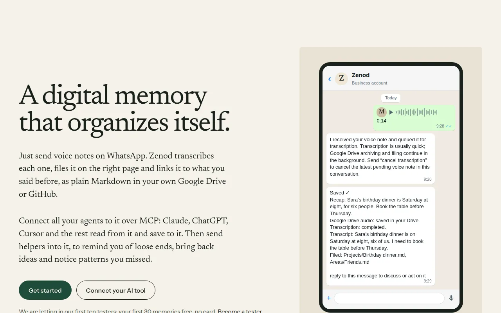
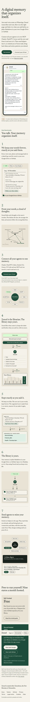
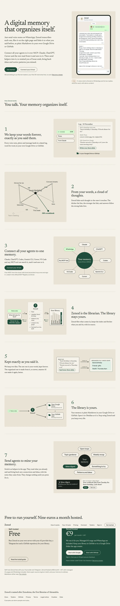
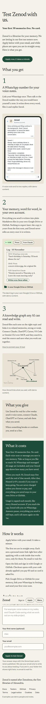

# E25-S3 iteration 2: zenod.dev after Jordi's 18 Nov review

Live: https://zenod.dev/ on production **ada4e0f** since 2026-11-18T18:28:59Z (PR [#1700](https://github.com/zenod-ai/zenod/pull/1700), promote gate demo 96/100, real-note set 91.2 ≥ 90 floor).
Source: Jordi's voice note vn_668d73df, 18 Nov 17:18Z. Run run_3490dfd0-37b6-43c2-a27c-ea41fcb1a7cb.

| His point | Done |
|---|---|
| 1. No garden example, a normal one | ✓ One person's week everywhere: Sara's birthday dinner, a dentist visit, a team meeting (hero WhatsApp scene, all diagrams, /testers) |
| 2. No made-up names like Westcom | ✓ The Westcombe/cabin graph and answer screenshots are gone from zenod.dev and /testers |
| 3. Fix the image that does not load, keep the words | ✓ Section "Kept exactly as you said it." keeps its words, now a drawn diagram (no image to fail); 0 broken images live at 1280 and 390 |
| 4. Raw file vs derived file | ✓ Diagram: raw file "Kept forever. Never edited." → organized file by today's AI → made again by a newer AI |
| 5. The library is yours as a diagram | ✓ Voice note → Zenod → your Google Drive or your GitHub repo, animated arrows |
| 6. Remove "Everything on one page" | ✓ Removed, with the Filed, Graph, Constellation, Save, Ask and Strength screenshot sections |
| 7. Keep hero, 1, 2, 3; arrows on 4 | ✓ Hero unchanged; the librarian now has in/shelve/fetch/answer arrows |
| 8. Point five earlier | ✓ "Connect all your agents to one memory." is now 3 |
| 9. Helpers later, as mining your memory | ✓ Now 7: "Send agents to mine your memory.", Ideas digest finds a connection (live helpers, personaCatalog.ts) |
| 10. Less text, one diagram each | ✓ Page text 1838 → 863 words; every section is one animated diagram; same paper look |

Kept: the 30-free-memories tester offer and the visit counter (pv.js untouched). Checks: site tests 55/55, `clean_look_check.py` clean on the landing (the /testers first screen has no visual, unchanged by this step).
zenod-social told by desk note (`desk/inbox/2026-11-18-zenod-zenod-dev-rewritten-after-jordi-s-18-nov.md`).

Phone, 390 px: 

Full page, 1280 px: 

/testers at 390 px: 
