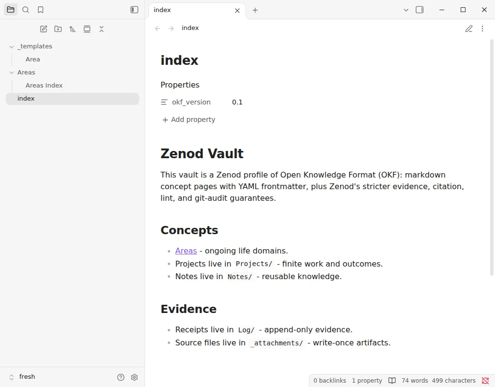
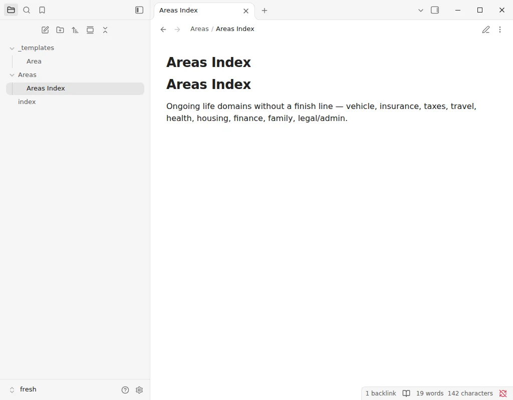

# E25-S4: a new memory opens in Obsidian with no broken link (2026-11-18)

**Bottom line:** a new Zenod memory's start page (`index.md`) linked to five folders, and Obsidian showed all five as broken links. It now links to the one note a new memory has (Areas Index) and names the other four folders as plain text. Opened in Obsidian 1.15.1, a memory built with the merged code shows **0 unresolved links**, and the Areas link opens the Areas Index.

```
 Jordi, 18 Nov (vn_101d2c67)        E25-S3 found               E25-S4 (this)
 "do the memory files really   ──▶  5 folder links in a   ──▶  1 link to a real note,
  open in Obsidian?"                new index: unresolved      4 folders as plain text: 0 unresolved
```

| | Before (old starter) | After (merged f5602fc) |
|---|---|---|
| Links in a new memory's `index.md` | 5, all to folders | 1, to `Areas/Areas Index.md` |
| Unresolved in Obsidian | 5 (E25-S3, Obsidian 1.15.1) | **0** (Obsidian 1.15.1, its own link cache) |
| Folders a new memory has | `Areas/`, `_templates/`, `.brain/` only: `Projects/`, `Notes/`, `Log/`, `_attachments/` do not exist yet | same |

## What changed

- PR [#1694](https://github.com/zenod-ai/zenod/pull/1694), merged `f5602fcd`, CI green (14 min). One file of code: `packages/core/src/vault/migrate.ts` (`ensureSchemaV1`, the vault setup step). Filing and retrieval untouched (EPIC-22 freeze to 24 Nov).
- The new start page:

  ```
  ## Concepts
  - [[Areas/Areas Index|Areas]] - ongoing life domains.
  - Projects live in `Projects/` - finite work and outcomes.
  - Notes live in `Notes/` - reusable knowledge.
  ## Evidence
  - Receipts live in `Log/` - append-only evidence.
  - Source files live in `_attachments/` - write-once artifacts.
  ```

  Same style as the clean-slate start page, which already linked `[[Areas/Areas Index|Areas]]`.

## Existing memories

A safe rewrite of the start page only: when an existing memory's `index.md` is still **byte for byte** the old starter (never edited by its owner), the next time Zenod opens that memory it replaces it with the new one and commits `schema: v1 — add index.md`. An `index.md` that differs by even one character is left alone. Nothing else in an existing memory is touched. Tested both ways.

## Proof

1. **Obsidian 1.15.1** (AppImage under Xvfb on VPS3, as in E25-S3), a memory built by `ensureSchemaV1` from merged `main` `f5602fcd`. Read from Obsidian's own metadata cache: files `index.md`, `Areas/Areas Index.md`, `_templates/Area.md`; link `Areas/Areas Index` resolves to `Areas/Areas Index.md`; `unresolvedLinks` empty for every file, **count 0**; following the link opens `Areas/Areas Index.md`.

   
   

2. **Tests** `packages/core/test/starter-index.test.ts` (an Obsidian-style link checker: a wikilink must name a note, a markdown link must name a file, a folder counts as broken): a new memory has links and 0 broken; the old starter has exactly 5 broken (the checker sees the bug); an untouched old starter is rewritten, an edited one is not; a clean-slate memory has 0 broken. Passed locally and in CI.

## Live

See the row E25-S4 in [the epic](../landing-literals-kept-forever-a-living-g.md) for the production sha.
