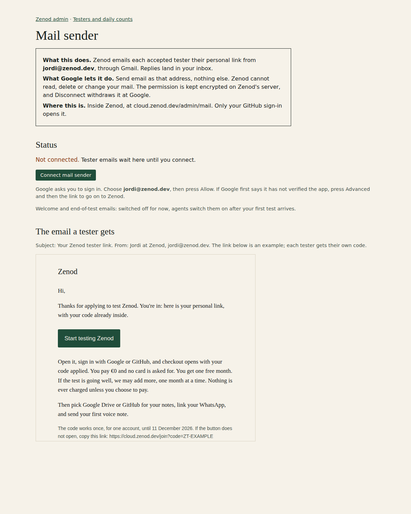
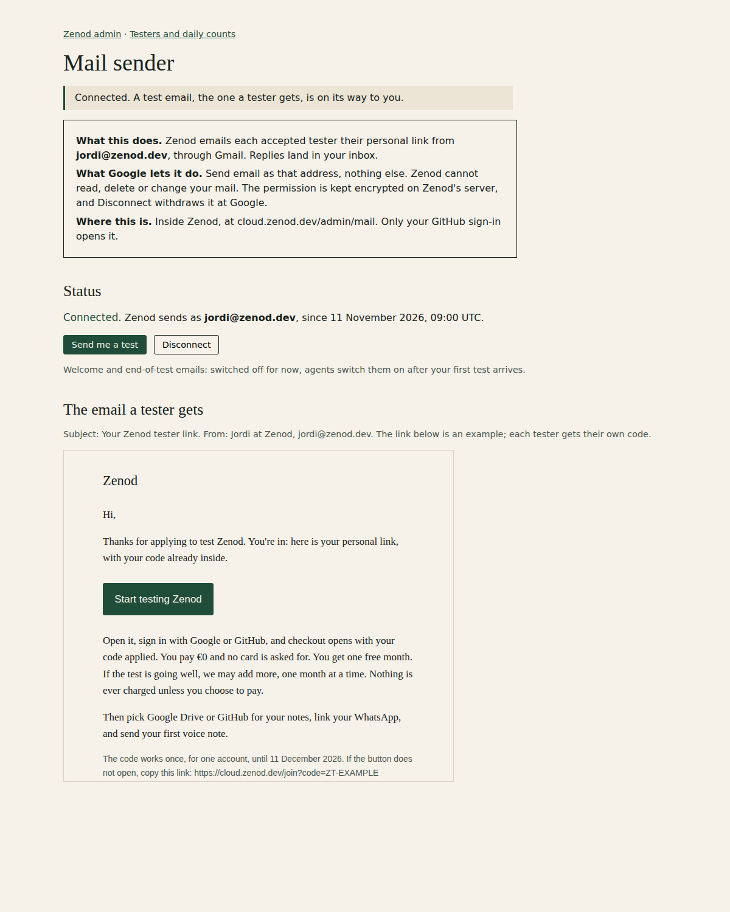
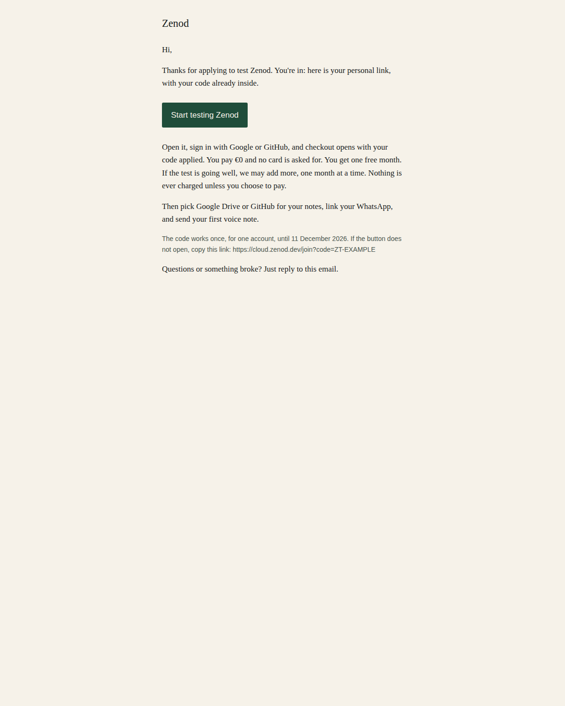

# Connect mail sender: one click instead of Google domain delegation

Jordi's answer to ask E26-A6 on 11 November 2026: "stuck at setting up domain delegation, this should be an agent doing for me interactive".

## What changed

Zenod no longer needs a Google service account or domain-wide delegation. It sends its mail as **jordi@zenod.dev** through one permission Jordi gives himself, on a page inside Zenod:

1. He opens **cloud.zenod.dev/admin/mail**. Only his GitHub sign-in opens it; anyone else gets Not Found.
2. He presses **Connect mail sender**. Google asks him to sign in. He picks jordi@zenod.dev and presses **Allow**.
3. Zenod checks that Google signed in as jordi@zenod.dev and gave the send permission, keeps that permission encrypted on its own server, and emails him the tester email as a test straight away.
4. From then on, every accepted tester gets their personal link by email within minutes. Replies land in his inbox.

After Allow, the same page shows who Zenod sends as, a Send me a test button and Disconnect:

## The email a tester gets

From Jordi at Zenod, jordi@zenod.dev. Subject: Your Zenod tester link. The code in the link is an example; each tester gets their own.

## What Google is asked for

- One permission, **send email as jordi@zenod.dev** (Google's `gmail.send`), plus the sign-in email so Zenod can check the address. Zenod cannot read, delete or change mail.
- It uses the Google client Zenod already has (the one behind its Google Drive connection) and that client's callback address, which Google already knows. No new client and no new redirect address.
- If anyone other than jordi@zenod.dev signs in, or the send box is unticked, Zenod gives the permission straight back to Google and stores nothing.
- **Disconnect** withdraws the permission at Google and deletes it from Zenod. If Google withdraws it on its own side (for example from Jordi's Google account page), Zenod stops sending and the page says so; tester emails wait until he connects again.
- The permission is sealed with AES-256-GCM under a key derived from Zenod's vault key, in one private file on Zenod's data volume. It is never in the repo, a log or a chat.

## Is a Google Cloud step needed?

Possibly one, and the page handles it: Gmail sending needs Google's **Gmail API switched on** in the Google Cloud project that owns Zenod's client. Agents have no Google Cloud login to check it. If it is off, Zenod sees it on the test email and the page shows a link straight to that project's Gmail API page, where Jordi presses **Enable** and then Send me a test. Anything else (consent screen review, domain delegation) is not needed for his own address. Google may first show "Google hasn't verified this app"; he presses Advanced and goes on.

## What stays switched off

- The welcome email after checkout and the end-of-test offer email stay behind their switch (`ZENOD_WELCOME_MAIL`). Agents switch them on after his first test arrives.
- The DKIM signature record for zenod.dev stays a later, optional step.

## Shipped

- [PR #1625](https://github.com/zenod-ai/zenod/pull/1625): the page, the consent, the encrypted store, the sender switched to it, the service-account path removed. Tests cover the admin-only page, the consent address, the sealed store, the test email, replay, a wrong account, a missing permission, Cancel, the Drive connection's own callback left alone, Disconnect and the Gmail API being off.
- Deploy: merged as 57ea1252; **on staging 57ea1252, waits for a promote** (staging health 2026-11-11T04:26:51Z). Checked live on staging: its /admin/mail answers Not Found to anyone signed out, a return from Google's mail consent reaches the new handler, and a return from the Google Drive connection still reaches the Drive handler. Production runs d9ebdd6e until the Delivery Manager promotes. The one-click ask to Jordi goes out only after that.
