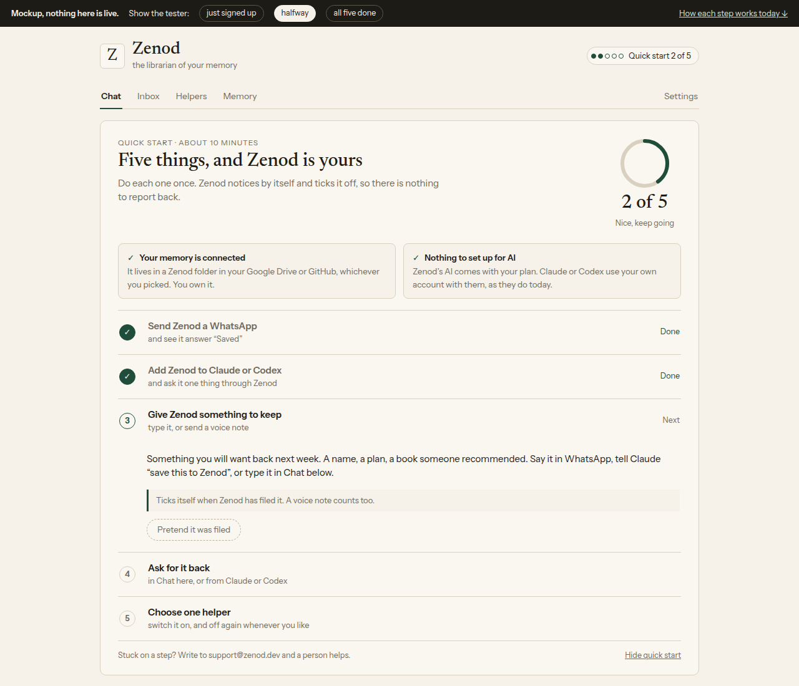

# E26-S12: Zenod quick start, a mockup before the build (2026-11-11)

Row: E26-S12 in [EPIC-26](../tester-invite-three-clear-promises-first.md). Run `run_f1cff0f1-fe86-4bc6-944d-5ad6970efe61`.
Source: Jordi's Team desk voice note vn_944ab5ef (2026-11-10 23:41Z): "send and receive a message in WhatsApp ... send and
receive a message from Claude or Codex ... create a new memory, and then ... retrieve it ... Or send a voice note and
retrieve. And then we can think about also switching off one persona ... If you've done these five things, then it's
like you get five out of five ... Can you do a mock-up of this before we deliver this patch for delivery? ... they also
need to connect. So they need to connect the repo or Google Drive. And what do they need to set up a model?"

**Mockup (clickable, no password, tailnet):** http://vps3.taild81fbb.ts.net:8921/e26-s12/
(source [e26-s12/index.html](e26-s12/index.html), served from `~/zenod-evidence-pages/e26-s12/`). No tester data.

## The real tester path today (production 29872f6b, walked 2026-11-10/11)

| Step | What a tester does today | What Zenod could tick by itself |
|---|---|---|
| Connect | Forced before the app opens: after the €0 tester checkout the app asks Google Drive or GitHub and will not go on without one (E23-U1 first-run walk). | Vault ready: already known. Shown done, not scored. |
| Model | Nothing. Hosted includes Zenod's AI ("managed AI usage and WhatsApp included", zenod.dev pricing) with the monthly AI cap; background work runs on DeepSeek. No key, no model choice; the key wizard (`SetupWizard`) is self-hosted only. Claude or Codex run on the tester's own account. | Shown done, not scored. |
| 1 WhatsApp | Settings › WhatsApp & Telegram: type the number, send the shown code from WhatsApp, Zenod acknowledges. Nothing in the app points there after sign-up, only the invite. | `lastInboundAt` of the linked number (hostedChannels). |
| 2 Claude or Codex | Claude: custom connector `https://cloud.zenod.dev/mcp`, sign in, Allow (OAuth). Codex: the app's Connect page shows only a token line (`codex mcp add ... --bearer-token-env-var`); zenod.dev/connect does not list Codex. | OAuth clients store `client_name`; first MCP tool call ticks. |
| 3 Keep | WhatsApp text or voice note, Chat, or "save this to Zenod" from Claude. | First filed memory. |
| 4 Get it back | App Chat or Claude/Codex. WhatsApp only captures and acknowledges (root L-6), so it never answers. | An answer citing the step-3 memory; simpler first cut: any search with a hit. |
| 5 Helper | Helpers tab; every helper is off by default for new accounts (E23-A2, `personaCatalog.ts` `defaultEnabled: false`). | `persona_settings.updated_at` for any helper. |

## Recommendations

- Step 5 is "switch one helper on" (off again counts): testers start with all off, so switching one off does nothing.
- The quick start lives in the app only (a header score and one card above Chat); WhatsApp replies stay as they are (L-6).
- Codex: check browser sign-in for Codex and add it to zenod.dev/connect, or step 2 leads with Claude and keeps the token route.
- Build size: about one day. One read endpoint over five facts Zenod already stores, the card and header score, tests.
  No change to filing, finding, the tree or chat replies (engine freeze until 2026-11-24 untouched).

## Proposed ask E26-A8 (for the Delivery Manager to post)

ask-tier: decide — build the quick start as in the mockup? — context: Jordi asked for five steps and a 5 out of 5 score
to guide testers; the mockup is at http://vps3.taild81fbb.ts.net:8921/e26-s12/; connect and the AI model need nothing
from a tester (connect is forced before the app opens, AI is included) — impact: each new tester sees one card that
says what to do next and ticks itself, so nobody needs a guide or a call — risk: low; app-only, no change to chat
replies or how memories are filed; rollback: hide the card — recommend: yes, build it as shown with step 5 as "switch
one helper on", about one day of work — why Jordi: it adds a new screen every tester sees — options: build as shown ·
build without the helper step (4 of 4) · not now.

Screens: [just signed up](e26-s12/new.png), [halfway](e26-s12/halfway.png), [all five](e26-s12/done.png), [phone](e26-s12/mobile.png).
