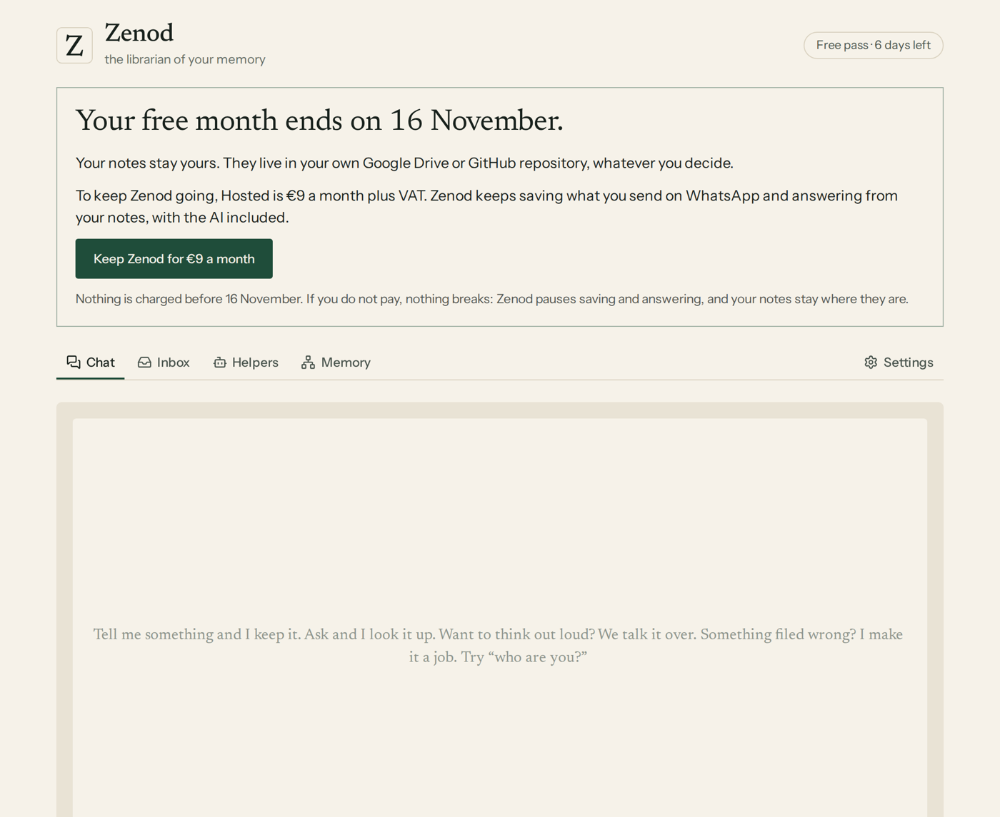
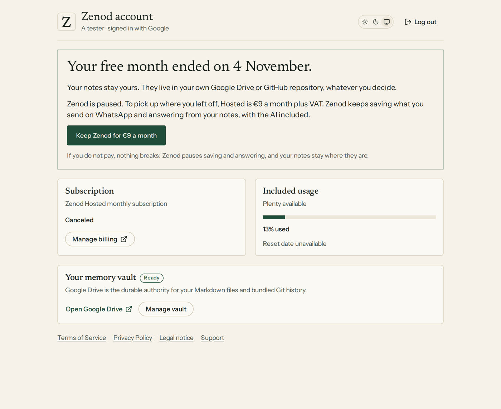
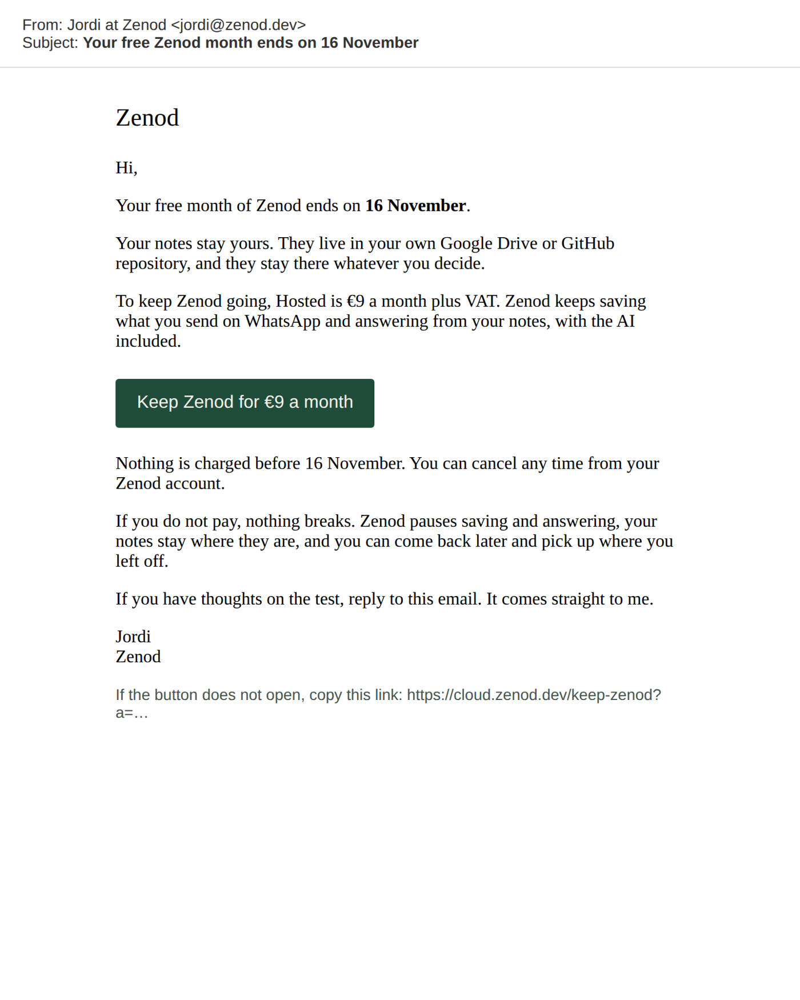

# When a tester's free month ends, Zenod offers to keep going for €9, one click to pay

**In one sentence:** when a tester's free month is about to end and we did not add a month, Zenod shows them one plain
offer in the app and on their account page (their notes stay theirs, what €9 a month gives, one button into the
existing €9 checkout for their own account), and the same offer is ready as an email.

EPIC-26 row E26-S13, 2026-11-11, run_f944a430. Source: Jordi started this row when he closed E26-S5 (the free month on
our terms) on 2026-11-11. It also covers the first half of draft row E26-S6, what the tester sees and the one click to
the €9 checkout. The live €9 payment stays with ZAL-A5.

## What the tester sees

From the moment Zenod sets their free month to end, six days before the end, unless we press **One more free month**:

- **At the top of the app**, on every tab, and **on the account page**: "Your free month ends on 16 November." Below
  it, three short lines:
  - their notes stay theirs, in their own Google Drive or GitHub repository, whatever they decide
  - Hosted is €9 a month plus VAT, and Zenod keeps saving what they send on WhatsApp and answering from their notes,
    with the AI included
  - nothing is charged before the end date, and if they do not pay, nothing breaks: Zenod pauses saving and answering,
    and their notes stay where they are
- **One button**, *Keep Zenod for €9 a month*.
- **After the end**, the same box says "Your free month ended on …" and "Zenod is paused", with the same button. It
  stays until they pay.
- If we add a month, or they pay, the box disappears.

## The one click

The button opens the existing €9 Hosted checkout. The price is the same live monthly price, unchanged, and the
checkout is for the tester's own account. There is no new sign-in and no code to type.

- **Before the end**, the checkout starts the €9 subscription with its first charge on the day the free month ends.
  Stripe asks for a card, and above the pay button it says: "Nothing is charged today. Your first €9 is on 16
  November, when your free month ends. Cancel any time before then from your Zenod account and nothing is charged."
  No free day is lost.
- **After the end**, it is the plain €9 checkout.
- In both cases the subscription binds to the same account, so the same notes, the same WhatsApp link and the same
  connector keep working. Paying before the end used to have a trap: when the old free month ran out, it would have
  paused the account the tester had just paid for. That no longer happens. The old month's end leaves a paid account
  on, and sends no "access stopped" message.
- **From the email**, the button is a signed link that opens the checkout for that one account without signing in. It
  works for 45 days, and an altered link opens nothing.

## The email

It is queued the moment the free month is set to end, one per tester and free month, and it goes out from Jordi's
mailbox. It sits behind the welcome email's switch and Zenod's own mail key, so nothing is sent until the mail key
(ask E26-A6) is in. The full text:

## If they do not pay

Nothing breaks. Their notes were always in their own Google Drive or GitHub repository and stay there. Zenod pauses,
as for any ended plan: it stops saving and answering on WhatsApp, and the connector stops. They can still sign in, and
the account page still shows the offer. Paying later brings back the same account and notes.

## What is not proven yet

✗ **The Stripe checkout page itself is not captured.** Zenod has no Stripe test key. Production's key is a money key
that agents may never load, and the team's Stripe test service refused its own key when we tried it on 11 November
(the team desk has a note to fix it). The
checkout settings are covered by tests (the trial up to the end date, card always asked, no code field, the words
above the pay button, back to the app). A test-mode run with a real checkout page needs one Zenod test key, proposed
as an ask.

The banner screenshots come from the real built app with one tester's account details filled in, because no tester
has reached a month end yet. The email screenshot is the real email made by the code.

## Live

Code: [#1618](https://github.com/zenod-ai/zenod/pull/1618). Live in Zenod production as `3831b061` since
2026-11-11T02:50Z (cloud.zenod.dev health). On production, `cloud.zenod.dev/keep-zenod` sends anyone without an
ending free month back to the app, and an altered email link opens nothing.

Tests: which subscriptions get the offer (only a tester's month we did not extend), the first charge date, the signed
link (one account, expiry, altered links), the email words and its switch, the route signed in and from the email,
the plain checkout after the end, no offer when we extended, the paid account staying on when the old month ends, the
month-end job queuing the email once, and the banner in both phases.
