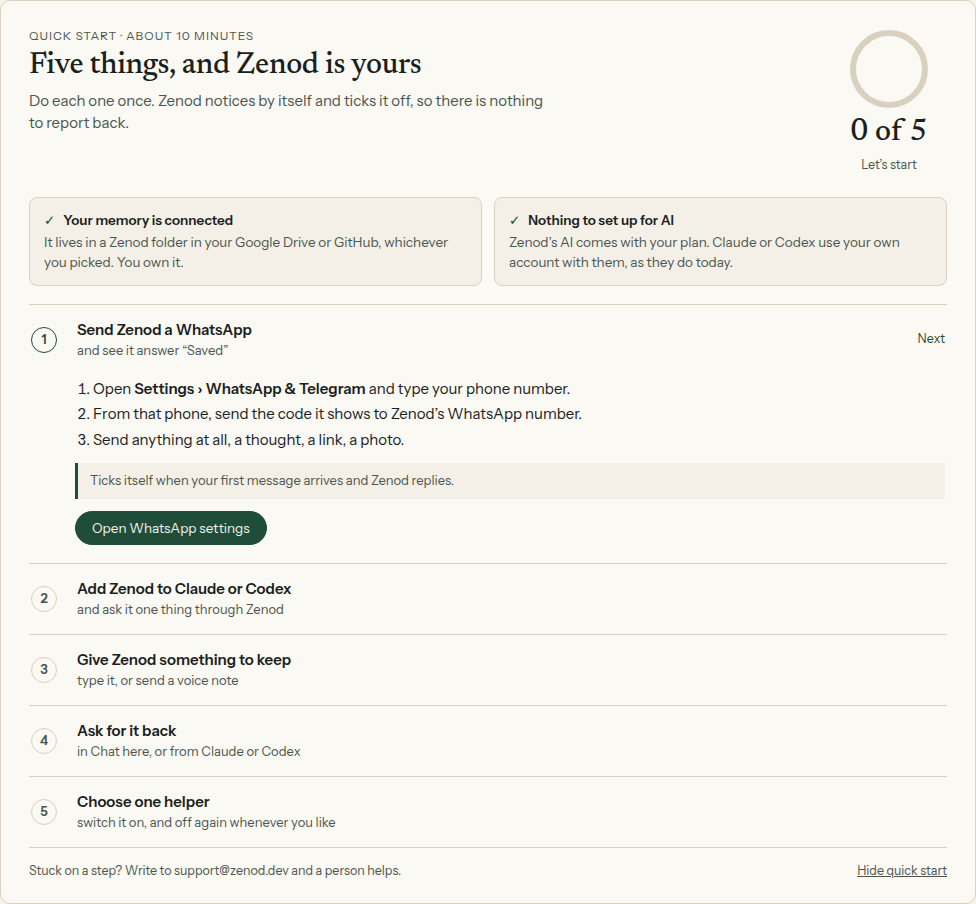

# E26-S15: the tester quick start, built (2026-11-11)

Row: E26-S15 in [EPIC-26](../tester-invite-three-clear-promises-first.md). Run `run_cb50a573-ade3-4260-8998-5bd89d256b4d`.
Source: Jordi's answer to E26-A8, "build as shown", with step 5 as "switch one helper on". The mockup was
[E26-S12](e26-s12-2026-11-11.md).

**Code:** [#1629](https://github.com/zenod-ai/zenod/pull/1629), merged `9013340` with green `ci`.
**Live:** not yet. Staging still runs `57ea125` because the staging auto-roll is paused on VPS1. infra-vps paused it
at 04:32Z after Jordi's voice note vn_cb74f290 about VPS1 load (desk note `desk/inbox/2026-11-11-infra-vps-zenod-rolls-paused-vps1-choking.md`).
Production moves only when the Delivery Manager promotes.

## What a tester sees

A card above Chat and a score in the header, "Quick start n of 5". It has five steps, and each one ticks off by itself
without a reload, because the card checks the server every 15 seconds and whenever the tab gets focus. Testers
connect a vault before the app opens and their AI comes with the plan, so the card shows both as done and does not
score them. At 5 of 5 the card says "You're all set", names the assistant and the helper, and can be closed.
"Hide quick start" hides the card, and Settings › Account brings it back.

| Step | Ticks when | Read from |
|---|---|---|
| 1 Send Zenod a WhatsApp | a message from WhatsApp reaches the memory | the tenant's capture jobs keyed to the WhatsApp channel |
| 2 Add Zenod to Claude or Codex | Claude or Codex signs in | the OAuth sign-in to this tenant, or a used access token. The tenant's own token is not counted because WhatsApp uses it. |
| 3 Give Zenod something to keep | the first memory is filed | the first finished capture from any channel |
| 4 Ask for it back | an answer or search brings a memory back | app Chat and search, and the Claude or Codex read tools (search, get, cloud, ask) |
| 5 Choose one helper | one helper is switched on | the helper switch. The tick stays if the helper is switched off again. |

A step that has ticked stays ticked, even if old jobs are pruned or the helper is switched off, because the server
keeps each tick in the tenant's own `quick-start.json`. Nothing changes in filing, finding, chat replies or WhatsApp replies.

**Helpers are still building for testers.** Jordi's later note (U7, vn_f4ab8ad2) put helpers "off and still
building" for testers, so today a tester cannot switch one on. The card follows the same rule: while helpers are
still building for an account, step 5 shows "Coming soon" and the score is out of four. When helpers open, which is
one env switch, `ZENOD_HELPERS_FOR_TESTERS=1`, step 5 opens and the score is out of five. Nothing else changes.

## Local check: the shipped code, ticking from real state

Agents cannot sign in as a real tester, and staging has no customer sign-in. These screens therefore come from the
shipped branch run in a [harness](e26-s15/harness/serve.mjs) ([browser half](e26-s15/harness/shoot.mjs)): a real
tenant Runtime and the real customer layer, signed in as a made-up tester, with a made-up memory. Each step wrote the
row the real path writes or called the real route, and the card ticked on its own:

1. [0 of 5](e26-s15/01-new.png), in place above Chat: [whole app](e26-s15/00-app.png).
2. A WhatsApp capture job, as Phylax makes it: [1 of 5](e26-s15/02-whatsapp.png).
3. Claude's OAuth sign-in row, `claude-ai`: [2 of 5](e26-s15/03-claude.png).
4. The same capture filed: [3 of 5](e26-s15/04-kept.png).
5. The app's real memory search for "Piranesi" found `Notes/Books to read.md`: [4 of 5](e26-s15/05-found.png).
6. Step 5 open with every helper switch: [helpers](e26-s15/06-helpers.png). One click on Weekly recap gave [5 of 5](e26-s15/07-done.png).
7. With helpers still building, on a phone: [4 of 4](e26-s15/08-phone-building.png).

There were no page errors. The tick file afterwards held all five ticks, with `assistantName: Claude` and `helperName: Weekly recap`.

## Tests

- `packages/server/test/quickStart.test.ts`, 6 tests: ticks kept for good, four steps while helpers build, found
  detection for each read tool, first WhatsApp and filed capture per tenant, first OAuth sign-in per tenant, and the
  route tested signed out, ticking from real jobs, from a sign-in and from the helper switch, and hiding.
- `apps/web/src/components/quick-start.test.tsx`, 5 tests: new tester, ticks and the next step, coming soon at 1 of 4,
  all set by name, and the server state with the header score and hide.
- Full suites: web 212 passed. Server 1796 passed and 22 timed out under load while the screenshots ran; all 22
  passed when run again on their own. CI was green.

## Still to do

- Staging: confirm the card on staging once the roll resumes. Staging has no sign-in, so the check there is that the
  build is live and `/api/console/quick-start` answers 401 when signed out.
- Production: needs the Delivery Manager's promote.

## Production check, 2026-11-12T03:58Z (run `run_9a9f6c6b`)

- Production `cloud.zenod.dev` runs `b4cf52b` (health `ok`), promoted by the M12 timer at 03:49Z. `9013340` is in it (`git merge-base --is-ancestor`). Staging runs the same sha.
- The app served on production (`/assets/index-CJMX91lz.js`) holds the card: "Quick start · about 10 minutes", the header score "Quick start n of total", "Hide quick start", "You're all set", and the call to `/api/console/quick-start`. The route answers 401 when signed out, on both production and staging.
- **The card itself is not checked yet.** The only agent-owned production account is the T7 one (operations@alpha9.io). T7's worker `run_7e5d9249` claimed it at 03:53Z and is using it now: round 5 retries the Drive vault, keeps a note and gets it back. Those same steps should tick step 3 and step 4 on the card. Staging cannot stand in because it has no customer sign-in. Turning that on would need a fake Google client and a Stripe-free account path on staging, which is more than this check is worth.
- Next: once T7 releases the account (lease to 05:53Z), open `/app` on it read-only, screenshot the card and check the score against what T7 did. While helpers are still building for testers, expect the vault and the AI shown done, "Quick start n of 4", and step 5 "Coming soon".

## The card on a real production account, 2026-11-12T04:33Z (run `run_f3a8c2a1`)

Evidence page: http://vps3.taild81fbb.ts.net:8921/e26-s15/

- Production `cloud.zenod.dev` on `b4cf52b`. The account is T7's test tester, operations@alpha9.io, right after T7 round 5 ([epic7-t7-r5-2026-11-12.md](epic7-t7-r5-2026-11-12.md)). The agents' sign-in Chromium (`operations-profile`) ran under Xvfb with CDP on `[::1]:9333`, the same way T7 ran it. No remote window was opened, and no cookie, password or token was read out. The app was only opened. The one click was the Chat tab. Afterwards Chromium and Xvfb were stopped and the profile's Google session was kept.
- Housekeeping: the Chromium build T7 used (playwright `chromium-1248`) had been removed from the cache since round 5, and the older `chromium-1223` crashed on the profile (SIGTRAP). `chromium-1248` was installed again with playwright-core's own installer.
- `GET /api/console/quick-start` → `200`, `score 2`, `total 4`, `helpersOpen false`, `hidden false`. The ticks were `keep` at `03:59:37.419Z` and `found` at `04:01:04.011Z`. `whatsapp`, `assistant` and `helper` were not ticked.
- The card ([desktop](e26-s15/10-prod-app.png), [card alone](e26-s15/11-prod-card.png), [phone](e26-s15/12-prod-phone.png)) shows "Four things, and Zenod is yours", **2 of 4** "Nice, keep going", with the same score in the header ("Quick start 2 of 4"). Memory connected and Nothing to set up for AI are shown done and are not scored. Step 1 WhatsApp is marked Next and has its three lines and the Open WhatsApp settings button. Step 2 Claude or Codex is open. Steps 3 Keep and 4 Ask for it back are Done. Step 5 Choose one helper reads "Helpers are still being built … Coming soon". No token-like string is on the page.

| Step | Card | T7 round 5 | Match |
|---|---|---|---|
| 1 WhatsApp | open, Next | not walked (needs a second number) | yes |
| 2 Claude or Codex | open | MCP calls with the manual token from a test script (`clientInfo t7-r5`). There was no OAuth sign-in and no Connect-AI-apps access token, and the tenant's own token is left out by design (WhatsApp uses it) | yes, by design |
| 3 Keep | Done 03:59:37 | note kept in chat at 03:59:37 (Recent saves 3:59:37 AM) | yes, to the second |
| 4 Ask for it back | Done 04:01:04 | recall in chat at about 04:01 ("heron") | yes |
| 5 Helper | Coming soon, out of the score | helpers still building for testers (U7) | yes |

**Result: works.** The card is live on production, in place above Chat, and its ticks and score match what T7 did. Nothing was broken, so no fix PR was made.

Note for later, not a defect: a tester who connects an agent only by pasting the "Access token (manual setup)" from Connect AI apps does not tick step 2. That token is the tenant's own, and WhatsApp uses it too. Claude and Codex, which the step names, connect by browser sign-in, and that does tick it.
