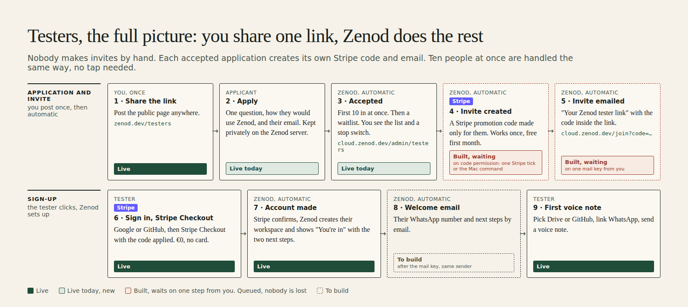
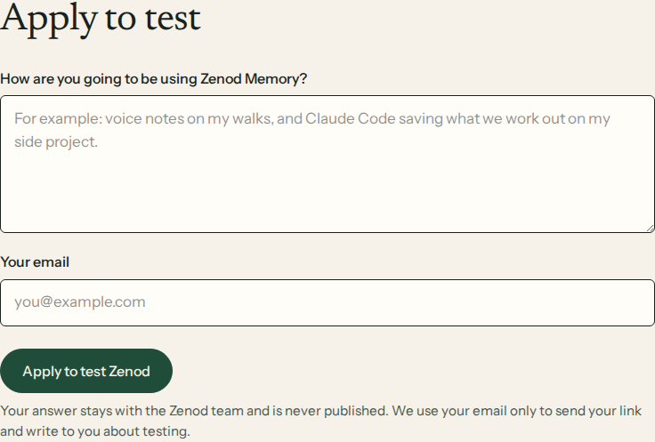
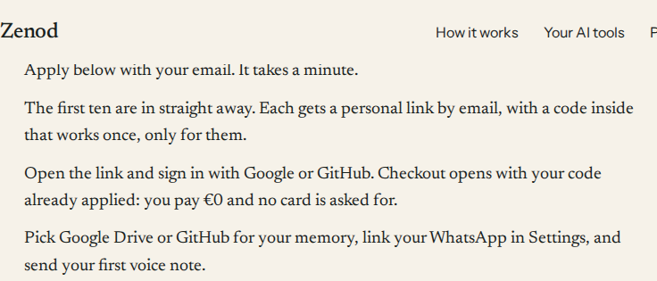

# Testers, the full picture: application, invite, Stripe, account (EPIC-26 S2, answers T1 too)

**Bottom line: you never make invites. You share one link, zenod.dev/testers, once. Each person who applies there with their email is accepted by Zenod itself (the first 10, then a waitlist), and that acceptance creates their invite: a Stripe promotion code made only for them, emailed inside their personal link. Ten applications at once are handled the same way, with no tap from you. Yes, they go through Stripe: the code is a Stripe promotion code and checkout is Stripe Checkout, at €0 with no card. After checkout Zenod creates their account and shows "You're in". Today the application and the acceptance are live (new on this release), and sign-in, Stripe Checkout and the account are live since earlier. Two steps are built and wait on you: making the code (one Stripe permission tick, or the command on your Mac list) and sending the email (one mail key). Until then every accepted person is queued and nobody is lost. The welcome email after checkout is still to build, on the same mail key.**

Jordi's words (2026-11-10, two voice notes): "So I send them the link to the testers, and then they put their email, they apply to it, and then, so what's the flow? … is it a possibility that I give them one link? … a one-time use coupon that is issued only for them, and it's emailed to them. Close the flow to me, please." and "Do I make them one by one manually? … If 10 people ask to join in, it work? … are they going through Stripe? Yes or no? I want them to go through Stripe. … who creates the invite? … Paint the full picture, bro."

## Your questions, plainly

- **Who creates each invite?** Zenod, automatically, the moment it accepts an application. Never you, never one by one.
- **If 10 people apply at once?** All 10 are accepted and each gets their own code and email, with no tap from you. The 11th goes on a waitlist; you can let anyone in from the waitlist with one button, or stop accepting with one button.
- **Do they go through Stripe?** Yes. Their invite is a Stripe promotion code on the free tester coupon, and they sign up through Stripe Checkout with it applied, €0, no card.
- **One link?** Yes: zenod.dev/testers. That is the only thing you ever share.

## Step by step: what exists today and what is still to build

| Step | Who | What happens | Today |
|---|---|---|---|
| 1 Share | You, once | Post zenod.dev/testers anywhere | Live |
| 2 Application | Applicant | The form asks one question, how they would use Zenod, and their email. It is kept privately on the Zenod server, never in a repo or a page | Live, new today |
| 3 Acceptance | Zenod | First 10 accepted at once, then a waitlist. You see the list, a stop switch and an Accept button per waitlisted person on cloud.zenod.dev/admin/testers (sign in with GitHub) | Live, new today |
| 4 Invite created | Zenod | A Stripe promotion code made only for that person: one use, 14 days to use it, free first month on the tester coupon | Built. Waits on permission to make codes: one tick on the Stripe key, or the command on your Mac list |
| 5 Invite emailed | Zenod | "Your Zenod tester link", their personal link cloud.zenod.dev/join?code=… with the code inside, replies go to support@zenod.dev | Built. Waits on one mail key |
| 6 Sign in and Stripe Checkout | Tester | Google or GitHub, then Stripe Checkout with the code already applied, €0, no card | Live |
| 7 Account made | Zenod | Stripe confirms the checkout, Zenod creates their account and workspace and shows "You're in" with the two next steps | Live |
| 8 Welcome email | Zenod | Their WhatsApp number and next steps by email | To build, after the mail key |
| 9 First voice note | Tester | Pick Drive or GitHub, link WhatsApp, send a voice note | Live |

Not possible today: signing in with the email they applied with (Google or GitHub only). The code is not tied to an account, so any sign-in works with it.

## The two steps that wait on you

**Making the code (step 4).** Production's Stripe key may read promotion codes but not create them, the safe list chosen at the November key rotation. Either one of these opens it, and both are built:

1. Recommended, about 1 minute: in the Stripe dashboard, on the key named zenod-mt 2026-11, set "Promotion codes" to Write. Agents then switch code making on and Zenod creates each code itself at acceptance.
2. Or the tester-code command already on your Mac list. A script then hands Zenod each code; it only ever sees an id, never an email.

**Sending the email (step 5, later step 8).** Zenod has no mail sender: zenod.dev mail is Google Workspace and no mail provider key exists on our servers. The pick is Resend: free for 3,000 mails a month, one key, and it sends from a zenod.dev subdomain without touching your Google mail. Ask text for the Delivery Manager to post (not posted by this run):

> Make a free Resend account and paste one key (about 4 minutes) — context: testers are now accepted by Zenod itself, but it cannot email them their personal link because Zenod has no mail sender — impact: every accepted tester gets their link in minutes with nobody in the loop, and the welcome email can follow — risk: low; the key only sends mail from zenod.dev and is removed in one step; nobody is mailed who did not apply — recommend: yes, Resend, free, no card — why Jordi: a new account needs your login — steps: open https://resend.com/signup, sign up with Google, open https://resend.com/api-keys, Create API key named zenod-mt with "Sending access", paste it into the card — secret (provide a key): zenod-mt RESEND_API_KEY — then agents add the zenod.dev sending records in Cloudflare, verify the domain and send a test to your own address before any tester gets one.

## Reading applications: the root read rule

Acceptance, the list and the email all run inside the Zenod server, so nobody has to read the applications file. **For this flow the infra-vps root read rule (EPIC-2-A46) is no longer needed.** It would matter only to read the free-text answers kept before today; those earlier applications are left alone, since they applied under "picked by hand" and some left a handle instead of an email.

## Proof

- PR [#1597](https://github.com/zenod-ai/zenod/pull/1597): acceptance, cap, stop switch, the code, the email and retries every 10 minutes inside the server; the private list at /admin/testers; a script for the Mac command route; the testers page asks for an email and answers "You're in" or "waitlist".
- An end-to-end test runs the whole chain against one fake Stripe: apply with an email, accepted, a code made on the tester coupon only for them, the email carries cloud.zenod.dev/join?code=…, and that link signs in and opens checkout with exactly that code applied. Nobody real and nothing charged. A real Stripe test-mode run is not possible from here: agents hold no Stripe key, live or sandbox.

## Live on production

Deployed by the push roll: `https://cloud.zenod.dev/api/health` reports sha 0274bf2f, status ok, read 2026-11-10 17:24Z. Checks that use up no tester place:

- The form refuses a handle with "That email does not look right. Please check it, so we can send you your link." (400), so the new rule runs.
- cloud.zenod.dev/admin/testers answers 404 to anyone not signed in as you.
- The code queue answers 404 without its token and, with it, 0 people waiting: nobody applied on the new form yet.
- The live form and steps, captured 17:25Z:

No test application was sent to production: each one would take one of the 10 real places.
