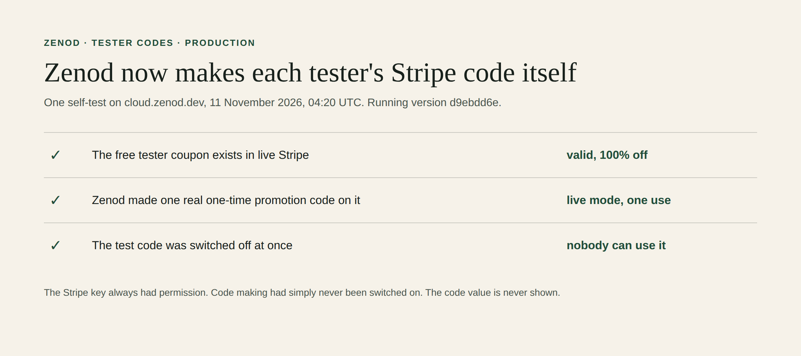

# Why Zenod never made a tester code, and the fix (EPIC-26 S2 round 2)

Jordi, on ask E26-A3 (2026-11-11): "it already was on write! You push man". He was right.

## What was really wrong

- The production Stripe key has had **Promotion codes: Write** since the November rotation (EPIC-7 T3.4 corrected the list to Write; see [epic7-t3-4](epic7-t3-4-2026-11-02.md)). The E26-A3 ask quoted the older rotation guide's "Promotion codes: Read" line and was never tested against Stripe.
- Zenod's own Stripe code making was **opt-in**: it ran only with `ZENOD_TESTER_MINT=stripe`. Production's env (`dokploy env-names zenod-mt`, names only, read 2026-11-11 03:05Z) has `STRIPE_SECRET_KEY`, `STRIPE_MODE` and `ZENOD_TESTER_OPS_TOKEN` but no `ZENOD_TESTER_MINT`. So Zenod never asked Stripe for a code. Each accepted tester waited "for the code command" instead.
- No Stripe refusal was ever logged. Zenod never made the call. The tester coupon `ZENOD_TESTER_1M` is the one the code path uses. The self-test below checks it exists in live mode.

## The fix, PR [#1624](https://github.com/zenod-ai/zenod/pull/1624), merged d9ebdd6e

- By default Zenod now makes a real one-time Stripe promotion code on the tester coupon for each accepted person: one use, 14 days. If Stripe ever refuses, Zenod logs Stripe's answer with no key fragment in it. It then makes its own code, U7's checkout coupon path, so nobody waits.
- A used Stripe code can no longer be replayed through Zenod's own coupon path at checkout.
- An ops-token self-test, `POST /api/ops/testers/stripe-self-test`, makes one real code on the tester coupon and switches it off at once. It reports whether the coupon exists in live mode and whether the code was made and deactivated. It never returns the code.
- Tests: tester flow 24 passing, customer layer and month end green, server typecheck clean, `ci` green.

## Proved on production

Production has run d9ebdd6e since 2026-11-11 04:20:44Z, after the Delivery Manager's promote. The question set passed on staging first.

The self-test ran once on production at 04:20:58Z, with the agent-held ops token, and answered 200:

| Check | Answer |
|---|---|
| Tester coupon `ZENOD_TESTER_1M` | exists, valid, live mode, 100% off |
| One real promotion code made on it | yes, live mode, one use |
| That code switched off right away | yes, nobody can use it |

The code itself was never returned or shown. From now on, each person accepted on zenod.dev/testers gets their own one-time Stripe code from Zenod, with nobody in the loop.

